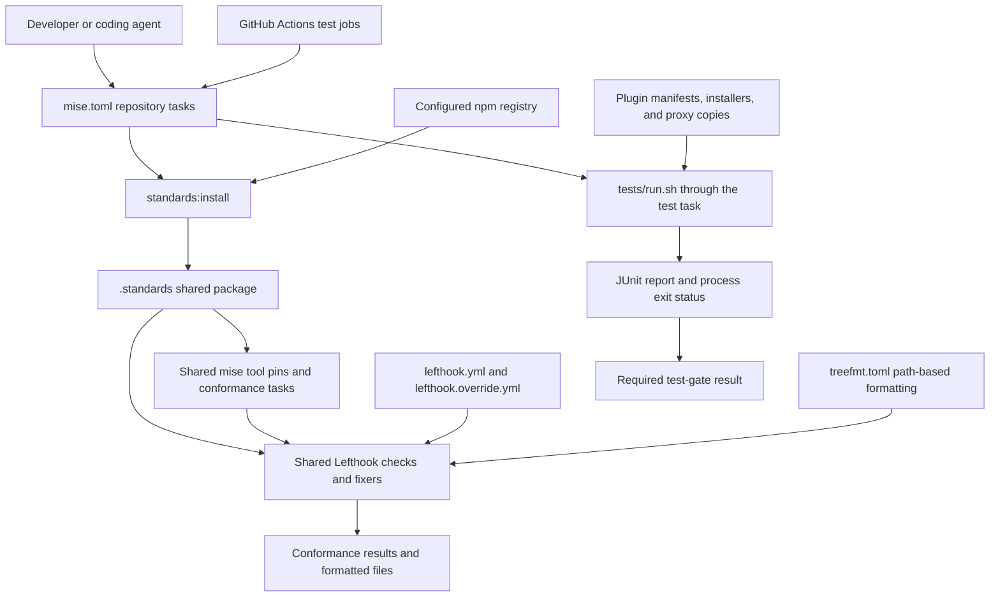
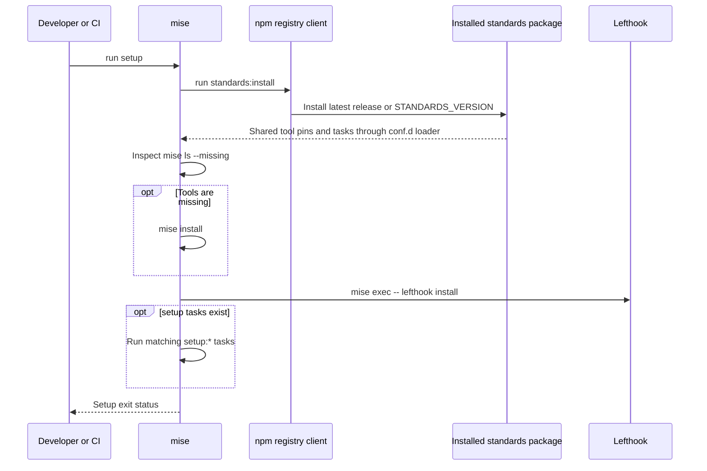
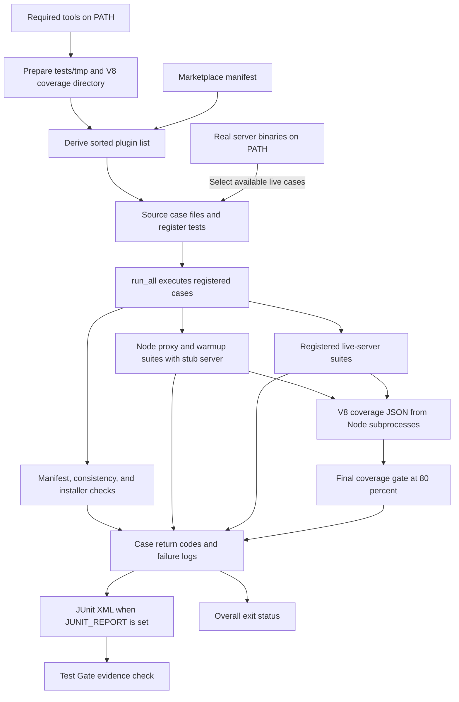
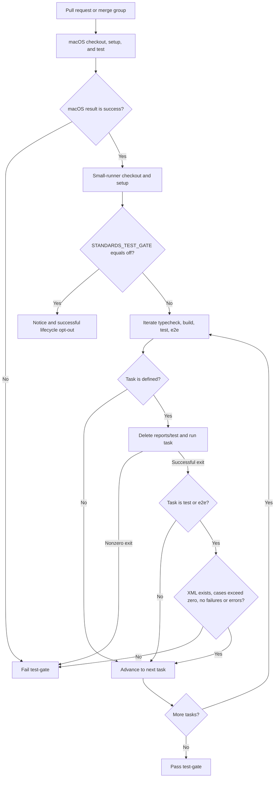
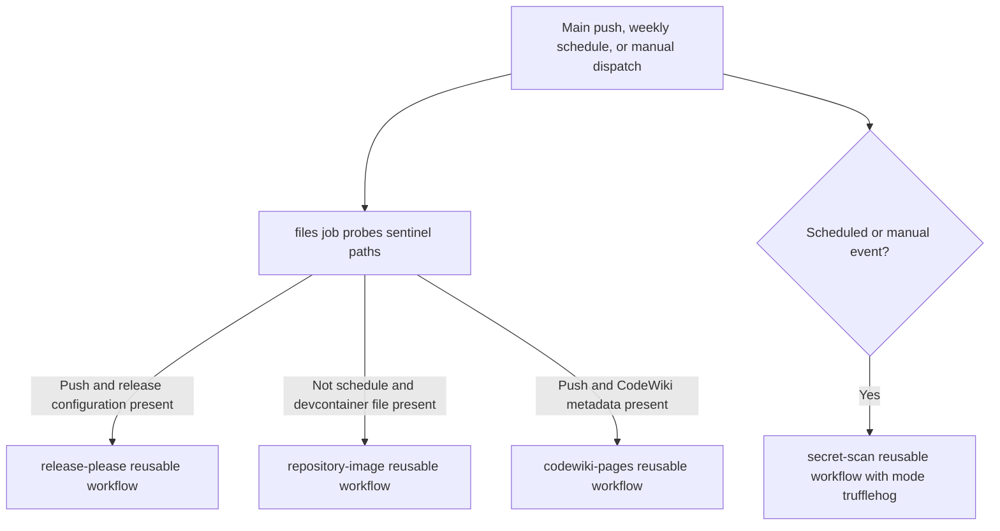

# Development and CI

The `claude-lsps_development` module defines how contributors bootstrap tools,
format and check changes, run tests, and obtain CI results for `claude-lsps`.
It is a configuration and automation layer, not an LSP runtime component.
Its central integration point is `mise.toml`: repository-owned tasks use a
shared standards package for tool pins and conformance checks, while GitHub
Actions orchestrates testing and repository maintenance.

## Scope and related modules

This page documents development infrastructure and its test dependencies.
Runtime behavior is described separately:

- [System overview](overview.md): marketplace purpose, runtime architecture,
  and system-wide boundaries.
- [Plugin configuration and installation](claude-lsps_plugins.md): manifests,
  language mappings, session hooks, and language-server installation behavior.
- [Proxy internals](claude-lsps_proxy.md): protocol adaptation, warmup,
  document synchronization, and process lifecycle.
- [Experiments and evidence](claude-lsps_experiments.md): wiretap observations
  and the separate Pyright synchronization prototype.

Two kinds of development tasks must remain distinct:

- **Conformance tasks** such as `check`, `check:pr`, and `fmt` come from
  `@rubio-enterprises/standards` and operate through shared checks and fixers.
- **Lifecycle tasks** such as `test`, `typecheck`, `build`, and `e2e` belong to
  this repository. The Test Gate discovers and runs whichever are defined.
  Of these four, the repository's `mise.toml` currently defines only `test`.

The production proxies use Node.js without npm dependencies. Installing the
standards npm package is a development operation, not a prerequisite that
plugin consumers must perform.

## Architecture and ownership



The diagram separates conformance from lifecycle testing. The supplied
`.github/workflows/test-gate.yml` runs lifecycle tasks; it does not explicitly
invoke `mise run check`. Likewise, `.github/workflows/standards.yml` dispatches
release, image, documentation, and secret-scan workflows rather than running
the test harness itself.

### Configuration inventory

All paths below are relative to the repository root.

| Component | Responsibility | Main relationship |
| --- | --- | --- |
| `mise.toml` | Runtime pin, bootstrap, standards installation, test and live-server tasks | Loads shared tools and tasks through `.config/mise/conf.d/standards.toml` |
| `Makefile` | Minimal `make test` shortcut | Calls `bash tests/run.sh` directly |
| `lefthook.yml` | Shared hook integration, package-presence guards, package refresh hooks | Extends the installed standards hooks and the local override |
| `lefthook.override.yml` | Repository-specific patches and exclusions | Excludes deliberately malformed `tests/fixtures/**` from pre-commit processing |
| `treefmt.toml` | Path-based bridge to the pre-commit fixers | Invokes Lefthook with the `fixer` tag |
| `.editorconfig` | Encoding, whitespace, and indentation defaults | Applies to editors and compatible checks |
| `ruff.toml` | Python lint and formatting configuration | Extends the installed standards Ruff configuration |
| `tombi.toml` | TOML formatting configuration | Disables schema-driven behavior locally |
| `renovate.json` | Dependency-update policy entry point | Inherits `github>Rubio-Enterprises/.github` |
| `.github/workflows/test-gate.yml` | Pull-request and merge-queue test orchestration | Requires macOS success and fresh JUnit evidence |
| `.github/workflows/standards.yml` | Main-branch and periodic maintenance automation | Dispatches reusable organization workflows conditionally |
| `.github/workflows/copilot-setup-steps.yml` | Copilot runner selection override | Selects a GitHub-hosted Ubuntu runner and checks out the repository |

Supporting configuration includes the shared mise loader at
`.config/mise/conf.d/standards.toml` and the repository's `biome.jsonc`.
The latter extends the shared Biome configuration and adds local lint rules;
console output remains allowed because it is part of the proxy and driver
interfaces.

## Environment and bootstrap

### Prerequisites and first run

`mise.toml` requires mise **2026.10.19 or later** and pins the repository's
Node.js toolchain to **24.22.1**. The test runner explicitly requires `node`,
`bash`, `jq`, and `shellcheck` on `PATH`. Shared mise configuration supplies
check-tool pins, including jq, ShellCheck, Lefthook, and treefmt.

Bootstrap also needs a working npm command, network access to the standards
registry, and credentials authorized to read the package. With an authenticated
GitHub CLI, a typical first run is:

```bash
export NODE_AUTH_TOKEN="$(gh auth token)"
mise trust
mise run setup
mise run check
mise run test
```

Use a token appropriate for the package registry and do not commit it to
repository configuration. In the test workflow, `NODE_AUTH_TOKEN` is provided
from `github.token` during setup.

The Node.js pin is a development choice. The installed plugins' session hooks
check for Node.js on `PATH`, rather than requiring contributors' pinned version
from `mise.toml`. See [plugin setup](claude-lsps_plugins.md) for consumer-side
prerequisites.

### Setup sequence

The `setup` task in `mise.toml` performs these operations in order:

1. Run its `standards:install` dependency to populate `.standards/`.
2. Check `mise ls --missing` and run `mise install` only when tools are missing.
   Avoiding a no-op install prevents unnecessary shim rebuilding on machines
   with many tracked configurations.
3. Run `mise exec -- lefthook install` to register Git hooks.
4. Run any matching `setup:*` tasks through optional `depends_post` expansion.
   No such repository-specific setup task is currently defined in `mise.toml`.

The repository's existing `.config/mise/conf.d/standards.toml` symlink points
into the installed package. Populating its target makes the shared tool pins
and tasks available to mise; setup does not create a separate copy of them.



The mise directory-entry hook only warns when the shared package configuration
is absent. It does not install the package or replace `mise run setup`.

### Standards package resolution

The `standards:install` task uses npm to install
`@rubio-enterprises/standards` under `.standards/`. Its installation options
include `--no-save`, `--prefer-online`, `--fetch-retries=0`, and
`--ignore-scripts`; audit and funding output are disabled.

| Setting | Default | Effect |
| --- | --- | --- |
| `STANDARDS_VERSION` | `latest` | Selects the standards release; an explicit value is a temporary Release Pin |
| `STANDARDS_REGISTRY` | `https://npm.pkg.github.com` | Overrides the registry for the `@rubio-enterprises` scope |
| `NODE_AUTH_TOKEN` | Supplied by the environment | Provides GitHub Packages authentication for the configured install command |
| `STANDARDS_TEST_GATE` | Unset | Exact value `off` bypasses the Test Gate's lifecycle step, not its macOS prerequisite |

The authentication option in the install command is specifically scoped to
`npm.pkg.github.com`. When changing `STANDARDS_REGISTRY`, verify the credentials
required by the replacement registry rather than assuming that option covers it.

The repository pins its Node.js runtime, but follows the latest standards
release unless `STANDARDS_VERSION` is set. Consequently, shared check behavior
and check-tool pins can change without an edit to the root `mise.toml`.
That file includes a commented Release Pin example with an issue-link reminder
for a standards release that temporarily breaks the repository.

The loaded shared configuration documents two useful extension rules:

- A repository's own tool pin takes precedence over the shared pin.
- A repository task with the same name takes precedence over the shared task.
  Avoid redefining conformance tasks merely to evade shared checks.

Source paths: `mise.toml` and `.config/mise/conf.d/standards.toml`.

### Installing real servers for live tests

`live-setup` is separate from `setup`; its name does not match `setup:*`, so it
is not installed automatically through the setup task's post-dependencies.
It invokes the existing plugin installer hooks in this order:

1. `pyright/hooks/check-pyright.sh`
2. `bash-language-server/hooks/check-bash-language-server.sh`
3. `vtsls/hooks/check-vtsls.sh`
4. `cue-lsp/hooks/check-cue.sh`
5. `regal-lsp/hooks/check-regal.sh`

The task enables `set -e` and prepends `$HOME/.local/bin` to its own `PATH`.
The first failing hook stops the task. Its environment changes do not persist
back into the invoking shell, so expose that directory when running tests
subsequently:

```bash
export PATH="$HOME/.local/bin:$PATH"
mise run live-setup
mise run test
```

This reuses production installation behavior rather than introducing a separate
test-only installer. Package-manager selection, download behavior, locking,
and post-install checks belong to
[plugin configuration and installation](claude-lsps_plugins.md).

## Local commands and conformance

| Command | Behavior | Important distinction |
| --- | --- | --- |
| `mise run setup` | Installs standards, missing managed tools, and Git hooks | Also runs optional `setup:*` tasks |
| `mise run standards:install` | Refreshes the standards package only | Does not itself execute setup's missing-tool and hook-install steps |
| `mise run check` | Runs shared and repository pre-commit checks over the selected tracked files | Fixers may rewrite files; it is not a read-only command |
| `mise run check:pr` | Runs pull-request-specific secret and convention checks | Requires caller-supplied PR context, including `BASE_SHA` |
| `mise run fmt` | Runs fixers over tracked files | Does not replace the full checker suite |
| `treefmt <paths>` | Runs the same fixer selection for supplied paths | Does not stage fixes or automatically install hooks |
| `mise run test` | Runs the harness with `JUNIT_REPORT=reports/test/junit.xml` | Preferred lifecycle entry point and the one CI uses |
| `make test` | Runs `bash tests/run.sh` | Does not set `JUNIT_REPORT` or arrange tools through mise |
| `mise run live-setup` | Installs language servers through plugin hooks | Enables additional tests when binaries are visible on `PATH` |
| `mise exec -- lefthook dump` | Shows effective hook configuration | Use after editing local overrides |

The shared `check` task normally selects all tracked files. Its inspected
implementation restricts selection to fork changes when
`refs/remotes/origin/upstream` exists, using supplied comparison SHAs or the
merge base. In CI, it detects fixer rewrites and fails rather than accepting
uncommitted formatting changes.

The shared `check:pr` task scans the PR commit range for secrets and checks
available title and PR metadata. It is not a lifecycle task, and it is not
called by the supplied Test Gate loop.

Source paths: `mise.toml`, `Makefile`, and
`.config/mise/conf.d/standards.toml`. Shared task implementation details follow
the installed standards release.

## Git hooks and formatting

### Hook layering and package guards

`lefthook.yml` combines configuration in this precedence order, with later
files winning:

1. Repository `lefthook.yml`.
2. `.standards/node_modules/@rubio-enterprises/standards/lefthook/standards.yml`.
3. Repository `lefthook.override.yml`.

The root file adds a `standards installed` job to both `pre-commit` and
`commit-msg`. Each checks that the shared Lefthook file exists and fails with
instructions to run `mise run setup` when it does not. This prevents a silent
loss of checks: Lefthook otherwise skips a missing extended file.

The inspected shared hooks provide formatting, linting, and conventional
commit-message checking. Fixers run sequentially inside their group; read-only
checkers can run in parallel. Their complete selection and versions are owned
by the standards package, not copied into this module.

For repository-specific changes:

- Add new hook jobs under names not used by the shared configuration.
- Patch shared jobs in `lefthook.override.yml`, setting only necessary fields.
- Remember that an overridden list replaces the shared list rather than
  appending to it.
- Remember that overriding `run` keeps replacing the shared command in later
  package releases.
- Patch formatter jobs inside the shared `fixers` group.
- Confirm the merged result with `mise exec -- lefthook dump`; the override
  file explicitly notes that no check validates the patch itself.

### Fixture exclusions

`lefthook.override.yml` excludes `tests/fixtures/**` from pre-commit processing.
Those directories intentionally contain malformed language examples for LSP
tests. Correcting them with general source fixers can destroy the behavior the
tests need to observe.

This is a hook exclusion, not removal from the test suite. Live test helpers
copy selected fixtures into isolated temporary workspaces before starting real
servers.

### Refresh after checkout changes

The `post-checkout`, `post-merge`, and `post-rewrite` hooks all run the same
command, shared through a YAML anchor:

```bash
mise run --quiet standards:install
```

Each wraps failure with a warning about trust or network problems and tells
the developer to run `mise run setup`. A failed refresh does not fail the Git
operation. These hooks refresh the package only; use setup when a new release
also requires missing tools to be installed.

### treefmt bridge

`treefmt.toml` establishes itself as the tree root and registers one formatter
for `includes = ["*"]`. It delegates actual file-type selection to Lefthook
rather than maintaining an independent formatter matrix.

The bridge:

1. Checks for the installed shared hook file and fails with setup instructions
   if it is missing.
2. Writes the supplied paths as NUL-delimited input.
3. Calls `mise exec -- lefthook run pre-commit` with `--tag fixer` and
   `--files-from-stdin`.
4. Uses `--no-stage-fixed`, `--no-fail-on-changes`, and `--no-auto-install`.

Thus, `treefmt <paths>` shares pre-commit's fixers without staging their output
or treating an expected rewrite as a failure. `on-unmatched = "debug"` keeps
unmatched-path reporting at debug level. A successful formatting command still
does not prove that all read-only checks or tests pass.

### Editor and language configuration

`.editorconfig` is rooted at this repository and establishes these conventions:

| Files | Conventions |
| --- | --- |
| All files by default | UTF-8, LF endings, a final newline, trimmed trailing whitespace, two-space indentation |
| `*.patch`, `*.diff` | Preserve trailing whitespace |
| `*.py`, `*.rs` | Four-space indentation |
| `*.go` | Tab indentation |
| `Makefile` | Tab indentation |

`ruff.toml` extends the standards package's `config/ruff.toml`. Local exceptions
should use Ruff's own extension settings where appropriate; local scalar
settings override the inherited value. The base file must be installed before
Ruff can load it.

`tombi.toml` disables schemas with `[schema] enabled = false`. Tombi cannot
extend a shared configuration file, so this repository keeps the required
setting locally to avoid schema-driven key or array sorting and
network-dependent formatting.

## Test architecture and evidence

### Runner lifecycle

`mise run test` and `make test` both execute `tests/run.sh`. The mise task adds
the JUnit output path; the Makefile recipe does not, although an explicitly
exported `JUNIT_REPORT` is still honored by the harness.

The runner performs the following work:

1. Enable `set -euo pipefail`. Case files are sourced, so registration-time
   errors must not leave an apparently successful partial suite.
2. Require `node`, `bash`, `jq`, and `shellcheck`, exiting with status 2 when
   tools are missing.
3. Guard the cleanup target, recreate `tests/tmp`, and install an exit cleanup
   trap.
4. Export `ROOT_DIR`, `TESTS_DIR`, `TMP_DIR`, and
   `NODE_V8_COVERAGE=tests/tmp/cov` using repository-resolved paths.
5. Derive a sorted `PLUGINS` array from `.claude-plugin/marketplace.json`.
   An empty plugin set is an error. The reader avoids Bash 4-only `mapfile`
   because macOS compatibility includes Bash 3.2.
6. Source `tests/cases/*.sh` to register cases, then call `run_all` from
   `tests/lib/framework.sh`.



Registered test functions run sequentially in Bash subshells. The framework
explicitly disables `-e` inside each case so cases can aggregate failures and
return their own status. New shell tests must therefore return failure
explicitly rather than relying on implicit fail-fast behavior in their body.

Each case gets a numbered log name, avoiding collisions between names that
sanitize to the same string. Passing cases print a status line; failing cases
also print their captured output. The framework returns 0 only when all
registered cases pass.

Source paths: `tests/run.sh` and `tests/lib/framework.sh`.

### Test families and component relationships

| Case file | Coverage focus | Dependencies |
| --- | --- | --- |
| `tests/cases/01-manifests.sh` | JSON validity, manifest fields, LSP and hook structure, proxy configuration, marketplace consistency | jq and plugin configuration files |
| `tests/cases/02-consistency.sh` | Safe launch paths, proxy invocation and installer agreement, byte-identical proxy copies, resolvable hook script paths | Marketplace-derived plugins and installer metadata |
| `tests/cases/03-installer-lint.sh` | Bash syntax and ShellCheck warning-level lint | Plugin `check-*.sh` scripts |
| `tests/cases/04-installer-behavior.sh` | Existing-binary no-op, install-method selection, prerequisites, download branches, and failure paths | `tests/helpers/mock-bin.sh` sandboxes |
| `tests/cases/05-installer-concurrency.sh` | Concurrent installation deduplication and the mkdir-lock fallback | Shared mock sandboxes and deliberately overlapping invocations |
| `tests/cases/06-proxy.sh` | Framed passthrough, blocked traffic, auto-acknowledgement, invalid input, lifecycle, disk synchronization, and reconciliation | `proxy-suite.js`, shared LSP utilities, and `stub-server.js` |
| `tests/cases/07-warmup.sh` | Discovery, empty trees, disabled warmup, and multiple extensions | `tests/helpers/warmup-suite.js` |
| `tests/cases/08-live.sh` | Real-server diagnostics and selected refresh or warmup behavior | Available server executables and isolated fixture copies |
| `tests/cases/99-coverage.sh` | Minimum exercised proxy coverage | `tests/helpers/coverage-check.js` and collected V8 output |

The installer sandbox removes the normal host `PATH`, provisions only selected
real utilities, and mocks installation tools. It also rewrites installer lock
paths into the sandbox. This keeps negative installation tests from invoking
real package managers or sharing production lock state.

The Node suites use `tests/helpers/lsp-test-utils.js` for framing, temporary
workspaces, assertions, proxy spawning, and scenario dispatch. Stub tests inspect
wire behavior without requiring real language servers. For the semantics being
tested, see [proxy internals](claude-lsps_proxy.md); for installer contracts, see
[plugin setup](claude-lsps_plugins.md).

### JUnit output contract

When `JUNIT_REPORT` names a file, `tests/lib/framework.sh` creates its parent
directory and writes a `testsuite` containing one `testcase` per registered case.
Failed cases contain a `failure` element with the return code. Case names are
escaped for XML attributes. Detailed captured logs are printed on failure,
not embedded in the generated report.

The Test Gate expects XML files under `reports/test/`; the repository task writes
`reports/test/junit.xml`. Its evidence check is deliberately lightweight:

- At least one `*.xml` file must exist below `reports/test/`.
- Across those files, there must be at least one `testcase` tag.
- There must be no `failure` or `error` tags.

The workflow counts recognizable tags with shell tools; it is not a general
JUnit schema validator. New report producers should emit ordinary, compatible
JUnit XML in addition to returning a meaningful process status.

### Coverage gate

`tests/cases/99-coverage.sh` invokes
`tests/helpers/coverage-check.js --threshold=80`. The checker discovers
`lsp-proxy.js` in top-level plugin directories and reads coverage produced by
the harness's Node subprocesses.

Its aggregation has several important properties:

- Targets and V8 paths are normalized through real paths, including macOS
  `/var` versus `/private/var` aliases.
- Proxy files are grouped by SHA-256 content hash. Coverage from byte-identical
  deployed copies is combined, so scenarios can exercise different copies
  without repeating every scenario for every deployment path.
- Within one coverage entry, nested ranges override enclosing ranges. Across
  runs, a covered range wins over an uncovered range.
- A line counts as covered when any instrumented position on it is covered.
  Positions with no instrumentation do not contribute to the denominator.
  This is a line-oriented V8 range measure, not a branch-coverage guarantee.
- Missing coverage data for a target group or coverage below 80 percent fails
  the gate. The checker reports uncovered line numbers for low-coverage groups.

The byte-identity test is complementary to coverage: it detects a deployment
copy that drifts, while coverage measures the shared implementation's exercised
paths. Keep both checks when changing proxy deployment.

`tests/tmp` contains logs, temporary workspaces, and raw coverage, and is deleted
on runner exit. The JUnit report lives outside that directory. The supplied CI
workflow does not add a report-artifact upload step.

### Live-server coverage and limitations

`tests/cases/08-live.sh` registers live cases only when their server executable
is discoverable with `command -v`.

| Binary | Registered live behavior |
| --- | --- |
| `bash-language-server` | Clean and broken shell fixtures |
| `pyright-langserver` | Clean and broken Python fixtures, client-driven refresh, and disk-sync refresh |
| `vtsls` | Clean and broken TypeScript or JavaScript fixtures |
| `cue` | Clean CUE fixture only |
| `regal` | Clean and broken Rego fixtures plus proxy warmup |

The broken-CUE case is intentionally omitted: the case file records that
`cue lsp serve` v0.16 does not publish diagnostics. Do not interpret its clean
case as proof of error-diagnostic support.

A `live/skip-report` case records missing-binary information and always returns
success. Missing live cases are not represented as JUnit skipped cases; they
are not registered at all. Therefore, a green suite or nonempty JUnit report
does **not** establish that every real server was exercised.

Neither job in `.github/workflows/test-gate.yml` explicitly runs `live-setup`.
Live coverage in those jobs depends on the binaries actually available on the
runner. Use the live-server setup procedure when full local integration
coverage is needed.

### Optional latency measurements

`tests/perf.sh` is deliberately outside `tests/run.sh`. It measures, rather than
gates, cold spawn-to-ready and open-to-first-diagnostic latency, plus Pyright
change-to-refresh latency. It reports median and minimum values, defaults to
three cold spawns per server, and skips servers whose binary is missing.

```bash
mise exec -- bash tests/perf.sh
PERF_ITERS=5 mise exec -- bash tests/perf.sh
```

This script requires Node.js and uses a separately guarded and cleaned
`tests/tmp-perf` directory. Performance measurements do not contribute JUnit
proof or change the required Test Gate status.

## GitHub Actions workflows

### Required Test Gate

`.github/workflows/test-gate.yml` runs on `pull_request` and `merge_group`, not
on ordinary main-branch pushes. It grants read access to contents and packages.
Its concurrency group combines the workflow name with the PR number or commit
SHA, and newer runs cancel an in-progress run in the same group.

The workflow is designed around the required status name **`test-gate`**.
Preserve that name when changing the implementation; required-check settings
are external to the workflow file.

| Job | Default runner labels | Override from `vars.RUNNERS` | Timeout |
| --- | --- | --- | --- |
| `tests-macos`, displayed as `tests / macos` | `["macos-26"]` | `macos` | 15 minutes |
| `test-gate` | `["ubuntu-slim"]` | `small` | 30 minutes |

`vars.RUNNERS` is parsed as JSON. An absent variable falls back to `{}`, then to
the listed default runner-label arrays. A malformed JSON value is not handled
as a valid fallback configuration.

Both jobs check out without persisting credentials and use `jdx/mise-action`
with `install: false`. They then run `mise run setup` explicitly with
`NODE_AUTH_TOKEN` supplied from `github.token`.

The macOS job exists because users run plugin hooks with macOS's Bash 3.2.
It runs `mise run test`. It is not the independently required check: the
`test-gate` job depends on it and checks its result before proceeding.



The dependent job uses `if: ${{ !cancelled() }}` so a failed prerequisite can
still produce a failing required gate instead of silently skipping it. A
cancelled workflow is excluded by that condition.

For each defined lifecycle task, the gate deletes `reports/test` **before**
execution. This prevents an old report, or a previous lifecycle task's report,
from satisfying the next proof check. `test` and `e2e` must each produce their
own fresh evidence; `typecheck` and `build` need only return success.

Setting `STANDARDS_TEST_GATE = "off"` bypasses only the lifecycle-task step.
The preceding macOS success check and small-runner setup still run. The opt-out
therefore cannot make a failed macOS suite pass.

### Standards maintenance workflow

`.github/workflows/standards.yml` runs on:

- Pushes to `main`.
- A weekly schedule, `0 9 * * 1`: Monday at 09:00 UTC.
- Manual `workflow_dispatch`.

Its default permission is `contents: read`. Concurrency is grouped by workflow
and ref, with `cancel-in-progress: false`.

The `files` job uses the `small` runner override or `["ubuntu-slim"]` and has a
five-minute timeout. It sparsely checks out three sentinel paths and emits
`true` only for files that exist. Its outputs are `release-please`, `image`,
and `codewiki`, corresponding to the first three rows below. Absent files leave
the corresponding output unset. This indirection exists because `hashFiles()`
cannot be used in the job-level condition where these checks are needed.

| Job | Event condition | Sentinel file | Declared permissions |
| --- | --- | --- | --- |
| `release-please` | Push only | `release-please-config.json` | Contents write, pull requests write |
| `repository-image` | Any supported event except schedule | `.github/.devcontainer/devcontainer.json` | Contents read, packages write |
| `codewiki-pages` | Push only | `docs/codewiki/metadata.json` | Contents read, Pages write, ID token write |
| `trufflehog` | Schedule or manual dispatch | None | Workflow default contents read |



`trufflehog` does not depend on `files`; its condition is event-based. A scheduled
run therefore probes files and requests secret scanning, but does not dispatch
release, image, or Pages jobs. A manual run can dispatch the image job and
secret scanning, but not the push-only release and Pages jobs.

All four maintenance implementations are delegated to
`Rubio-Enterprises/.github/.github/workflows/` at `@main`, respectively:

- `release-please.yml`, with `secrets: inherit`.
- `repository-image.yml`.
- `codewiki-pages.yml`.
- `secret-scan.yml`, with `mode: trufflehog`.

The repository owns these dispatch conditions and permissions. The detailed
release, build, deployment, and scanning implementations remain in the reusable
workflows and can change at their `main` ref. Do not infer their implementation
from the local job names alone.

The inspected `.github/.devcontainer/devcontainer.json` is minimal: it names a
repository image build and has an empty `features` object. Its existence enables
the image dispatch condition; it does not establish the contents of the
externally implemented image build.

### Copilot setup runner override

`.github/workflows/copilot-setup-steps.yml` declares a specially named
`copilot-setup-steps` job with `runs-on: ubuntu-latest` and a 59-minute timeout.
Its only step is checkout. It does **not** run `mise run setup`, install the
language servers, or execute tests.

The workflow comments describe this as a public-repository override: Copilot
reads the job's runner selection instead of using the organization's
self-hosted `linux-x64` default, avoiding long queued reviews. The workflow
itself also supports manual dispatch.

The workflow files quote the `"on"` key. This preserves compatibility with
YAML 1.1-based lint tools that otherwise interpret bare `on` as a boolean,
without changing GitHub Actions trigger behavior.

### Dependency and action updates

`renovate.json` delegates its update policy to the organization preset
`github>Rubio-Enterprises/.github`; no local package rules are declared.
Update grouping, schedules, and other Renovate policy details therefore belong
to that preset.

The supplied checkout and mise action usages are pinned to commit hashes, with
major-version comments for readability. In contrast, the maintenance reusable
workflows track `@main`, and the standards npm package follows `latest` unless
pinned. These are different update boundaries and should be reviewed separately.

## Maintainer extension points

### Adding or changing checks

Keep shared checks in the standards package and repository exceptions in local
configuration. Add a repository-only hook under a unique name, or patch a
shared field in `lefthook.override.yml`. Inspect the effective result, then run
both conformance and lifecycle tests:

```bash
mise exec -- lefthook dump
mise run check
mise run test
```

Do not remove the package-presence guards to work around an incomplete setup.
Restore the standards installation instead.

### Adding lifecycle or setup tasks

Define repository-owned `typecheck`, `build`, `test`, or `e2e` tasks in
`mise.toml`. The gate discovers them dynamically. New `test` and `e2e` tasks
must emit fresh JUnit XML under `reports/test/` with at least one case and no
failures or errors.

Use the `setup:*` naming convention for repository prerequisites that should
run after standards, tools, and hooks are installed. Keep optional real-server
installation separate unless changing the intended setup contract.

### Changing plugins or the unified proxy

The marketplace-driven plugin list reduces maintenance, but not every test or
setup entry is automatically generated:

- Adding a marketplace entry includes that source directory in the harness's
  plugin-based checks.
- Coverage discovers top-level `lsp-proxy.js` targets automatically.
- `live-setup` explicitly names installer scripts in `mise.toml`.
- Installer behavior tests explicitly map plugin names to binaries in
  `tests/cases/04-installer-behavior.sh`.
- Live test registrations are explicit in `tests/cases/08-live.sh`.

Update the explicit entries when adding or renaming a plugin. See
[plugin configuration and installation](claude-lsps_plugins.md) for the complete
packaging contract rather than duplicating it here.

The unified production proxy must be deployed as a real, byte-identical copy
inside each plugin directory because plugins are installed independently.
After editing one copy, propagate the same contents to all copies before
running the suite. `tests/cases/02-consistency.sh` compares their bytes, and the
coverage gate combines only copies with identical content hashes.

Protocol changes should add stub-driven regression cases first, then exercise
relevant real-server cases where available. Consult
[proxy internals](claude-lsps_proxy.md) for runtime invariants and
[experiments](claude-lsps_experiments.md) for observational tools, rather than
using the experimental prototype as the production implementation.

## Troubleshooting

| Symptom | Likely boundary | Recommended action |
| --- | --- | --- |
| Entry warning, hook failure, or treefmt error says standards is missing | `.standards/` was not installed or refreshed | Check mise trust, npm availability, registry access, and `NODE_AUTH_TOKEN`, then run `mise run setup` |
| Package refresh warns after checkout or merge, but Git succeeds | Post-operation refresh is intentionally nonfatal | Restore trust or network access and rerun setup before relying on hooks |
| Harness exits with missing required tools | Test preflight could not find Node.js, Bash, jq, or ShellCheck | Run setup and invoke through `mise run test`, or use `mise exec` for direct scripts |
| Conformance fails in CI after rewriting files | Fixers found uncommitted formatting changes | Run `mise run fmt`, review the diff, and commit the result |
| Fixture files appear invalid to general tools | Deliberately malformed test inputs | Preserve their test intent and the pre-commit fixture exclusion |
| An override does not have the expected effect | Hook layering or list replacement | Inspect `mise exec -- lefthook dump` and narrow the patch |
| Task succeeds but the Test Gate reports no JUnit proof | Wrong entry point or output location | Use the mise test task and write reports below `reports/test/` |
| A suite produces no usable cases | Registration, discovery, or report generation failed | Inspect runner output and verify ordinary `testcase` tags are emitted |
| Tests pass without exercising a particular language server | Missing executable prevented live registration | Export the intended `PATH`, run `mise run live-setup`, then rerun tests |
| A downloaded server remains invisible in later commands | The live setup task's `PATH` export was process-local | Add `$HOME/.local/bin` to the invoking environment |
| macOS fails while another platform passes | Bash 3.2 or platform-specific installer behavior | Reproduce with the system Bash and avoid Bash 4-only features in portable scripts |
| Test Gate still fails with its opt-out enabled | macOS success and setup are outside the bypassed step | Fix the preceding failure; the opt-out affects only lifecycle execution |
| Proxy identity or coverage gate fails | A deployed copy drifted, or exercised paths are insufficient | Synchronize copies, inspect uncovered lines, and add relevant regression cases |
| Release, image, or Pages job is skipped | Event or sentinel-file condition was not met | Check the `files` outputs and the trigger matrix in `standards.yml` |

The key maintenance rule is to keep setup, conformance, lifecycle proof, and
optional integration coverage separate. Sharing entry points makes results
comparable, but a successful formatter, a green Test Gate, and a fully exercised
set of real language servers prove different things.
