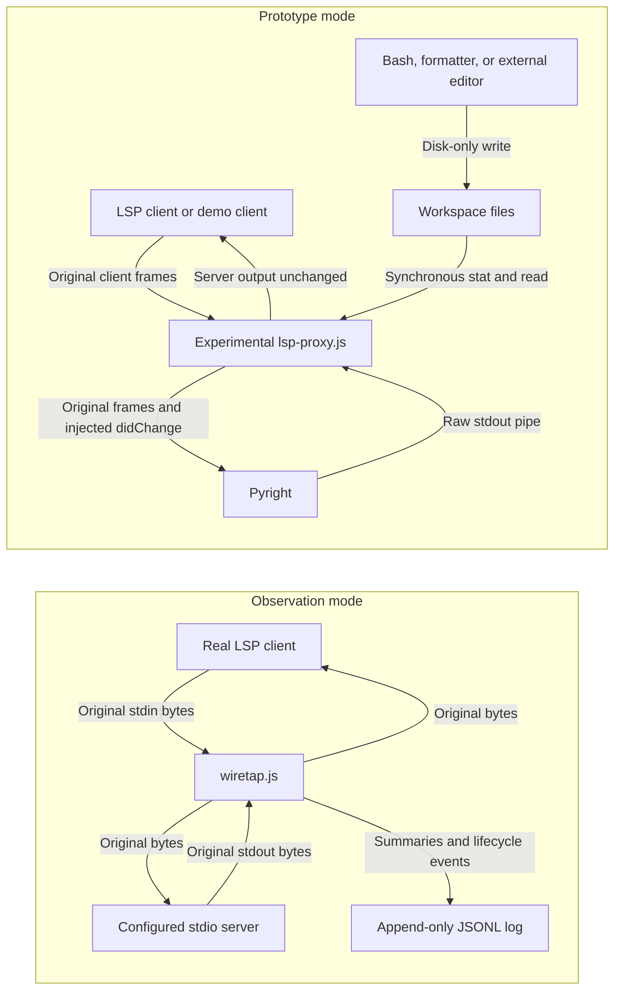
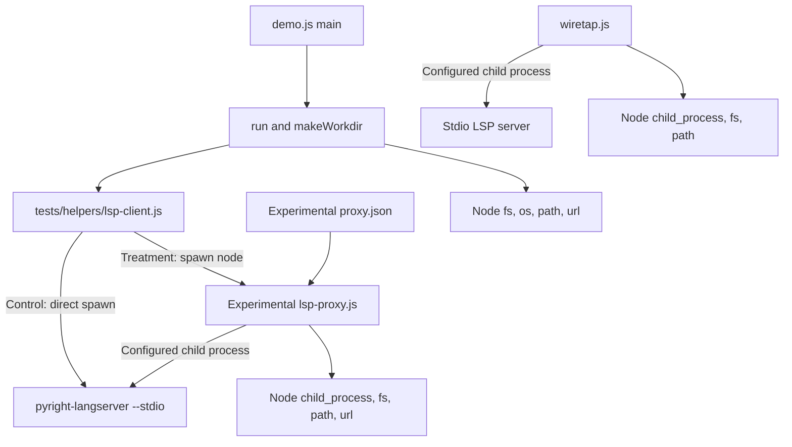
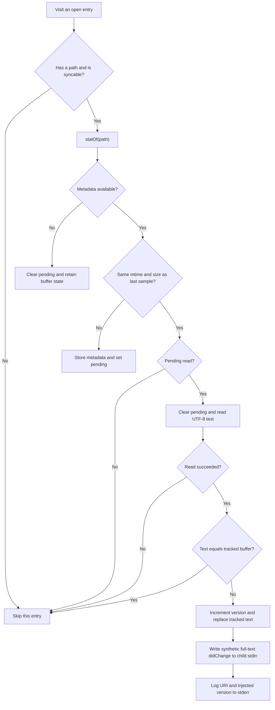
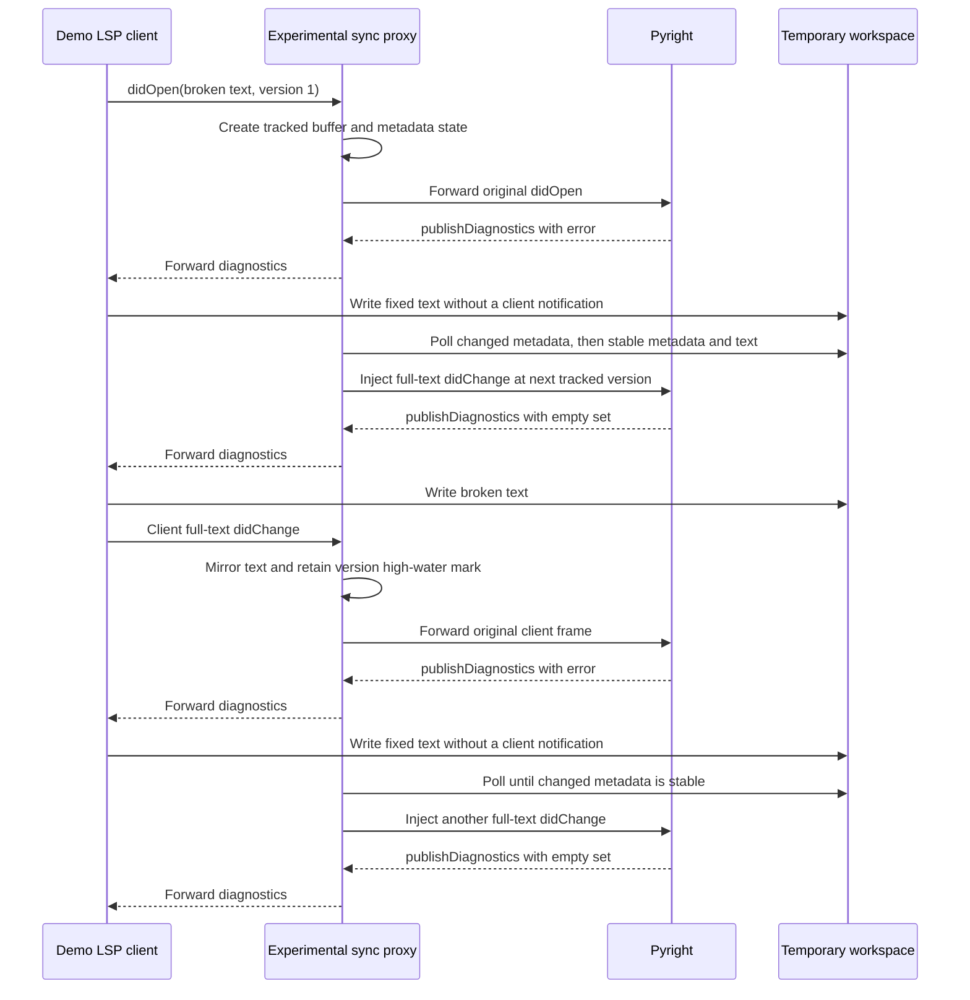

# Experiments and evidence

The `claude-lsps_experiments` module investigates stale language-server
diagnostics and preserves the evidence behind disk synchronization in the
shipped proxy. It contains a transparent LSP wiretap, a standalone Pyright
synchronization prototype, and a self-verifying A/B demonstration.

These tools answer different questions: the wiretap establishes what a client
actually sends, the prototype tests a synchronization strategy, and the demo
checks its effect on real Pyright diagnostics. None performs language analysis
itself; diagnostics still come from the external server.

## Scope and place in the system

Disk synchronization has been productized in the unified proxy, but the
scripts under `experiments/` remain separate diagnostic and design-history
tools. `experiments/pyright-sync-proxy/README.md` explicitly records that status.
Its older adoption checklist is historical, not a pending installation guide.

The shipped `pyright/.lsp.json` launches the plugin-local `lsp-proxy.js` and
`proxy.json`, not the experimental scripts. There is no runtime import from a
production plugin into this module.

Related documentation owns the broader system behavior:

- [System overview](overview.md) describes marketplace architecture.
- [Production proxy](claude-lsps_proxy.md) documents the deployed compatibility
  layer, warmup, synchronization, and process supervision behavior.
- [Plugin configuration and installation](claude-lsps_plugins.md) describes
  manifests, language routing, prerequisites, and server installation.
- [Development and CI](claude-lsps_development.md) describes repository setup,
  formatting, the test harness, and workflow integration.

### Files and responsibilities

Unless noted otherwise, source paths are relative to the repository root.

```text
experiments/
  lsp-wiretap/
    wiretap.js
    FINDINGS.md
  pyright-sync-proxy/
    lsp-proxy.js
    proxy.json
    demo.js
    README.md
```

| File | Responsibility |
| --- | --- |
| `lsp-wiretap/wiretap.js` | Forward raw LSP traffic and append metadata logs |
| `lsp-wiretap/FINDINGS.md` | Record real-client observations and their limits |
| `pyright-sync-proxy/lsp-proxy.js` | Inject updates for changed open files |
| `pyright-sync-proxy/proxy.json` | Configure the server and polling interval |
| `pyright-sync-proxy/demo.js` | Compare direct Pyright with the prototype |
| `pyright-sync-proxy/README.md` | Preserve design rationale and status |

The table paths are relative to `experiments/`. The three JavaScript entry
points execute directly under Node.js; they do not expose a reusable library
API or require a compilation step.

### Runtime architecture

The wiretap and synchronization prototype are alternative wrappers, not two
mandatory layers of one deployment.



Both wrappers spawn one child with piped stdin/stdout and inherited stderr.
Their stdout is reserved for LSP traffic. The prototype logs operational
messages to stderr; the wiretap writes observations to its separate log file.
Neither wrapper writes workspace source files. The demo deliberately writes
and removes its own temporary workspaces.

### Dependencies and component relationships

The wrappers use Node.js standard-library modules only. The demo additionally
imports the repository's `LspClient` test helper; it does not need Claude Code
to be running.



`Buffer`, streams, process events, and timers supply framing and scheduling.
The scripts have separate framing implementations rather than importing one
another. All handlers within a wrapper share one Node.js event loop, and the
prototype's filesystem operations are synchronous.

The development runtime is pinned to Node.js `24.22.1` in `mise.toml`. That is
a repository toolchain pin, not an explicit minimum-version check in these
scripts. Pyright must be separately available on `PATH` for the demo and the
shipped experimental configuration.

## Evidence and the stale-diagnostics problem

The motivating failure concerns an already-open document. In the investigated
Pyright behavior, diagnostics are pushed with
`textDocument/publishDiagnostics`; no `diagnosticProvider` is advertised for
pull diagnostics. Changing a file on disk does not replace the open buffer
that Pyright received from the client.

A `workspace/didChangeWatchedFiles` notification is not a replacement for
updating that buffer. The experiment therefore tests full-text
`textDocument/didChange` as the refresh mechanism, rather than fabricating
diagnostics or asking the server to reread an authoritative client buffer.

### What the wiretap actually established

`experiments/lsp-wiretap/FINDINGS.md` records three real Claude Code `2.1.207`
sessions, using headless `claude -p` on macOS with Pyright.

| Scenario | Recorded behavior |
| --- | --- |
| First Edit-tool fix | Lazy startup and `didOpen` with post-edit content |
| Edit-tool change to an open file | Full-text `didChange`, then `didSave` |
| Bash `sed` after an Edit-tool change | No document or watched-file update |

In the third run, no `didChange`, close/reopen, or watched-file notification
appeared during approximately 16 seconds remaining after the disk edit.
Pyright retained clean diagnostics even though the disk content had become
incorrect. The stale state can therefore hide new errors as well as retain
errors that have been fixed.

The crucial correction to the original hypothesis is that **Edit-tool edits
were synchronized in these runs**. The prototype's opening comment retains the
older hypothesis, but its subsequent validation notes and implementation use
the corrected hybrid model: the client reports its own edits while some
out-of-band disk changes remain unreported.

These observations are not a guarantee for every Claude Code release, the
Write tool, interactive mode, other language servers, or every external
editing mechanism. Git, formatters, other sessions, and human editors are
motivating examples of the same disk-only path, not separate captures among
the three recorded runs. Re-capture traffic when that behavior matters for a
new client/server combination.

### Why reconciliation replaced permanent back-off

Stopping disk synchronization forever after the first client `didChange`
would fail for a hybrid client: its own edit would disable synchronization
before a later Bash edit. The prototype instead mirrors client full-text
changes into its comparison buffer and continues polling.

The findings also record a direct Pyright probe with versions
`v1` on open, then changes at `v50`, `v2`, and `v2` again. The tested server
applied and republished each change. The prototype relies on that observed
version tolerance; it is not a general permission to send non-monotonic LSP
versions to other servers.

## Transparent LSP wiretap

`experiments/lsp-wiretap/wiretap.js` observes traffic without deliberately
rewriting, blocking, acknowledging, or injecting messages. It is the appropriate
tool for testing assumptions about a real client's messages before changing
proxy behavior.

### Invocation and configuration

From the repository root, a wrapper command is:

```bash
node experiments/lsp-wiretap/wiretap.js \
  --log /tmp/lsp-wiretap.jsonl -- pyright-langserver --stdio
```

The environment-variable alternative is:

```bash
LSP_WIRETAP_LOG=/tmp/lsp-wiretap.jsonl \
  node experiments/lsp-wiretap/wiretap.js -- pyright-langserver --stdio
```

An LSP client must launch this command and exchange framed messages on stdin
and stdout; it is not an interactive diagnostic shell.

The CLI contract is:

- A literal `--` separates wiretap options from the server command and arguments.
- The separator and a following server command are required; otherwise it prints
  usage to stderr and exits `1`.
- A supplied `--log` value overrides `LSP_WIRETAP_LOG`.
- Without either log setting, it refuses to run and exits `1`.
- The log path is resolved against the wrapper's working directory and opened
  in append mode. Parent directories must already exist and be writable.
- The server is spawned without a shell and inherits the working directory and
  environment. Server arguments are passed as separate arguments.

Several sessions can append to one file. Records carry the wrapper PID so
sessions can be separated during analysis. There is no rotation, retention
policy, or dedicated session identifier beyond PID and timestamps.

### Core functions and framing

| Function | Contract |
| --- | --- |
| `makeScanner(onMessage)` | Return a stateful chunk scanner for one direction |
| `describe(msg, bodyLen)` | Reduce a parsed message to selected metadata |
| `logRecord(rec)` | Append a JSON line with timestamp and process identity |

A separate scanner handles each direction. Each scanner buffers chunks until
it can find `\r\n\r\n`, extract a case-insensitive decimal `Content-Length`,
and collect that many body bytes. It parses the body as UTF-8 JSON, emits a
summary, and continues through any additional complete frames.

This handles a frame split across chunks and multiple frames in one chunk.
Forwarding uses the original chunks, not serialized scanner output. The tap
runs before the corresponding write in each data callback, so observation
adds work and buffering even though it does not change the forwarded bytes.

| Scanner condition | Observation behavior |
| --- | --- |
| Incomplete header or body | Retain bytes until more data arrives |
| Complete frame with invalid JSON | Emit an `unparseable` summary |
| Header without recognized length | Emit `unparseable` and discard tap buffer |

For invalid JSON, `bodyLen` is the body byte length. For a header desync, it is
the entire discarded scanner-buffer length, not a known body length. These
fallbacks do not change the raw forwarded chunk. They do not establish a
complete protocol-validation or resynchronization guarantee either.

### Log record contract

`logRecord` adds `t: Date.now()` and `pid: process.pid` to each supplied record
and appends a newline after its JSON serialization. `t` is wall-clock time in
milliseconds since the Unix epoch, not a monotonic performance clock.

| Field | Meaning |
| --- | --- |
| `t`, `pid` | Observation timestamp and wrapper process ID |
| `dir` | `c2s`, `s2c`, or `meta` |
| `kind` | `request`, `notification`, `response`, or `unparseable` |
| `method`, `id` | Method and ID when present |
| `error` | JSON-RPC error code and message, when present |
| `uri`, `version` | Selected document identity and version |
| `textLen` | UTF-8 byte length of `params.textDocument.text` |
| `changes` | Per-change `full` flag and UTF-8 `textLen` |
| `diagCount` | Count in a `publishDiagnostics` notification |
| `watched` | URI/type entries in `didChangeWatchedFiles` |
| `bodyLen` | Size associated with an unparseable observation |

Classification is based on field presence: a message with method and ID is a
request, one with a method but no ID is a notification, and otherwise it is
classified as a response. This is summarization, not JSON-RPC schema validation.

For `textDocument/didChange`, `full` means the change has no `range`; range
coordinates and replacement text are not logged. For diagnostics, the tap
records URI, optional version, and count, not diagnostic bodies. For watched
files, it retains each supplied URI and change type.

Metadata records use `dir: "meta"` and an `event`:

- `start` includes the server command and argument array in `server`.
- `child-error` includes the child-process error `message`.
- `exit` includes the child's `code` and `signal`.

These events supplement frame summaries. Child stderr is inherited, not
captured into JSONL.

### Inspecting a capture safely

Useful queries are:

```bash
jq -c 'select(.dir == "c2s" and .method)' /tmp/lsp-wiretap.jsonl
jq -c 'select(.method == "textDocument/publishDiagnostics")' \
  /tmp/lsp-wiretap.jsonl
jq -c 'select(.dir == "meta")' /tmp/lsp-wiretap.jsonl
```

When several sessions share a log, filter by `pid` as well. Correlate opens,
changes, versions, and diagnostic counts rather than inferring synchronization
from a tool's visible file write alone. An initial `didOpen` with post-edit
content can correctly require no preceding `didChange`.

To reproduce the evidence collection, use a scratch project and a temporary
local plugin that launches the wiretap around direct Pyright. Avoid attaching
the normal Pyright plugin simultaneously. The exact historical setup is in
`experiments/lsp-wiretap/FINDINGS.md`. See the
[launch contract](claude-lsps_plugins.md#language-routing-and-launch-contract)
for the plugin configuration mechanism.

Document text is not deliberately logged, but **the log is not automatically
safe to publish**. URIs, watched-file paths, server arguments, RPC error
messages, and child errors may disclose sensitive information. Review captures
before sharing them. The logger does not provide redaction, encryption, or
special access controls.

## Pyright synchronization prototype

`experiments/pyright-sync-proxy/lsp-proxy.js` adds exactly one class of behavior
to forwarding: it tracks client-opened documents and sends a full-text
`didChange` when a stable disk edit differs from its last known buffer text.
It does not synthesize diagnostic results or modify client buffers.

Unlike the production compatibility layer, it has no method blocklist,
server-request auto-acknowledgement, or workspace warmup. Server-to-client
traffic is a raw `child.stdout.pipe(process.stdout)` connection.

### Launch and configuration

The standalone launch command is:

```bash
node experiments/pyright-sync-proxy/lsp-proxy.js \
  --config experiments/pyright-sync-proxy/proxy.json
```

The checked-in `experiments/pyright-sync-proxy/proxy.json` contains:

```json
{
  "server": ["pyright-langserver", "--stdio"],
  "sync": {
    "pollMs": 150
  }
}
```

The script resolves the config path against the current working directory and
reads it once. Missing `--config`, read/JSON failures, or a missing or empty
`server` array cause stderr output and exit `1`. Validation is limited; use a
trusted JSON object with a string command and string arguments.

`server[0]` is the executable and `server.slice(1)` supplies its arguments.
The child inherits the wrapper's environment and working directory; relative
server paths are not rebased to the config directory. No shell is involved.

The poll interval is calculated as:

```javascript
Math.max(50, config.sync?.pollMs || 300)
```

For intended numeric inputs, the default is `300` ms and the minimum is
`50` ms; `0` selects the default. The checked-in config explicitly uses
`150` ms. There is no global sync-disable switch in this prototype:
`"sync": false` still results in default polling. Do not apply the production
proxy's configuration contract to this script.

### Core functions

| Function | Responsibility |
| --- | --- |
| `drainClient` | Parse complete client frames, observe, then forward raw |
| `observe` | Maintain state for opens, changes, and closes |
| `pollOpenFiles` | Detect settled disk changes and inject full-text updates |
| `toPath` | Convert a valid file URI to a local path, otherwise return null |
| `statOf` | Return `{ mtimeMs, size }`, or null after a stat failure |
| `sameStat` | Test that both snapshots exist and their fields match |
| `writeMessage` | Serialize JSON and write a byte-counted LSP frame |

`drainClient` buffers the client stream until each declared frame is complete.
It calls `observe` for parsed messages and always writes the original frame to
the server. Client versions, headers, and JSON formatting are not rewritten.

A complete invalid JSON body is forwarded without observation. A delimited
header without a recognized length causes all currently buffered bytes to be
forwarded and the buffer reset. Incomplete input waits for more data; the EOF
handler does not flush a partial buffered frame.

`writeMessage` is used for synthetic notifications. It checks whether the
stream is writable, serializes the object to a `Buffer`, and sends:

```text
Content-Length: <JSON body byte length>\r\n\r\n<JSON body>
```

Lengths are byte counts, not JavaScript character counts.

### Open-document state

The `open` map is keyed by URI and holds the wrapper's model of each buffer.
It is not a workspace-wide file index.

| Field | Meaning |
| --- | --- |
| `version` | High-water mark of client and injected numeric versions |
| `text` | Last known full buffer text |
| `path` | Local file path, or null for an unsupported URI |
| `stat` | Last sampled modification time and size, or null |
| `pending` | A metadata change awaits a stable follow-up sample |
| `unsyncable` | An unsupported change permanently disabled this entry |

On `textDocument/didOpen`, `observe` replaces the URI's entry. It uses the
numeric client version or `1`, supplied non-null text or an empty string,
current file metadata when available, and cleared flags. Invalid or non-file
URIs can be tracked but cannot be polled.

On `textDocument/didChange` for a tracked URI:

- A greater numeric client version advances the stored high-water mark.
- Full-document replacements with string text update the comparison buffer.
- Polling remains enabled after ordinary full-text changes. A matching client
  disk write will later compare equal and produce no synthetic change.
- A ranged or otherwise unrecognized change entry sets `unsyncable` and logs
  the disable once. The original client message still reaches the server.

`unsyncable` is latched for that entry. Even a later full-text replacement does
not clear it; a new `didOpen` replaces the state, and `didClose` removes it.
This differs from the more capable production reconciliation logic.

On `textDocument/didClose`, the entry is deleted and future polls stop for it.
Other messages, including `didSave`, are forwarded without updating this model.
The prototype does not apply range edits, merge unsaved buffers with disk, or
resolve concurrent editor conflicts.

### Version reconciliation without rewriting

For a tracked full-text client edit, the stored version becomes the greater
of its existing value and the supplied numeric client version. Every disk
injection increments that stored version by one. However, the client's own
message is forwarded unchanged, even if its version repeats or regresses
relative to a preceding injection.

| Event | Version sent to Pyright | Stored version |
| --- | --- | --- |
| Client opens at `1` | `1` | `1` |
| Disk-only edit is injected | `2` | `2` |
| Client sends its next change at `2` | `2` again | `2` |
| Another disk-only edit is injected | `3` | `3` |

This is sufficient for the tested Pyright version tolerance described in the
findings. It is not equivalent to production server-side version rebasing;
see [production version rules](claude-lsps_proxy.md#version-rules).

### Polling and the stability gate

A timer invokes `pollOpenFiles` at the configured interval. It is unreferenced
when supported so it cannot keep the process alive by itself. Polling starts
at setup, not in response to the LSP initialization handshake.



A changed `(mtimeMs, size)` sample arms `pending`. Only a subsequent identical
sample permits a read. Further metadata changes defer the read again. A
content-identical rewrite or `touch` sends no message and consumes no version.

An injected notification has `jsonrpc: "2.0"`, method
`textDocument/didChange`, the URI and next tracked version, and
`contentChanges: [{ text }]`. It is sent only to the server. The prototype
sends no accompanying `didSave` or watched-file notification. Pyright decides
whether and when to publish diagnostics; those bytes pass back unchanged.

For a settled edit, detection normally takes about one to two poll intervals,
plus server analysis time. That is approximately `150`–`300` ms before analysis
with the checked-in config, not a guaranteed refresh deadline. The stability
gate reduces partial-write exposure but is not a lock or atomic snapshot:
a writer can resume after sampling, and there is no post-read stat check.

Important edge behavior follows directly from the state machine:

- Missing or inaccessible files clear `pending` but do not cause `didClose`,
  remove tracking, or clear diagnostics.
- A failed read clears the pending attempt. Another metadata change is needed
  to arm a new read; unchanged metadata does not trigger repeated read attempts.
- Initial disk/buffer disagreement is not checked independently. `didOpen`
  samples current metadata, so a subsequent detectable metadata change is
  needed before the first disk read.
- Same-size rewrites with unchanged modification time can be missed. The
  prototype does not compare inode or change time, or periodically hash text.
- Each eligible open file is statted on every tick. Full buffer text remains
  in memory, and stable changes are read synchronously in full.

## Self-verifying A/B and hybrid demo

`experiments/pyright-sync-proxy/demo.js` drives real Pyright twice: first
directly as the control, then through the experimental proxy as the treatment.
The runs are sequential and use independent temporary workspaces.

From the repository root:

```bash
command -v pyright-langserver
node experiments/pyright-sync-proxy/demo.js
```

Node.js and `pyright-langserver` must be on `PATH`; the demo does not install
them or skip itself when the server is missing. Its treatment launches the
command `node` explicitly. Use the existing
[session setup](claude-lsps_plugins.md#session-startup-and-prerequisites)
for installation rather than treating the prototype as an installer.

### Demo components and fixtures

| Function | Responsibility |
| --- | --- |
| `makeWorkdir` | Create a temporary project and write its starting files |
| `run` | Execute one server scenario and collect observed diagnostics |
| `main` | Run control/treatment, check expectations, and select exit status |
| `line` | Format a result summary; local to `main`, not a shared API |

`makeWorkdir` creates an OS temporary directory prefixed
`pyright-sync-demo-`. It writes `broken.py` and a `pyrightconfig.json` with
`include: ["."]`, `pythonVersion: "3.11"`, and
`reportGeneralTypeIssues: "error"`.

The broken content is:

```python
x: int = "not an int"
print(x)
```

The fixed content is:

```python
x: int = 5
print(x)
```

`run({ label, command, args, hybrid = false })` starts `LspClient` with that
workspace as its working directory and initializes with its root URI. The
control uses `pyright-langserver --stdio`. The treatment uses the prototype
and `proxy.json` located relative to `demo.js`, not the production plugin's
manifest or configuration.

The dependency `tests/helpers/lsp-client.js` provides initialization,
full-document notifications, push-diagnostic collection, and shutdown. Its
initialization also sends `initialized` and an empty
`workspace/didChangeConfiguration`. The helper answers its supported
server-initiated requests at the client endpoint; this is not an auto-ack
feature added to the experimental proxy.

### Scenario sequence and assertions

Both runs open the broken file and require a nonempty diagnostic set before
performing the first disk-only fix. Only the treatment continues into the
hybrid phases.

| Phase | Wait window | Required observation |
| --- | --- | --- |
| Open broken file, both runs | `15000` ms | At least one diagnostic |
| Fix disk only, control | `4000` ms | No newer diagnostic publication |
| Fix disk only, treatment | `4000` ms | New publication with zero diagnostics |
| Client writes broken text and sends `didChange` | `8000` ms | Nonempty set |
| Fix disk only after that client change | `4000` ms | New empty set |

The hybrid interaction is the regression check for permanent back-off:



The demo's client-edit phase sends `didChange` but not `didSave`; it models
the relevant buffer-update path rather than replaying every message captured
from Claude Code.

### Results, timing, and failure semantics

Before each edit, `run` captures `client.publishSeq(uri)` and waits for a
publication newer than that baseline. This prevents already-cached diagnostics
from satisfying a refresh check.

The returned result includes:

- `label` and `opened`, with the initial diagnostic messages.
- `afterDiskFix`, either new diagnostic messages or `null` for no publication.
- `refreshMs`, the new publication timestamp minus the time just before the
  disk write, or `null` if there was no refresh.
- `afterClientEdit` and `afterHybridFix`, populated for the hybrid treatment.

An empty array means a publication explicitly reported zero diagnostics.
`null` means no qualifying publication arrived within the observation window;
these are deliberately different outcomes. The initial diagnostic wait uses
push-mode quiet-period handling. Refresh waits use `waitForPublish` without
that debounce, measuring a newer observed publication rather than a settled
series of publications.

`main` requires all four final conditions: stale control, cleared treatment,
nonempty client-edit diagnostics, and cleared post-client disk-fix diagnostics.
It prints the control/treatment summaries, the hybrid summary, and either
`DEMO PASSED` or a list of failed expectations. Success exits `0`; failed
expectations or an uncaught error exit `1`, with the outer error handler
printing a stack when available.

A control refresh is explicitly a failure of the demo's expected contrast.
It can indicate changed server behavior or an unrelated publication, not
necessarily a defect in proxy injection. The assertion only establishes
absence of a new publication during the four-second window; it does not prove
that the control could never refresh later.

Each run's `finally` block attempts client shutdown and recursive removal of
its temporary directory, suppressing cleanup errors. The helper performs an
LSP shutdown handshake and, when necessary, process-group signal escalation.
By default it captures stderr, so successful demo output does not display
every `[pyright-sync]` injection log. The demo produces console output and an
exit status, not a JUnit report or persistent results file.

## Process lifecycle and operational limits

The wrappers forward ordinary LSP `shutdown` and `exit` messages. Their EOF
and signal handlers do not manufacture an LSP shutdown handshake.

| Event | Wiretap | Sync prototype |
| --- | --- | --- |
| Spawn error | Log metadata, exit `1` | Log to stderr, exit `1` |
| Stdin EOF | Mark shutdown, send `SIGTERM` | Stop poll, send `SIGTERM` |
| `SIGTERM` or `SIGINT` | Mark shutdown, forward | Stop poll, forward |
| Numeric child exit | Close log, propagate code | Stop poll, propagate code |
| Signal-only exit | `0` if expected, else `1` | Always `1` |

The wiretap uses `code ?? (shuttingDown ? 0 : 1)` and ends its log stream before
exiting on the normal child-exit path. The prototype uses `code ?? 1`, so an
otherwise expected signal-only child termination can still make it exit `1`.
Do not assume it has the production proxy's expected-shutdown accounting.

The wiretap ignores errors on the child's stdin, such as a closed pipe. The
prototype has no corresponding stdin error listener, so a pipe error can be
fatal. Neither wrapper supplies automatic restart, a forced-kill timeout, or
process-group supervision; the demo's test helper has its own cleanup logic.

Both tools assume ordinary LSP message shapes rather than providing robust
validation for hostile input. Framing buffers have no size limit or timeout.
Wiretap forwarding, proxy client writes, and JSONL writes do not explicitly
wait for stream `drain`; the prototype's server output uses normal stream
piping. Large messages, sustained logging, or synchronous filesystem work can
affect memory and latency. The wiretap also has no explicit log-stream error
handler: an unwritable log is not a harmless loss of observability.

These constraints are appropriate to controlled experiments, not a promise
that the wrappers are transparent in timing or resilient under every failure.

## Relationship to production and automated tests

The prototype preserves the central reconciliation idea, not every current
production behavior.

| Concern | Experimental proxy | Production proxy |
| --- | --- | --- |
| Client versions | Original frames | Rebase versions when needed |
| Injected update | `didChange` only | `didChange` and `didSave` |
| Stat comparison | mtime and size | Adds ctime and inode |
| Incremental fallback | Latched disable | Recovers with known full text |
| Missing file | Skip synchronization | Close/reopen lifecycle handling |
| Other compatibility | None | Blocking, auto-ack, optional warmup |

See the production documentation for
[synchronization](claude-lsps_proxy.md#document-state-and-synchronization)
and [configuration](claude-lsps_proxy.md#configuration-contract).
Do not copy the prototype over plugin-local proxies as a maintenance shortcut.

The test/build integration is separate from running the experiment:

- `Makefile` maps `make test` to `bash tests/run.sh`.
- `mise.toml` defines `mise run test` with
  `JUNIT_REPORT=reports/test/junit.xml` and a separate `live-setup` task.
- `.github/workflows/test-gate.yml` runs setup and the repository lifecycle
  tasks, including tests on macOS and the required gate job. It contains no
  explicit invocation of this standalone demo or a real Claude Code capture.
- `tests/cases/06-proxy.sh` registers production synchronization scenarios,
  including reconciliation, incremental recovery, deletion, and rebasing.
- `tests/cases/08-live.sh` conditionally registers `live/pyright-refresh` and
  `live/pyright-disksync` when `pyright-langserver` is available. Their
  implementation in `tests/helpers/live-suite.js` resolves the shipped plugin
  launch configuration rather than launching this prototype.
- `tests/helpers/coverage-check.js`, invoked by
  `tests/cases/99-coverage.sh`, targets top-level plugin `lsp-proxy.js` files.
  It does not include the nested experimental proxy or the wiretap.

Consequently, passing the production suite is not proof that a new client
release preserves the captured edit behavior. Run the standalone demo for its
A/B contrast and use a real-client wiretap to validate new behavioral claims.
Full test setup and CI ownership remain in
[development and CI](claude-lsps_development.md).

## Troubleshooting and maintenance

| Symptom | First checks |
| --- | --- |
| Server will not start | Executable on `PATH`, arguments, inherited stderr |
| Wiretap refuses to start | Separator, server command, log option or variable |
| Wiretap exits when opening log | Existing parent directory and write access |
| No `didChange` after first edit | Lazy open may already contain edited text |
| Prototype never injects | Tracked URI, local path, metadata, disable log |
| Disk edit after ranged change stays stale | Entry is latched `unsyncable` |
| Prototype exits `1` on EOF | Child may have exited by signal without a code |
| Control unexpectedly refreshes | New Pyright behavior or extra publication |
| Live tests are skipped | Server visibility on the test process's `PATH` |

When maintaining the experiments:

- Keep the wiretap observational. Adding injection or auto-ack would undermine
  its role as evidence of what the client and server actually exchanged.
- Record client version, server version when available, platform, launch mode,
  editing path, and wrapper placement with new findings. A tap outside a
  mutating proxy and one inside it observe different traffic boundaries.
- Retain the hybrid phase when modifying synchronization. A disk-only fix
  before any client edit does not detect permanent-back-off regressions.
- Re-test repeated or regressed versions before relying on the prototype with
  a different server. Production uses a stronger version contract.
- Treat timing as environment-dependent and the stability gate as a heuristic,
  not proof that a writer has finished.
- Review log paths and error strings before sharing captures, and avoid writing
  human-readable debugging output to an LSP wrapper's stdout.
