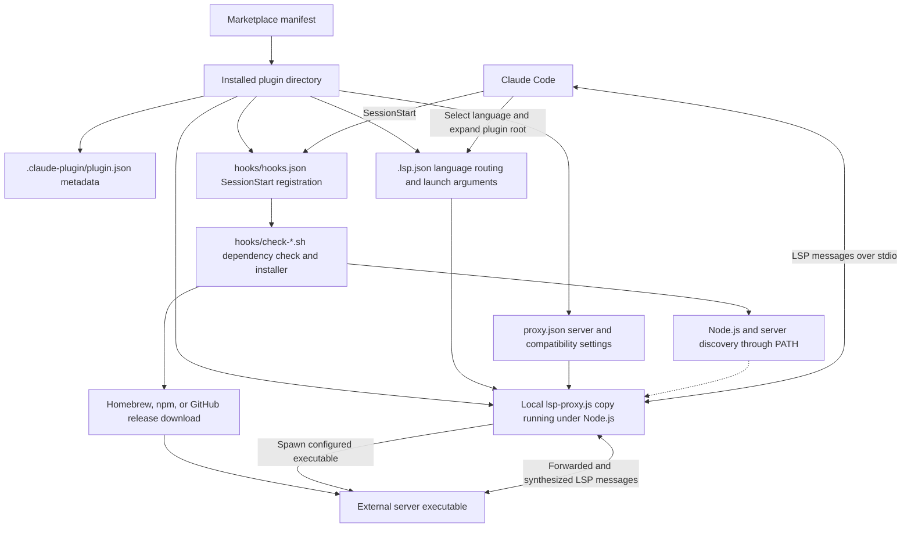
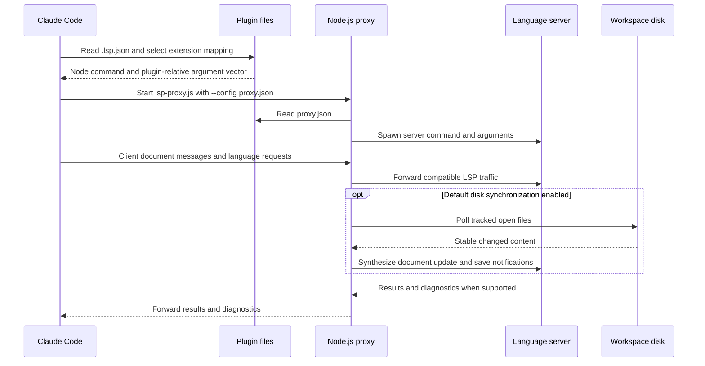
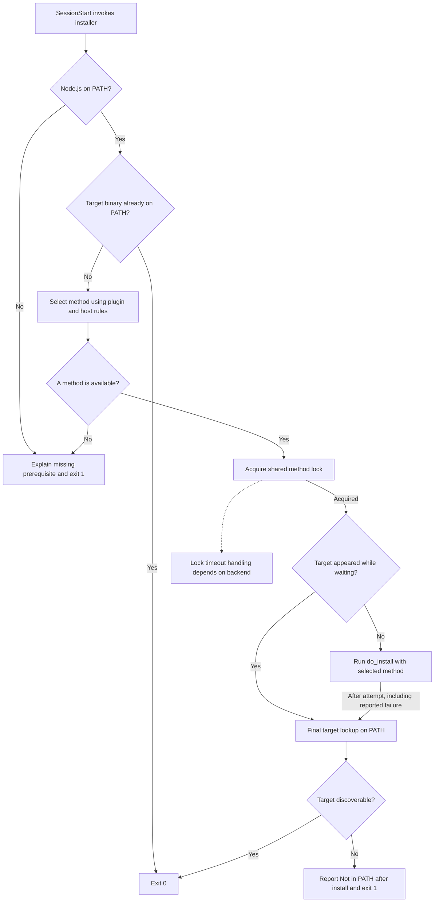
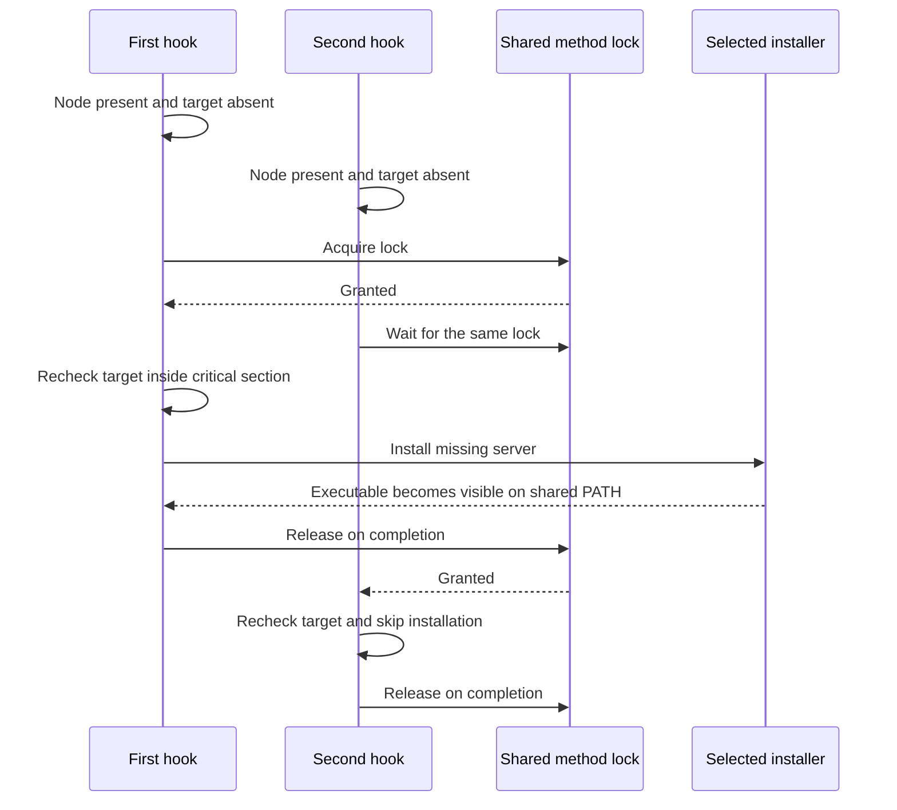

# Plugin configuration and installation

The `claude-lsps_plugins` module integrates five language servers with Claude
Code: Bash, CUE, Python, Rego, and TypeScript/JavaScript. It declares which files
belong to each server, launches the shared Node.js proxy, and checks or installs
server executables at session start. Language analysis remains the responsibility
of the external servers.

The core components are each plugin's `.lsp.json` and `hooks/check-*.sh`.
Their supporting manifests, hook registrations, and `proxy.json` files complete
the installation and launch contract.

## Scope and related modules

This page covers plugin packaging, language routing, runtime prerequisites,
installation strategies, concurrency, troubleshooting, and maintenance rules.
Shared implementation details are documented separately:

- [System overview](overview.md) explains the marketplace and system boundaries.
- [Proxy internals](claude-lsps_proxy.md) describes LSP framing, interception,
  document synchronization, warmup, and process lifecycle.
- [Development and CI](claude-lsps_development.md) covers repository setup,
  formatting, the test harness, and GitHub Actions.
- [Experiments and evidence](claude-lsps_experiments.md) documents the observations
  behind the proxy and the separate diagnostic tools.

## Architecture and packaging

Every marketplace entry points to a self-contained plugin directory. Claude Code
uses its manifests to register a session-start hook and an LSP launch command.
The hook prepares dependencies; the LSP command starts the proxy, which reads
its configuration and spawns the real server.



The setup and runtime paths are complementary, not one persistent process.
Installer output is human-readable setup output; it is not part of the LSP
stream. The proxy is a per-launch child process rather than a shared daemon.

### Directory contract

Each plugin follows this layout:

```text
<plugin>/
  .claude-plugin/
    plugin.json
  .lsp.json
  hooks/
    hooks.json
    check-<server>.sh
  lsp-proxy.js
  proxy.json
```

| Artifact | Responsibility |
| --- | --- |
| `.claude-plugin/marketplace.json` | Repository-wide discovery and source paths |
| `<plugin>/.claude-plugin/plugin.json` | Plugin identity and release metadata |
| `<plugin>/.lsp.json` | File routing and proxy launch arguments |
| `<plugin>/hooks/hooks.json` | Session-start command and timeout |
| `<plugin>/hooks/check-*.sh` | Prerequisite checks and server installation |
| `<plugin>/proxy.json` | Real server command and proxy options |
| `<plugin>/lsp-proxy.js` | Deployed copy of the common proxy implementation |

Plugin installation copies the plugin directory. Consequently, every plugin
must carry its own real `lsp-proxy.js` file; a reference to a shared parent path
or an external symlink is not a suitable packaging substitute. All five deployed
copies must remain byte-identical. The packaging rationale and byte-identity
check are in `tests/cases/02-consistency.sh`.

The production proxy uses only the Node.js standard library. Consumers do not
need to install proxy npm dependencies or compile the plugin. Installing an npm
language-server package is a separate operation from installing dependencies for
the proxy or the development toolchain.

### Metadata relationships

The marketplace is defined in `.claude-plugin/marketplace.json`. Each entry uses
`source: "./<plugin>"` to identify its plugin directory. The entry and the local
`.claude-plugin/plugin.json` must agree on `name`, `version`, `description`, and
`author.name`.

Local metadata also includes `license`; marketplace entries include `category`
and a non-empty array of string `tags`. `tests/cases/01-manifests.sh` validates
these structures and their cross-file agreement. Marketplace metadata versions
are plugin release versions, not the versions of downloaded server binaries.

## Language routing and launch contract

### Plugin catalog

The top-level keys in `.lsp.json` identify configured server entries. The actual
LSP document language IDs come from `extensionToLanguage` and need not equal
those keys.

| Plugin directory | Entry key | Real server invocation |
| --- | --- | --- |
| `bash-language-server` | `bash` | `bash-language-server start` |
| `cue-lsp` | `cue` | `cue lsp serve` |
| `pyright` | `python` | `pyright-langserver --stdio` |
| `regal-lsp` | `rego` | `regal language-server` |
| `vtsls` | `typescript` | `vtsls --stdio` |

The real invocations are configured in `bash-language-server/proxy.json`,
`cue-lsp/proxy.json`, `pyright/proxy.json`, `regal-lsp/proxy.json`, and
`vtsls/proxy.json`. They are not the commands launched directly by `.lsp.json`.

### Extension mappings

| Plugin | Extensions | LSP language ID |
| --- | --- | --- |
| `bash-language-server` | `.sh`, `.bash` | `shellscript` |
| `bash-language-server` | `.zsh`, `.ksh` | `shellscript` |
| `cue-lsp` | `.cue` | `cue` |
| `pyright` | `.py`, `.pyi` | `python` |
| `regal-lsp` | `.rego` | `rego` |
| `vtsls` | `.ts`, `.mts`, `.cts` | `typescript` |
| `vtsls` | `.tsx` | `typescriptreact` |
| `vtsls` | `.js`, `.mjs`, `.cjs` | `javascript` |
| `vtsls` | `.jsx` | `javascriptreact` |

Sources: `bash-language-server/.lsp.json`, `cue-lsp/.lsp.json`,
`pyright/.lsp.json`, `regal-lsp/.lsp.json`, and `vtsls/.lsp.json`.

In particular, the `typescript` entry also routes JavaScript and JSX files, and
the `bash` entry sends every listed shell extension as `shellscript`. Routing a
file does not guarantee complete support for that language dialect or every LSP
feature; those capabilities depend on the selected server.

### Common proxy invocation

All five configurations use `command: "node"` and the same three arguments.
For example, `pyright/.lsp.json` is equivalent to:

```json
{
  "python": {
    "command": "node",
    "args": [
      "${CLAUDE_PLUGIN_ROOT}/lsp-proxy.js",
      "--config",
      "${CLAUDE_PLUGIN_ROOT}/proxy.json"
    ],
    "extensionToLanguage": {
      ".py": "python",
      ".pyi": "python"
    }
  }
}
```

Claude Code expands `${CLAUDE_PLUGIN_ROOT}` to the installed plugin directory.
The script path and configuration path remain distinct arguments, including
when the directory contains spaces. `node` and the configured real server are
resolved through the process environment rather than plugin-relative paths.
There are no generated wrapper executables to add to `PATH`.

The launch contract enforced by `tests/cases/02-consistency.sh` is:

- Every `.lsp.json` entry uses the exact common command and argument vector.
- Paths inside `.lsp.json` use `${CLAUDE_PLUGIN_ROOT}/...`, not absolute
  developer paths, other variables, or references outside the plugin.
- `proxy.json` is present and its `server[0]` equals the installer's `BINARY`.
- The registered hook references an existing script in the plugin's `hooks/`.

## Proxy configuration and runtime data flow

For Bash, CUE, Pyright, and vtsls, `proxy.json` contains the server argument
vector and `"blocked": []`. None of those four configurations enables warmup.
Regal additionally configures two blocked methods and a workspace warmup scan:

```json
{
  "server": ["regal", "language-server"],
  "blocked": ["textDocument/references", "textDocument/implementation"],
  "warmup": {
    "extensions": [".rego"],
    "exclude": ["node_modules", ".git", "vendor", ".venv", ".claude"]
  }
}
```

Source: `regal-lsp/proxy.json`.

The blocked requests receive `result: null` from the proxy instead of reaching
Regal; blocked notifications are dropped. This avoids known unsupported-method
errors but deliberately provides no references or implementation result for
those methods. Warmup opens matching workspace files after initialization so
Regal can begin indexing without waiting for an explicit client open.

All shipped configurations omit `sync`, so they use the proxy's default disk
synchronization with a 300 ms polling interval. Setting `"sync": false` in a
plugin's `proxy.json` disables that feature. Polling is for tracked documents,
not a workspace-wide continuous discovery service. Server-request
acknowledgements are common proxy behavior rather than installer logic.



The proxy connects to the real server using piped stdin/stdout and inherits its
stderr. It does not implement language analysis or install project dependencies.
See [proxy internals](claude-lsps_proxy.md) for initialization sequencing,
configuration options, protocol framing, and synchronization edge cases.

## Session startup and prerequisites

Each `<plugin>/hooks/hooks.json` registers a command-type `SessionStart` hook
with a **60-second timeout**. The commands invoke Bash explicitly and quote the
plugin-relative script path. For example, Pyright registers:

```bash
bash "${CLAUDE_PLUGIN_ROOT}/hooks/check-pyright.sh"
```

The five installer entry points are:

- Bash: `bash-language-server/hooks/check-bash-language-server.sh`.
- CUE: `cue-lsp/hooks/check-cue.sh`.
- Python: `pyright/hooks/check-pyright.sh`.
- Rego: `regal-lsp/hooks/check-regal.sh`.
- TypeScript/JavaScript: `vtsls/hooks/check-vtsls.sh`.

The hook registrations are in `bash-language-server/hooks/hooks.json`,
`cue-lsp/hooks/hooks.json`, `pyright/hooks/hooks.json`,
`regal-lsp/hooks/hooks.json`, and `vtsls/hooks/hooks.json`.

### Prerequisite ordering

Every installer checks prerequisites in this order:

1. Run `command -v node`. If Node.js is missing, print an explanation to stderr
   and exit with status 1. The hook suggests installing Node.js and restarting
   the session; it does not install Node.js itself.
2. Run `command -v "$BINARY"`. If the target is already discoverable, exit 0
   silently without selecting an installer or acquiring a lock.
3. Select an installation method, acquire its shared lock, and check for the
   target again before attempting installation.
4. Verify that the target is discoverable after the installation path completes.

**Node.js is required even when CUE or Regal is already installed.** Those
servers are Go binaries, but every plugin still launches the Node.js proxy.
The Node check therefore intentionally precedes the existing-server fast path.

These are discoverability checks, not execution or compatibility tests. Existing
servers are accepted without checking their version, upgrading them, or testing
whether they start successfully. The hooks also do not enforce a Node.js version.
`mise.toml` pins Node.js `24.22.1` for repository development; that pin is not a
consumer-side runtime version check.

### Common installation process



The diagram emphasizes the final lookup because these scripts do not enable
`set -e` or explicitly propagate every installation command's status. Lock
release and timeout behavior are described below.

## Installation strategies

### Method selection

| Plugin or host case | Selection when the server is absent |
| --- | --- |
| Bash, Pyright, vtsls | Homebrew, else npm, else fail |
| CUE | Homebrew, else GitHub release download |
| Regal on macOS | Homebrew, else GitHub release download |
| Regal on other hosts | Release download, with an OS check during installation |

Homebrew is selected by command availability for Bash, CUE, Pyright, and vtsls;
there is no macOS-only condition for those four. Regal is different: on Linux it
selects a release download even if `brew` is installed. Its downloader rejects
operating systems other than Linux and Darwin.

**An alternative method is selected only when the preferred method is absent.**
A failed `brew install` does not cause a retry through npm or a binary download.
No installation command is retried automatically.

### Homebrew and npm identities

The Homebrew branches run `brew install "$FORMULA"` with these formulas:

| Plugin | Homebrew formula |
| --- | --- |
| `bash-language-server` | `bash-language-server` |
| `cue-lsp` | `cue-lang/tap/cue` |
| `pyright` | `pyright` |
| `regal-lsp` | `styrainc/tap/regal` |
| `vtsls` | `vtsls` |

The npm alternatives are global installations:

| Plugin | npm command |
| --- | --- |
| `bash-language-server` | `npm install -g bash-language-server` |
| `pyright` | `npm install -g pyright` |
| `vtsls` | `npm install -g @vtsls/language-server` |

For Pyright, the package is `pyright` but the executable checked and launched is
`pyright-langserver`. For vtsls, the package is `@vtsls/language-server` but the
executable is `vtsls`.

These commands do not pin package versions. They inherit the caller's package
manager configuration and permissions, and the hooks do not invoke `sudo`.
Package manager success still has to leave the expected executable on the
session's `PATH`.

### CUE release download

`cue-lsp/hooks/check-cue.sh` downloads a release only when Homebrew is absent.
Its direct-download path uses:

- Version: **0.16.0** from the `cue-lang/cue` GitHub repository.
- Architecture: `x86_64` becomes `amd64`; `aarch64` and `arm64` become `arm64`.
  Other architecture names produce `Unsupported architecture`.
- OS: the lowercase output of `uname -s`, such as `linux` or `darwin`.
  There is no explicit OS allowlist; a matching upstream asset must exist.
- Asset: `cue_v0.16.0_<os>_<arch>.tar.gz`, under release `v0.16.0`.
- Destination: `$HOME/.local/bin/cue`.

The script creates a temporary directory with `mktemp -d`, streams
`curl -fsSL` into `tar xz -C`, moves the extracted `cue` executable to its
destination, makes it executable, and removes the temporary directory.
It requires the corresponding Unix utilities, including `curl`, `tar`, `tr`,
`mv`, and `chmod`; it does not separately preflight each one.

### Regal release download

`regal-lsp/hooks/check-regal.sh` downloads a release on Linux and on macOS
without Homebrew. Its direct-download path uses:

- Version: **0.39.0** from the `open-policy-agent/regal` GitHub repository.
- Architecture: `x86_64` stays `x86_64`; `aarch64` and `arm64` become `arm64`.
  Other architecture names produce `Unsupported architecture`.
- OS: exactly `Linux` or `Darwin`; other values produce `Unsupported OS`.
- Asset: `regal_<OS>_<arch>`, under release `v0.39.0`.
- Destination: `$HOME/.local/bin/regal`.

The script creates the destination directory, downloads directly to the final
path with `curl -fsSL -o`, and applies `chmod +x`. Unlike CUE, there is no archive
extraction or temporary staging directory.

The version pins above apply only to the download branches. An existing binary
or a Homebrew installation can have a different version.

### Installation destinations and trust

Neither binary installer adds `$HOME/.local/bin` to `PATH`, and a hook cannot
modify the parent Claude Code process's environment. Configure the environment
before starting the session, for example:

```bash
export PATH="$HOME/.local/bin:$PATH"
```

Make an equivalent persistent change in the shell or launcher configuration
used to start Claude Code. Package-manager executable directories must likewise
be visible to that process, not merely to a different interactive shell.

The direct-download branches use HTTPS but do not verify release checksums or
signatures. They also do not execute the installed binary as a health check.
For controlled, offline, or centrally managed environments, preinstall approved
Node.js and server versions on `PATH`; the hooks will then take the fast path.

## Locking and concurrent installation

Installers coordinate by installation method, not by plugin or executable.
All hooks selecting the same method use the same fixed path in `/tmp`:

| Method | Lock file |
| --- | --- |
| Homebrew | `/tmp/claude-lsp-brew.lock` |
| npm | `/tmp/claude-lsp-npm.lock` |
| Release download | `/tmp/claude-lsp-binary.lock` |

Thus, two different plugins using Homebrew serialize their installs, while a
Homebrew install and a binary download use different locks. The paths are
hard-coded rather than derived from `TMPDIR`. These locks coordinate cooperating
plugin hooks; they do not lock unrelated manual package-manager invocations.

### Lock backends

When `flock` is available, the script opens the method lock on file descriptor
9 and calls `flock --timeout 120 9` inside a subshell. The target lookup and
installation run while that lock is held. The lock is released when the
subshell and its inherited descriptors close; the file itself may remain.
An existing lock file alone does not mean a lock is active.

When `flock` is absent, the script atomically creates a directory named
`<lock-file>.d`. Failed attempts sleep for two seconds and increment a wait
counter until the 120-second limit is reached. After acquisition, an `EXIT`
trap removes the directory with `rmdir` when the script finishes.

The directory backend has no stale-lock ownership or expiry detection.
Abnormal termination can leave a directory behind. The two backends use
different filesystem objects and do not coordinate with each other if callers
have inconsistent `flock` availability.

### Recheck inside the critical section

Every installer performs a second `command -v "$BINARY"` after acquiring the
lock. This prevents duplicate installation when another session made the same
binary available while the caller was waiting.



This example assumes the same binary and a shared visible installation
location. Different binaries using the same method each install in turn.
`tests/cases/05-installer-concurrency.sh` exercises parallel invocations and the
inside-lock short circuit, including the directory-lock fallback.

### Timeouts and recovery

The installer permits **120 seconds of lock waiting**, but each registered
session hook has a **60-second timeout**. Contention can therefore outlast the
caller's timeout, even before installation begins. `LOCK_TIMEOUT` is a lock wait
limit, not a duration limit on `brew`, `npm`, or `curl`.

Timeout propagation also differs by backend:

- A directory-lock timeout executes `exit 1` in the main script.
- A `flock` timeout executes `exit 1` in the subshell. The outer script still
  reaches its final target lookup, so it normally also reports a missing binary.
  If the binary has become visible by then, that lookup can make the overall
  script succeed despite the timeout message.

For a suspected stale directory lock, first verify that no installer is active.
Only then remove the relevant empty `.lock.d` directory and retry. Do not remove
or recreate an active `flock` lock file: unlinking its path is not a safe way to
release another process's lock. Installing the server manually before restarting
the session also avoids first-run installation contention.

## Installation and project operation

From a Claude Code session, add the marketplace and install the plugins needed
for the project:

```text
/plugin marketplace add Rubio-Enterprises/claude-lsps
/plugin install bash-language-server@claude-lsps
/plugin install cue-lsp@claude-lsps
/plugin install pyright@claude-lsps
/plugin install regal-lsp@claude-lsps
/plugin install vtsls@claude-lsps
```

Installing every plugin is optional. Node.js must already be available to the
session; a package manager or download tools are needed only when a server is
missing. To diagnose installation independently of the hook timeout, run the
corresponding script from a repository checkout. For example:

```bash
export PATH="$HOME/.local/bin:$PATH"
command -v node
bash cue-lsp/hooks/check-cue.sh
command -v cue
```

This is a real installation attempt, not a dry run. Restart Claude Code after
changing its launch environment.

### Python dependency environments

Installing Pyright does not install the project's Python dependencies.
As noted in `README.md`, Pyright discovers a project-root `.venv`, but dependencies
provided only through ephemeral `uv run --with` injection or `uv tool` are not
necessarily visible to it.

For a project using `.venv`, a root `pyrightconfig.json` can specify:

```json
{
  "venvPath": ".",
  "venv": ".venv"
}
```

Ensure that environment exists and contains the project's dependencies before
treating `reportMissingImports` as a plugin installation failure.

### Rego project roots

When Rego files live below the workspace root, Regal may need explicit roots to
resolve sibling packages. For example, a project storing policies in `policy/`
can use this `.regal/config.yaml`:

```yaml
project:
  roots:
    - policy
```

`README.md` documents this distinction: a whole-directory CLI lint can work even
when the LSP reports false `unresolved-import` or `opa-fmt` errors. The proxy's
warmup scan does not replace Regal's project-root configuration.

### CUE capability limitation

`tests/cases/08-live.sh` intentionally omits a broken-file CUE diagnostic test
because `cue lsp serve` v0.16 does not publish diagnostics in the tested setup.
A successful CUE installation therefore does not imply diagnostic publication.
See [development and CI](claude-lsps_development.md) for the live-test scope.

## Failure handling and troubleshooting

Installer messages are prefixed with the checked executable, such as `[cue]`,
`[pyright-langserver]`, or `[vtsls]`. The missing-Node explanation goes to stderr;
most other installation messages use stdout.

| Message or symptom | First response |
| --- | --- |
| `node is required` | Install Node.js and restart with the correct `PATH`. |
| `Neither Homebrew nor npm found` | Provide one for Bash, Pyright, or vtsls. |
| `brew install failed` | Fix the selected Homebrew command; no retry occurs. |
| `npm install failed` | Check global-install permissions and npm access. |
| `Binary download failed` | Check network access and the release asset. |
| `Unsupported architecture` | Preinstall a compatible server if available. |
| `Unsupported OS` | Regal downloads accept only Linux and Darwin. |
| `Lock timeout` | Check contention, caller timeout, and stale lock state. |
| `Not in PATH after install` | Expose the actual executable directory. |

The final missing-binary message always suggests `brew install "$FORMULA"`,
even if npm or a download was selected. That generic suggestion is not evidence
that Homebrew is available or appropriate for the host.

### Limits of success and failure detection

The scripts' final `command -v "$BINARY"` is the main post-install success
criterion. `do_install` returns 1 for explicit package-manager or download
failure, but the outer script does not stop solely on that return value.
A discoverable executable can therefore mask an earlier reported failure.
Conversely, a successful download can still end with failure if the destination
is absent from `PATH`.

There are additional implementation limits to consider when debugging:

- CUE pipes `curl` into `tar` without enabling `pipefail`, so the conditional
  tests the last pipeline command's status, not both statuses independently.
  `tests/cases/04-installer-behavior.sh` records this known asymmetry.
- CUE's move and permission changes, and Regal's permission change, are not
  explicitly guarded as separate failure conditions. The final lookup does not
  verify executable contents or successful server startup.
- Regal downloads directly to its destination, with no atomic replacement or
  explicit cleanup of a failed partial download.
- Already-present executables bypass all download-platform and version checks.
  Manage upgrades and required server versions outside the session hooks.

If dependency checks succeed but diagnostics remain stale, investigate tracking
and synchronization in [proxy internals](claude-lsps_proxy.md). If the question
is what Claude Code actually transmitted, use the tools described in
[experiments and evidence](claude-lsps_experiments.md), rather than changing the
installer.

## Maintenance and validation

### Cross-file invariants

When changing a plugin, preserve these relationships:

1. Keep marketplace metadata synchronized with the local plugin manifest.
2. Keep the `.lsp.json` command and arguments on the common Node proxy path.
3. Keep `proxy.json` `server[0]` equal to the installer's `BINARY` value.
4. Keep exactly one unambiguous `hooks/check-*.sh` installer per plugin, and
   update `hooks/hooks.json` whenever its filename changes.
5. Keep `BINARY="value"` as a standalone assignment starting at column one.
   `tests/cases/02-consistency.sh` extracts it with an `awk` pattern; computing
   the value dynamically would break that consistency check.
6. Keep every deployed proxy copy byte-identical. Language-specific server
   arguments, blocked methods, and warmup belong in `proxy.json`.
7. When bumping a download pin, update the version and asset expectations in
   `tests/cases/04-installer-behavior.sh` as well as the installer.

### Relevant test coverage

| Test case file | Contract checked |
| --- | --- |
| `tests/cases/01-manifests.sh` | JSON structure and manifest agreement |
| `tests/cases/02-consistency.sh` | Launch paths, binaries, hooks, proxy copies |
| `tests/cases/03-installer-lint.sh` | Bash syntax and ShellCheck warnings |
| `tests/cases/04-installer-behavior.sh` | Selection, no-op, failure, download pins |
| `tests/cases/05-installer-concurrency.sh` | Locking and inside-lock rechecks |
| `tests/cases/08-live.sh` | Optional real-server integration |

Installer behavior tests use sandboxed `PATH` and mocked package managers,
network tools, and platform identification. Their copies of the installers have
lock paths redirected into the sandbox by `tests/helpers/mock-bin.sh`. They do
not need to install real servers to exercise the installation branches.

`tests/run.sh` derives the general plugin list from marketplace sources.
Registering a plugin therefore enrolls it in manifest, consistency, and installer
lint checks. Plugin-specific behavior and concurrency tests are explicitly
registered; adding a marketplace entry does not create those scenarios or its
live-server tests automatically.

After repository tool setup, run the harness with:

```bash
mise run test
```

`mise.toml` defines this as `bash tests/run.sh` with
`JUNIT_REPORT=reports/test/junit.xml`. `Makefile` provides `make test` for the same
harness without setting the report path. The harness requires Node.js, Bash,
jq, and ShellCheck. `.github/workflows/test-gate.yml` runs it on macOS, including
the system Bash compatibility requirement, and requires that result before the
remaining Test Gate checks.

For optional real-server tests, expose the download directory and use the
production installers through the separate `live-setup` task:

```bash
export PATH="$HOME/.local/bin:$PATH"
mise run live-setup
mise run test
```

`mise.toml` prepends that directory inside `live-setup`, but the task cannot
persist the change into the shell that later runs tests. Live cases skip when
their binaries are absent. For full setup, CI behavior, and report requirements,
see [development and CI](claude-lsps_development.md).

### Adding another plugin

Create the standard directory layout, select extension-to-language mappings,
and copy the common proxy as a real local file. Define the real server command
in `proxy.json`, then implement a Node-first installer using the established
method locks, target recheck, and final `PATH` check. Register its session hook
and add matching local and marketplace metadata.

Finally, add explicit behavior, concurrency, and relevant live-test cases.
Consider whether existing method-wide lock names and the 60-second hook timeout
are appropriate before introducing another installation strategy. Shared
protocol changes belong in [proxy internals](claude-lsps_proxy.md) and must be
deployed consistently to every plugin, not implemented as a language-specific
proxy fork.
