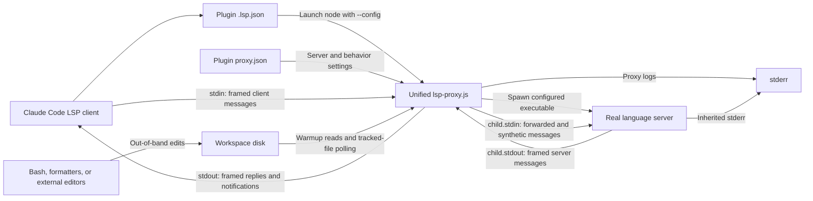
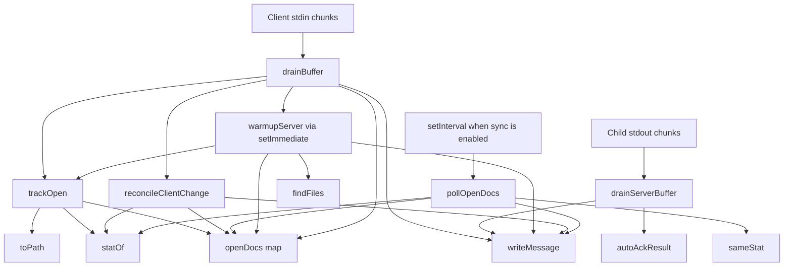
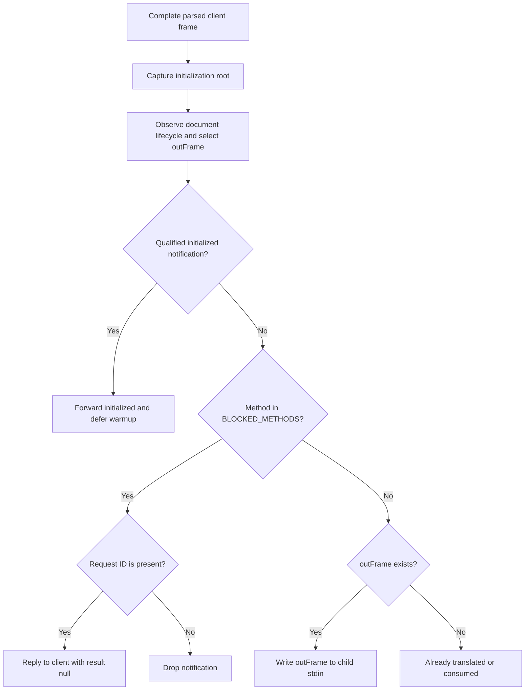
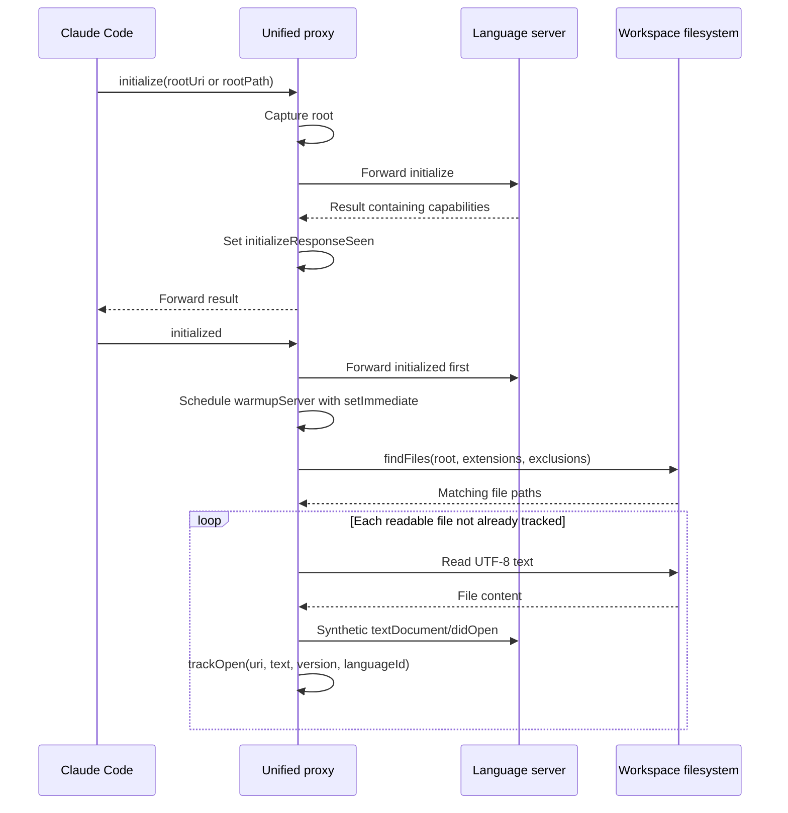
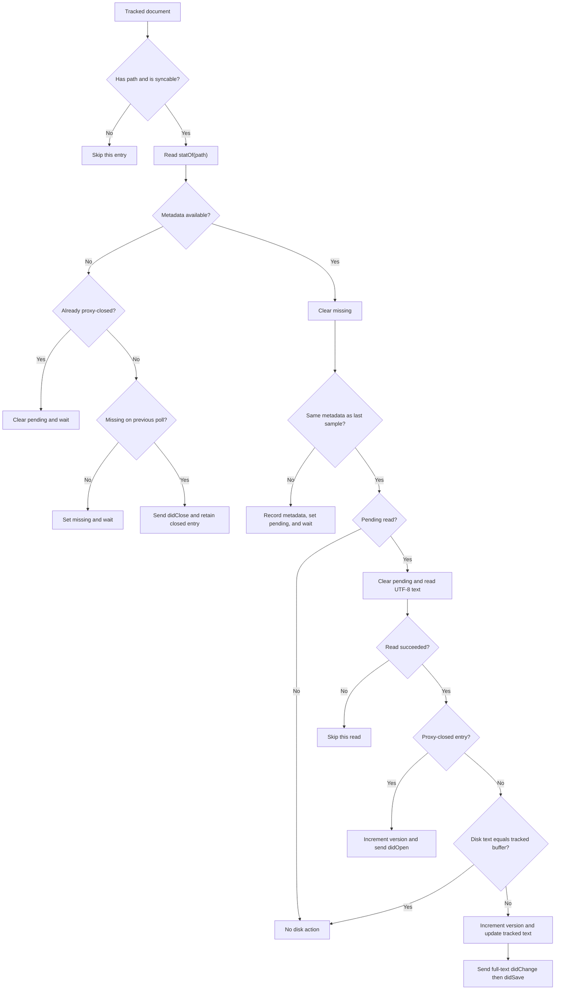

# Unified LSP proxy

The `claude-lsps_proxy` module is the stdio compatibility layer between Claude
Code's LSP client and the marketplace's external language servers. It forwards
ordinary JSON-RPC traffic while intercepting selected unsupported requests,
answering server requests the client cannot handle, optionally opening files
for indexing, and synchronizing tracked documents after unreported disk edits.

The proxy does not perform language analysis or modify workspace files. Its
output causes the real server to update its buffers; diagnostics and navigation
results remain the server's responsibility.

## Scope and related modules

This page documents the common production implementation, its configuration,
message handling, document state, filesystem polling, and process lifecycle.
Related responsibilities are documented separately:

- [System overview](overview.md) explains marketplace-wide architecture and
  system boundaries.
- [Plugin configuration and installation](claude-lsps_plugins.md) covers
  manifests, language routing, dependency installation, and packaging.
- [Development and CI](claude-lsps_development.md) covers tool setup, formatting,
  the test harness, coverage reporting, and GitHub Actions.
- [Experiments and evidence](claude-lsps_experiments.md) explains the wiretap and
  the separate Pyright synchronization prototype. Neither is a production
  runtime dependency.

The disk-sync design is motivated by the observations in
`experiments/lsp-wiretap/FINDINGS.md`: the tested Claude Code sessions reported
Edit-tool changes but not a subsequent Bash `sed` edit. Those measurements used
Claude Code `2.1.207`, headless macOS sessions, and Pyright; they are evidence for
that scenario, not a guarantee about every client release.

## Deployment and runtime architecture

The following files are deployed copies of one implementation, not independent
language-specific proxies:

- `bash-language-server/lsp-proxy.js`
- `cue-lsp/lsp-proxy.js`
- `pyright/lsp-proxy.js`
- `regal-lsp/lsp-proxy.js`
- `vtsls/lsp-proxy.js`

Each script executes directly under Node.js and starts one configured child
server. There is no exported library API, shared daemon, network listener, or
persistent document database. The current marketplace contains five plugins,
although the source header still mentions six copies. The plugin set is defined
by `.claude-plugin/marketplace.json` and consumed by `tests/run.sh`.



The child uses piped stdin/stdout and inherited stderr. The proxy's stdout is
reserved for LSP traffic; its own operational messages go to stderr.

All five `.lsp.json` files launch the local proxy using `node`, the local
`lsp-proxy.js`, `--config`, and the local `proxy.json`. Claude Code expands
`${CLAUDE_PLUGIN_ROOT}` before launch. Sources are
`bash-language-server/.lsp.json`, `cue-lsp/.lsp.json`, `pyright/.lsp.json`,
`regal-lsp/.lsp.json`, and `vtsls/.lsp.json`. See the
[launch contract](claude-lsps_plugins.md#language-routing-and-launch-contract)
for language mappings and installation requirements.

Every plugin carries a real copy because plugin installation copies its own
directory. `tests/cases/02-consistency.sh` checks byte identity, consistent
launch arguments, and agreement between `proxy.json` and the installer's
executable. General packaging details belong to
[plugin architecture](claude-lsps_plugins.md#architecture-and-packaging).

### Components and dependencies

All production dependencies are Node.js standard-library modules:

| Dependency | Use |
| --- | --- |
| `node:child_process` | Spawn the real server |
| `node:fs` | Read configuration, walk directories, stat and read files |
| `node:path` | Resolve config paths, join paths, extract extensions |
| `node:url` | Convert between file URIs and local paths |
| `Buffer`, streams, timers | Frame messages and schedule work |

There are no proxy npm dependencies or compilation steps. The repository's
`mise.toml` pins Node.js `24.22.1` for development; that is separate from the
consumer-side prerequisite checks described in the plugin documentation.



The arrows show calls and shared-state access, not separate services. All
handlers run in the same Node.js event loop. Filesystem operations are
synchronous; `setImmediate` defers the start of warmup but does not make its
scan asynchronous.

| Function | Responsibility |
| --- | --- |
| `writeMessage` | Write a byte-counted LSP frame to a stream |
| `drainBuffer` | Dispatch complete client frames |
| `drainServerBuffer` | Dispatch complete server frames |
| `autoAckResult` | Build the result for intercepted server requests |
| `toPath` | Safely convert a file URI to a local path |
| `statOf` | Read the filesystem change-detection tuple |
| `sameStat` | Compare two existing metadata snapshots |
| `trackOpen` | Initialize an entry in `openDocs` |
| `reconcileClientChange` | Mirror text, rebase versions, or reopen |
| `pollOpenDocs` | Detect stable disk edits, deletion, and reappearance |
| `findFiles` | Walk the warmup root using an explicit stack |
| `warmupServer` | Send and track synthetic document opens |

## Launch and configuration

A direct launch from the repository root is:

```bash
node pyright/lsp-proxy.js --config pyright/proxy.json
```

This starts an LSP stdio process, not an interactive command interface. Its
stdin must receive framed LSP messages.

The script finds `--config` in `process.argv`, resolves the following argument
against the current working directory, reads it as UTF-8, and parses JSON.
Missing arguments, read/parse failures, and a missing or empty `server` array
produce stderr messages and exit status `1` before a child is started.

### Configuration contract

A representative configuration explicitly expressing the default polling
interval is:

```json
{
  "server": ["pyright-langserver", "--stdio"],
  "blocked": [],
  "sync": {
    "pollMs": 300
  }
}
```

| Field | Default | Meaning |
| --- | --- | --- |
| `server` | Required | Non-empty command and argument array |
| `blocked` | `[]` | Exact client method names to intercept |
| `warmup` | Disabled | Optional startup discovery settings |
| `warmup.extensions` | No files | Non-empty extension array, including dots |
| `warmup.exclude` | `[]` | Entry names to skip during discovery |
| `sync` | Enabled | Literal `false` disables disk-sync |
| `sync.pollMs` | `300` | Poll interval in milliseconds, minimum `50` |

The interval is calculated as follows:

```javascript
Math.max(50, config.sync?.pollMs || 300)
```

For intended numeric inputs, a value below `50` is clamped to `50`; `0` uses the
`300` ms fallback. Only literal `false` disables synchronization. Auto-ack is
always enabled and has no configuration switch.

Setting `sync` to `false` disables both the polling timer and ordinary client
`didChange` reconciliation, including version rebasing. It does **not** disable
method blocking, server-request auto-ack, warmup, open/close tracking, or the
translation of duplicate client opens.

Configuration is read once. The proxy validates that `server` is a non-empty
array but does not perform comprehensive object or field-type validation.
Malformed optional settings can fail later or be coerced by JavaScript; use the
expected shapes above rather than relying on coercion.

The child is spawned with `server[0]` and `server.slice(1)`, without a shell.
It inherits the proxy's working directory and environment. Relative server
paths and arguments are not rebased to the configuration directory. Treat
configuration as trusted local launch configuration: the proxy does not
sandbox the executable or its arguments.

### Shipped configuration profiles

Bash, CUE, Pyright, and vtsls configure a real server command with
`"blocked": []` and no warmup. Regal adds:

- Blocking of `textDocument/references` and `textDocument/implementation`.
- Warmup for `.rego` files.
- Exclusions for `node_modules`, `.git`, `vendor`, `.venv`, and `.claude`.

All shipped configurations omit `sync`, so all use the default `300` ms poll
interval. Sources are `bash-language-server/proxy.json`, `cue-lsp/proxy.json`,
`pyright/proxy.json`, `regal-lsp/proxy.json`, and `vtsls/proxy.json`.
The exact real-server invocations are listed in
[the plugin catalog](claude-lsps_plugins.md#plugin-catalog).

## Transport and dispatch

### Framing and raw forwarding

`writeMessage(stream, body)` accepts a string or `Buffer`, converts strings to
bytes, and writes a `Content-Length` header followed by the body. Lengths count
UTF-8 bytes, not JavaScript string characters.

```text
Content-Length: <body byte length>\r\n\r\n<JSON body>
```

The two parsers maintain independent buffers:

- `buffer` receives client stdin and is consumed by `drainBuffer`.
- `serverBuffer` receives child stdout and is consumed by `drainServerBuffer`.

Both parsers use the same procedure:

1. Wait for the `\r\n\r\n` header delimiter.
2. Match a case-insensitive `Content-Length` header containing decimal digits.
3. Wait until the complete declared body is buffered.
4. Extract the original frame and parse its UTF-8 JSON body.
5. Dispatch that message and continue draining any remaining complete frames.

This supports frames split across chunks and several frames in one chunk.
Messages requiring no intervention are forwarded as their original bytes,
including their original headers and JSON formatting. Rewritten and synthetic
messages use new serialization and a recalculated content length.

Error handling deliberately favors forwarding rather than validation:

- If a delimited header has no recognized content length, the entire current
  buffer is forwarded unchanged and cleared, rather than resynchronized.
- If a complete body is not valid JSON, its original frame is forwarded.
- An incomplete header or declared body remains buffered until more data arrives.

These fallbacks do not make the proxy a general protocol validator. Dispatch
assumes the expected JSON message object and parameter shapes. There is no
message-size limit, framing timeout, or comprehensive malformed-message recovery.

### Client-to-server handling

`drainBuffer` captures initialization state and observes the document lifecycle
before applying the configured method blocklist. The frame selected for final
forwarding is `outFrame`: original bytes, rebased bytes, or `null` when an
internal action has consumed the message.



The blocklist isolates known methods whose servers return JSON-RPC `-32601`
(`Method not found`), which can leave Claude Code's LSP client in an
unrecoverable broken state. For a blocked request, the proxy preserves the
request ID and returns:

```json
{
  "jsonrpc": "2.0",
  "id": 42,
  "result": null
}
```

Blocked notifications receive no response and never reach the server. A defined
ID, including `0`, is treated as a request ID. Blocking is an exact configured
method match, not capability negotiation or a general rewrite of server errors.
Unlisted methods and their server responses retain normal forwarding behavior.

Returning success with `null` deliberately hides the unsupported-method error
rather than implementing the feature. A client can interpret it as an empty
result rather than an unsupported capability. This compatibility behavior is
codified, with that distinction noted, in `tests/helpers/proxy-suite.js`.

Because document bookkeeping precedes the blocklist, blocking lifecycle methods
can make tracked state disagree with server state. The shipped blocklist only
contains language-feature requests, not initialization or document messages.

### Server-to-client handling

`drainServerBuffer` first checks for a server request with a defined ID and a
method in `SERVER_REQUESTS_AUTO_RESPOND`. Such a request is consumed locally:
`autoAckResult` supplies a result, and `writeMessage` sends the reply directly to
child stdin with the same ID. Claude Code does not see the request.

| Server request | Synthesized result |
| --- | --- |
| `client/registerCapability` | `null` |
| `client/unregisterCapability` | `null` |
| `workspace/configuration` | One `null` per requested item |
| `window/workDoneProgress/create` | `null` |

For example, a configuration request with two `params.items` receives
`"result": [null, null]`. Missing or non-array `items` produces `[]`. A bare
`null` would break servers that index the response array, including Pyright and
vtsls. The entries mean that no configuration value is provided for each item.

Auto-ack prevents these known requests from waiting indefinitely on client
features. It does not install dynamic registrations, supply actual workspace
settings, or implement progress UI. Notifications with these method names and
requests outside the fixed set are forwarded normally.

After auto-ack handling, a truthy `msg.result.capabilities` sets
`initializeResponseSeen`. This is a response-shape heuristic, not a lookup by
initialize request ID. All remaining frames, including results, errors, and
`textDocument/publishDiagnostics`, are forwarded unchanged to the client.

## Initialization and warmup

Warmup helps servers such as Regal that begin indexing only after a document is
opened. It requires all of the following:

- A configured `warmup` value.
- A root captured from `initialize.params.rootUri`, falling back to `rootPath`.
- A server result observed with a truthy `capabilities` property.
- A subsequent client `initialized` notification.

`warmupServer` additionally requires a non-empty `warmup.extensions` array.



`setImmediate` ensures the proxy writes `initialized` before the open burst.
It does not wait for server indexing to finish or for any acknowledgement of
that notification.

### File discovery and language IDs

`findFiles(rootDir, extensions, excludeDirs)` uses a stack instead of recursive
function calls. For each directory it reads `Dirent` entries and:

- Skips entries whose entire name matches an exclusion, before testing type.
- Pushes directories onto the stack.
- Selects regular files whose `extname` matches a configured extension exactly.
- Silently skips unreadable directories.

Exclusions are literal names, not globs or substring matches against absolute
paths. They can exclude files as well as directories with the same name.
Extension matching is case-sensitive. Hidden directories are not implicitly
excluded, and symbolic-link entries are not followed by this traversal.

`warmupServer` converts selected paths with `pathToFileURL`, skips unreadable
files, and derives language IDs from its own mapping:

| Extension | Warmup language ID |
| --- | --- |
| `.rego` | `rego` |
| `.py` | `python` |
| `.ts` | `typescript` |
| `.js` | `javascript` |
| `.cue` | `cue` |
| `.sh` | `shellscript` |
| `.yml`, `.yaml` | `yaml` |
| `.swift` | `swift` |

Other extensions use the extension without its leading dot. This mapping is
independent of `.lsp.json` language routing. Adding a warmup extension such as
`.tsx` without updating this mapping would produce `tsx`, not
`typescriptreact`.

The warmup version counter starts at `0` for each scan and increments after
each sent open. Each document retains its own starting version; the counter is
not a workspace-wide document revision. Warmup opens are enrolled in disk-sync
through `trackOpen`, exactly like client opens.

### Duplicate-open protection and scope

The `openDocs` map prevents two races:

- **Client opens first:** warmup sees the URI already tracked and skips it.
- **Warmup opens first:** a later client open becomes a full-text `didChange`
  with the client's buffer and a version greater than the tracked version,
  rather than a second server-side `didOpen`.

The latter also applies to duplicate client opens. A second open is avoided
because open-after-open is undefined by the protocol and can cause Regal to
drop diagnostics. An entry already closed server-side is allowed a normal open.

Warmup uses one captured root, converting `file://` roots to local paths.
It does not interpret `workspaceFolders`, monitor folder changes, or support a
remote filesystem abstraction. There is no continuous discovery pass: newly
created, previously untracked files require a client open or another scan.
There is no separate warmup-completed flag; another qualifying `initialized`
notification would schedule another scan, with tracked-URI deduplication.

## Document state and synchronization

### Tracking model

`openDocs` is a `Map` keyed by document URI. It represents the proxy's view of
server buffers, not an authoritative list of every file in the workspace.

| Field | Meaning |
| --- | --- |
| `version` | Latest tracked server-side document version |
| `text` | Last known full buffer text, if reconstructable |
| `languageId` | Language ID retained for possible reopening |
| `path` | Local path for a file URI, otherwise `null` |
| `stat` | Last observed disk metadata, otherwise `null` |
| `pending` | Metadata changed and awaits a stable follow-up poll |
| `missing` | An initial failed stat has armed deletion handling |
| `closed` | Proxy has closed the server buffer but retains tracking |
| `unsyncable` | Full buffer is unknown, so polling is skipped |

`trackOpen(uri, text, version, languageId)` initializes this entry with a
numeric version or `1`, non-null text or an empty string, and a supplied
language ID or `plaintext`. It samples current metadata when a local path is
available and initializes all flags to `false`.

`toPath` accepts file URIs and catches conversion errors. Invalid and non-file
URIs get `path: null`; they can remain lifecycle-tracked but cannot be polled.

`statOf` returns this tuple, or `null` on any stat failure:

```javascript
{ mtimeMs, ctimeMs, size, ino }
```

`sameStat` is truthy only when both snapshots exist and every field is equal.
Change time helps detect rewrites that restore modification time; inode helps
detect atomic write-and-rename replacement with unchanged size and mtime.
The code does not hash every file on every poll.

### Client lifecycle reconciliation

A first client `didOpen` is tracked and forwarded unchanged. A client open for
an already-open entry instead updates its full text and language ID, resets
pending/missing/unsyncable state, refreshes its stat, and emits a synthetic
full-text `didChange`. Its version becomes the greater of the client version
and the previous tracked version plus one. The original open is consumed.

With synchronization enabled, `didChange` is passed to
`reconcileClientChange(msg, rawMessage)`. Its return value is one of:

- The original frame for an untracked URI, or for an ordinary tracked change
  whose client version is already greater than the tracked version.
- A newly framed version-rebased message.
- `null`, when a change has been converted into a server-side reopen.

A client `didClose` always removes its tracking entry. It is forwarded unless
`closed` is already true, in which case it is swallowed to avoid closing the
same server buffer twice. Once removed, the URI is no longer polled.

Client `didSave` is ordinary forwarded traffic. It does not update the tracked
text or apply a separate synchronization algorithm, even if it includes text.

### Full-text changes and incremental fallback

The proxy mirrors complete replacements rather than applying ranged edits.
A replacement is recognized when an entry has no `range` and has string `text`.
`contentChanges` is scanned in order, because each change applies to the result
of the preceding one:

- A full replacement makes the current text known.
- A ranged or otherwise unrecognized entry makes it unknown again.
- `[incremental, fulltext]` leaves a known final buffer and allows disk-sync.
- `[fulltext, incremental]` leaves the final buffer unknown and disables it.

When the final text is known, the proxy records it. A previously unsyncable
document is re-enabled and logged. If incremental changes leave the text
unknown, `unsyncable` becomes true and a disable message is logged once for that
transition. The ranged edits themselves still reach the server, with version
rebasing when needed; the proxy simply stops polling that document.

This is reconciliation, not permanent back-off after any client edit. A client
full-text change updates the comparison buffer, so its matching disk write
becomes a no-op during a later poll. A later external edit can still synchronize.
There is no general merge or unsaved-buffer conflict-resolution algorithm.

### Version rules

While synchronization is enabled, tracked client changes and proxy injections
share a server-side version sequence:

1. An ordinary client change with a numeric version greater than the tracked
   version keeps its original frame and advances tracking to that version.
2. A client change whose version is equal, lower, missing, or non-numeric is
   rewritten with `trackedVersion + 1`.
3. A disk-injected change or disk-driven reopen increments the tracked version.
4. A full-text client change reopening a proxy-closed document uses the greater
   of the client version and `trackedVersion + 1`.

Rebasing changes the forwarded `textDocument.version`, not the client's own
counter. Synthetic document notifications are sent only to the server.

| Event | Client version | Version sent to server |
| --- | --- | --- |
| Client opens document | `1` | `1` |
| External edit is injected | None | `2` |
| Client sends its next change | `2` | `3` |
| Another external edit is injected | None | `4` |

This prevents servers that enforce increasing versions from dropping a client
edit after proxy injection. Version reconciliation continues even while an
entry is `unsyncable`; that flag suppresses polling, not client forwarding.
These rules do not apply to ordinary client changes when `sync` is `false`.

### Polling and stability gate

When enabled, a timer calls `pollOpenDocs` every configured interval. It starts
during proxy setup, not after initialization, and is unreferenced so it cannot
keep the process alive by itself.

For each tracked entry, the following flow applies. The wait nodes mean to
continue with the remaining entries and reconsider this URI on a later tick.



The first changed metadata sample sets `pending`; a subsequent identical sample
allows a read. Further metadata changes defer the read again. A content-identical
rewrite or `touch` causes no message and no version increment.

An actual update sends these two notifications in order:

- `textDocument/didChange` with the next tracked version and
  `contentChanges: [{ text }]`.
- `textDocument/didSave` containing the document URI, without embedded text.

This refreshes the server buffer without writing the disk or modifying the
client buffer. Server diagnostics, if any, are forwarded through the normal
server-to-client path.

The two-poll gate normally gives a settled edit approximately one to two poll
intervals of detection latency, plus server analysis time. At the default
interval that is roughly `300`–`600` ms before analysis, not a deadline.
The gate reduces partial-write exposure; it is not an atomic snapshot, a file
lock, or proof that a writer has finished. There is no post-read stat check.

If a stable read fails, that attempt is skipped after clearing `pending`.
A new metadata change is needed to arm another read; unchanged metadata does
not cause repeated read attempts.

### Deletion, reappearance, and reopening

A failed stat is treated as absence, regardless of its cause. The first missing
poll arms `missing`; a second consecutive missing poll sends a synthetic
`didClose`, clears pending state, sets `stat` to `null`, and marks `closed`.
A successful stat between those polls cancels the missing sequence.

Closing is intended to let the server drop its buffer and clear diagnostics;
the proxy itself neither clears nor fabricates diagnostic results. Importantly,
the tracking entry and its last text/version remain in memory.

If the file reappears, changed metadata first arms the normal stability gate.
After a stable read, the proxy increments the retained version and sends a
`didOpen` with disk text and the retained language ID. It does not additionally
send `didSave` for this reopen.

A full-text client change can reopen the server buffer before disk reappearance.
`reconcileClientChange` resets close/missing/pending state, refreshes metadata,
sends `didOpen` with the client text, and consumes the original change. If the
file stays absent, subsequent polls can close it again.

A ranged change cannot supply the full content required for this conversion.
It follows normal change forwarding/rebasing and disables polling if the final
buffer is unknown. A later full-text change is needed to restore reconciliation.
Client `didOpen` on a proxy-closed entry instead follows normal open tracking.

## Process lifecycle and operations

### Startup, shutdown, and exit status

The proxy maintains `shuttingDown` to distinguish expected signal termination
from unexpected server loss.

| Event | Proxy behavior |
| --- | --- |
| Child spawn error | Log the child error and exit `1` |
| Client stdin EOF | Mark shutdown, stop polling, send child `SIGTERM` |
| Proxy receives `SIGTERM` | Mark shutdown, stop polling, forward `SIGTERM` |
| Proxy receives `SIGINT` | Mark shutdown, stop polling, forward `SIGINT` |
| Child exits with numeric code | Stop polling and propagate that code |
| Child exits without code during shutdown | Exit `0` |
| Child exits without code unexpectedly | Exit `1` |

The child-exit calculation is:

```javascript
code ?? (shuttingDown ? 0 : 1)
```

A numeric nonzero status is therefore not hidden by expected-shutdown tracking.
A normal signal-only child termination after stdin EOF no longer appears as an
unexpected failure.

Client LSP `shutdown` requests and `exit` notifications are otherwise ordinary
forwarded traffic. Signal and EOF handlers do not synthesize an LSP shutdown
handshake. There is no automatic restart, forced-kill timeout, process-group
supervision, or state recovery after exit.

### Logging and troubleshooting

Configuration read/validation errors use `[lsp-proxy]`; a missing `--config`
argument prints the usage line. Runtime messages use
`[lsp-proxy:<server command>]`, where the command is `server[0]`, not its full
argument vector. Child stderr is inherited and can appear alongside proxy logs.

Useful runtime messages identify:

- The captured initialization root.
- Warmup discovery count and actual sent-open count.
- Incremental-change disabling and full-text re-enabling of disk-sync.
- Injected changes and their versions.
- Deletion closes and disk- or client-driven reopens.
- Client-version rebasing and duplicate-open translation.

Warmup's discovered and sent counts may differ because files are already
tracked or unreadable. Content-identical reads do not produce an injection log.
Logs include file URIs, so treat captured stderr as potentially containing
sensitive workspace paths.

| Symptom | First investigation |
| --- | --- |
| Stale results after a disk edit | Check tracking, sync config, and disable logs |
| No warmup opens | Check handshake order, root, extensions, and exclusions |
| Unexpected empty Regal results | Check the configured blocked methods |
| Client versions increase at the server | Check injection and rebasing logs |
| Unexpected server-side close | Check deletion and stat/permission failures |
| Server process fails to start | Check stderr, executable lookup, and arguments |

For actual client-message capture, use the tools documented in
[experiments and evidence](claude-lsps_experiments.md), rather than assuming the
traffic-mutating production proxy is a transparent wiretap.

### Operational limits and performance

- Polling covers only tracked local-file documents. Without warmup, a document
  must first be opened by the client; creating an unrelated file does not enroll
  it. The poll loop does not send `workspace/didChangeWatchedFiles`.
- Unknown incremental buffers and non-file URIs are skipped, including deletion
  detection for those entries. Lifecycle tracking can still retain them.
- Metadata comparison can miss a same-size in-place rewrite within one timestamp
  quantum when the complete tuple is unchanged. There is no periodic content
  hashing to close that blind spot.
- Stat failures, including permission failures, can trigger deletion handling.
  Read failures are skipped. Filesystem observations do not distinguish every
  transient I/O failure from real disappearance.
- Each tick visits the map and stats eligible entries, including proxy-closed
  entries awaiting reappearance. Full text is retained for tracked documents;
  closed entries remain until client close or process exit.
- Warmup walks the selected tree synchronously, reads matching files in full,
  and emits an uncapped open burst. Exclusions are important for large trees.
- Both transport buffers can grow without a configured bound. Stream writes do
  not explicitly honor backpressure through `drain` handling. Large scans,
  files, or bursts can delay other work in the single event loop.
- Auto-ack and method blocking provide compatibility, not missing language or
  client capabilities. Refresh timing and diagnostic support depend on the real
  server. There is no guarantee that a close immediately clears client output.

## Maintenance and validation

Behavior changes belong in the common proxy implementation and must reach every
production copy. Prefer configuration differences over language-specific code
branches. Update warmup's language-ID mapping when extending its supported
extensions; `.lsp.json` routing alone does not update that mapping.

The following repository checks protect the module's contracts:

- `tests/cases/02-consistency.sh` checks byte-identical proxy copies, common
  invocation arguments, and agreement with the installer executable.
- `tests/cases/06-proxy.sh` dispatches `tests/helpers/proxy-suite.js` scenarios
  for byte-preserving forwarding, framing, blocked requests and notifications,
  auto-ack, malformed input fallbacks, configuration errors, signals, exit codes,
  disk-sync, version rebasing, deletion/reappearance, and both warmup-open races.
- `tests/cases/07-warmup.sh` uses `tests/helpers/warmup-suite.js` to check file
  discovery, exclusions, empty trees, absent warmup, and multiple extensions.
- `tests/cases/08-live.sh` registers real-server cases only when their executables
  are present. Relevant cases include Pyright disk-sync and Regal warmup;
  passing stub tests alone does not establish real-server diagnostic behavior.
- `tests/cases/99-coverage.sh` invokes the V8 coverage gate at `80` percent.
  See [coverage aggregation](claude-lsps_development.md#coverage-gate) for how
  identical deployed copies share coverage evidence.

Run the full harness after synchronizing changes across the copies:

```bash
mise run test
```

`mise.toml` defines this task to write `reports/test/junit.xml`; `Makefile`
provides `make test` as a direct `bash tests/run.sh` shortcut without setting
that report path. `.github/workflows/test-gate.yml` runs the suite on macOS and
through the required Test Gate lifecycle step, which checks JUnit evidence.
See [local commands](claude-lsps_development.md#local-commands-and-conformance)
for setup, optional live-server installation, and CI details.

When extending synchronization, preserve the distinction between client buffer
text, observed disk metadata, and server-side lifecycle state. Add regressions
for both client-driven and disk-driven paths, including their ordering, rather
than checking only that a synthetic notification was emitted.
