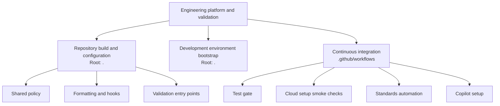

# Engineering Platform and Validation

> No file-reading tool is available in this session, so this overview is based
> on the supplied repository structure rather than the child documentation.

## Purpose

`engineering_platform_and_validation` groups the repository’s shared engineering
infrastructure: build and configuration policy, development environment setup,
and continuous integration. Its scope spans the repository rather than an
individual language-server integration.

## Architecture

The diagram shows component organization, not an execution sequence.

These components divide the engineering platform into three areas: shared
repository configuration, developer environment preparation, and automated
workflow validation.

## Core Component Documentation

- [Repository build and configuration](engineering_platform_and_validation/repository_build_and_configuration.md):
  Covers root-level build and configuration concerns, including shared policy,
  formatting and hooks, and validation entry points.
- [Development environment bootstrap](engineering_platform_and_validation/development_environment_bootstrap.md):
  Covers development environment setup associated with the repository root.
- [Continuous integration](engineering_platform_and_validation/continuous_integration.md):
  Covers workflows under `.github/workflows`, organized around the test gate,
  cloud setup smoke checks, standards automation, and Copilot setup.
