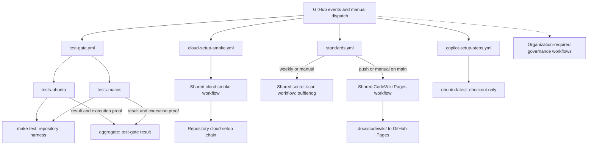
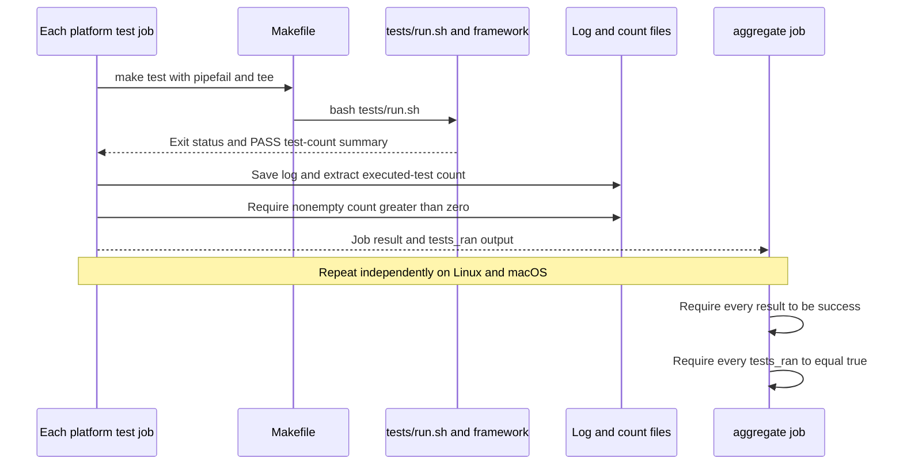

# Continuous Integration

## Purpose and scope

The `continuous_integration` module defines the repository's GitHub Actions
entry points for cross-platform tests, cloud setup validation, scheduled
secret scanning, documentation deployment, and Copilot runner selection.
It validates the `claude-lsps` plugin marketplace rather than building or
publishing an application package.

Four workflow files divide these responsibilities. The repository-local
`test-gate.yml` implements the test execution contract directly. The generated
cloud smoke and standards workflows call reusable organization workflows;
the generated Copilot workflow supplies a small hosted-runner override.

Sources: `.github/workflows/test-gate.yml`,
`.github/workflows/cloud-setup-smoke.yml`, `.github/workflows/standards.yml`,
`.github/workflows/copilot-setup-steps.yml`, `Makefile`.

## Place in the system

- [Engineering platform and validation](../engineering_platform_and_validation.md)
  provides the surrounding engineering platform.
- [Repository build and configuration](repository_build_and_configuration.md)
  owns the canonical `make test` entry point, formatting, hooks, and shared
  validation policy. CI invokes that entry point rather than reimplementing
  the harness.
- [Development environment bootstrap](development_environment_bootstrap.md)
  owns the setup scripts, mise configuration, and standards checkout that the
  cloud smoke job exercises. Test-gate jobs provision their own tools instead
  of running that bootstrap chain.
- [Language intelligence integration](../language_intelligence_integration.md)
  describes the language-server installers and proxies under validation.

Organization-required governance workflows are a separate enforcement layer.
The header of `standards.yml` assigns audit, lint-config, secret-scan, PR-title,
typecheck, and lint-hooks enforcement to that layer. These jobs are not
implemented by the four local workflows documented here. Their implementation
and branch-protection configuration cannot be inferred from these files.

## Architecture overview

The workflows are independent event consumers. There is no dependency from
cloud smoke, standards automation, or Copilot setup into the test aggregate.
Only the two explicit platform test jobs feed the `test-gate` result.

The shared workflow implementations reside in `Rubio-Enterprises/.github`.
The checked-in callers reference `@main`; they do not define the shared
jobs' complete steps, runner configuration, or timeout values. The cloud
caller's comments describe hosted Linux x64 execution and compatibility
probing, but the reusable workflow owns those details.

Sources: the four workflow files under `.github/workflows/`.

## Workflow and event map

| Workflow | Configured events | Jobs and outcomes |
| --- | --- | --- |
| `test-gate` | `pull_request`, `merge_group`, push to `main`, manual dispatch | `tests-ubuntu` and `tests-macos` run independently; `aggregate` requires successful, nonempty execution from both. |
| `cloud-setup smoke` | Path-filtered `pull_request`, manual dispatch | `cloud-setup-smoke` calls the shared consumer-side setup smoke workflow. It is not a required check. |
| `standards` | Push to `main`, Monday at 09:00 UTC, manual dispatch | `trufflehog` runs on its weekly cron or any manual dispatch. `codewiki-pages` deploys on push or manual dispatch on `main`. |
| `Copilot Setup Steps` | Manual dispatch | `copilot-setup-steps` selects `ubuntu-latest` and checks out the repository. GitHub also uses the specially named job to select the Copilot environment's runner. |

The smoke PR filter includes `scripts/**`, `.mise.toml`, its own workflow
file, `package.json`, `package-lock.json`, and `pnpm-lock.yaml`. Other changes
do not trigger this workflow through `pull_request`; manual dispatch covers
investigation of inputs outside the filter, such as cloud base-image changes.

`standards.yml` has no `pull_request` or `merge_group` trigger. On a push to
`main`, only its Pages job is eligible. On the weekly schedule, only
`trufflehog` is eligible. A manual run on `main` enables both jobs; a manual
run on another ref enables scanning but not Pages deployment.

The rendered standards workflow contains only `trufflehog` and
`codewiki-pages`. Its general header mentions E2E and cache seeding, but there
are no such jobs in this repository's YAML. `.copier-answers.yml` records
`enforce_e2e: false`, `has_playwright: false`, and `has_codewiki: true`.

Sources: `.github/workflows/cloud-setup-smoke.yml`,
`.github/workflows/standards.yml`, `.github/workflows/test-gate.yml`,
`.github/workflows/copilot-setup-steps.yml`, `.copier-answers.yml`.

## Sub-module guide

The detailed pages separate test execution, setup validation, shared
standards automation, and the Copilot runner override. Each page links back
to this overview and to the configuration or bootstrap module that owns its
supporting behavior.

| Documentation | Core components | Responsibility |
| --- | --- | --- |
| [Test gate](continuous_integration/continuous_integration_test_gate.md) | `test-gate.yml`, `tests-ubuntu`, `tests-macos`, `aggregate` | Explicit cross-platform jobs, runner and tool preparation, positive test-count proof, output propagation, and aggregate failure semantics. |
| [Cloud setup smoke](continuous_integration/continuous_integration_cloud_setup_smoke.md) | `cloud-setup-smoke.yml`, `cloud-setup-smoke` | Path-filtered consumer setup validation, shared workflow and App credentials, smoke-mode coverage, diagnostics, and optional-check policy. |
| [Standards automation](continuous_integration/continuous_integration_standards_automation.md) | `standards.yml`, `trufflehog`, `codewiki-pages` | Weekly and manual scanning, default-branch documentation publication, event eligibility, Pages permissions, and shared workflow dependencies. |
| [Copilot setup](continuous_integration/continuous_integration_copilot_setup.md) | `copilot-setup-steps.yml`, `copilot-setup-steps` | Public-repository hosted-runner selection, checkout-only execution, timeout behavior, and the generated workflow's ownership contract. |

For a failing platform suite or aggregate, start with the test-gate page.
For cloud snapshot preparation, start with cloud smoke and follow its links
to bootstrap internals. For scanner or Pages behavior, use standards
automation; for Copilot queueing and runner routing, use Copilot setup.

## Validation contracts and data flow

### Successful and nonempty test execution

Each platform job checks out the repository, installs Node `24.22.0` and
ShellCheck `v0.10.0`, ensures `jq` is available, prints tool versions, and runs
`make test`. The Makefile delegates to `bash tests/run.sh`; it exists because
the canonical gate recognizes `make test` and this repository is not a root
npm package.

The test step writes `tests_ran=true` only after a successful pipeline and a
positive count extracted from the harness's `PASS: <n> tests, 0 failures`
summary. The aggregate uses `if: always()` and explicitly depends on both
platform jobs. Its `jq -e` assertion rejects failed, skipped, or cancelled
dependencies and missing execution proof; it also rejects an empty dependency
object. Workflow cancellation can still interrupt execution.

This proves that the configured suite ran successfully on both jobs, not
that every optional live-server case ran. `tests/cases/08-live.sh` registers
real-server scenarios only when their binaries are present, and the workflow
does not install those servers. See
[Validation entry points](repository_build_and_configuration/repository_build_and_configuration_validation_entry_points.md)
for the harness contract and
[Development environment bootstrap](development_environment_bootstrap.md)
for optional live-server provisioning.

Sources: `.github/workflows/test-gate.yml`, `Makefile`, `tests/run.sh`,
`tests/lib/framework.sh`, `tests/cases/08-live.sh`.

### Cloud smoke validates setup, not the complete cloud environment

The smoke workflow delegates execution of the real repository's setup chain:
`scripts/cloud-setup-shim.sh` to `scripts/common/cloud-setup.sh` and then the
optional `scripts/repo-local/cloud-setup.sh`. The optional repo-local tail is
not present in the inspected checkout. Consumer-side execution covers actual
repository manifests and extensions that template-render fixtures cannot.

The common core distinguishes mandatory standards-pin verification from
best-effort dependency warming. `CLOUD_SETUP_SMOKE=1` invokes portable
bootstrap and records supported warming failures for a final nonzero status;
`CLOUD_SETUP_SMOKE=warm` skips portable bootstrap. Both smoke levels omit
cloud-only apt, marketplace, plugin, workflow-seeding, and fingerprint work.
A green smoke result is therefore not a full cloud snapshot or plugin-loading
attestation, nor proof that every declared tool installed successfully.

The workflow must remain optional while path-filtered: making it required
would leave unrelated PRs waiting for a status that never reports. Any
promotion requires an unconditional validation path first. Setup internals
and their failure semantics are documented in
[Development environment bootstrap](development_environment_bootstrap.md).

Sources: `.github/workflows/cloud-setup-smoke.yml`,
`scripts/cloud-setup-shim.sh`, `scripts/common/cloud-setup.sh`.

## Runners, permissions, and external dependencies

| Area | Contract in the checked-in configuration |
| --- | --- |
| Linux tests and aggregate | Use the JSON organization variable `RUNNERS.small`, falling back to `["ubuntu-slim"]`. The Linux job's display name is `tests / ubuntu-24.04`; it is not the authoritative runner selector. |
| macOS tests | Use `RUNNERS.macos`, falling back to `["macos-26"]`. The pinned ShellCheck download is x86_64 and requires Rosetta on arm64. |
| Test timeouts | Both platform jobs and the aggregate have 15-minute execution timeouts. |
| Copilot setup | Uses `ubuntu-latest` directly with a 120-minute execution timeout. No explicit token-permissions block is present. |
| Reusable workflows | Shared workflows own their actual job timeouts and runners; caller comments do not establish a local `timeout-minutes` value. |
| Read-only defaults | Test gate, cloud smoke, and standards explicitly set `contents: read`. |
| Pages deployment | Only `codewiki-pages` additionally requests `pages: write` and `id-token: write`. Pages must already be enabled with workflow-based deployment. |
| Cloud smoke authentication | Explicitly forwards `STANDARDS_READER_APP_ID` and `STANDARDS_READER_APP_PRIVATE_KEY` for read-only standards access. The caller documents both as required by the reusable workflow. |

The test jobs install ShellCheck into `$RUNNER_TEMP/bin` and append that path
to `$GITHUB_PATH`, avoiding privileged writes. Linux verifies preinstalled
`jq`; macOS installs it with Homebrew only when missing and fails explicitly
if neither `jq` nor Homebrew is available. The aggregate itself also requires
`jq` on its selected runner and contains no installation step.

Action references are SHA-pinned in the local test and Copilot jobs. Reusable
workflow references currently use `@main`, despite cloud caller comments
about digest pins. The test gate's Node `24.22.0` is also independent of the
`24.21.0` runtime pin in `.mise.toml`; do not assume the two environments are
identical.

Sources: all four workflow files; `.mise.toml`.

## Concurrency and maintenance

- Test gate groups by workflow name and PR number, falling back to commit
  SHA, with `cancel-in-progress: true`. New runs supersede active runs in the
  same group; different non-PR commits have different groups.
- Cloud smoke and standards group by workflow name and ref, requesting active
  cancellation only for PR events. Standards has no configured PR trigger,
  so that cancellation condition is false for its current event set.
- Copilot setup has no explicit concurrency policy in this file.
- `cloud-setup-smoke.yml`, `copilot-setup-steps.yml`, and `standards.yml` are
  fully generated by Rubio standards. Their headers require changes in the
  upstream templates followed by a Copier update; there is no per-repository
  override. `test-gate.yml` is the repository-local test contract.
- Preserve explicit platform jobs and list every required platform in
  `aggregate.needs`. The test-gate contract forbids matrices here and requires
  both successful job results and positive execution proof.

For diagnosis, start with the failing boundary: tool setup or harness output
for test jobs, result/output JSON for aggregation, App credentials and setup
logs for smoke, and event predicates or repository Pages settings for
standards automation. The sub-module pages provide the detailed execution
sequences and failure modes without duplicating bootstrap or runtime design.

Sources: workflow concurrency blocks and ownership headers,
`.github/workflows/test-gate.yml`, `.copier-answers.yml`.
