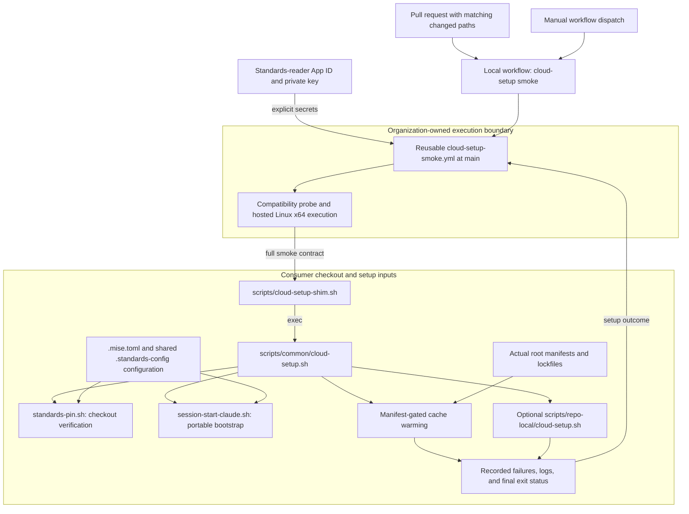
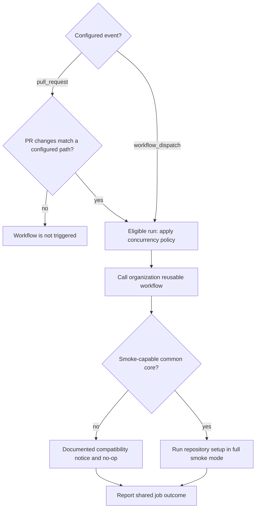
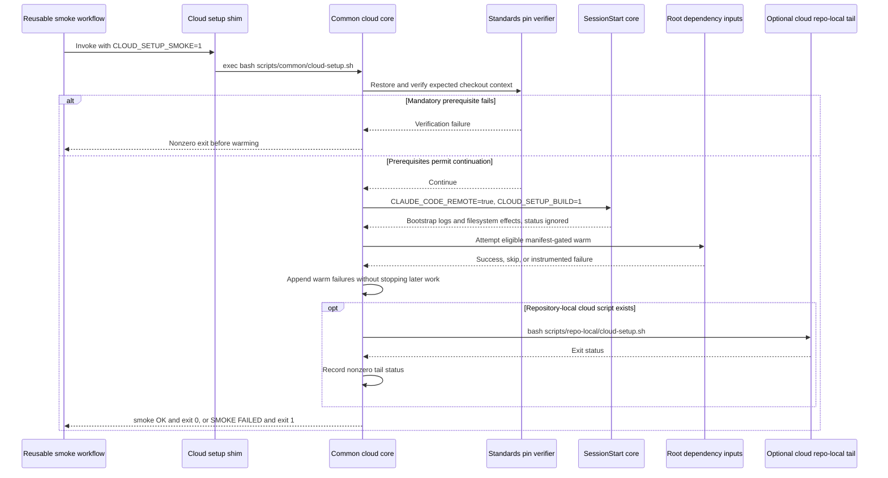

# Continuous Integration Cloud Setup Smoke

The `continuous_integration_cloud_setup_smoke` module provides consumer-side
validation of this repository's Claude Code on the web setup chain. Its
workflow, `.github/workflows/cloud-setup-smoke.yml`, delegates to an
organization reusable workflow so setup defects can surface on the pull
request that introduces them rather than only in a cloud snapshot build log.

It complements the standards template's render canary: rendered fixtures
cannot exercise this repository's real dependency manifests or repository-owned
setup extensions. This is an optional setup smoke check, not the repository's
canonical test gate or an end-to-end cloud-environment certification.

## Responsibilities and system boundaries

- [Continuous integration](../continuous_integration.md) describes the other
  workflow entry points and organization-level validation boundaries.
- [Development environment bootstrap](../development_environment_bootstrap.md)
  owns the setup scripts, mise configuration, standards checkout, snapshot
  caching, and session handoff. This page documents how CI invokes and
  evaluates that machinery rather than duplicating its implementation guide.
- [Continuous integration test gate](continuous_integration_test_gate.md)
  documents the independent Linux/macOS test suite and aggregate result.
  Cloud smoke is not a dependency of that aggregate and does not replace
  `make test`.
- [Standards automation](continuous_integration_standards_automation.md)
  describes the generated standards workflow. The smoke workflow's header
  identifies an unconditional standards job set as the prerequisite for any
  future promotion of smoke to a required check.

The local YAML is a generated caller, not the implementation of the runner
job. It defines events, permissions, concurrency, a reusable-workflow
reference, and explicitly forwarded secrets. Checkout, runner selection,
credential creation, compatibility probing, execution steps, and the actual
job timeout belong to the organization reusable workflow.

Sources: `.github/workflows/cloud-setup-smoke.yml`,
`.github/workflows/test-gate.yml`.

## Components and architecture

Both core components are in `.github/workflows/cloud-setup-smoke.yml`:

| Component | Responsibility |
| --- | --- |
| Workflow `cloud-setup smoke` | Events, permissions, and concurrency. |
| Job `cloud-setup-smoke` | Reusable call and secret forwarding. |

The job currently calls:

```yaml
uses: Rubio-Enterprises/.github/.github/workflows/cloud-setup-smoke.yml@main
```

There are no local `steps`, `runs-on`, `with` inputs, or `timeout-minutes` on
this job. The caller also declares no outputs or artifact-upload steps;
shared-workflow behavior beyond its documented contract must be inspected in
the external implementation.



The runner and probe nodes represent the reusable contract described in the
caller comments. The external workflow is not included in the inspected
source. The comments specify hosted Linux x64 rather than the usual arm64
pool, matching the cloud environment's architecture; the precise runner
label, image, and execution timeout are not established by this YAML.

Sources: `.github/workflows/cloud-setup-smoke.yml`,
`scripts/cloud-setup-shim.sh`, `scripts/common/cloud-setup.sh`,
`scripts/common/session-start-claude.sh`, `.mise.toml`.

## Events and path selection

### Pull requests

The `pull_request` trigger has no branch filter but requires a changed path
matching at least one of these patterns:

- `scripts/**`
- `.mise.toml`
- `.github/workflows/cloud-setup-smoke.yml`
- `package.json`
- `package-lock.json`
- `pnpm-lock.yaml`

The broad script pattern covers the shim, generated common core, and any
repository-local tail. The mise manifest covers toolchain changes, the
workflow path makes wiring changes test themselves, and the package files
cover the listed root Node dependency inputs.

Path filtering is a cost-control decision: the reusable contract cold
bootstraps the pinned toolchain and warms applicable dependency caches on a
hosted x64 runner. Running it for unrelated changes would add expensive work
without corresponding setup signal.

This filter is not a complete dependency graph. For example,
`.mise.local.toml`, Bun lockfiles, an external reusable-workflow update, or a
cloud base-image change do not independently match the listed PR patterns.
Review trigger coverage when adding setup inputs; use manual dispatch for
investigation outside the filter.

### Manual dispatch

`workflow_dispatch` has no declared inputs and is not subject to the PR path
filter. It allows a maintainer to investigate a snapshot failure without
pushing a no-op commit. There are no `push`, `schedule`, or `merge_group`
triggers in this file.



Compatibility probing and notice-only no-ops are documented by the caller,
not implemented locally. They let the caller land before a consumer has
re-rendered a smoke-capable setup core. A compatibility no-op is not proof
that the setup chain executed.

Source: `.github/workflows/cloud-setup-smoke.yml`.

## Permissions, credentials, and concurrency

### Read-only standards access

The workflow sets `permissions: contents: read` for `GITHUB_TOKEN`. It
explicitly forwards only these named secret arguments rather than using
`secrets: inherit`:

- `STANDARDS_READER_APP_ID`
- `STANDARDS_READER_APP_PRIVATE_KEY`

The caller's ADR-0033 comment identifies these as the read-only
standards-reader App credentials used to clone the Shared Config Checkout.
It states that the reusable workflow fails without them. The shared checkout
supplies mise configuration and tool definitions referenced by `.mise.toml`.
The App credentials and the caller's read-only `GITHUB_TOKEN` are distinct
authentication surfaces.

Provision the App credentials through the appropriate Actions secret scope
and ensure the App can read the required standards repository. A matching
path does not make secrets available: ordinary fork PRs generally do not
receive repository secrets, and this caller defines no fork-specific guard or
alternate credential path. Diagnose those failures at the reusable-workflow
authentication boundary; do not put private keys or replacement tokens in
committed setup scripts or logs.

Sources: `.github/workflows/cloud-setup-smoke.yml`, `.mise.toml`.

### Run supersession and timeout ownership

The exact concurrency policy is:

```yaml
concurrency:
  group: ${{ github.workflow }}-${{ github.ref }}
  cancel-in-progress: ${{ github.event_name == 'pull_request' }}
```

- Eligible PR runs for the same workflow/ref supersede an in-progress run in
  that group when a newer eligible run starts.
- The workflow name namespaces the group, separating it from differently
  named workflows in the repository.
- Manual dispatches do not request in-progress cancellation through this
  expression. They still participate in GitHub Actions concurrency grouping.
- A cancelled run may never reach its final smoke summary; cancellation is
  not a successful validation result.

The header discusses a 120-minute organization-wide execution floor, but
this caller sets no actual timeout value. The called workflow owns the
ceiling on its executing job. Execution timeouts do not bound queue time.

Source: `.github/workflows/cloud-setup-smoke.yml`.

## Smoke execution and failure propagation

### Smoke levels

The `CLOUD_SETUP_SMOKE` environment variable selects two smoke levels or
ordinary cloud mode:

| Mode | SessionStart bootstrap | Recorded warm/tail failures |
| --- | --- | --- |
| Unset | If the session core exists. | Warn, normal exit 0. |
| `warm` | Skipped. | Final exit 1. |
| `1` | If the session core exists. | Final exit 1. |

`warm` is intended for template render-canary fixtures, which have no real
consumer dependencies. `1` is the consumer-side contract: it invokes the
pinned toolchain bootstrap to avoid testing only no-ops caused by an
unprovisioned toolchain. The coverage limitations below still apply.

At both smoke levels, the common core omits cloud-only apt work, marketplace
credential setup and pre-seeding, plugin-cache materialization, workflow
seeding, and snapshot fingerprint writing. The private Go-module credential
helper is a narrow exception: it may run during credentialed smoke when
`go.mod` is present. This checkout has no root Go module or rendered Go warm
to exercise. Bootstrap and cloud-specific implementation details belong to
[Development environment bootstrap](../development_environment_bootstrap.md).

The workflow header describes the chain as abort-proof. In the inspected
scripts, that describes ordinary dependency/cache warming, not every
prerequisite: standards-pin restoration and checkout verification can fail
before the smoke accumulator is initialized. With neither an expected pin
nor a provisioner record, pin restoration allows continuation without
attesting a pinned revision. See the bootstrap documentation for that trust
boundary.

Sources: `scripts/common/cloud-setup.sh`,
`scripts/common/standards-pin.sh`.

### Component interaction and result data flow

The shim resolves the checkout from its own location and `exec`s the common
cloud core. It does not translate the core's exit status. If the common core
is absent, the shim instead warns and exits zero; the reusable's documented
compatibility probe is therefore important to interpreting execution.



The common core uses `set -uo pipefail`, not `set -e`, for its warming path.
Its `__warn` helper prints a failure message and, in smoke mode, appends the
step name to a failure accumulator. Later steps still run. At the end,
recorded failures become one `SMOKE FAILED` summary and exit status 1;
otherwise it emits `smoke OK` and exits 0.

This is explicit instrumentation, not a universal shell-error trap.
`__smoke_check_failed` can assert missing tools in full smoke mode, but the
current rendered Node warm has no calls to that helper. The SessionStart
subprocess is invoked with `|| true`; bootstrap warnings or its exit status
alone do not guarantee a red smoke job. Exports inside that subprocess also
do not automatically alter the cloud core's parent-shell environment.

The optional cloud repo-local script deliberately runs in smoke mode, and a
nonzero exit is recorded. It is not automatically rewritten to skip its own
cloud-only operations. Repository-specific additions should account for the
CI environment and return a meaningful status for work CI must validate.

Sources: `scripts/cloud-setup-shim.sh`, `scripts/common/cloud-setup.sh`,
`scripts/common/session-start-claude.sh`.

## Coverage in this repository

The inspected checkout is a dependency-free Node-proxy marketplace, not a
root npm application. `.mise.local.toml` makes `setup:ts` a no-op because the
proxies have no npm dependencies. There is no root `package.json`, supported
Node lockfile, or `scripts/repo-local/cloud-setup.sh` in the inspected tree.
Consequently, the current chain attempts portable toolchain bootstrap but
has no root Node dependency install or cloud repo-local tail to execute.
Those no-ops are expected, not failures.

The rendered warm selects eligible npm, pnpm, or Bun branches by root
lockfile presence and package-manager availability. It has no unconditional
PATH-only package-install fallback. Its clean/frozen install attempts can
fall back to ordinary installs, so success is not a strict lockfile
conformance assertion. If a root package manifest exists but no branch is
eligible, the script prints a node-warm skip message rather than recording a
missing-tool assertion in this render.

A green result must therefore be interpreted narrowly:

- Confirm that the reusable actually ran the smoke-capable chain rather
  than taking its compatibility no-op.
- Confirm the expected bootstrap and warm work from logs; zero status does
  not independently prove installation of every declared tool.
- Do not infer marketplace registration, plugin loading, workflow seeding,
  cloud network-policy parity, or a usable snapshot. Those cloud-only paths
  are outside smoke coverage.
- Do not infer language-server installation or test execution. The separate
  [test gate](continuous_integration_test_gate.md) owns suite execution, and
  [development environment bootstrap](../development_environment_bootstrap.md)
  documents explicit live-server provisioning.

Sources: `.mise.local.toml`, `.mise.toml`,
`scripts/common/cloud-setup.sh`, `scripts/common/session-start-claude.sh`,
and the inspected repository/script tree.

## Running and diagnosing the workflow

For an ordinary setup change, open or update a PR containing a matching
path and inspect the `cloud-setup smoke` workflow run. For an out-of-filter
change or a reported snapshot failure, use **Actions → cloud-setup smoke →
Run workflow**, selecting the intended ref. With an authenticated GitHub CLI
and permission to dispatch the workflow, an equivalent manual request is:

```bash
gh workflow run cloud-setup-smoke.yml --ref main
```

A dispatch requests a run; it does not establish that the setup executed or
passed. Check the resulting run and reusable job logs. The caller declares
no local artifact collection or execution-proof output.

| Symptom | Inspect first |
| --- | --- |
| No PR run | Changed paths and event configuration. |
| Compatibility no-op | Smoke-capable core and template refresh. |
| Checkout auth fails | App secrets, App access, event secret availability. |
| Pin/status fails | Standards checkout and provisioned pin context. |
| `SMOKE FAILED` | Recorded step names and warm/cloud-tail failures. |
| Tools missing | SessionStart warnings and actual tool availability. |
| Cloud plugins fail | Real snapshot build and SessionStart health notes. |
| Run queued/cancelled | Runner availability and concurrency. |

The common core's Node install commands suppress their detailed stdout and
stderr. The final summary may identify only `npm install`, `pnpm install`,
or `bun install`; investigate the applicable manifest, package manager, and
network/authentication environment separately. Frozen/clean failures that
recover through the fallback install do not produce a final smoke failure.

Use the full consumer mode when reproducing the script directly. `warm`
deliberately skips toolchain bootstrap and is not an equivalent consumer
smoke. Prefer the dispatched workflow for runner and credential parity;
direct execution can install tools, warm dependencies, and execute
repository-local code rather than acting as a read-only check.

Sources: `.github/workflows/cloud-setup-smoke.yml`,
`scripts/common/cloud-setup.sh`.

## Maintenance and required-check policy

- The workflow is fully generated by Rubio standards from
  `template/.github/workflows/cloud-setup-smoke.yml.jinja` in
  `Rubio-Enterprises/standards`. Its header prohibits consumer edits and says
  there is no per-repository override. Change the upstream template and
  propagate it through `copier update`.
- Keep generated setup-core changes upstream as well. Put repository-owned
  setup additions in `scripts/repo-local/cloud-setup.sh`; the smoke chain is
  designed to execute that tail against real consumer inputs.
- Preserve explicit read-only standards-reader secret forwarding and review
  trigger coverage whenever setup dependencies change.
- The checked-in reusable reference is **`@main`**, despite adjacent comments
  describing a full-SHA digest pin and `# vN` convention. Do not treat those
  comments as evidence of an immutable pin. The reusable workflow revision
  and the separate `STANDARDS_PIN` configuration revision are different
  dependencies.
- Keep this workflow optional while it is paths-filtered. An unrelated PR
  may never report its status; requiring it would leave that PR waiting for
  an expected check that never runs. The header requires moving the call
  into an unconditional `standards.yml` job set before making it required.
  Repository rulesets themselves are configured outside this file.

The current `standards.yml` has no `pull_request` or `merge_group` trigger.
Moving the call there without changing event coverage would therefore not
produce a PR check. Any promotion must ensure unconditional reporting on
every event for which the check will be required, not just relocate the job.

For broader ownership and policy, see
[Continuous integration](../continuous_integration.md) and
[Repository build and configuration](../repository_build_and_configuration.md).

Source: `.github/workflows/cloud-setup-smoke.yml`.
