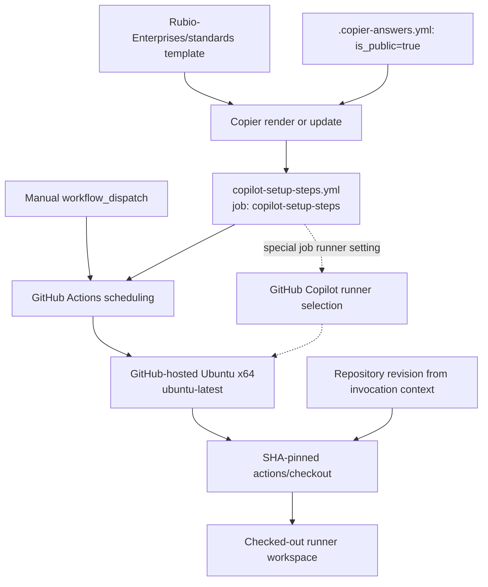
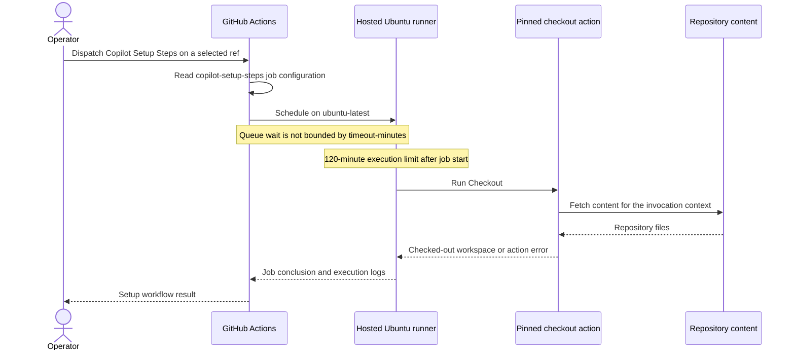

# Continuous Integration: Copilot Setup

The `continuous_integration_copilot_setup` module selects a GitHub-hosted
Ubuntu runner for Copilot code review and the coding agent in this public
repository. Its implementation is
`.github/workflows/copilot-setup-steps.yml`: one specially named job with one
checkout step.

This is a runner-selection override, not a toolchain bootstrap or test gate.
It belongs to the repository's
[Continuous Integration](../continuous_integration.md) layer, but it does not
feed the test aggregate or invoke another repository workflow.

## Purpose and public-repository rationale

The workflow's comments document an incompatibility between public-repository
Copilot execution and the organization's default self-hosted runner, labeled
`linux-x64`. They describe reviews waiting roughly 24 hours in the queue
before cancellation when that default is used. The generated override sets
`copilot-setup-steps.runs-on` to `ubuntu-latest` so GitHub selects a hosted
Ubuntu x64 runner instead.

The header identifies this as a public-repository template variant rendered
only when `is_public=true`. The checked-in `.copier-answers.yml` records
`is_public: true`, consistent with the presence of this workflow. The answer
controls template rendering; GitHub reads the rendered workflow at runtime,
not the Copier answers file.

Two integration surfaces must be distinguished:

- **Actions trigger:** the YAML declares only `workflow_dispatch`, allowing
  an explicit manual run of the checkout-only workflow.
- **Copilot runner selection:** the header documents GitHub interpreting the
  specially named `copilot-setup-steps` job's `runs-on` for code review and
  coding-agent execution. Copilot's launch and review logic are not
  implemented in this file.

The queueing rationale applies to this Copilot configuration; it is not a
statement about runner support for every kind of public-repository Actions
job. Increasing an execution timeout would not correct the routing problem.

Sources: `.github/workflows/copilot-setup-steps.yml`, `.copier-answers.yml`.

## Architecture and dependencies

Template generation and workflow execution are separate dependency paths.
The standards repository supplies the workflow template, while GitHub
provides scheduling, the hosted runner, and the Copilot integration.



Solid arrows show generation dependencies and the declared Actions execution
path. Dotted arrows show the Copilot runner-selection contract documented in
the workflow header, not additional YAML steps.

The only declared runtime action dependency is `actions/checkout`. This is a
local job definition, not a call to a reusable organization workflow. The
standards template is a generation-time dependency; this job does not clone
`.standards-config/`, run mise bootstrap, install language servers, or invoke
the cloud setup scripts.

For those separate responsibilities, see
[Development Environment Bootstrap](../development_environment_bootstrap.md).

Sources: `.github/workflows/copilot-setup-steps.yml`, `.copier-answers.yml`.

## Workflow and job contract

The operative configuration, without the generated explanatory comments, is:

```yaml
name: Copilot Setup Steps
"on": workflow_dispatch

jobs:
  copilot-setup-steps:
    runs-on: ubuntu-latest
    timeout-minutes: 120
    steps:
      - name: Checkout
        uses: actions/checkout@d23441a48e516b6c34aea4fa41551a30e30af803 # v6
```

### Identity and events

`Copilot Setup Steps` is the workflow's display name.
`copilot-setup-steps` is the job identifier consumed by the Copilot
integration. Preserve the special workflow filename and job identifier when
updating the template; do not treat them as cosmetic names.

The explicit event configuration has no dispatch inputs, branch filters,
`push`, `pull_request`, `merge_group`, schedule, or `workflow_call` trigger.
Consequently, this file does not declare an ordinary PR validation run or a
reusable workflow interface. The Copilot integration described in the header
must not be confused with an additional event declared under `on`.

The `"on"` key is intentionally quoted. As the comments explain, YAML 1.1
parsers can interpret an unquoted `on` as a boolean. Quoting preserves the
string key for `yaml[truthy]` checks used by yamllint and ansible-lint while
remaining valid for GitHub Actions and actionlint.

### Runner selection and execution limit

- `runs-on: ubuntu-latest` directly selects the hosted Ubuntu runner. There
  is no organization `RUNNERS` variable lookup, runner matrix, custom runner
  group, or self-hosted fallback in this job.
- `ubuntu-latest` is a moving runner-image label, not a fixed Ubuntu release
  or a complete toolchain version pin.
- `timeout-minutes: 120` limits job execution after it starts. It does not
  bound time spent waiting for a runner.
- The value follows the generated standards timeout policy. The shared
  comment discusses protection against wedged self-hosted execution, but the
  actual job here explicitly selects a hosted runner.
- No concurrency group, superseded-run cancellation policy, step-specific
  timeout, or explicit retry is configured in this file.

### Checkout and observable results

`Checkout` is the sole step. Its action reference is pinned to the full commit
`d23441a48e516b6c34aea4fa41551a30e30af803`, annotated `v6`. The comment does
not make the reference follow later releases in that major version.

There is no `with` block. The workflow therefore supplies no explicit checkout
ref, fetch depth, or credential-persistence setting; those behaviors follow
the pinned action's defaults and the invocation context. Do not assume a
full-history checkout or an explicitly selected `main` ref from this YAML.

The result is a checked-out workspace plus the normal job status and logs.
The workflow declares no job outputs, artifact uploads, cache operations,
package installation, build, test, or deployment steps. A successful manual
run establishes that this checkout-only job completed on its selected runner.
It does not establish that a Copilot review completed or that repository
validation passed.

Actual cross-platform validation belongs to
[Test Gate](continuous_integration_test_gate.md). Testing the separate cloud
setup chain belongs to
[Cloud Setup Smoke](continuous_integration_cloud_setup_smoke.md).

### Permissions and authentication boundary

There is no workflow-level or job-level `permissions` block, nor any explicit
`secrets` or `env` declaration. The file does not request custom credentials
or forward the standards-reader App secrets used by cloud smoke.

Effective token permissions depend on the surrounding GitHub organization,
repository, and invocation policy. Absence of a permissions or secrets block
is not a guarantee of read-only or credential-free execution. Review those
settings separately when diagnosing checkout authorization failures.

Source: `.github/workflows/copilot-setup-steps.yml`.

## Execution process and data flow

The following sequence illustrates the explicitly declared manual Actions
path. It does not prescribe GitHub's internal Copilot launch sequence.



The invocation supplies the revision context, and the rendered job supplies
the runner label, timeout, and action revision. Checkout materializes the
repository into the runner workspace. No explicit outputs or uploaded
artifacts carry that workspace into a separate workflow, and no `needs`
relationship connects this job to the test gate, cloud smoke, or standards
jobs.

Source: `.github/workflows/copilot-setup-steps.yml`.

## Operation and troubleshooting

### Manual verification

From GitHub Actions, select **Copilot Setup Steps**, choose **Run workflow**,
and select the ref to investigate. An authenticated GitHub CLI with dispatch
access can also start a diagnostic run on `main`:

```sh
gh workflow run copilot-setup-steps.yml --ref main
gh run list --workflow copilot-setup-steps.yml
```

The example chooses `main`; the workflow itself declares no branch filter.
For the resulting run, verify the following:

- The job identifier is `copilot-setup-steps`.
- The selected runner is GitHub-hosted Ubuntu, consistent with
  `runs-on: ubuntu-latest`, rather than the default self-hosted `linux-x64`.
- The sole configured step is `Checkout`, using the expected pinned action.
- Checkout succeeds, and no toolchain or test execution is inferred from that
  success.

When diagnosing Copilot behavior, also inspect the actual code-review or
coding-agent execution. A successful manual dispatch alone does not prove
that a separate Copilot invocation used the override.

### Failure patterns

- **Copilot remains queued for `linux-x64`:** check that the workflow file and
  special job identifier are present in the configuration GitHub is using,
  that `runs-on` still selects `ubuntu-latest`, and that the generated public
  repository profile is current. The 120-minute timeout cannot repair a
  queue-time routing mismatch.
- **A hosted run remains queued:** investigate GitHub runner availability and
  applicable Actions or Copilot policy. Queue waiting is outside the declared
  execution timeout.
- **Checkout fails:** inspect the action log, repository/ref availability,
  effective token permissions, and action-use restrictions. There is no
  later bootstrap or recovery step in this workflow to compensate.
- **The job reaches its timeout:** investigate the executing job and action
  logs. This is an execution-limit failure, distinct from a job that never
  acquires a runner.
- **Tools are missing or tests never ran despite a green result:** that is
  consistent with the checkout-only contract. Use the bootstrap and
  validation modules rather than treating this result as environment or test
  certification.

The routing and timeout distinctions above follow the workflow's comments
and settings; service availability and effective repository policy must be
checked in GitHub rather than inferred from this file.

## Ownership and safe changes

The entire workflow is generated by Rubio standards. Its header states that
`copier update` replaces the file and that there is no per-repository
override. The upstream source is `Rubio-Enterprises/standards`, at
`template/.github/workflows/copilot-setup-steps.yml.jinja`.

Use the following change process:

1. Propose runner, timeout, or setup-step changes against the upstream
   standards template rather than hand-editing the generated consumer file.
2. Apply the approved template change through the supported Copier update
   process. Do not manually edit `.copier-answers.yml`; it is managed state.
3. Review the rendered diff for the public-repository condition, special
   filename and job identifier, hosted runner selection, execution limit,
   quoted `"on"` key, and full-SHA action pin.
4. Validate the regenerated YAML and manually dispatch the workflow. For
   runner-routing changes, also confirm an actual Copilot invocation selects
   the intended hosted environment.

The answers file currently records template revision `template/v1.55.158`.
That is generation provenance, not a runtime standards checkout pin or a
runner-image version. See
[Shared Repository Policy](../repository_build_and_configuration/repository_build_and_configuration_shared_policy.md)
for Copier provenance and managed configuration ownership instead of
replicating that policy here.

Sources: `.github/workflows/copilot-setup-steps.yml`, `.copier-answers.yml`.
