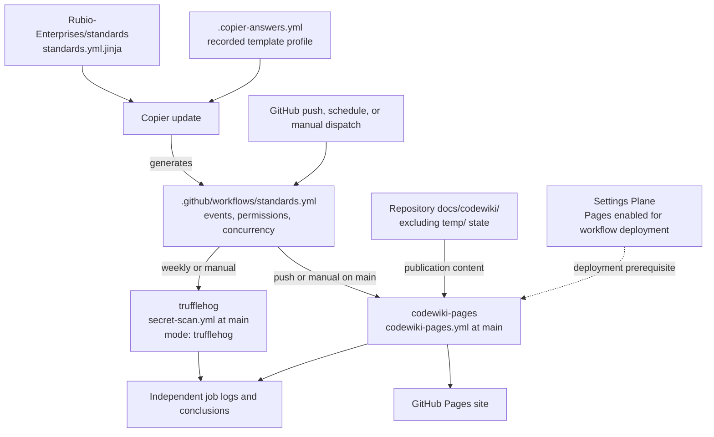
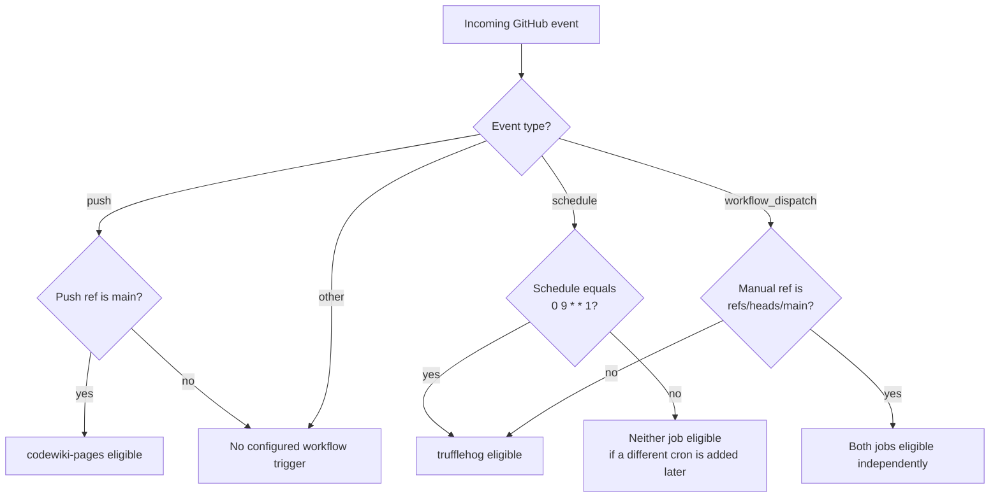
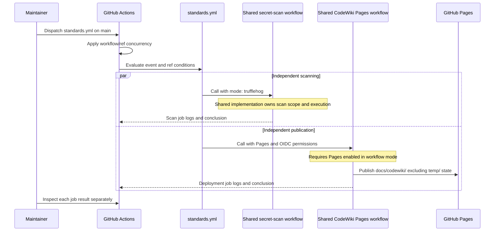

# Continuous Integration Standards Automation

The `continuous_integration_standards_automation` module is the generated
GitHub Actions entry point for scheduled secret scanning and CodeWiki
publication. It is implemented by `.github/workflows/standards.yml`, named
`standards`, and delegates execution to organization-owned reusable workflows.

## Scope and system boundaries

The checked-in workflow contains exactly two jobs:

- `trufflehog` requests the shared secret scanner's TruffleHog mode on the
  weekly schedule or a manual dispatch.
- `codewiki-pages` requests publication of existing CodeWiki documentation
  on pushes to `main` or manual dispatches on `main`.

This workflow is not the repository's complete standards enforcement layer.
Its header assigns audit, lint-config, required secret-scan, PR-title,
typecheck, and lint-hooks enforcement to organization-required governance
workflows. Those checks are not implemented by these two jobs. Canonical
non-E2E tests belong to the separate
[Test gate](continuous_integration_test_gate.md).

The generic header also mentions E2E and default-branch cache seeding, but
neither has a job in this repository's rendered YAML. The current
`.copier-answers.yml` records `enforce_e2e: false`, `has_playwright: false`,
`has_codewiki: true`, and `default_branch: main`. These answers describe the
repository profile; the workflow does not read them at runtime.

See [Continuous integration](../continuous_integration.md) for the wider
workflow architecture and
[Shared policy](../repository_build_and_configuration/repository_build_and_configuration_shared_policy.md)
for template provenance and local secret-scanning configuration.

Sources: `.github/workflows/standards.yml`, `.copier-answers.yml`,
`.github/workflows/test-gate.yml`.

## Architecture and dependencies

The local YAML owns event routing, caller permissions, and workflow-level
concurrency. The reusable workflows own the executable job implementations.
The template source and the runtime reusable-workflow repository are separate
dependencies.



The external dependency contracts are:

- [Standards template](https://github.com/Rubio-Enterprises/standards/blob/main/template/.github/workflows/standards.yml.jinja)
  generates the entire caller file. Its header prohibits repository-local
  edits and says there is no per-repository override.
- [Shared secret scanner](https://github.com/Rubio-Enterprises/.github/blob/main/.github/workflows/secret-scan.yml)
  is called as
  `Rubio-Enterprises/.github/.github/workflows/secret-scan.yml@main` with
  `mode: trufflehog`.
- [Shared Pages deployment](https://github.com/Rubio-Enterprises/.github/blob/main/.github/workflows/codewiki-pages.yml)
  is called as
  `Rubio-Enterprises/.github/.github/workflows/codewiki-pages.yml@main`
  without explicit inputs.

Both reusable workflows follow the mutable `main` ref, not a commit SHA.
Their behavior can therefore change without a change to this repository's
caller. `.copier-answers.yml` currently records template version
`template/v1.55.158`; that version does not pin either reusable workflow.

The shared workflow bodies are not defined in the local caller. Runner
selection, checkout behavior, scanner flags, artifact names, retention, and
deployment steps must be verified in the applicable shared revision rather
than inferred from this file.

Sources: `.github/workflows/standards.yml`, `.copier-answers.yml`.

## Trigger and routing contract

The workflow subscribes to pushes to `main`, one weekly schedule, and
`workflow_dispatch`. The cron expression `0 9 * * 1` means Monday at 09:00 UTC.
GitHub scheduled workflows run from the default branch; the recorded default
branch here is `main`.

| Event and ref | `trufflehog` | `codewiki-pages` |
| --- | --- | --- |
| Push to `main` | Skipped | Eligible |
| Schedule `0 9 * * 1` | Eligible | Skipped |
| Manual dispatch on `main` | Eligible | Eligible |
| Manual dispatch on another ref | Eligible | Skipped |

Eligibility means the job's event condition passes, not that its execution or
deployment is guaranteed to succeed. Manual execution on another ref assumes
that the workflow definition is available on that ref.

Pushes to other branches, `pull_request`, and `merge_group` do not start this
workflow. This differs from an eligible workflow run containing a skipped
job. There is no `paths` filter, so a push to `main` republishes documentation
even when the changed files are unrelated to documentation.



The scanner deliberately checks the exact schedule string as well as the
event name. Adding another schedule later will not automatically run
TruffleHog for that schedule. The Pages condition accepts any `push` event
that reaches the workflow; its branch restriction is supplied by the
workflow-level push trigger.

The dispatch trigger declares no inputs. A fresh manual run on `main`
selects both jobs; there is no input to request only scanning or only
publication on that ref.

The YAML spells the trigger key as `"on"` to prevent YAML 1.1 parsers from
treating it as a boolean and to satisfy truthy-value linting. Quoting it does
not change its GitHub Actions meaning.

Source: `.github/workflows/standards.yml`.

## Job contracts

### TruffleHog scanning

`trufflehog` is a reusable-workflow caller, not a local scanner command. Its
condition is equivalent to:

```text
(event_name == 'schedule' AND event.schedule == '0 9 * * 1')
OR event_name == 'workflow_dispatch'
```

The only explicit input is `mode: trufflehog`. The caller describes the
weekly purpose as a tree-wide entropy scan and supports manual incident
response reruns. It does not specify the scanner version, history depth,
verification settings, exclusions, finding-to-failure policy, or report
format. Those details belong to the shared secret-scan workflow.

The local `.gitleaks.toml` extends a shared Gitleaks configuration. This
caller does not pass that TOML file to TruffleHog; do not assume Gitleaks
allowlists suppress TruffleHog findings. Configuration inheritance and local
Gitleaks exceptions are documented in
[Shared policy](../repository_build_and_configuration/repository_build_and_configuration_shared_policy.md).

### CodeWiki Pages publication

`codewiki-pages` calls the shared deployment workflow without explicit
inputs. The caller documents its publication source as `docs/codewiki/`,
excluding CodeWiki's `temp/` state. The shared workflow implements the actual
content selection and deployment.

The Settings Plane must first enable GitHub Pages with
`build_type=workflow`. This job deploys to an already configured Pages
service; it does not enable Pages or change repository settings. A manual
run on `main` can republish after the Settings Plane completes that setup.

There are no local documentation-generation, test, or build steps. Treat
this caller as a publication entry point, not proof that the documentation
has been regenerated or validated. Inspect the shared implementation before
relying on additional processing.

### Independence and result handling

Neither job declares `needs`. When both are eligible, they may execute
independently; the scanner is not a prerequisite for Pages publication.
There is no aggregate job, no cross-job output contract, and no dependency
from these jobs into the repository's `test-gate` aggregate.

A successful deployment does not establish that scanning succeeded. A
successful weekly scan does not establish that Pages was deployed, because
Pages is skipped on the scheduled run. Diagnose each eligible job by its
own logs and conclusion.

Sources: `.github/workflows/standards.yml`, `.gitleaks.toml`,
`.github/workflows/test-gate.yml`.

## Permissions and trust boundaries

The workflow defaults to `contents: read`. Only the Pages caller requests
additional token permissions.

| Caller scope | Explicit permissions |
| --- | --- |
| Workflow default and `trufflehog` | `contents: read` |
| `codewiki-pages` | `contents: read`, `pages: write`, `id-token: write` |

The Pages grants authorize deployment and OIDC token requests without
requesting repository-content writes. They do not enable the Pages service
or replace its repository-level configuration.

Neither caller declares a named `secrets` mapping or `secrets: inherit`.
This does not remove the normal `GITHUB_TOKEN` made available to reusable
workflows under the caller's permission grants. No static deployment
credential is configured in this YAML.

The reusable workflows are trusted execution dependencies. Review their
resolved revisions when investigating permission failures or unexpected
behavior, especially because both references use `@main`. The caller alone
does not establish what scanner findings or deployment artifacts contain.

Source: `.github/workflows/standards.yml`.

## Concurrency and execution limits

The workflow-level concurrency policy is:

```yaml
concurrency:
  group: ${{ github.workflow }}-${{ github.ref }}
  cancel-in-progress: ${{ github.event_name == 'pull_request' }}
```

The workflow name namespaces the group, so these runs do not share a group
with the repository's differently named test or smoke workflows. Runs on
`main` normally share `standards-refs/heads/main`, regardless of whether the
event was a push, schedule, or manual dispatch.

Although the comment discusses superseding PR runs, no PR trigger is
configured. The cancellation expression is therefore false for every
currently supported event: a newer run does not request cancellation of an
active run in its group. GitHub concurrency still permits only one running
and one pending run per group; a newer pending run can replace an older
pending run. This is not a FIFO queue or a guarantee that every push will
receive a separate deployment.

Neither reusable-workflow caller defines `runs-on` or `timeout-minutes`.
The header's discussion of a 120-minute organization-wide policy is not a
local timeout setting. Actual runners and execution ceilings belong to the
shared workflows, and execution timeouts do not bound time spent queued.

Source: `.github/workflows/standards.yml`.

## Component interaction and data flow

A manual run on `main` illustrates both execution paths. The repository
content is consumed by the reusable workflows; it is not passed as a local
job output or a custom dispatch parameter.



The diagram describes the caller's documented publication contract, not the
shared workflows' internal checkout, packaging, or scanner command sequence.
Those implementations are the next boundary to inspect when local routing
and permissions are correct.

Source: `.github/workflows/standards.yml`.

## Operating procedures

### Dispatch and inspect a run

From an authenticated GitHub CLI session with permission to dispatch this
repository's workflows:

```sh
# On main, this requests both scanning and Pages publication.
gh workflow run standards.yml --ref main

# Find the resulting run and inspect its individual jobs.
gh run list --workflow standards.yml --limit 10
```

Use the run page or `gh run view RUN_ID` to inspect job conclusions. Replace
`RUN_ID` with the selected run's numeric ID. Confirm the event and ref before
interpreting a skipped job as a failure.

For incident response, a new dispatch on `main` also republishes CodeWiki.
A non-main dispatch makes only scanning eligible under this definition, but
the actual scanned checkout and history remain the shared scanner's
responsibility. Do not treat the ref selector as an independently configured
scanner target without checking that implementation.

### Verify publication

Before requesting publication, confirm that the intended documentation is
committed under `docs/codewiki/` and Pages is configured for workflow-based
deployment. After the run, inspect the deployment job and the published site.
If source documents are stale, rerunning this caller is not evidence that
new documents were generated.

When investigating unexpected published content, verify the shared
workflow's packaging and `temp/` exclusion. A documented exclusion is not a
safe place to store credentials or other sensitive information.

## Maintenance and validation

Change the owning layer rather than editing the generated caller:

- For event routing, permissions, concurrency, or generated job composition,
  open a change against
  `Rubio-Enterprises/standards`, in
  `template/.github/workflows/standards.yml.jinja`. Apply the supported
  `copier update` process and review the generated diff.
- For scan commands, scanner policy, runners, or deployment mechanics, inspect
  and change the applicable reusable workflow in
  `Rubio-Enterprises/.github`.
- For repository capabilities or template provenance, use the Copier-managed
  answer/update workflow. Do not manually edit `.copier-answers.yml`.
- For enabling Pages, use the Settings Plane. Granting `pages: write` in a
  job is not a substitute for enabling the service.

When reviewing an update, validate all four rows of the event matrix and
check that the scanner's schedule condition still matches the declared
cron. Keep the Pages push trigger and manual-ref guard aligned with the
intended default branch; both currently name `main` explicitly.

Also verify that write permissions remain confined to publication, that no
unintended dependency couples scanning to deployment, and that concurrency
behavior remains appropriate for push, scheduled, and manual runs. Validate
reusable-workflow behavior separately from local tests: `test-gate.yml`
does not execute or aggregate these two jobs.

Sources: `.github/workflows/standards.yml`, `.copier-answers.yml`,
`.github/workflows/test-gate.yml`.

## Troubleshooting

- **No standards run for a PR or merge queue event:** this workflow has no
  `pull_request` or `merge_group` trigger. Check the required governance
  workflows and [Test gate](continuous_integration_test_gate.md) instead.
- **TruffleHog is skipped on a push:** expected. Use the weekly schedule or a
  manual dispatch; a push to `main` selects publication only.
- **Pages is skipped on a manual run:** check whether the selected ref is
  exactly `refs/heads/main`. Scheduled runs also skip publication.
- **A newly added schedule skips scanning:** the scanner compares
  `github.event.schedule` with the literal `0 9 * * 1`. Change the template's
  schedule and condition together if the intended schedule changes.
- **Pages deployment fails:** first confirm workflow-based Pages setup and
  the caller's Pages/OIDC permissions, then inspect the shared deployment
  workflow's logs and content selection.
- **A scan differs from local Gitleaks:** these are different scanner paths.
  Consult the shared scanner and
  [Shared policy](../repository_build_and_configuration/repository_build_and_configuration_shared_policy.md)
  rather than assuming local allowlists apply.
- **Runs wait or an intermediate pending run disappears:** runs on the same
  ref share a concurrency group. Active cancellation is disabled for the
  current events, but pending-run replacement still applies.
- **A local workflow fix disappears after updating standards:** the entire
  file is generated. Move the change to the upstream template rather than
  maintaining a repository-local patch.
