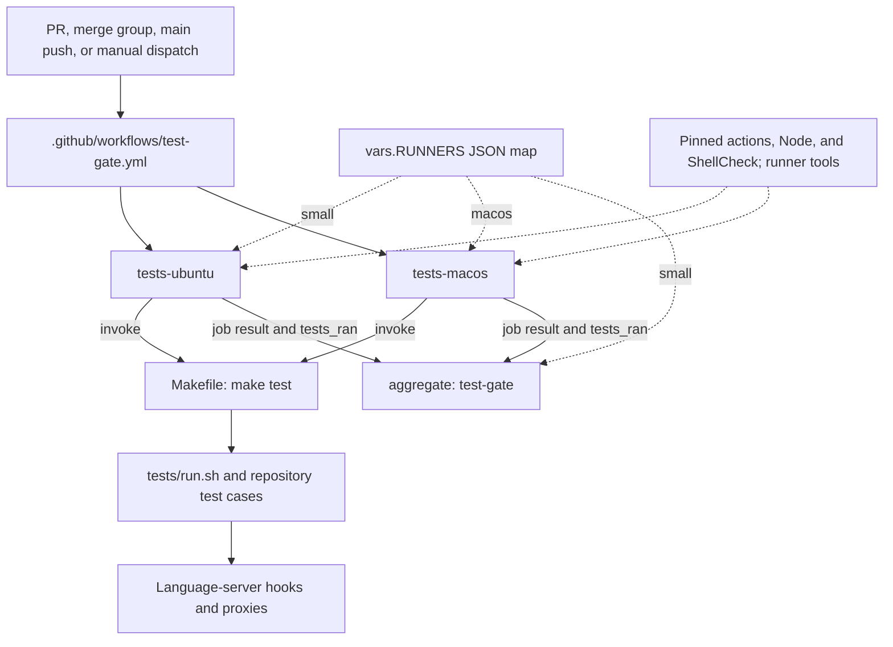
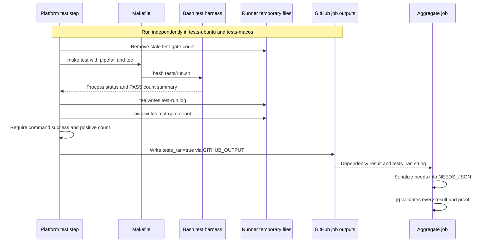
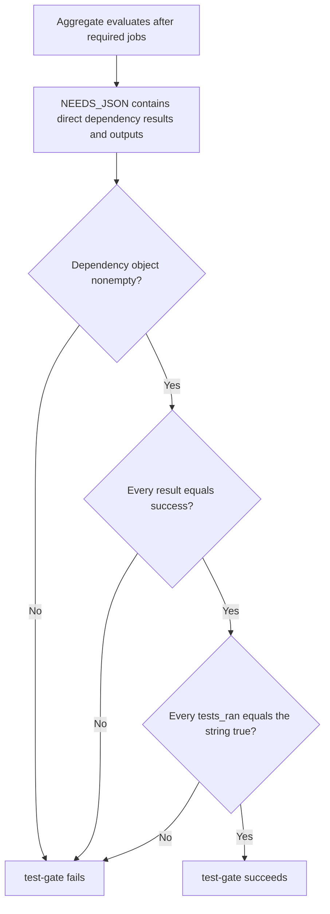

# Continuous Integration Test Gate

The `continuous_integration_test_gate` module implements the repository-local
GitHub Actions test gate in `.github/workflows/test-gate.yml`. It runs the
repository test suite independently on Linux and macOS, verifies that each
successful run executed a nonzero number of tests, and publishes one aggregate
check named `test-gate`.

The workflow header identifies this as the canonical gate for Rubio standards
ADR-0020, replacing the retired bespoke `test.yml`. Its central contract is
**successful execution plus positive execution proof from both platform jobs**,
not merely a green command exit status.

## Responsibilities and system boundaries

- [Continuous integration](../continuous_integration.md) describes the other
  workflows and organization-level validation boundaries. This gate depends
  only on its two platform jobs, not on the cloud smoke, standards, or Copilot
  setup workflows.
- The
  [validation entry points](../repository_build_and_configuration/repository_build_and_configuration_validation_entry_points.md)
  module owns `Makefile`, the canonical test command, and the harness interface.
  This page documents how CI provisions tools, invokes that interface, and
  validates its results rather than duplicating individual test cases.
- [Development environment bootstrap](../development_environment_bootstrap.md)
  owns mise and setup scripts. These test jobs provision their tools directly;
  they do not run the cloud bootstrap chain or invoke a mise task.
- [Language intelligence integration](../../language_intelligence_integration.md)
  documents the language-server hooks and proxies that the repository tests
  validate.

The workflow does not build or publish an application package, deploy
artifacts, or configure repository rulesets. It supplies the `test-gate`
check; whether that check is required for merging is configured outside this
file.

## Architecture and component relationships

The three core job components live in the same workflow file:

| Job ID | Display name | Responsibility |
| --- | --- | --- |
| `tests-ubuntu` | `tests / ubuntu-24.04` | Linux suite and execution proof. |
| `tests-macos` | `tests / macos` | macOS suite and execution proof. |
| `aggregate` | `test-gate` | Validate both dependency results and proofs. |



The shared Make and harness nodes represent a common interface, not a shared
execution: each platform job has its own checkout, test run, temporary files,
and output. Neither platform job depends on the other, so they are eligible
to run in parallel.

The workflow deliberately uses explicit jobs rather than `strategy.matrix`.
Its header records that the gate contract forbids matrices because an
unstarted matrix leg must not disappear into an apparently successful result.
Both required job IDs are explicitly listed in `aggregate.needs`.

Source: `.github/workflows/test-gate.yml`.

## Events, permissions, and concurrency

The workflow is named `test-gate` and subscribes to:

- `pull_request`, without branch or path filters in this file.
- `merge_group`, allowing the gate to validate merge-queue candidates.
- `push` to the `main` branch only.
- `workflow_dispatch`, for manual runs.

There are no event-specific conditions on either platform job. Every triggered
run uses the same two-job execution contract. Other branch pushes do not
trigger this workflow solely through the configured `push` event.

The workflow sets `permissions: contents: read` for `GITHUB_TOKEN`. It declares
no write-permission override or explicit secret inputs. Tests and aggregation
do not need repository write access.

Concurrency combines `github.workflow` with
`github.event.pull_request.number`, falling back to `github.sha` when there is
no PR number. With `cancel-in-progress: true`:

- A newer run for the same PR supersedes an active run in the same group.
- Non-PR runs for different commit SHAs have different groups; this is not
  blanket cancellation of all older runs on a branch.
- Runs sharing the same workflow name and fallback SHA can share a group.

`if: always()` on the aggregate does not make the workflow immune to this
cancellation policy. A cancelled run is not a successful execution proof.

Source: `.github/workflows/test-gate.yml`.

## Runner and toolchain contract

### Runner routing

Runner selection evaluates the JSON map in `vars.RUNNERS` using
`fromJSON(vars.RUNNERS || '{}')`. The workflow comments describe this as an
organization-level routing mechanism so the fleet can move between hosted
and self-hosted pools without changing each job.

- `tests-ubuntu` and `aggregate` select `.small`, falling back to
  `fromJSON('["ubuntu-slim"]')` when that route is absent or falsey.
- `tests-macos` selects `.macos`, falling back to
  `fromJSON('["macos-26"]')` when that route is absent or falsey.
- An absent or empty `RUNNERS` variable becomes an empty JSON object. Invalid
  nonempty JSON cannot be rescued by the per-key fallback.
- Every job has `timeout-minutes: 15`. These are per-job execution limits,
  not a single timeout for the complete workflow.

The Linux display name `tests / ubuntu-24.04` is not the runner selector.
The actual default route is `ubuntu-slim`, and an organization override can
select a different compatible pool. Diagnose runner problems from `runs-on`
and the resolved runner, not from the job's display name.

### Common preparation

Both platform jobs perform these steps before running tests:

- Check out the repository with `actions/checkout`.
- Install Node.js `24.22.0` with `actions/setup-node`.
- Download and install ShellCheck `v0.10.0` from its GitHub release.
- Verify or provide `jq` according to the platform-specific policy below.
- Print Bash, Node, jq, and ShellCheck versions for diagnosis.

The checkout and setup-node action references are pinned to full commit SHAs
and annotated as `v7` in the workflow. Node is pinned to an exact patch
version, and ShellCheck is pinned to avoid newly introduced diagnostics
changing the result without a repository change.

Bash and jq are not version-pinned here. The runner also needs `make`, the
shell utilities used by the workflow, archive extraction support, and network
access for action setup and ShellCheck downloads. `tests/run.sh` separately
checks that `node`, `bash`, `jq`, and `shellcheck` are on `PATH` before it loads
cases.

Node V8 coverage collection is enabled inside `tests/run.sh`; the coverage
case in `tests/cases/99-coverage.sh` runs as part of the suite, not as a
separate Actions job. The fixed Node version supports repeatable coverage
behavior.

The CI Node pin is independent of the `24.21.0` pin in `.mise.toml`. A locally
provisioned mise environment is therefore not automatically identical to CI.
See the
[bootstrap documentation](../development_environment_bootstrap.md)
for local provisioning rather than adding setup behavior to the Make target.

### Platform-specific preparation

On Linux, the ShellCheck archive is `linux.x86_64`. The workflow installs its
binary with mode `0755` into `$RUNNER_TEMP/bin` and appends that directory to
`$GITHUB_PATH`. The selected pool must be compatible with that binary.

Linux verifies preinstalled jq with `jq --version`; it does not install jq.
The aggregate also uses the `.small` route and requires jq already present,
but performs no checkout, tool setup, or version-printing step of its own.
Tool installation in a test job does not provision another job's runner.

On macOS, the ShellCheck archive is `darwin.x86_64`. The workflow moves the
binary into `$RUNNER_TEMP/bin`, makes it executable, and updates
`$GITHUB_PATH`. On arm64 runners, the pinned binary requires Rosetta. Using a
runner-writable prefix avoids assuming passwordless sudo or a writable
`/usr/local/bin` on self-hosted machines.

The macOS jq step follows this conditional policy:

- If `jq` is already on `PATH`, keep it and report its location.
- Otherwise, if Homebrew is available, run `brew install jq`.
- If both are missing, fail with
  `jq is missing and Homebrew is unavailable on this runner`.

Sources: `.github/workflows/test-gate.yml`, `tests/run.sh`,
`tests/cases/99-coverage.sh`, `.mise.toml`.

## Execution proof and data flow

### Canonical invocation

Each job's test step has ID `test` and invokes `make test` from the checked-out
repository root. `Makefile` declares a phony `test` target that dispatches to
`bash tests/run.sh`.

The Makefile header explains why CI uses the adapter: the canonical gate's
recognized-command allowlist accepts `make test`, not a direct
`bash tests/run.sh` invocation. This repository is not a root npm package.
Keep test implementation in the harness; details of local task alternatives
and harness discovery belong in the
[validation entry points documentation](../repository_build_and_configuration/repository_build_and_configuration_validation_entry_points.md).

### Per-platform proof construction

Both platform jobs use the same test-step logic. The environment variable
`RUBIO_TEST_GATE_COUNT_OUTPUT` points to
`${{ runner.temp }}/test-gate-count`. With only a line continuation added for
readability, the commands are:

```bash
set -euo pipefail
rm -f "$RUBIO_TEST_GATE_COUNT_OUTPUT"
make test | tee "$RUNNER_TEMP/test-run.log"
awk '/^PASS: [0-9]+ tests/{print $2}' \
  "$RUNNER_TEMP/test-run.log" > "$RUBIO_TEST_GATE_COUNT_OUTPUT"
test -s "$RUBIO_TEST_GATE_COUNT_OUTPUT"
test "$(cat "$RUBIO_TEST_GATE_COUNT_OUTPUT")" -gt 0
echo "tests_ran=true" >> "$GITHUB_OUTPUT"
```

These commands establish a chain of evidence:

- **Successful command:** `set -euo pipefail` prevents `tee` from hiding a
  failing `make test`. If the pipeline fails, the step stops before emitting
  proof.
- **Fresh output:** Removing the count file before execution prevents an old
  count from satisfying the check on a reused runner. `tee` writes the current
  run's stdout to `$RUNNER_TEMP/test-run.log` while preserving console output.
- **Executed count:** The harness framework prints
  `PASS: <n> tests, 0 failures` after a successful suite. `awk` extracts the
  second field from lines matching `^PASS: [0-9]+ tests` and writes the count
  file. The workflow, not the harness, writes this file.
- **Nonempty execution:** `test -s` rejects a missing summary's empty count
  file. The integer comparison rejects a zero count. The expected interface
  is one matching summary; multiple matches produce a multiline value that
  does not satisfy the integer check.
- **Published proof:** Only after all checks pass does the step append
  `tests_ran=true` to `$GITHUB_OUTPUT`. The job exposes that value through
  `outputs.tests_ran: ${{ steps.test.outputs.tests_ran }}`.

The parser checks the summary prefix and numeric count, not the complete
`0 failures` suffix. Correct failure reporting still depends on the harness
returning a nonzero status for failures. `tests/lib/framework.sh` supplies
that status and the summary format.



The diagram shows the successful hand-off. Failures before proof publication
leave the job without a `tests_ran` output equal to `"true"` and cannot satisfy
aggregation.

### Data lifetime and observability

- `$RUNNER_TEMP/test-run.log` holds test-command stdout, not a merged
  stdout/stderr stream. Other diagnostics can still appear in the Actions
  console without being present in this file.
- `$RUNNER_TEMP/test-gate-count` holds the extracted count for the local test
  step. The workflow does not forward the numeric count to the aggregate.
- `tests_ran` is an Actions output string, not a JSON Boolean. The aggregate
  compares it with the string `"true"`.
- `NEEDS_JSON` is the aggregate's environment variable containing
  `${{ toJSON(needs) }}`. It includes each directly required job's result and
  exposed outputs; no runner-local files are transferred.
- There is no artifact-upload step. These temporary files are not published
  as durable workflow artifacts. Harness-owned `tests/tmp/` data has its own
  cleanup lifecycle, described in the validation entry points documentation.

Sources: `.github/workflows/test-gate.yml`, `Makefile`, `tests/run.sh`,
`tests/lib/framework.sh`.

## Aggregate contract

The aggregate job has the display name `test-gate`, uses `if: ${{ always() }}`,
and declares `needs: [tests-ubuntu, tests-macos]`. This lets it evaluate the
dependency results even when a platform job failed or was skipped, rather
than allowing the normal success-only dependency condition to skip the
aggregate automatically.

Its only step runs this assertion:

```bash
jq -e 'length > 0 and all(.[]; .result == "success" and
  .outputs.tests_ran == "true")' <<<"$NEEDS_JSON"
```

The conditions have distinct purposes:

- `length > 0` rejects an empty dependency object. This is not a test-count
  assertion; positive counts were checked separately in each platform job.
- Every dependency must have `.result == "success"`.
- Every dependency must also have `.outputs.tests_ran == "true"`.
- `jq -e` turns a false assertion into a failing command exit status.



A `failure`, `skipped`, or `cancelled` dependency result is rejected. A
successful job with a missing, empty, false, or incorrectly typed proof is
also rejected. Both platform jobs must satisfy the predicate for the gate to
succeed.

The jq expression does not assert the exact number or names of dependencies.
The two-platform guarantee also depends on preserving the explicit `needs`
list. Removing a required platform from that list weakens the contract even
if the remaining dependencies satisfy jq.

`always()` is an evaluation policy, not a promise that the aggregate can
finish after whole-workflow cancellation, runner unavailability, invalid
routing configuration, or failure to start its runner.

Source: `.github/workflows/test-gate.yml`.

## What a green gate proves

A green aggregate proves that both declared platform jobs completed
successfully and each reported a positive executed-test count through the
configured proof path. It does not prove that:

- Both platforms executed the same number of tests. Counts are not compared
  or exposed to the aggregate.
- Every optional live-server scenario ran. `tests/cases/08-live.sh` registers
  those scenarios only when their language-server binaries are on `PATH`.
  The workflow does not install those servers, and the skip-report case can
  pass when they are absent.
- A known minimum suite size or fixed test inventory was met. The count
  assertion is only greater than zero.
- Separate cloud setup, standards automation, formatting, or organization
  governance checks passed. They are not dependencies of this aggregate.

Optional live-server provisioning belongs in
[Development environment bootstrap](../development_environment_bootstrap.md),
and server-specific behavior belongs in
[Language intelligence integration](../../language_intelligence_integration.md).

Sources: `.github/workflows/test-gate.yml`, `tests/cases/08-live.sh`.

## Failure modes and diagnosis

Start with the first failing step in the relevant platform job, then inspect
the aggregate only if both platform results and proof publication need
verification.

- **Runner cannot be selected or started:** Check `vars.RUNNERS` JSON, the
  selected key, matching labels, and runner availability. The display name is
  not evidence of the actual operating system or image.
- **Tool preparation fails:** Check the ShellCheck download and extraction,
  writable `$RUNNER_TEMP/bin`, and `$GITHUB_PATH` update. On macOS arm64,
  verify Rosetta; on Linux and the aggregate, verify preinstalled jq.
- **macOS cannot provide jq:** Either preinstall jq on the selected runner or
  provide working Homebrew. The workflow deliberately fails when neither is
  available instead of assuming a hosted image.
- **The suite fails:** Inspect the test output and its failing-case logs in
  the Actions console. `pipefail` means a successful `tee` is not enough to
  make this step pass.
- **The command succeeds but the proof check fails:** Inspect the stdout
  summary and parser compatibility. A missing summary, zero count, or
  multiple matching summaries prevents publication of `tests_ran=true`.
- **The aggregate fails despite successful test commands:** Check the job
  results and the exposed `tests_ran` outputs, not just the command logs.
  Confirm the test step still has ID `test` and the job output mapping still
  points to it. The aggregate runner itself must also have jq.
- **The run is cancelled or times out:** Check concurrency supersession and
  the per-job 15-minute timeout. Neither condition supplies successful proof;
  a new run must satisfy the complete contract.

For a local reproduction, use the CI Node and ShellCheck versions, verify jq
and Bash availability, then run `make test` from the repository root. See
[validation entry points](../repository_build_and_configuration/repository_build_and_configuration_validation_entry_points.md)
for developer commands and harness diagnostics, and
[bootstrap](../development_environment_bootstrap.md)
for provisioning. Local command success alone does not perform the workflow's
positive-count and two-platform aggregation checks.

## Maintenance contract

Preserve these invariants when changing `.github/workflows/test-gate.yml`:

- Keep required platforms as explicit jobs; do not reintroduce a matrix.
- List every required platform job in `aggregate.needs`. Add a new platform's
  full execution-proof path before treating it as covered by the gate.
- Keep the canonical `make test` invocation and the Make target as a thin
  dispatcher to the harness.
- Preserve strict pipeline failure propagation and publish proof only after
  successful, positive-count execution. Do not substitute an unconditional
  output or a step that can succeed without running tests.
- Keep `tests_ran`, the `test` step ID, job output mappings, and the aggregate
  string comparison consistent across both platform jobs.
- Coordinate changes to `tests/lib/framework.sh` success-summary formatting
  with both workflow parsers.
- Retain the nonempty-dependency guard, the successful-result check, and the
  proof check in the aggregate. Neither job status nor proof alone is enough.
- Update shared tool pins consistently across platforms, retain SHA-pinned
  action references, and validate runner architecture and jq prerequisites
  whenever routing changes.
- Keep token permissions read-only unless a separately justified workflow
  responsibility requires more access.

## Source references

- `.github/workflows/test-gate.yml`: events, concurrency, permissions, runner
  routes, tool installation, proof construction, outputs, and aggregation.
- `Makefile`: canonical gate-recognized test command and harness dispatch.
- `tests/run.sh`: tool preflight, test discovery, coverage environment, and
  harness invocation.
- `tests/lib/framework.sh`: executed-test count, success-summary format, and
  failure exit status consumed by CI.
- `tests/cases/08-live.sh`: conditional live-server test registration.
- `tests/cases/99-coverage.sh`: coverage validation within the suite.
- `.mise.toml`: independent local Node pin and environment configuration.
