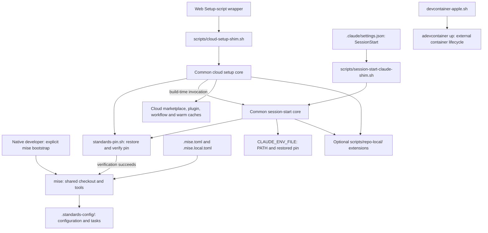
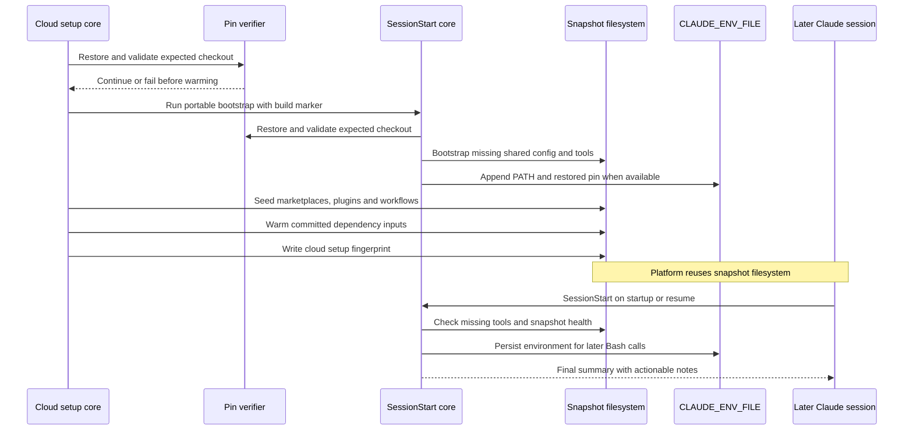

# Development Environment Bootstrap

## Purpose and scope

The `development_environment_bootstrap` module prepares the development
platform for `claude-lsps`: the shared standards checkout, pinned developer
tools, Claude Code session environment, and reusable cloud snapshot state.
It also supplies a guarded launcher for Apple-silicon devcontainers.

This is infrastructure for a plugin marketplace, not an application build
pipeline. The Node proxies have no npm dependencies, but running their
language servers and optional live tests requires separate server binaries.
Toolchain provisioning and language-server installation are distinct steps.

Sources: `.mise.toml`, `.mise.local.toml`, `scripts/common/cloud-setup.sh`,
`scripts/common/session-start-claude.sh`, `scripts/devcontainer-apple.sh`.

## Place in the system

- [Engineering platform and validation](../engineering_platform_and_validation.md)
  describes the surrounding engineering platform.
- [Repository build and configuration](repository_build_and_configuration.md)
  consumes the shared configuration and tools provisioned here. It owns Git
  hook composition, formatting policy, compiler configuration, and `make test`.
- [Continuous integration](continuous_integration.md) owns workflow triggers,
  runner provisioning, the cloud smoke job, and test-gate aggregation.
- [Language intelligence integration](../language_intelligence_integration.md)
  owns the language-server installers and proxy behavior. This module's
  `live-setup` task calls those installers without reimplementing them.

## Architecture

The implementation separates stable entry points, generated common logic,
repository-owned extensions, and external shared configuration. Cloud setup
runs before Claude Code launches when a snapshot is built. SessionStart runs
on every matching startup or resume, locally and remotely, and reuses the
same portable mise bootstrap path.



The pin node is a validation boundary, not an unconditional cloning step.
With neither `STANDARDS_PIN` nor a provisioner record, pin restoration returns
without enforcing a revision and `.mise.toml` defaults to `main`. Trusted
provisioning is a separate, explicit operation.

Sources: `.mise.toml`, `.claude/settings.json`, both shim scripts,
`scripts/common/standards-pin.sh`, both common setup cores.

## Sub-module guide

SUB_MODULE_GUIDE_PENDING

## Configuration and ownership

- `.mise.toml` requires mise `2026.10.19` or newer and pins Node to `24.21.0`.
  Shared tool pins and task definitions come from `.standards-config/`.
- Missing shared mise fragments resolve to `.config/mise-bootstrap.toml`, an
  empty local fragment. Entering a cold checkout does not fetch shared config;
  the `enter` hook prints an explicit bootstrap instruction instead.
- `.mise.local.toml` adapts shared tasks to this dependency-free proxy
  repository: `setup:ts` is a no-op, `lint:ts` runs Biome, and `test:ts` runs
  `bash tests/run.sh`. `live-setup` installs external LSP servers separately.
- The shim paths are frozen consumer entry points. Their missing-core paths
  warn and exit successfully; they otherwise `exec` the common core.
- `scripts/common/` and `.config/mise-bootstrap.toml` are generated standards
  files. Change their upstream templates and update through Copier rather
  than editing the generated consumer copies.
- Repository-specific setup belongs in the optional, committed
  `scripts/repo-local/cloud-setup.sh` or
  `scripts/repo-local/session-start-claude.sh`. Neither extension is present
  in the inspected script tree.
- `scripts/devcontainer-apple.sh` is generated and has no per-repository
  override. `.mise.toml` permits repository additions; its header describes
  Copier merging those additions.

The shared checkout is a Git dependency, not a committed mise lockfile. The
manifest deliberately leaves `settings.lockfile` unset and documents that
`mise.lock` must not be committed. The Copier template version is separate
from the runtime standards revision selected by `STANDARDS_PIN` or `main`.
See [Toolchain configuration and pins](development_environment_bootstrap/development_environment_bootstrap_toolchain_and_pins.md) for include paths,
local task behavior, and revision management.

Sources: `.mise.toml`, `.mise.local.toml`, `.config/mise-bootstrap.toml`,
`.copier-answers.yml`, script ownership headers.

## Native development workflow

Install a compatible mise version using your normal developer provisioning
process and ensure Git can read the standards repository. From the repository
root, trust the configuration and explicitly provision both repositories and
tools:

```sh
mise trust
mise bootstrap --only repos,tools --yes
mise exec -- make test
```

A plain `mise install` is not the cold-checkout bootstrap: it does not replace
provisioning the shared repository. When `CI` is empty, the manifest's
`postinstall` hook runs `mise exec -- lefthook install`; a nonempty `CI` skips
that hook-install command. The shared checkout's `post-repos` hook runs
`mise bootstrap repos status --missing`.

The canonical test command remains `make test`, which dispatches to the Bash
harness. The local `test:ts` override provides a mise task for that harness;
it does not turn the repository into an npm package. See
[Repository build and configuration](repository_build_and_configuration.md)
for validation entry-point contracts.

For optional real-server scenarios, run the explicit live setup first:

```sh
mise run live-setup
PATH="$HOME/.local/bin:$PATH" mise exec -- make test
```

`live-setup` calls the Pyright, Bash, vtsls, CUE, and Regal checks in that order
under `set -e`. Its PATH addition is local to the task; CUE and Regal fallback
binaries under `~/.local/bin` must also be reachable when tests run later.
Missing server binaries cause the live-case registration to skip those
scenarios, so a passing nonempty suite is not proof of complete live coverage.

Sources: `.mise.toml`, `.mise.local.toml`, `Makefile`, `tests/run.sh`,
`tests/cases/08-live.sh`. Installer details belong to the
[language-server documentation](../language_intelligence_integration.md).

## Standards trust boundary

Both common setup cores restore and verify the expected standards pin before
ordinary mise bootstrap. When a pin is supplied or recovered from a workspace
record, verification requires:

- A nonempty, 40-character lowercase hexadecimal SHA.
- A real `.standards-config/` clone, not a checkout-directory symlink or a
  worktree-style `.git` file.
- The exact credential-free origin
  `https://github.com/Rubio-Enterprises/standards.git`.
- A non-shallow checkout at the expected HEAD, with no changes reported by
  Git status, including untracked files.
- Agreement between an explicitly set environment pin and any existing
  provisioner record. An explicitly empty pin is invalid, not unset.

The trusted `standards_provision_pin` path independently resolves remote
`main`, stages a full clone, validates it, replaces a valid previous checkout
with rollback protection, and writes a workspace-scoped record. It requires
the trusted setup environment's read-only `GH_PAT`; restoration itself does
not fetch, repair, or choose a new pin.

The cloud core exposes this path through `--provision-standards`. Invoke that
core directly for explicit provisioning: the frozen shims do not forward
arguments. The embedded web wrapper calls the cloud shim without this flag,
so merely copying the wrapper does not establish an independent pin record.
Do not describe default wrapper execution as trusted pin provisioning.

The [toolchain and pin guide](development_environment_bootstrap/development_environment_bootstrap_toolchain_and_pins.md) documents the individual helper
functions, transactional provisioning sequence, and recovery boundaries.

Sources: `scripts/common/standards-pin.sh`,
`scripts/common/cloud-setup.sh`, `scripts/cloud-setup-shim.sh`.

## Cloud snapshot and session handoff

The cloud core is intended for the root Ubuntu snapshot-build environment.
Portable toolchain work stays in the SessionStart core so local and remote
sessions follow the same implementation. Cloud setup calls it with
`CLAUDE_CODE_REMOTE=true` and `CLOUD_SETUP_BUILD=1`, then prepares marketplace
clones and registry entries, installs enabled plugins in user scope, seeds
opted-in workflows, and performs manifest-gated dependency warming.



### Persisted state

Two records serve different purposes and use different keys:

- The provisioner pin record is under
  `${XDG_STATE_HOME:-$HOME/.local/state}/standards/cloud/`. Its filename is the
  Git object hash of the canonical physical workspace path, followed by
  `.pin`. It is used for pin verification, not snapshot freshness.
- The snapshot marker is
  `${XDG_CACHE_HOME:-$HOME/.cache}/<checkout-basename>/cloud-setup.built`. It
  contains `epoch` and `sha256` fields. The hash covers the concatenated cloud
  shim and common cloud core, in that order; it does not cover every setup
  input or the repo-local extensions.

Marketplace state lives under `~/.claude/plugins/`; opted-in workflow payloads
are copied into `~/.claude/workflows/`. These caches are separate from the
workspace standards clone. Session PATH changes, and a restored pin when
present, are appended to `CLAUDE_ENV_FILE` because exports in a hook process
do not persist to later Bash calls.

Sources: both common setup cores, `scripts/common/standards-pin.sh`.

### Authentication and cache refresh

Use the marked thin wrapper embedded in `scripts/common/cloud-setup.sh` for
the web Setup-script field, not the entire common core. It locates the shim
without assuming the UI's working directory. The implementation expects
private-dependency credentials in that build-time wrapper, not in the
sessions-only environment-variable field. Keep real credentials out of
committed files and logs, and restrict the read-only token's repository scope.

Cloud credential helpers are keyed to discovered repository URLs rather than
an entire host or organization. This limits scope but does not universally
exclude the working repository: `.claude/settings.json` declares
`Rubio-Enterprises/claude-lsps` itself as a marketplace. Review discovered
scopes when diagnosing working-repository authentication. The standards
reader uses a separate command-local helper that reads `GH_PAT` at runtime.

A SessionStart drift note asks the operator to bump `CACHE_EPOCH` in the web
wrapper and re-save it. The source documents snapshot invalidation on wrapper
text or allowed-network-host changes, or approximately seven-day expiry;
repository script edits alone do not force a rebuild. Health checks also
report missing marketplaces, uncached enabled plugins, and missing workflow
filenames. They are diagnostics, not automatic cache repair or full content
verification.

See [Cloud setup and snapshot caching](development_environment_bootstrap/development_environment_bootstrap_cloud_setup.md) for transport restrictions,
plugin installation, workflow collision handling, and smoke-mode coverage.
See [Session startup and environment persistence](development_environment_bootstrap/development_environment_bootstrap_session_startup.md) for readiness
checks and the final context line.

Sources: `.claude/settings.json`, `scripts/common/cloud-setup.sh`,
`scripts/common/session-start-claude.sh`.

## Apple-silicon devcontainer launcher

`scripts/devcontainer-apple.sh` is an independent launcher, not an alternate
implementation of the cloud snapshot builder. It requires all of the
following before delegating:

- `uname -s` reports `Darwin` and `uname -m` reports `arm64`.
- Apple's `container` CLI and `adevcontainer` are already on PATH.
- `adevcontainer doctor` succeeds.

The script does not install those tools or start the runtime automatically.
If the doctor fails, its error suggests starting the runtime explicitly:

```sh
container system start
bash scripts/devcontainer-apple.sh
```

The launcher derives the workspace from its own path and replaces itself
with `adevcontainer up -w "$repo_root" "$@"`. Additional arguments are passed
through unchanged. Platform, missing-command, and doctor failures exit with
status 1. Container configuration and the actual container lifecycle remain
responsibilities of `adevcontainer` and its environment; the launcher does
not define a container image or provision the mise checkout itself.

Source: `scripts/devcontainer-apple.sh`.

## Failure semantics and validation

The most important distinction is between required verification and optional
warming:

- Pin, checkout, and required repository-status failures are fatal in the
  common cores. The cloud core also rejects unsupported arguments with status
  2. The shims use `exec`, so they do not suppress these core exit statuses.
- Missing common-core files are graceful shim no-ops. Ordinary toolchain and
  cache-warming failures are generally warnings; repo-local session failures
  are ignored, and cloud repo-local failures are warned about.
- `CLOUD_SETUP_SMOKE=warm` skips portable toolchain bootstrap and runs warming
  and the cloud repo-local extension. `CLOUD_SETUP_SMOKE=1` also invokes the
  SessionStart core. Recorded warming failures become a final nonzero result.
- Smoke skips apt, marketplace setup, plugin materialization, workflow
  seeding, and fingerprint writing. It is not an end-to-end cloud-plugin test.
  The SessionStart subprocess status is ignored, and this rendered Node warm
  has no missing-tool assertion, so a green smoke result is not independent
  proof that every declared tool installed successfully.
- The final SessionStart readiness text is a summary, not an installation
  attestation. Check warnings and actual commands when diagnosing missing
  tools. The normal path deliberately tolerates bootstrap failures.

The consumer smoke workflow is
`.github/workflows/cloud-setup-smoke.yml`; it is paths-filtered and also
manually dispatchable, not an unconditional required check. The ordinary
suite in `.github/workflows/test-gate.yml` uses its own tool installation and
Node pin (`24.22.0`), not the manifest's `24.21.0`. Do not assume CI and native
setup are byte-identical environments. Workflow details belong to
[Continuous integration](continuous_integration.md).

For recovery, use the detailed guide matching the failed boundary: shared
checkout and revision issues in [Toolchain configuration and pins](development_environment_bootstrap/development_environment_bootstrap_toolchain_and_pins.md),
snapshot or plugin issues in [Cloud setup](development_environment_bootstrap/development_environment_bootstrap_cloud_setup.md), and missing session
PATH or health notes in [Session startup](development_environment_bootstrap/development_environment_bootstrap_session_startup.md). Preserve a failing
pin gate rather than bypassing it with a best-effort warm command.

Sources: both shim scripts, both common setup cores,
`scripts/common/standards-pin.sh`, `.github/workflows/cloud-setup-smoke.yml`,
`.github/workflows/test-gate.yml`.
