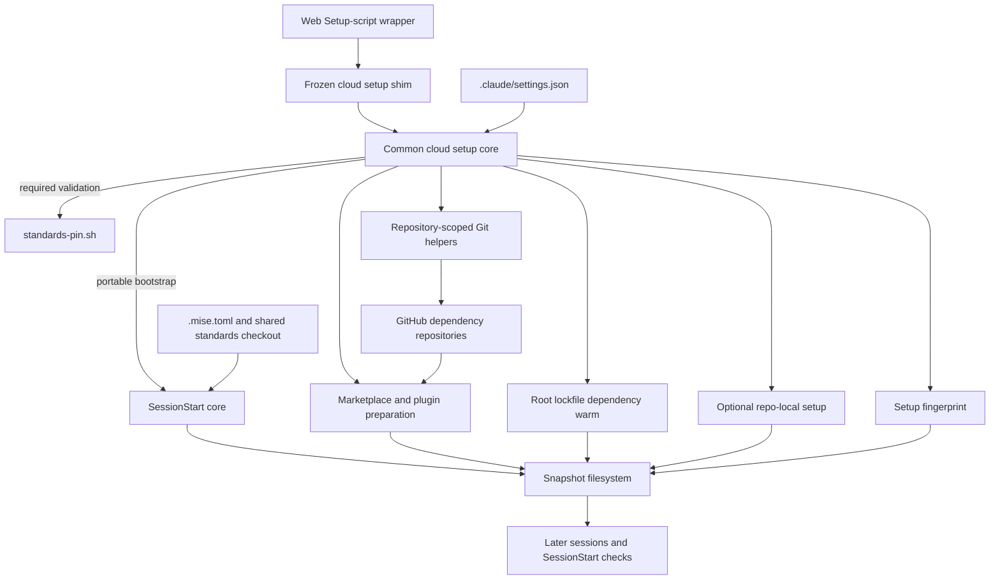
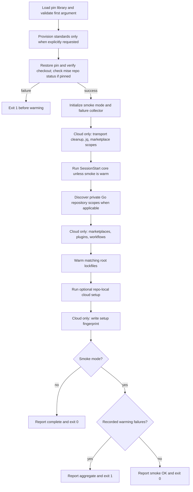
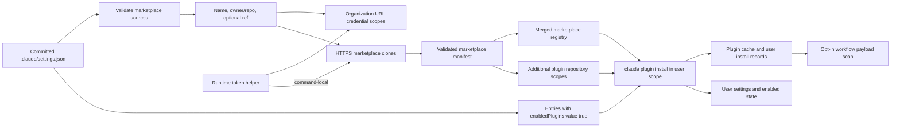
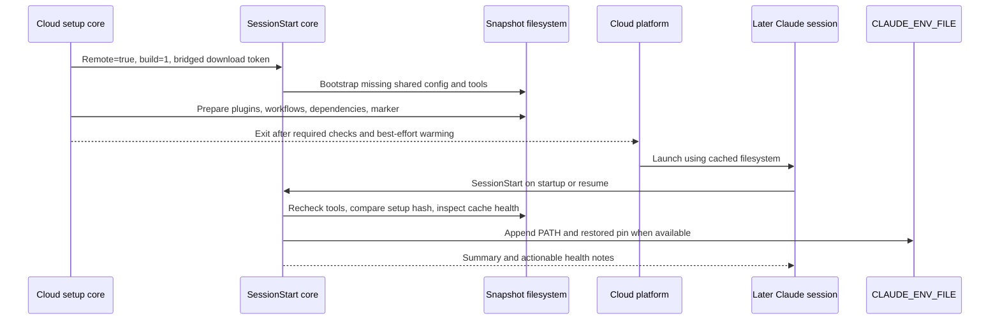

# Development Environment Bootstrap: Cloud Setup

The `development_environment_bootstrap_cloud_setup` module prepares the
reusable filesystem snapshot for Claude Code on the web. It runs the portable
developer-tool bootstrap, prepares marketplace and plugin state, seeds
opted-in workflows, and warms dependencies before a cloud session launches.
Later sessions reuse that filesystem rather than repeating the entire build.

Its central contract has two parts: **standards pin verification is
mandatory**, while ordinary dependency and cache warming is **best-effort**.
CI smoke mode turns recorded warming failures into a final failure status;
it does not make every installation or cloud integration independently
verifiable.

## Scope and ownership

The implementation separates a stable entry point from evolving shared logic:

- `scripts/cloud-setup-shim.sh` is the frozen consumer entry point. The
  standards template preserves it with `_skip_if_exists` after rendering.
  It locates the common core and replaces itself with that process.
- `scripts/common/cloud-setup.sh` contains the setup implementation and an
  embedded, ready-to-copy web wrapper. It is generated from
  `Rubio-Enterprises/standards`, not a repository-local customization surface.
  Change the upstream template and update through Copier.
- `scripts/repo-local/cloud-setup.sh` is the optional, committed,
  repository-owned extension. It runs after the common warming work and is
  never rendered by the template. It is absent from the inspected script tree.

This page owns snapshot preparation and its operational contract. Related
responsibilities remain in their respective modules:

- [Development environment bootstrap][bootstrap-doc] explains the overall
  bootstrap architecture and the separate devcontainer launcher.
- [Toolchain and pins][toolchain-doc] documents mise configuration, standards
  checkout validation, trusted provisioning, and repository task overrides.
- [Session startup][session-doc] owns per-session environment persistence and
  snapshot-health diagnostics.
- [Continuous integration][ci-doc] owns workflow orchestration and runners.
- [Language intelligence integration][language-doc] owns language-server
  installation and LSP proxy behavior. Snapshot setup is not an LSP protocol
  implementation or a guarantee that every server binary is installed.

Sources: `scripts/cloud-setup-shim.sh`, `scripts/common/cloud-setup.sh`,
`.mise.local.toml`.

## Architecture and dependencies

Cloud setup is intended for the root Ubuntu snapshot-build environment. It
runs before Claude Code launches when the platform needs a new environment
snapshot, not on every startup or resume. Portable toolchain work stays in the
SessionStart core so cloud and local sessions share one implementation.



The arrows show responsibilities and dependencies; the execution order is
specified below. Important external interfaces are:

- Bash, Git, and standard Linux utilities provide discovery, cloning,
  hashing, copying, and process timeouts.
- `jq` parses marketplace configuration and registry state. Setup installs it
  through apt only when it is missing, and waits for that attempt before
  marketplace discovery. Failure does not broaden credential scopes.
- The SessionStart core uses mise to provision the shared configuration and
  developer tools. With an active standards pin, mise must already resolve on
  the setup process's PATH for the earlier repository-status check.
- The `claude` CLI materializes enabled plugins using its own installer.
  `timeout` limits each plugin install to 60 seconds.
- `.claude/settings.json` is the committed configuration carrier for
  marketplace declarations and enabled plugins.

The source targets a build time under roughly five minutes, but implements
no overall deadline. Per-plugin timeouts do not impose a total build limit,
and the apt fallback is awaited before subsequent work.

Sources: `scripts/common/cloud-setup.sh`,
`scripts/common/session-start-claude.sh`, `.mise.toml`,
`.claude/settings.json`.

## Entry points and deployment

### Installing the web wrapper

Copy only the text between the two `8<` COPY markers in
`scripts/common/cloud-setup.sh` into the web environment's **Setup script**
field. Do not paste the entire common core or assume that the web wrapper
starts in the repository root.

The marked wrapper is stored inside an inert, quoted heredoc consumed by
`:`. Running the common script does not execute that embedded wrapper:
its sample `CACHE_EPOCH` and `GH_PAT` assignments do not become runtime
configuration unless the copied wrapper supplies them.

The wrapper locates the shim in this order:

- Check `CLAUDE_PROJECT_DIR`, when nonempty, and then the current directory.
  In each location, check both `scripts/` and `Scripts/`.
- Search `/home`, `/root`, and `/workspace`, to a maximum depth of five,
  for a matching shim under a scripts directory. Use the first match.
- If none is found, emit a warning and finish successfully, leaving portable
  bootstrap to the SessionStart hook.

After discovery, it changes to the checkout and executes the shim. The shim
resolves its root one directory above its own location; the common core
resolves it two directories above `scripts/common/`. Both unset `CDPATH` so
shell directory-navigation configuration cannot contaminate root discovery.
The common core does not trust the caller's current directory as the root.

Source: both cloud setup scripts.

### Runtime inputs

The principal environment inputs are:

- `CACHE_EPOCH`: a diagnostic snapshot-generation label supplied by the web
  wrapper. Changing its assignment in the UI changes the wrapper text and
  therefore requests a rebuild; the Bash variable is not itself a platform
  cache-invalidation API.
- `GH_PAT`, `GH_TOKEN`, and `GITHUB_TOKEN`: runtime authentication inputs,
  with different precedence for dependency cloning and toolchain downloads.
- `STANDARDS_PIN`: an expected standards commit. Set-but-empty is invalid,
  not equivalent to unset. A provisioner record can also restore this value.
- `CLOUD_SETUP_SMOKE`: selects CI behavior. The documented values are `warm`
  and `1`; an unset or empty value selects normal cloud setup.
- `HOME` and `XDG_CACHE_HOME`: select user state and the snapshot-marker
  location. Pin records separately use `XDG_STATE_HOME`.
- `CLAUDE_ENV_FILE`: when available, lets the SessionStart core and pin
  restoration append environment exports for later Claude Bash calls.

The common core accepts no first argument, or `--provision-standards`.
An unsupported first argument exits with status 2. **The frozen shim does not
forward arguments**, and the embedded wrapper invokes it without arguments.
Consequently, copying the wrapper does not request trusted pin provisioning.

A trusted builder that deliberately provisions standards must invoke the
common core directly, with its read-only `GH_PAT` already exported:

```sh
export PATH="$HOME/.local/bin:$PATH"
bash scripts/common/cloud-setup.sh --provision-standards
```

This is a cloud setup operation, not a portable laptop installation command.
For pin selection, checkout replacement, rollback, and record details, see
[Toolchain and pins][toolchain-doc].

Sources: `scripts/common/cloud-setup.sh`, `scripts/cloud-setup-shim.sh`,
`scripts/common/standards-pin.sh`.

## Execution order and failure behavior

Once the repository root is resolved, the core follows this sequence:



Loading `scripts/common/standards-pin.sh` is mandatory, even if no pin is
active. `standards_restore_pin` returns without enforcing a revision when
neither an environment pin nor a provisioner record exists. Otherwise it
verifies the expected checkout before ordinary mise setup. It does not repair
an invalid checkout. With a restored or supplied pin, the core additionally
requires this command to succeed:

```sh
mise -C "$repo_root" bootstrap repos status --missing
```

The optional provisioner and required pin/status checks fail immediately;
they are not part of the later smoke failure collector. A missing pin library
also exits with status 1. If root resolution itself fails, the normal path
returns 0, but explicit provisioning or a set `STANDARDS_PIN` returns 1.

The core uses `set -uo pipefail`, without `set -e`. After the mandatory
gate, expected warming failures are guarded rather than allowed to stop
ordinary cloud setup. A shim that finds the core uses `exec`, so it preserves
fatal core statuses; the missing-core fallback is not a blanket suppression
of errors from a present core.

### Execution modes

| Behavior | Cloud | `warm` | `1` |
| --- | --- | --- | --- |
| Required pin gate | Yes | Yes | Yes |
| Portable bootstrap call | Yes | No | Yes |
| Cloud marketplace preparation | Yes | No | No |
| Workflow seeding | Yes | No | No |
| Node warm and repo-local tail | Yes | Yes | Yes |
| Snapshot fingerprint write | Yes | No | No |
| Recorded warming failure | Warn | Fail at end | Fail at end |

Both smoke levels skip apt, marketplace credential setup and pre-seeding,
plugin-cache materialization, workflow seeding, legacy URL-rewrite cleanup,
and snapshot fingerprint writing. The Go credential helper is a narrow
exception: smoke can register its scopes when a supported token is present.
Any nonempty smoke value other than `warm` currently follows the full
bootstrap path; values are not validated as an enumeration.

`__warn` emits `cloud-setup: <step> failed (non-fatal)` to stderr. In smoke
mode, it also appends the step name to a semicolon-separated failure list.
`__smoke_check_failed` supports missing-tool assertions at full smoke level,
but this rendered Node-only warming section has no calls to that function.
Unrecorded failures and skipped work are therefore not automatically detected.

Source: `scripts/common/cloud-setup.sh`.

## Authentication and transport boundaries

### Build credentials versus session credentials

The setup source documents that the web environment's **Environment
variables** field reaches sessions, not the snapshot build. Private dependency
access therefore expects `GH_PAT` to be exported in the copied Setup-script
wrapper. The committed wrapper contains a placeholder, not a usable token.

Use a narrowly scoped, read-only token with Contents access to the required
private repositories. Keep real credentials out of committed files, pasted
logs, and documentation. Environment editors can see the setup configuration;
its access controls are part of the credential boundary.

Do not put a replacement `GH_TOKEN` in the session environment field: the
source warns that this can overwrite the platform's working-repository token.
Public marketplace clones do not require a token.

There are three distinct credential paths:

- Dependency Git helpers resolve `GH_PAT`, then `GH_TOKEN`, then
  `GITHUB_TOKEN`, at credential-request time. Git configuration stores the
  literal helper expression, not the expanded token.
- The portable bootstrap child receives `GITHUB_TOKEN` selected from
  `GH_TOKEN`, then `GITHUB_TOKEN`, then `GH_PAT`, to authenticate GitHub
  release metadata requests used by mise backends.
- Trusted standards provisioning requires `GH_PAT`; the other token names
  are not substitutes for that provisioner's command-local reader helper.

The marketplace diagnostic reports only which token variable names are
nonempty, never their values. `auth tokens present at build: NONE` distinguishes
missing build-time credentials from credentials that GitHub rejects later.

Sources: `scripts/common/cloud-setup.sh`,
`scripts/common/standards-pin.sh`.

### Repository-scoped helpers

Helpers are written with `git config --global`, but their configuration keys
are scoped to specific repository URLs, not the whole host or organization.
Both bare and `.git` URL forms are registered. Discovery supplies three sets:

- Organization marketplace repositories from
  `.claude/settings.json` → `extraKnownMarketplaces`.
- Additional organization repositories referenced by enabled plugins whose
  marketplaces seeded successfully. Supported source objects include
  `github`, `url`, and `git-subdir` forms naming GitHub repositories.
- Organization repositories mentioned in root `go.mod` requirements and
  replacement targets. The parser handles block and single-line forms,
  strips comments, and reduces module subpaths to the repository root.

The Go scan collects textual `require` entries and right-hand-side `replace`
targets; it is not a complete Go module resolver. A required repository can
remain in its results even when replaced with a local or public target.
The core sets `GOPRIVATE` to `github.com/Rubio-Enterprises/*`, replacing any
inherited value. Go helper discovery is conditional on `go.mod`, but that
`GOPRIVATE` export is not. This rendering contains no Go dependency warm.

**Repository scoping does not guarantee exclusion of the working repository.**
The current carrier declares `Rubio-Enterprises/claude-lsps` itself as a
marketplace. Discovery neither tests repository privacy nor explicitly removes
the working repository. Review the resulting scopes if a read-only token
interferes with working-repository writes; do not rely on the source comments'
intended separation as an enforced exclusion rule.

Missing `jq`, absent configuration, or failed marketplace discovery does not
install an unscoped fallback helper. The core exports
`CLAUDE_CODE_PLUGIN_PREFER_HTTPS=1` and, in normal cloud mode, removes only the
exact legacy `git@github.com:` to HTTPS rewrite it previously installed.
Sibling URL values and unrelated credentials are not intentionally removed.

Marketplace pre-seed network commands additionally disable global and system
Git configuration, prohibit interactive prompts, and allow only HTTPS.
They receive a command-local helper for organization repositories, avoiding
inherited URL rewrites. Other GitHub marketplaces receive no such helper.

Sources: `scripts/common/cloud-setup.sh`, `.claude/settings.json`.

## Marketplace and plugin materialization

The pre-seed is a compatibility workaround for the source-documented cloud
startup behavior `SKIP_PLUGIN_MARKETPLACE=true`. Without native sync, enabled
plugins can be dropped as orphaned marketplaces or cache misses. The setup
build prepares all three required layers:

- Marketplace content under
  `$HOME/.claude/plugins/marketplaces/<marketplace>/`.
- A registry entry in `$HOME/.claude/plugins/known_marketplaces.json`.
- CLI-installed enabled plugins under
  `$HOME/.claude/plugins/cache/<marketplace>/<plugin>/`.

The workaround depends on Claude Code's on-disk marketplace layout. Plugin
installation itself uses the CLI rather than reproducing its installed-cache
metadata format. Reevaluate this workaround, together with its SessionStart
health checks, when native marketplace sync works in fresh cloud sessions.

### Configuration-to-cache data flow



Discovery parses the carrier once into name/repository/ref triples for both
credential setup and pre-seeding. It accepts GitHub shorthand sources and
`git` sources with `https://github.com/` URLs. Marketplace names and
`owner/repo` strings must match restricted character sets and cannot contain
standalone dot segments. Optional refs must be strings in the permitted
character set. Unsupported source types are ignored; a discovery error clears
the discovered set and warns rather than broadening authentication.

### Clone freshness and registry state

The clone lifecycle distinguishes explicit refs from the remote default:

- A new unpinned marketplace gets a shallow clone of its default branch.
- An existing clone has its origin normalized to HTTPS. Without a configured
  ref, setup resolves the remote's current default branch, validates it,
  fetches it, and checks out a tracking branch. It does not trust an old
  cached `origin/HEAD` or remain on a formerly pinned branch.
- With an explicit ref, setup fetches that branch, tag, or commit and checks
  out detached `FETCH_HEAD`. Ref failure is reported without silently falling
  back to the default branch.
- Unpinning an existing clone returns it to the current remote default.
  Fetch mappings for other branches are retained; a newly added mapping is
  rolled back if the corresponding checkout fails.

A clone is eligible for registration only when its marketplace manifest has
a `plugins` array. The registry entry records the normalized Git source,
optional ref, installation location, and update timestamp. Valid registry
JSON is merged to preserve unrelated entries; invalid registry content is
initialized to an empty object before merging.

Failures are summarized by marketplace and stage, including `clone`,
`default-ref`, `ref`, and `register`. Freshness is tied to snapshot rebuilds,
not to every session launch.

### Enabled plugin installation

Only carrier entries whose `enabledPlugins` value is exactly `true` are
considered, and only after their marketplace seeded successfully. For each
entry, setup discovers additional organization source repositories, rejects
dot-segment repository paths, installs their scoped helpers, and invokes the
CLI with a per-plugin cap:

```sh
GIT_TERMINAL_PROMPT=0 GIT_ALLOW_PROTOCOL=https \
  timeout 60 claude plugin install "$plugin" --scope user
```

Here, `$plugin` is the carrier key such as `pyright@claude-lsps`. The actual
script disconnects stdin and suppresses installer output, then records an
`install` stage failure when the command fails or times out.

User scope is essential for multi-repository cloud sessions: their launch
directory can be above the checkout, so a project-scoped installation record
keyed to the build's checkout path would not match. User installs also persist
enabled state without rewriting the committed project carrier. The core merges
`CLAUDE_CODE_PLUGIN_PREFER_HTTPS=1` into user settings for the same reason.

If `claude` is not on PATH, setup explicitly reports that plugin caches were
not materialized and plugins will not load. Marketplace registration alone
is not sufficient readiness.

Source: `scripts/common/cloud-setup.sh`; carrier:
`.claude/settings.json`.

## Opt-in workflow seeding

After plugin installation, normal cloud setup scans cached plugins for a
`.claude-plugin/seed-workflows` marker file. A `workflows/` directory alone
never opts a plugin in. This prevents unrelated cached plugins from acquiring
workflow-namespace behavior merely by carrying a similarly named directory.

The seeder handles both unversioned and versioned plugin-cache layouts:

```text
cache/<marketplace>/<plugin>/.claude-plugin/seed-workflows
cache/<marketplace>/<plugin>/<version>/.claude-plugin/seed-workflows
```

For every marked cache root, it copies `workflows/*/*.js` into
`$HOME/.claude/workflows/`, flattening all audience directories. Cloud
workspaces are treated as personal workspaces; audience selection is not
performed here. Files are copied, not symlinked, so moving a cache directory
does not leave dangling links.

Collision behavior is intentionally conservative:

- Existing destination filenames always win. Identical content is a no-op;
  different content is skipped and named in a warning.
- Among new payloads with the same filename, the first copied file wins.
- When new files were seeded, a textual scan warns about duplicate workflow
  `meta.name` values because runtime name resolution would be ambiguous.

This is not a synchronization or garbage-collection pass: it does not update
a different existing file or remove stale workflows. It scans marked cache
roots, not only the carrier's current enabled-plugin list. The duplicate-name
check is a best-effort text extraction, not JavaScript validation.

Smoke mode explicitly disables the scan, even if a runner already has a real
plugin cache. The SessionStart module provides the later missing-filename
health check, not automatic repair or content-equivalence verification.

Sources: `scripts/common/cloud-setup.sh`,
`scripts/common/session-start-claude.sh`.

## Dependency warming and repository extensions

### Root Node dependency warming

The rendered dependency warm is Node-specific. File checks test existence,
not Git tracking. It checks root lockfiles and installer availability in this
order, using the first matching condition:

| Priority | Root lockfile | Required command |
| --- | --- | --- |
| 1 | `package-lock.json` | `npm` |
| 2 | `pnpm-lock.yaml` | `pnpm` |
| 3 | `bun.lock` or `bun.lockb` | `bun` |

The corresponding warm commands first try the locked installation, then a
plain install as a best-effort fallback:

```sh
npm ci || npm install
pnpm install --frozen-lockfile || pnpm install
bun install --frozen-lockfile || bun install
```

Only the selected branch runs. Output is suppressed; failure of both attempts
calls `__warn`. These fallbacks can update existing dependency state, so this
is cache preparation, not a reproducible-build or lockfile-integrity audit.

There is no installer choice based on PATH alone. A root `package.json`
without an eligible lockfile-and-command branch produces a skip diagnostic,
and no root manifest or lockfile produces a silent no-op. There is no Yarn
branch or recursive discovery of nested package roots.

The diagnostic says that no committed lockfile exists, but it can also be
reached when a lockfile exists and its installer is unavailable. This path
does not record a smoke failure. The Node rendering has no missing-installer
assertion, so a green smoke run can still have skipped dependency warming.

The inspected repository has no root npm package or dependency lockfile;
`.mise.local.toml` makes `setup:ts` a no-op because the Node proxies have no
npm dependencies. This expected warm no-op does not install the language
servers. Their explicit setup remains in the
[language integration modules][language-doc].

### Repo-local cloud setup

After dependency warming, the core runs
`scripts/repo-local/cloud-setup.sh` with Bash if the file exists. Its working
directory is the repository root, and it inherits the setup process's
environment. It runs in both smoke levels so CI can exercise repository-owned
behavior that the upstream template cannot know about.

Use it for cloud-only additions such as extra apt packages or bespoke cache
prefetching. Keep it committed, idempotent, and compatible with the smoke
environment, or explicitly gate operations that genuinely require cloud
facilities. A nonzero child status becomes a warning in normal cloud mode
and a recorded failure in smoke mode.

Both this extension and the portable SessionStart core run as child Bash
processes, not sourced scripts. Their exports do not change the parent cloud
core's PATH or environment. Filesystem changes persist, and explicit writes
to `CLAUDE_ENV_FILE` can affect later session commands; ordinary child exports
cannot. Do not assume that installing a tool through the portable child makes
its executable discoverable by the parent's subsequent `command -v` checks.

The separate repo-local SessionStart extension may also run during portable
bootstrap. Its per-session contract belongs to [Session startup][session-doc],
not to this cloud-only extension point.

Sources: `scripts/common/cloud-setup.sh`,
`scripts/common/session-start-claude.sh`, `.mise.local.toml`.

## Snapshot lifecycle and session handoff

The source documents platform invalidation when the web Setup-script text or
allowed network hosts change, or on approximately seven-day expiry. Repository
script edits and session environment-variable edits do not themselves force
a rebuild. These are platform-cache assumptions, not timers implemented in
this module. See the platform's [environment caching documentation][cache-doc].

After setup changes, bump `CACHE_EPOCH` in the **UI wrapper** and re-save it to
request a fresh snapshot. Rebuild early when plugin versions, credentials,
network access, or other setup inputs change; do not wait for a source hash
warning to cover every input.

### Fingerprint format and limits

Normal cloud setup writes:

```text
${XDG_CACHE_HOME:-$HOME/.cache}/<checkout-basename>/cloud-setup.built
```

The marker contains two newline-delimited fields:

```text
epoch=<CACHE_EPOCH value, or unset>
sha256=<SHA-256 of cloud shim bytes followed by common cloud core bytes>
```

The hash is computed in this exact file order:

```sh
cat scripts/cloud-setup-shim.sh scripts/common/cloud-setup.sh \
  | sha256sum | awk '{print $1}'
```

The directory key is the **runtime checkout basename**, not the Copier
`project_name` answer. The writer and SessionStart reader must use the same
path rule and hash order. The standards provisioner record uses a different,
physical-workspace-path identity; see [Toolchain and pins][toolchain-doc].

The fingerprint covers only the shim and common cloud core. It excludes the
repo-local scripts, carrier settings, SessionStart core, mise files, dependency
manifests, and remote plugin contents. The epoch is stored separately, not
included in the hash. The marker can be written even after best-effort steps
failed, so it records the attempted setup version, not installation success.
It is never written in smoke mode.

### Build-to-session interaction



The build-time call forces `CLAUDE_CODE_REMOTE=true` because that variable may
not yet be supplied by the platform. `CLOUD_SETUP_BUILD=1` suppresses the live
plugin and workflow health checks before pre-seeding has happened.

Later SessionStart calls can report changed setup bytes, missing marketplace
content or registry entries, uncached enabled plugins, and missing workflow
filenames. These checks diagnose incomplete snapshots; they do not perform a
complete version audit or rebuild the snapshot automatically. Their precise
gates and environment-persistence behavior are documented in
[Session startup][session-doc].

Sources: `scripts/common/cloud-setup.sh`,
`scripts/common/session-start-claude.sh`.

## Validation and CI coverage

The consumer workflow is `.github/workflows/cloud-setup-smoke.yml`. It covers
the real repository chain and manifests, complementing upstream template
canaries whose freshly rendered fixtures lack consumer-owned dependencies
and repo-local setup.

For a disposable Linux environment, the documented smoke entry points are:

```sh
bash -n scripts/cloud-setup-shim.sh
bash -n scripts/common/cloud-setup.sh
CLOUD_SETUP_SMOKE=warm bash scripts/cloud-setup-shim.sh
CLOUD_SETUP_SMOKE=1 bash scripts/cloud-setup-shim.sh
```

The first two commands check syntax only. Smoke execution is **not a dry
run**: it can install tools and dependencies, run both relevant extension
paths, and, when credentialed and given `go.mod`, write scoped Go helpers to
global Git configuration. Use a suitable isolated environment.

Important coverage limits are:

- Mandatory pin failures stop immediately, before aggregate warming reports.
- The portable SessionStart subprocess status is ignored with `|| true`.
  Its invocation alone does not attest to successful tool installation.
- Current Node warming does not assert that the required installer exists.
  A skip or an expected manifest-less no-op can still report `smoke OK`.
- Marketplace discovery and cloning, CLI plugin installation, workflow
  copying, apt fallback, and fingerprint writing are excluded from smoke.
  A green job does not prove that a live cloud session will load plugins.
- Only failures routed through the collector affect the final smoke result.
  A repo-local child that swallows its own errors cannot make smoke fail.

The workflow triggers on manual dispatch and selected pull-request paths:
`scripts/**`, `.mise.toml`, the smoke workflow itself, `package.json`,
`package-lock.json`, and `pnpm-lock.yaml`. It does not cover every input;
for example, `.mise.local.toml`, carrier settings, and Bun lockfiles are not
listed. Manual dispatch remains useful after environment or base-image
changes.

The caller grants `contents: read` and passes the standards-reader App ID and
private key to
`Rubio-Enterprises/.github/.github/workflows/cloud-setup-smoke.yml@main`.
Runner setup, token acquisition, and execution details belong to that external
reusable workflow, not this caller. The caller explicitly describes the job
as advisory: a paths-filtered check must not become required while some PRs
never report it. See [Continuous integration][ci-doc] for orchestration.

Sources: `.github/workflows/cloud-setup-smoke.yml`,
`scripts/common/cloud-setup.sh`.

## Operational troubleshooting

Most setup diagnostics use the `cloud-setup:` prefix on stderr. The portable
hook can also emit its normal stdout summary. Inspect stage-specific build
messages rather than treating the final `complete.` line as a health proof.

- **Shim or common core not found:** verify the branch contains the setup
  files and the wrapper found the intended checkout. Missing-core fallbacks
  allow session startup but do not prepare cloud plugin caches.
- **Pin, checkout, or repository-status failure:** treat this as a required
  trust-boundary failure, not an optional warm failure. Check the expected pin,
  provisioner record, clone state, and early mise availability using
  [Toolchain and pins][toolchain-doc]. Do not suppress verification to obtain
  a successful cache build.
- **Private marketplace fails and token names show `NONE`:** export the token
  in the UI Setup-script wrapper, then re-save it. A token placed only in the
  session environment field does not satisfy this build-time contract.
- **A named `clone`, `ref`, or `default-ref` stage fails:** check token scope,
  repository access, configured ref, and allowed network hosts. Ref failures
  intentionally do not select another branch silently.
- **Marketplaces exist but plugins do not load:** check the registry and
  installed cache layer, `claude` availability during the build, and user-scope
  installation. Successful cloning alone is insufficient.
- **Workflow names are missing or ambiguous:** check the opt-in marker,
  installed payload, destination filenames, and duplicate `meta.name` warnings.
  Existing different files are not overwritten; correct collisions at their
  source rather than expecting seeding to reconcile them.
- **SessionStart reports setup drift or incomplete pre-seeding:** correct the
  underlying configuration or access problem, bump the UI wrapper epoch, and
  re-save. Script edits alone do not invalidate the platform snapshot.
- **Smoke succeeds but dependencies or tools are absent:** inspect skipped
  branches and bootstrap warnings. The ignored child status and lack of Node
  missing-tool assertions are known coverage boundaries, not readiness proof.

Sources: both common setup cores and `.github/workflows/cloud-setup-smoke.yml`.

## Maintenance invariants

Preserve these boundaries when changing the upstream implementation or adding
repository-local setup:

- Keep the shim path stable and put consumer-specific behavior in the
  committed repo-local extension, not generated common files.
- Keep required pin verification ahead of ordinary setup and separate from
  the best-effort warming collector.
- Keep Git helpers scoped to validated repository URLs; review any overlap
  with the working repository instead of adding an organization-wide helper.
- Gate dependency warming on repository manifests or lockfiles, not merely on
  tools present in the cloud image.
- Keep fingerprint path derivation and shim-then-core hash order synchronized
  with the SessionStart reader.
- Keep smoke from modifying cloud marketplace/workflow state or leaving a
  snapshot fingerprint in a runner's home directory.
- Validate cloud-only behavior in a real rebuilt snapshot when changing plugin
  transport, registry integration, user-scope installs, or workflow seeding;
  the smoke workflow intentionally does not exercise those paths.

[bootstrap-doc]: ../development_environment_bootstrap.md
[toolchain-doc]: development_environment_bootstrap_toolchain_and_pins.md
[session-doc]: development_environment_bootstrap_session_startup.md
[ci-doc]: ../continuous_integration.md
[language-doc]: ../../language_intelligence_integration.md
[cache-doc]: https://code.claude.com/docs/en/claude-code-on-the-web
