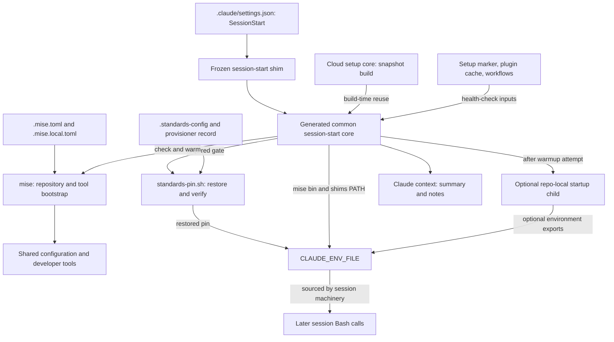
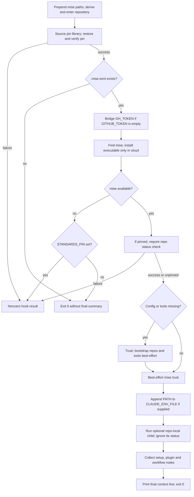

# Development Environment Bootstrap: Session Startup

The `development_environment_bootstrap_session_startup` module prepares the
portable development environment when Claude Code starts or resumes a
session. It verifies any provisioned standards pin, bootstraps missing shared
configuration and developer tools through mise, and persists tool discovery
for later Bash calls. In cloud sessions, it also reports incomplete or stale
snapshot state.

The important distinction is **mandatory standards verification versus
best-effort toolchain warming**. Ordinary installation failures should not
interrupt startup, but invalid pin or checkout state can make the hook fail.
The final readiness message is operational guidance, not proof that every
installation succeeded.

## Scope and system integration

This module owns the per-session path, not the entire development platform:

- [Development environment bootstrap][bootstrap-doc] describes the overall
  platform and the separate devcontainer launcher.
- [Toolchain and pins][toolchain-doc] owns mise configuration, shared tool
  versions, standards checkout verification, and trusted pin provisioning.
- [Cloud setup][cloud-doc] owns snapshot construction, marketplace and plugin
  installation, workflow copying, and dependency-cache warming. It calls this
  module to reuse the portable toolchain bootstrap during snapshot builds.
- [Repository build and configuration][build-doc] owns validation entry
  points, formatting policy, and Git hook composition.
- [Language intelligence integration][language-doc] owns language-server
  installation and LSP behavior. This startup hook does not invoke
  `live-setup`, start an LSP server, or verify every server binary.

Sources: `scripts/common/session-start-claude.sh`,
`scripts/common/cloud-setup.sh`, `.mise.toml`, `.mise.local.toml`.

## Components and ownership

The implementation uses a stable entry point, generated common logic, and
an optional repository-owned extension:

- `scripts/session-start-claude-shim.sh` is the frozen consumer entry point.
  The standards template preserves it with `_skip_if_exists` after its first
  render. Its job is only to locate and execute the common core.
- `scripts/common/session-start-claude.sh` contains all shared startup logic.
  It is generated from the standards template and replaced by `copier update`.
  Changes belong upstream in `Rubio-Enterprises/standards`, not in this
  consumer copy.
- `scripts/repo-local/session-start-claude.sh` is the optional, committed,
  repository-owned extension. It is never rendered by the template and is
  absent from the inspected script tree.
- `scripts/common/standards-pin.sh` supplies the required pin-restoration and
  checkout-verification functions. Startup sources this library; it does not
  invoke its trusted provisioning function.

Within the common core, `log()` and `warn()` write to stderr with the
`[session-start]` prefix. All other work is procedural: there is no separate
startup service, API server, or long-lived manager.

### Architecture and dependencies



The standards checkout is both a validation input and a bootstrap dependency.
The hook validates an existing checkout when a pin is active; it does not
repair an invalid pinned checkout by cloning over it. Without an active pin,
ordinary mise bootstrap can provision the missing shared checkout using the
manifest's native default ref. See [Toolchain and pins][toolchain-doc] for the
trust boundary and revision-selection rules.

Bash runs the hook, and Git supports pin-record lookup and checkout checks.
Mise is the provisioning interface. `curl` and `sh` are needed only for the
cloud mise-install fallback; `jq` gates plugin-health inspection. The drift
reader additionally uses `cat`, `sed`, `sha256sum`, and `awk`. The portable
hook does not install system packages to supply those utilities; root-only
package preparation belongs to [Cloud setup][cloud-doc].

Sources: both session-start scripts, `scripts/common/standards-pin.sh`,
`.mise.toml`, `scripts/common/cloud-setup.sh`.

## Entry points and execution context

### Claude Code registration

The committed `.claude/settings.json` registers the shim as a command hook:

```json
{
  "matcher": "startup|resume",
  "hooks": [
    {
      "type": "command",
      "command": "\"$CLAUDE_PROJECT_DIR\"/scripts/session-start-claude-shim.sh"
    }
  ]
}
```

This object is inside `hooks.SessionStart`. It matches startup and resume,
not every possible SessionStart event. The registration uses
`CLAUDE_PROJECT_DIR` to locate the shim, but once the script is running, root
selection is based on the script's location rather than that variable.
A wrong hook command path can therefore prevent invocation before the core's
root-resolution safeguards have a chance to run.

The shim unsets `CDPATH`, derives the root one directory above `scripts/`,
and checks for the common core. If present, it uses `exec bash` to replace
itself with that core. If root discovery or the file check fails, it warns on
stderr and exits 0. The shim does not forward arguments or suppress exit
statuses from a present core.

For manual diagnosis from the checkout root, invoke
`bash scripts/session-start-claude-shim.sh`. It needs no event payload, reads
no hook JSON from stdin, and implements no user-facing command-line options.
This executes real setup, not a dry run.

### Local sessions and cloud snapshot builds

The common core runs in a non-login, non-interactive Bash shell. It cannot
rely on profile scripts to make mise available. It derives the root two
levels above `scripts/common/`, then operates from that directory.

A nonempty `CLAUDE_PROJECT_DIR` that differs from this derived root produces
a stderr note but does not override the root. This supports execution from
other working directories and avoids choosing a multi-repository workspace's
parent directory as the checkout root.

The cloud setup core invokes the common core directly with:

- `CLAUDE_CODE_REMOTE=true`, enabling best-effort mise executable installation.
- `CLOUD_SETUP_BUILD=1`, suppressing live plugin and workflow health checks
  before snapshot seeding has happened.
- A caller-selected `GITHUB_TOKEN` for tool downloads, including a `GH_PAT`
  fallback when appropriate. That fallback belongs to cloud setup, not to
  this module's own token bridge.

The snapshot retains installed files. Later matching sessions rerun the same
checks and usually skip provisioning, but still persist environment exports,
run any repo-local startup, and inspect snapshot health. A warm run is not a
literal no-op, and this implementation imposes no overall runtime timeout.

Sources: `.claude/settings.json`, both session-start scripts,
`scripts/common/cloud-setup.sh`.

## Startup process

The common core uses `set -euo pipefail`. Expected optional failures are
explicitly guarded, while pin and required repository-status failures are
not. The following flow shows the main branches:



### Root discovery, pin gate, and repository marker

The first PATH export prepends these locations to the inherited PATH:

- `${HOME:-/root}/.local/bin`
- `${HOME:-/root}/.local/share/mise/shims`

After root discovery, the core sources `scripts/common/standards-pin.sh` and
calls `standards_restore_pin "$repo_root"`. This happens **before** the
`.mise.toml` repository-marker check and before ordinary mise commands.

When an environment pin or independent provisioner record exists, restoration
verifies the expected standards revision and checkout, exports
`STANDARDS_PIN`, and appends it to `CLAUDE_ENV_FILE` when that file is supplied.
An explicitly empty pin is invalid, not equivalent to an unset variable.
Restoration does not fetch or fix the checkout. With neither pin source,
restoration does not enforce a revision.

The pin library is still a required dependency even when no pin is active;
its record lookup also uses Git. After restoration succeeds, a missing
`.mise.toml` causes a clean exit 0. That early return skips the remaining
warming, PATH persistence, extension, diagnostics, and final summary. Any
pin export already written by restoration remains written.

Detailed clone requirements, provisioner-record identity, and recovery
procedures belong to [Toolchain and pins][toolchain-doc].

### Token bridge and mise availability

If `GITHUB_TOKEN` is empty and `GH_TOKEN` is nonempty, the hook exports
`GITHUB_TOKEN="$GH_TOKEN"`. An existing nonempty `GITHUB_TOKEN` wins. The
bridge helps mise's GitHub-backed release downloads avoid anonymous API rate
limits; the SessionStart core itself does not fall back to `GH_PAT`.

The hook then checks whether `mise` resolves on PATH. It also checks the
expected executable at `$HOME/.local/bin/mise`. If mise is still unavailable:

- Locally, the hook does not install the mise executable automatically.
- With `CLAUDE_CODE_REMOTE` exactly `true`, it attempts installation through
  `curl -fsSL https://mise.run | sh`, then checks availability again.
- If mise remains absent, it writes a warning and exits 0 when no standards
  pin is set, or exits 1 when `STANDARDS_PIN` is set.

This local/cloud distinction applies to the **mise executable**, not to all
tools. With an existing mise executable, local sessions can still trust the
repository and provision missing configuration or developer tools.

When a pin is active and mise is available, this command must succeed before
ordinary warming proceeds:

```sh
mise -C "$repo_root" bootstrap repos status --missing
```

The status check is not protected by `|| true`. The root manifest requires
mise `2026.10.19` or newer; this hook does not independently upgrade an
already-present incompatible mise executable.

### Idempotent shared configuration and tool warming

The core requests provisioning if any of the following is true:

- `.standards-config/config/lefthook/base.yml` is missing.
- `mise -C "$repo_root" ls --missing --no-header` fails.
- That command succeeds but produces nonempty output.
- `mise -C "$repo_root" which shellcheck` cannot resolve ShellCheck.

Checking the missing-tools output matters because `mise ls --missing` can
exit 0 even when tools are missing. The file and ShellCheck probes also catch
incomplete shared configuration or a toolchain that is not usable yet.
These are readiness heuristics, not a complete checkout-integrity audit.

On the provisioning branch, the hook attempts `mise trust`, logs its intent,
and runs:

```sh
mise -C "$repo_root" bootstrap --only repos,tools --yes
```

A plain `mise install` is not equivalent: it does not provision the shared
repository needed by configuration stubs and Lefthook. A bootstrap failure
produces a warning with the manual retry command, but startup continues.
The core attempts `mise trust` again after the branch, even on warm runs;
trust failures are ignored.

There is no post-bootstrap verification of every advertised tool. The hook
also does not run application setup tasks or `live-setup`. Task overrides and
optional live-server setup are documented in [Toolchain and pins][toolchain-doc].

Source for this process: `scripts/common/session-start-claude.sh`.
Pin behavior comes from `scripts/common/standards-pin.sh`; configuration and
compatibility requirements come from `.mise.toml` and `.mise.local.toml`.

## Environment data flow and persistence

Exports in a hook process do not automatically reach later Claude Bash calls.
`CLAUDE_ENV_FILE` is the persistence interface; process inheritance and
session persistence are distinct paths.

```mermaid
sequenceDiagram
    participant Claude as Claude session
    participant Core as Session-start core
    participant Pin as Pin library
    participant Mise as mise
    participant Env as CLAUDE_ENV_FILE
    participant Local as Repo-local child
    participant Bash as Later Bash call

    Claude->>Core: Run hook with session environment
    Core->>Core: Prepend mise bin and shims to PATH
    Core->>Pin: Restore and verify expected pin
    opt Valid active pin and environment file supplied
        Pin->>Env: Append STANDARDS_PIN export
    end
    Core->>Mise: Check repos and tools; bootstrap if needed
    opt Environment file supplied and execution reaches persistence
        Core->>Env: Append mise executable directory and shims PATH
    end
    opt Repository extension exists
        Core->>Local: bash child with cwd and exported environment
        Local->>Env: Optionally append repository exports
        Local-->>Core: Exit status ignored
    end
    Core-->>Claude: Final summary with collected notes
    Note over Env,Bash: Session machinery applies the environment file
    Env->>Bash: Persisted PATH and optional pin or repository values
```

When `CLAUDE_ENV_FILE` is nonempty, the core resolves the actual mise
executable with `command -v mise`, then appends a line in this form:

```sh
export PATH="<mise-executable-directory>:<home>/.local/share/mise/shims:$PATH"
```

The angle-bracket values above are placeholders. The written file contains
actual directory values but a **literal `$PATH`**, which expands when the
session later sources the file. Only the mise executable directory and shims
directory are added, not every version-specific installation directory.
Because those directories are prepended, managed shims can take precedence
over same-named system commands.

Important persistence semantics are:

- PATH writing is append-only and best-effort. A write failure is ignored;
  the hook does not create missing parent directories or deduplicate entries.
- Repeated startup or resume calls can append repeated exports. Provisioning
  is check-before-install, but environment-file writing is not deduplicated.
- No `CLAUDE_ENV_FILE` means no persistent PATH change from this core, even
  though its own process and children have the initial PATH export.
- Pin persistence is performed earlier by the pin library. Unlike the PATH
  append, a required pin-export write failure is fatal.
- The token bridge changes the hook's exported environment and its children's
  environment. The core does not write GitHub tokens into `CLAUDE_ENV_FILE`.
- A child script's ordinary exports do not modify its parent or later Bash
  calls. Repository-specific persistent values must use the environment file.

Sources: `scripts/common/session-start-claude.sh`,
`scripts/common/standards-pin.sh`.

## Repository-local startup extension

The supported customization point is:

```text
scripts/repo-local/session-start-claude.sh
```

The core checks for a regular file and executes it with `bash`, so this child
does not need an executable bit for this invocation. It runs after the
warming attempt and PATH persistence, with:

- Current directory set to the script-derived repository root.
- The core's mise bin and shims PATH inherited.
- Any restored `STANDARDS_PIN` and bridged `GITHUB_TOKEN` inherited.
- `CLAUDE_ENV_FILE` available if supplied by the caller.
- Cloud/build indicators inherited from the caller.

This is an attempted-warmup boundary, not a guarantee that all tools installed.
Earlier exits, such as missing mise or a pin failure, prevent the extension
from running. Cloud setup can also invoke it during snapshot construction,
not just during live sessions.

A minimal example of persistent, non-secret repository defaults is:

```bash
#!/usr/bin/env bash
set -uo pipefail

if [ -n "${CLAUDE_ENV_FILE:-}" ]; then
  printf 'export REPO_STARTUP_MODE=development\n' \
    >>"$CLAUDE_ENV_FILE" ||
    printf '[repo-start] could not persist startup mode\n' >&2
fi

exit 0
```

Keep the extension committed, repeatable, bounded in runtime, and quiet on
stdout. Put installation chatter and diagnostics on stderr. The parent uses
`bash ... || true`, so a nonzero child status does not fail startup, but that
protection does not stop a hanging child. Avoid assuming that a failed child
will produce a parent warning; the common core does not add one here.

Do not edit the frozen shim or generated common core to add workspace
installs, extra toolchains, or repository defaults. Snapshot-only work belongs
in the separate cloud extension described in [Cloud setup][cloud-doc].

Source: `scripts/common/session-start-claude.sh` and the ownership headers in
both session-start scripts.

## Snapshot health diagnostics

These checks collect notes after the optional extension. They diagnose
snapshot state; they do not reinstall plugins, copy workflows, or trigger a
platform rebuild. The checks have different gates and different blind spots.

### Cloud setup fingerprint drift

The reader checks this marker:

```text
${XDG_CACHE_HOME:-$HOME/.cache}/<checkout-basename>/cloud-setup.built
```

When the marker and `scripts/common/cloud-setup.sh` exist, it reads the
`sha256=` field and compares it with the current SHA-256 of these files,
concatenated in this exact order:

- `scripts/cloud-setup-shim.sh`
- `scripts/common/cloud-setup.sh`

If both hashes are nonempty and differ, the final context line gains a note
asking the operator to bump `CACHE_EPOCH` in the web Setup-script wrapper and
re-save it to rebuild the snapshot.

The directory key is the **runtime checkout basename**, not the Copier
`project_name` answer. Both path derivation and hash ordering must stay in
lockstep with the writer in the cloud setup core.

This check is marker-gated, not explicitly gated on `CLAUDE_CODE_REMOTE` or
`CLOUD_SETUP_BUILD`. It is normally silent locally because no marker exists.
It reads the hash, not the stored epoch, and does not warn about a missing
marker or empty stored hash. Matching hashes cover only those two files;
they do not attest to successful setup, current plugin contents, or changes
to SessionStart, mise configuration, carrier settings, or repo-local scripts.

See [Cloud setup][cloud-doc] for marker writing and platform cache refresh.

### Marketplace and enabled-plugin cache health

This check runs only when all these conditions hold:

- `CLAUDE_CODE_REMOTE` is exactly `true`.
- `CLOUD_SETUP_BUILD` is unset or empty.
- `jq` resolves on PATH.
- The checkout contains `.claude/settings.json`.

It reads marketplace declarations from `extraKnownMarketplaces` whose source
is an object with source type `github` or `git`. For each selected name, a
healthy marketplace requires both:

- A file at
  `~/.claude/plugins/marketplaces/<name>/.claude-plugin/marketplace.json`.
- A matching top-level key in `~/.claude/plugins/known_marketplaces.json`,
  tested with `jq`.

A `.git` directory is deliberately not required: native Claude handling can
replace a pre-seeded clone with a healthy Gitless marketplace directory.

The check then reads `enabledPlugins` entries whose value is exactly `true`.
For a `plugin@marketplace` entry, it skips a marketplace already reported
missing and skips entries without a marketplace manifest. Otherwise it
requires this directory:

```text
~/.claude/plugins/cache/<marketplace>/<plugin>
```

Missing marketplaces and uncached enabled plugins are combined into one
plugin-health note. Its recovery guidance is to supply the read-only
`GH_PAT` through the cloud Setup-script wrapper and rebuild, rather than
expecting the sessions-only environment-variable field to reach the build.
Follow the authentication guidance in [Cloud setup][cloud-doc]; keep actual
token values out of committed scripts and diagnostic output.

These are presence checks, not complete resolution tests. They do not verify
marketplace contents, refs, registry locations, installed-plugin records,
plugin versions, or successful loading. Missing `jq` or settings skips the
check silently, and some entries skipped above cannot produce a cache warning.

### Workflow seeding health

The workflow check requires only `CLAUDE_CODE_REMOTE=true` and an unset or
empty `CLOUD_SETUP_BUILD`. Unlike the plugin check, it does not require `jq`
or carrier settings.

It scans both supported cache layouts for a marker file:

```text
~/.claude/plugins/cache/<marketplace>/<plugin>/.claude-plugin/seed-workflows
~/.claude/plugins/cache/<mkt>/<plugin>/<version>/.claude-plugin/seed-workflows
```

For every marked cached plugin, it examines `workflows/*/*.js` and requires a
same-basename file under `~/.claude/workflows/`. Missing names produce a note
asking for a wrapper epoch bump and snapshot rebuild.

The scan covers marked cached plugins, not just enabled carrier entries. It
checks destination file existence only: it does not compare contents, parse
`meta.name`, detect duplicate names, or verify runtime resolution. A different
file with the expected basename passes, and an entirely absent cache payload
provides nothing to scan. The seeding and collision rules themselves belong
to [Cloud setup][cloud-doc].

Source for all three readers: `scripts/common/session-start-claude.sh`.
Snapshot-state writers live in `scripts/common/cloud-setup.sh`; plugin inputs
come from `.claude/settings.json`.

## Output and failure contract

### Context output versus diagnostics

On the normal path, the core emits a final stdout line beginning with
`claude-lsps dev toolchain ready (mise)`. It lists Biome, Lefthook, ShellCheck,
shfmt, Gitleaks, Prettier, and yq, then suggests mise tasks or package scripts.
It appends collected notes in this order:

- Cloud setup fingerprint drift.
- Marketplace and plugin-cache health.
- Workflow-seeding health.

All applicable notes are concatenated; there is no single-note priority rule.
The final `printf` emits one line, which may become long when multiple checks
report issues. Earlier clean exits produce no final summary.

The stdout contract matters because SessionStart stdout becomes Claude's
context. The helper functions put their own chatter on stderr, but the core
does not redirect every mise invocation or the repo-local child's stdout.
Consequently, the final one-line `printf` is not a strict guarantee that the
entire hook emits exactly one stdout line. Extensions must preserve the
quiet-output convention, and maintainers should inspect passthrough command
output when changing the upstream implementation.

The rendered readiness text is static and can print after best-effort
bootstrap errors. This repository has dependency-free Node proxies and uses
`make test` as the canonical harness entry point; do not infer the existence
of package scripts from the generic message. See
[Validation entry points][validation-doc] for the test-command contract.

### Exit behavior

The shim's abort-proof comment describes the intended optional-warming
contract, not blanket suppression of every error. Actual behavior is:

- A missing common core causes the shim to warn and exit 0.
- A pin-library load, pin restoration, or pinned repository-status failure
  can terminate the common core with a nonzero status. The shim preserves it
  through `exec`.
- A missing `.mise.toml` exits 0 after the pin gate.
- Unavailable mise exits 0 when unpinned, or 1 with a set standards pin.
- Mise executable installation and `mise trust` failures are tolerated.
  Toolchain bootstrap errors warn and continue.
- PATH persistence and repo-local child failures are ignored.
- Health-check findings append notes; they do not themselves request failure.
- Reaching the final summary ends in `exit 0`.

Unexpected failures in unguarded commands can still terminate execution under
`set -euo pipefail`. For example, this is not a general guarantee against
root-resolution, file-reading, or hashing errors. Standard filesystem access,
Git, and the utilities used by the active checks must remain available.
Do not bypass mandatory verification merely to make an installation warning
or startup failure disappear.

Sources: both session-start scripts, `scripts/common/standards-pin.sh`,
`Makefile`, `.mise.local.toml`.

## Runtime inputs and state boundaries

The principal environment inputs are:

- `HOME` and `PATH`: user tool/cache locations and command lookup. Although
  the initial PATH prepend has a `/root` fallback, later code also references
  `HOME` directly; the execution environment should supply it.
- `CLAUDE_PROJECT_DIR`: hook-path lookup in settings and a non-authoritative
  root sanity check in the core.
- `CLAUDE_CODE_REMOTE`: the exact string `true` enables cloud behavior.
- `CLOUD_SETUP_BUILD`: any nonempty value suppresses live plugin and workflow
  checks. Setting it to `0` does not enable those checks.
- `CLAUDE_ENV_FILE`: the append target for persistent PATH, restored pin, and
  optional repository environment exports.
- `STANDARDS_PIN` and `XDG_STATE_HOME`: expected standards revision and the
  state-root input used by the pin library's independent record lookup.
- `GH_TOKEN` and `GITHUB_TOKEN`: inputs to the non-overwriting token bridge.
- `XDG_CACHE_HOME`: the setup-fingerprint cache root, defaulting to
  `$HOME/.cache`.

The setup fingerprint, provisioner pin record, Claude plugin cache, and session
environment file are separate interfaces with different meanings. A fresh
fingerprint does not validate the standards checkout; a valid pin does not
prove that plugins or workflows were seeded; an in-process PATH export does
not replace environment-file persistence.

Sources: `.claude/settings.json`, `scripts/common/session-start-claude.sh`,
`scripts/common/standards-pin.sh`.

## Validation and operational troubleshooting

### Validation strategy

Syntax can be checked without executing startup:

```sh
bash -n scripts/session-start-claude-shim.sh
bash -n scripts/common/session-start-claude.sh
bash -n scripts/common/standards-pin.sh
```

Running the hook is **not a dry run**. With mise present it can mark the
repository trusted, clone shared configuration, install tools, activate Git
hooks through manifest hooks, append environment exports, and execute local
extensions. Use a disposable checkout and isolated state for behavioral
validation, especially when testing missing-tool or corrupted-pin branches.

Useful validation scenarios are:

- Missing common core: successful shim fallback with a stderr warning.
- Non-root invocation and mismatched `CLAUDE_PROJECT_DIR`: correct checkout
  selected once the script is invoked, with a mismatch note on stderr.
- Invalid or conflicting pin state: nonzero result before ordinary warming.
- Missing mise: no local executable installation; cloud best-effort install;
  pinned and unpinned exit behavior checked separately.
- Warm toolchain: no provisioning command, but environment persistence and
  optional extension still run.
- Failed provisioning: warning without treating the readiness text as proof.
- Repository extension failure: parent continues; persisted values remain
  available when the session applies its environment file.
- Cloud health fixtures: drift, missing marketplace, uncached plugin, and
  missing workflow notes, including build-time suppression and Gitless
  marketplace acceptance.

These are recommended behavioral checks, not a claim that all are covered by
the repository's existing test suite. `Makefile` dispatches `make test` to
`tests/run.sh`, whose required tools include Node, Bash, jq, and ShellCheck.
The plugin installer syntax checks in `tests/cases/03-installer-lint.sh` target
plugin `hooks/check-*.sh` files, not these startup scripts.

The consumer `.github/workflows/cloud-setup-smoke.yml` provides cloud-chain
coverage. The cloud core invokes SessionStart at full smoke level
`CLOUD_SETUP_SMOKE=1`, skips it at `warm`, and ignores that subprocess's exit
status with `|| true`. Smoke also omits marketplace installation, workflow
seeding, and fingerprint writing. A green smoke result alone is therefore
not proof of successful tool provisioning or live plugin health. See
[Cloud setup][cloud-doc] for smoke limits and
[Continuous integration][ci-doc] for workflow orchestration.

### Troubleshooting guide

- **Hook never runs:** check the committed SessionStart matcher and command
  path, including whether `CLAUDE_PROJECT_DIR` locates this checkout's shim.
  The core cannot correct a hook path that never invokes it.
- **No final readiness line:** inspect earlier stderr and exit status. A
  missing manifest or missing unpinned mise is an intentional early return;
  pin verification failures are not.
- **Pin or checkout rejection:** follow [Toolchain and pins][toolchain-doc].
  Restoration is verification, not an automatic repair path.
- **Tools disappear in later Bash calls:** check that `CLAUDE_ENV_FILE` was
  supplied and writable, execution reached the PATH append, and the session
  applied the file. Do not rely on exports from a completed hook process.
- **Readiness line appears but a tool is missing:** inspect bootstrap
  warnings and actual command resolution, then retry
  `mise bootstrap --only repos,tools --yes` from the checkout when appropriate.
- **Local mise is absent:** install a compatible mise executable through the
  normal developer provisioning process. The hook deliberately avoids doing
  that automatically on local machines.
- **Cloud plugin or workflow note appears:** correct build-time credentials,
  configuration, network policy, or seeding issues, then bump the UI wrapper's
  epoch and re-save. SessionStart reports these issues but does not repair the
  snapshot.
- **Startup hangs or context is noisy:** inspect the repo-local child and
  passthrough command output. Ignoring a child exit code does not impose a
  timeout or redirect its stdout.

Sources: both session-start scripts, `.claude/settings.json`, `.mise.toml`,
`Makefile`, `tests/run.sh`, `tests/cases/03-installer-lint.sh`,
`scripts/common/cloud-setup.sh`, `.github/workflows/cloud-setup-smoke.yml`.

## Maintenance invariants

Preserve these boundaries when updating the upstream template or adding a
repository-local extension:

- Keep the registered shim path stable and retain its missing-core fallback.
- Keep pin restoration and required checkout checks ahead of ordinary mise
  warming; do not turn trust-boundary failures into optional warnings.
- Keep repository discovery script-relative rather than trusting a workspace
  parent or the caller's current directory.
- Provision both repositories and tools, not just tool binaries, when shared
  configuration is absent.
- Keep current-process inheritance distinct from persistent environment
  exports, and do not persist token values as a PATH workaround.
- Keep extension work repeatable on startup, resume, and cloud build reuse.
- Keep fingerprint path derivation and shim-then-core hashing synchronized
  with the cloud writer.
- Keep plugin and workflow checks silent during snapshot construction, and
  treat presence checks and readiness text as diagnostics rather than proofs.
- Make consumer-specific changes in the committed repo-local script; make
  shared changes upstream and distribute them through Copier.

[bootstrap-doc]: ../development_environment_bootstrap.md
[toolchain-doc]: development_environment_bootstrap_toolchain_and_pins.md
[cloud-doc]: development_environment_bootstrap_cloud_setup.md
[build-doc]: ../repository_build_and_configuration.md
[language-doc]: ../../language_intelligence_integration.md
[validation-doc]:
  ../repository_build_and_configuration/repository_build_and_configuration_validation_entry_points.md
[ci-doc]: ../continuous_integration.md
