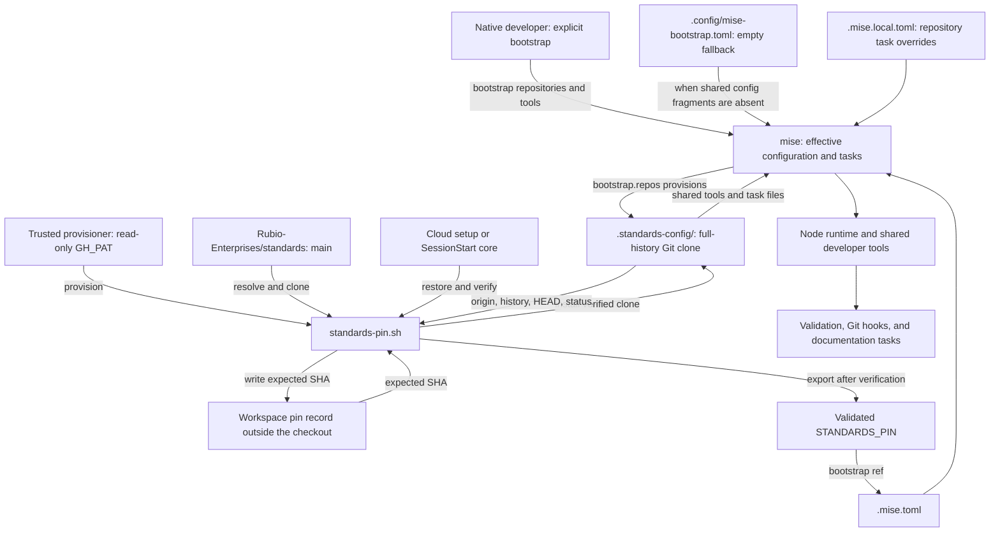
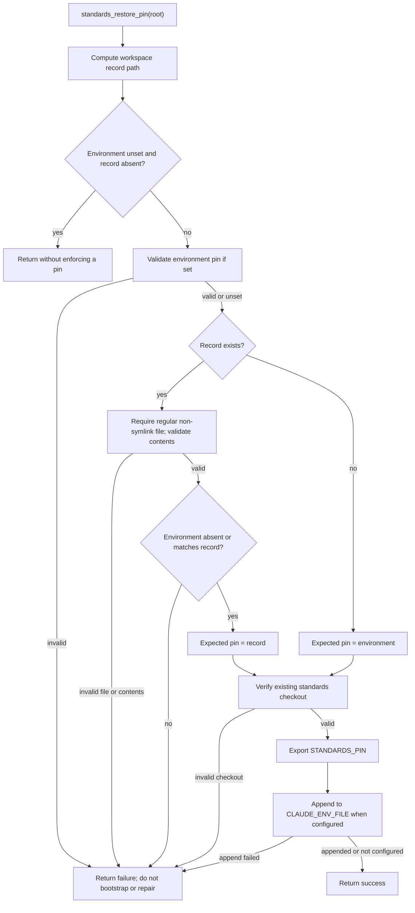

# Development Environment Bootstrap: Toolchain and Pins

The `development_environment_bootstrap_toolchain_and_pins` module defines
how `claude-lsps` obtains its developer toolchain and shared engineering
configuration. It combines repository-owned runtime and task choices with a
separate standards Git checkout, and supplies the validation and provisioning
functions used to preserve a trusted standards revision across cloud sessions.

The central distinction is between **bootstrap policy** and **pin validation**.
Native development defaults to the standards repository's `main` branch when
explicitly bootstrapping. A provisioned environment instead restores an
expected commit and verifies its existing checkout before ordinary setup.
Entering a cold checkout does not fetch shared configuration automatically.

## Scope and component ownership

The module has four core files:

- `.mise.toml` is the root manifest. It declares the minimum mise version,
  runtime pin, conditional shared includes, repository bootstrap settings,
  hooks, and shared task-file paths. Its header permits repository additions
  and describes Copier merging those additions during updates.
- `.config/mise-bootstrap.toml` is a generated, empty TOML fragment. It keeps
  missing shared configuration includes local until explicit bootstrap.
- `.mise.local.toml` supplies repository-specific task overrides and the
  optional language-server installation task. Despite its name, it is intended
  to remain trackable; `.gitignore` directs machine-local values to
  `.envrc.local` instead.
- `scripts/common/standards-pin.sh` is a generated Bash function library for
  pin syntax checks, checkout verification, record restoration, credentialed
  Git reads, and trusted provisioning. Sourcing it defines functions; executing
  the file alone does not provision anything.

Change generated files through their upstream templates in
`Rubio-Enterprises/standards` and Copier, not by editing consumer copies.
The template revision recorded in `.copier-answers.yml` is separate from the
runtime standards commit selected by bootstrap.

This page owns configuration resolution and the pin lifecycle. For the wider
bootstrap architecture, see [Development environment bootstrap][bootstrap-doc].
Cloud snapshot warming and session diagnostics belong to
[Cloud setup][cloud-doc] and [Session startup][session-doc]. Formatting policy,
Git hook composition, and canonical test dispatch are documented in
[Repository build and configuration][build-doc].

Sources: `.mise.toml`, `.mise.local.toml`, `.config/mise-bootstrap.toml`,
`scripts/common/standards-pin.sh`, `.gitignore`, `.copier-answers.yml`.

## Architecture and dependency flow

The shared checkout is an external configuration dependency, not an npm
package or a committed copy of the standards rules. Its tool definitions and
tasks are consumed alongside the repository's own declarations.



Restoration exports a pin only when an environment pin or provisioner record
exists. Otherwise it returns without selecting a revision, leaving the
manifest's native `main` default in effect. The provisioner, unlike restoration,
performs network access and replaces the standards checkout.

Sources: `.mise.toml`, `.mise.local.toml`,
`scripts/common/standards-pin.sh`, both common setup cores.

## Configuration resolution and version policy

### Cold-checkout behavior

`.mise.toml` declares two conditional configuration includes, evaluated using
`config_root`:

- Load `.standards-config/config/mise/base.toml` when that file exists;
  otherwise load `.config/mise-bootstrap.toml`.
- Load `.standards-config/config/mise/codewiki.toml` when that file exists;
  otherwise load the same empty fallback.

The checks are independent. A partial checkout can therefore load one real
fragment and one fallback. The fallback defines no tools, tasks, or fetching
behavior; it does not supply a reduced shared toolchain.

The `enter` hook tests only for the shared `base.toml` and writes this message
to stderr when it is absent:

```text
shared config missing: run mise bootstrap --only repos,tools
```

That warning is not verification of the checkout's origin, revision, or
completeness. Likewise, the include existence checks are not security checks.
Provisioned callers must run the pin verifier before relying on shared config.

The shared task paths in `[task_config].includes` are listed directly:

- `.standards-config/config/tasks/base.toml`
- `.standards-config/config/tasks/typescript.toml`
- `.standards-config/config/tasks/codewiki.toml`

These task paths do not have the conditional fallback used by the two config
includes. The empty fragment does not recreate missing shared task definitions.
A plain `mise install` is not a replacement for provisioning the shared
repository on a cold checkout.

Source: `.mise.toml`, `.config/mise-bootstrap.toml`.

### Runtime pins and standards selection

The manifest currently requires mise `2026.10.19` or newer and pins Node to
`24.21.0`. Language runtimes are repository-owned pins; linting and formatting
tool versions come from the shared includes. Declaring a tool locally overrides
its shared pin. This page does not enumerate versions from the external
checkout: their authoritative values depend on its selected revision.

The bootstrap repository declaration maps `.standards-config` to the exact URL
`https://github.com/Rubio-Enterprises/standards.git`. Its ref is selected as
follows:

- With a supplied `STANDARDS_PIN`, the manifest uses that value.
- Otherwise, the ref defaults to `main` for native development.

The strict 40-character SHA requirement is enforced by the Bash helpers, not
by the TOML ref expression itself. Calling mise directly is not equivalent to
passing the trusted pin gate. Also, following `main` describes the bootstrap
ref policy; merely entering the directory does not fetch or advance a checkout.

After the repository bootstrap phase, the `post-repos` hook runs
`mise bootstrap repos status --missing`. Provisioned setup callers also invoke
this status command explicitly before ordinary toolchain setup.

The provisioner may install the mise executable if it is absent, but it does
not select a fixed mise release. The root manifest's `min_version` is a minimum
compatibility requirement, not an exact executable-version pin.

Source: `.mise.toml`, `scripts/common/standards-pin.sh`.

### Deliberate absence of a mise lockfile

The manifest explicitly documents that this repository must not commit
`mise.lock`; the shared `lint-config` policy is described as rejecting one.
A per-repository lockfile would freeze centrally managed tool pins separately
in every consumer, defeating centralized updates.

Leave `settings.lockfile` unset rather than adding either Boolean value:

- `true` writes a lockfile.
- `false` can make an installation refuse to proceed when mise is globally
  configured for locked operation.

For a provisioned environment, the standards commit records which shared
configuration was selected. It is not a lockfile for every downloaded tool or
language-server binary. The independent local Node pin remains repository
configuration.

Source: `.mise.toml`.

### Git hook activation

The `postinstall` hook runs `mise exec -- lefthook install` only when `CI` is
empty or unset. A nonempty `CI` skips that command. This makes Git hook
installation local and per-repository; it does not make CI depend on Git hooks
firing. Shared lint-hook validation invokes Lefthook separately.

Hook composition and formatter routing are described in
[Formatting and Git hooks][formatting-doc].

Source: `.mise.toml`.

## Repository task adaptation

`.mise.local.toml` replaces the shared TypeScript-namespaced defaults where
necessary for this JavaScript proxy repository:

| Task | Command | Intent |
| --- | --- | --- |
| `lint:ts` | `biome check .` | Use Biome for repository checks. |
| `setup:ts` | `:` | No npm dependencies to install for the proxies. |
| `test:ts` | `bash tests/run.sh` | Invoke the repository test harness. |
| `live-setup` | Sequential installer checks | Enable optional live cases. |

The `:ts` names are integration names for shared task composition, not evidence
that this repository is an npm package or a TypeScript application. Definitions
replace same-named shared tasks; namespaced tasks join shared composites. The
shared setup and test defaults use npm; these overrides avoid that assumption
for the Node proxies, which have no npm dependencies. The full behavior of
shared top-level composite tasks remains defined by the external task files.

The canonical gate-recognized test command is still `make test`. `Makefile`
dispatches to the same `bash tests/run.sh` harness as `test:ts`; it does not
install tools. See [Validation entry points][validation-doc] for that contract.

### Optional live-server installation

`live-setup` runs with `set -e`, prepends `$HOME/.local/bin` to its task-local
PATH, and invokes these checks in order:

- `pyright/hooks/check-pyright.sh`:
  [Pyright setup][pyright-setup-doc].
- `bash-language-server/hooks/check-bash-language-server.sh`:
  [Bash language-server setup][bash-setup-doc].
- `vtsls/hooks/check-vtsls.sh`:
  [vtsls setup][vtsls-setup-doc].
- `cue-lsp/hooks/check-cue.sh`:
  [CUE setup][cue-setup-doc].
- `regal-lsp/hooks/check-regal.sh`:
  [Regal setup][regal-setup-doc].

A nonzero check stops the remaining sequence. Installer internals and server
versions belong to the linked setup pages, not to the shared mise tool pins.
The PATH adjustment allows CUE and Regal fallback installations under
`~/.local/bin` to be found during this task; it does not persist that PATH into
subsequent commands.

The live tests register scenarios only when their server binary is on PATH.
A passing ordinary suite can therefore include skipped live scenarios.
Toolchain bootstrap and `setup:ts` do not implicitly run `live-setup`.

Sources: `.mise.local.toml`, `Makefile`, `tests/cases/08-live.sh`.

## Pin library contracts and stored state

All functions below are defined in `scripts/common/standards-pin.sh`. The file
requires Bash, and its callers must handle failure statuses. Ordinary validation
failures return nonzero; `standards_pin_error` emits a `standards pin:`-prefixed
message to stderr and returns 1.

### Pin syntax and checkout verification

`standards_pin_valid(value)` accepts only `^[0-9a-f]{40}$`: exactly 40 lowercase
hexadecimal characters. Branch names, abbreviated SHAs, uppercase characters,
whitespace, and an explicitly empty value are invalid.

`standards_verify_checkout(root, pin)` first validates that pin, then checks
`root/.standards-config` against all of these requirements:

- The checkout directory must not itself be a symlink.
- Its `.git` must be a directory. A linked worktree with a `.git` file is not
  accepted as a substitute for the real clone.
- `remote.origin.url` must equal
  `https://github.com/Rubio-Enterprises/standards.git` exactly. SSH forms,
  credential-bearing URLs, and otherwise equivalent URL spellings fail.
- `git rev-parse --is-shallow-repository` must report `false`.
- `git rev-parse HEAD` must equal the expected pin.
- `git status --porcelain --untracked-files=all` must produce no output.
  This covers tracked changes and untracked files reported by Git, but does
  not inventory ignored files.

Verification does not fetch, clean, reset, or repair anything. It does not
require a detached HEAD, although the provisioner creates one. It checks local
consistency and declared repository identity, not commit signatures.

### Workspace record identity

`standards_pin_record(root)` returns the record pathname without creating it.
It canonicalizes the physical workspace root using `cd` and `pwd -P`, then
pipes that path, without a trailing newline, into `git hash-object --stdin`.
The resulting Git object hash becomes the workspace key:

```text
${XDG_STATE_HOME:-$HOME/.local/state}/standards/cloud/<workspace-key>.pin
```

This is a hash of the canonical path, not of repository content, the checkout
basename, or the standards commit. Two logical paths to the same physical
workspace share a key; moving the workspace changes the key. The record stores
the expected standards SHA, followed by a newline.

The state record is intentionally outside the working tree and separate from
the cloud snapshot freshness marker. Record restoration does not authenticate
its owner or verify a signature; the trusted provisioning environment and its
filesystem permissions are part of the trust boundary.

### Environment inputs and outputs

- `STANDARDS_PIN` is the expected commit. The helpers distinguish unset from
  set-but-empty using `${STANDARDS_PIN+x}`; empty is not a request to follow
  `main`.
- `GH_PAT` must be exported for trusted provisioning and credential subprocesses.
  The provisioner requires a nonempty value supplied by the trusted setup
  environment. Its read-only permissions and repository scope are operator
  responsibilities; the script does not inspect token permissions.
- `XDG_STATE_HOME` selects the pin-record state directory. If absent or empty,
  the default is `$HOME/.local/state`.
- `HOME` also determines the preferred mise binary and its installation path.
- `CLAUDE_ENV_FILE`, when nonempty, receives an appended
  `export STANDARDS_PIN=<sha>` after successful restoration so later Claude
  Bash calls can inherit the pin.

`GH_TOKEN` and `GITHUB_TOKEN` are not fallback credentials for
`standards_provision_pin`. Other session authentication behavior is documented
in [Session startup][session-doc].

Source: `scripts/common/standards-pin.sh`.

## Restoration: validate before using shared configuration

`standards_restore_pin(root)` derives its expectation from the environment,
the independent provisioner record, or both:

| Environment pin | Record | Result |
| --- | --- | --- |
| Unset | Absent | Return without enforcing a revision. |
| Set and valid | Absent | Verify against the environment pin. |
| Unset | Valid | Verify against the recorded pin. |
| Set and valid | Same valid pin | Verify their agreed pin. |
| Invalid | Any | Fail. |
| Set and valid | Different valid pin | Fail; neither silently wins. |
| Any | Existing invalid record | Fail. |

A record detected by the helper's `test -e` check must be a regular file and
must not be a symlink. Its contents must pass the same pin syntax check. A
dangling symlink does not satisfy `-e` and is treated as absent, not rejected
by the record-type branch. Even the no-pin path first computes the record
pathname, so an accessible root and working Git command are still required.



The function never resolves remote `main`, creates a checkout, or writes a
provisioner record. A valid environment pin without a record is accepted after
checkout verification; only the explicit provisioning path establishes an
independently resolved record.

Export occurs before the optional environment-file append. An append failure
is returned to the caller, but the current process's export is not rolled back.

### Integration with setup callers

`scripts/common/cloud-setup.sh` sources the library, optionally provisions on
`--provision-standards`, then restores the pin. If a pin is set, it requires
`mise -C "$repo_root" bootstrap repos status --missing` to succeed before
continuing. Pin and required repository-status failures are fatal, even though
later cache warming is generally best-effort.

`scripts/common/session-start-claude.sh` restores the pin before ordinary mise
work. A pinned session also requires the repository-status command to succeed.
Missing mise is fatal in pinned mode; the unpinned native path can warn and
exit successfully instead. The later ordinary toolchain bootstrap can warn on
failure, so a successful hook exit is not an installation attestation.

The library does not automatically guard every direct mise invocation. These
callers establish the validation boundary. Their complete lifecycle and PATH
persistence behavior are documented in [Cloud setup][cloud-doc] and
[Session startup][session-doc].

Sources: `scripts/common/standards-pin.sh`,
`scripts/common/cloud-setup.sh`, `scripts/common/session-start-claude.sh`.

## Trusted provisioning process

`standards_provision_pin(root)` is the network-enabled operation. It runs in a
subshell with `set -euo pipefail`, independently resolves the standards
repository's current `main`, installs a verified full clone, and writes a
workspace record. It is not a facility for selecting arbitrary historical
commits: any supplied `STANDARDS_PIN` must equal the independently resolved
current `main`.

### Credentialed reads and prerequisites

`standards_reader_git(arguments...)` wraps the provisioner's remote Git reads.
For that Git invocation it disables terminal prompting, clears inherited
credential helpers, enables HTTP-path credential matching, clears general and
GitHub-specific extra headers, and installs a command-local credential helper.
That helper reads `GH_PAT` from its subprocess environment and returns the
`x-access-token` username only for a credential `get` request.

The token is not embedded in the clone URL or written by this helper to Git
configuration. The stored origin remains credential-free. These overrides are
command-local; the helper does not install a global credential configuration.
Keep credentials out of shell tracing and diagnostic logs as well.

Provisioning needs Bash, Git, ordinary filesystem utilities, and `awk`, plus
network access to the standards repository. It chooses mise in this order:

- An executable `$HOME/.local/bin/mise`.
- `mise` found through `command -v mise`.
- Otherwise, installation through `curl -fsSL https://mise.run` piped to `sh`,
  executed from `/`, followed by an executable-file check.

Thus `curl`, `sh`, and installer network access are additionally needed when
mise is absent. Pinning the standards commit does not pin that installer.

### Component interaction sequence

```mermaid
sequenceDiagram
    actor Setup as Trusted setup
    participant P as standards_provision_pin
    participant G as Git with reader credentials
    participant R as Standards remote
    participant F as Workspace filesystem
    participant M as mise
    participant S as External state directory

    Setup->>P: root and exported GH_PAT; optional STANDARDS_PIN
    P->>P: Validate supplied pin and require token
    P->>M: Locate or install executable
    P->>G: ls-remote refs/heads/main
    G->>R: Credentialed read
    R-->>P: Independently resolved SHA
    P->>P: Validate SHA and compare supplied pin
    P->>F: Verify existing clone at its own HEAD, if present
    P->>G: Full clone into workspace-local scratch directory
    G->>R: clone --no-checkout
    P->>F: Detach at SHA and verify staged clone
    P->>F: Back up old clone and move staged clone into place
    P->>M: Trust root manifest with resolved pin
    P->>M: bootstrap repos status --missing with resolved pin
    alt All required steps succeed
        P->>S: Write temporary record with restrictive umask
        P->>S: Rename record into final pathname
        P->>P: Mark complete
        P->>F: Remove scratch directory and old backup
        P-->>Setup: Success; caller restores exported pin
    else Failure before completion
        P->>F: Remove installed replacement if present
        P->>F: Restore old clone if it was backed up
        P->>F: Remove scratch and temporary record
        P-->>Setup: Nonzero status
    end
```

### Replacement and rollback details

Before staging anything, an existing `.standards-config` must pass checkout
verification against its own current HEAD. This permits refreshing a clean,
valid older checkout without requiring it already to match the new pin. It
refuses to overwrite local changes, an unrelated origin, a shallow clone, or
a checkout-directory symlink.

The scratch directory is created under the workspace as
`.standards-provision.XXXXXX`. The provisioner clones without a depth limit,
checks out the resolved pin with `--detach`, and verifies that staged clone
before moving the old checkout aside. After installing the replacement, it
passes the resolved pin explicitly to both required mise commands:

```text
mise trust <root>/.mise.toml
mise -C <root> bootstrap repos status --missing
```

Only after those commands succeed does it compute the record path, set
`umask 077`, create the state directory if needed, write a temporary sibling
record, and rename it to the final pathname. Existing directory permissions
are not tightened by `mkdir -p`.

An `EXIT` trap uses the `installed`, `had_previous`, and `complete` flags to
remove an unsuccessful replacement, restore a moved prior checkout, and clean
scratch and temporary-record paths. On success, cleanup also removes the old
backup. The operation has rollback protection for ordinary command failures,
not a single atomic transaction covering checkout, mise trust, and state:

- The checkout moves and final record rename are separate operations.
- Installing mise or trusting configuration can leave external side effects
  that the checkout rollback does not undo.
- The implementation has no inter-process lock; serialize provisioning for a
  workspace and do not treat it as crash-proof directory replacement.

The restrictive umask and other shell-state changes stay inside the subshell.
The function does not export the resolved pin back into its parent. The cloud
core subsequently calls `standards_restore_pin` to recover it from the record.
It also does not install the declared tools or LSP servers: ordinary
`mise bootstrap --only repos,tools` and optional `live-setup` remain separate.

The cloud core deliberately invokes this function as a standalone command and
checks its status afterward. Do not wrap it in a shell conditional that would
disable Bash `errexit` within the provisioner subshell.

Source: `scripts/common/standards-pin.sh`,
`scripts/common/cloud-setup.sh`.

## Operating procedures

### Native development

Install a compatible mise version and ensure Git can read the standards
repository using your approved native authentication. From the repository
root, explicitly trust and bootstrap configuration before using shared tools:

```sh
mise trust
mise bootstrap --only repos,tools --yes
mise run lint:ts
mise exec -- make test
```

With neither an environment pin nor a provisioner record, this follows the
manifest's `main` default. It does not establish the independent cloud pin
record. Shared Git hooks are installed by the local postinstall hook when
`CI` is not set to a nonempty value.

For optional live scenarios, install their servers and make fallback binaries
reachable in the later test command too:

```sh
mise run live-setup
PATH="$HOME/.local/bin:$PATH" mise exec -- make test
```

Sources: `.mise.toml`, `.mise.local.toml`, `Makefile`.

### Trusted cloud provisioning

In the trusted setup environment, with the read-only `GH_PAT` already exported,
the explicit entry point is:

```sh
export PATH="$HOME/.local/bin:$PATH"
bash scripts/common/cloud-setup.sh --provision-standards
```

Use the common core directly for this flag. The frozen
`scripts/cloud-setup-shim.sh` does not forward arguments, and the embedded web
wrapper invokes that shim without `--provision-standards`. Running the default
wrapper is therefore not, by itself, independent pin provisioning.

Reprovisioning resolves `main` again. If a previously exported `STANDARDS_PIN`
now differs from remote `main`, provisioning fails rather than silently
changing the expectation. Refresh snapshots through the trusted setup process;
do not repair disagreement by editing records or resetting a dirty checkout.

Sources: `scripts/common/cloud-setup.sh`, `scripts/cloud-setup-shim.sh`,
`scripts/common/standards-pin.sh`.

### Inspecting a provisioned workspace

These local commands expose the checkout properties checked by the verifier:

```sh
git -C .standards-config config --get remote.origin.url
git -C .standards-config rev-parse --is-shallow-repository
git -C .standards-config rev-parse HEAD
git -C .standards-config status --porcelain --untracked-files=all
```

Expect the exact credential-free origin, `false` for shallow status, the
expected SHA for HEAD, and no Git-status output. To inspect record identity or
run the same restoration gate in a Bash process:

```bash
source scripts/common/standards-pin.sh
standards_pin_record "$PWD"
standards_restore_pin "$PWD"
```

Restoration can append to `CLAUDE_ENV_FILE` if that variable is set. It does not
create or repair the record. For toolchain diagnosis, inspect both status and
missing-tool output:

```sh
mise --version
mise bootstrap repos status --missing
mise ls --missing --no-header
mise exec -- node --version
```

`mise ls --missing` can exit successfully while printing missing tools; inspect
its output rather than treating status zero as proof of a complete toolchain.
The SessionStart core uses that distinction in its bootstrap decision.

Sources: `scripts/common/standards-pin.sh`,
`scripts/common/session-start-claude.sh`.

## Failure handling and validation boundaries

Pin failures must not be downgraded to ordinary warming warnings. Diagnose
which layer failed before retrying:

- **Invalid pin:** supply a full lowercase SHA through the trusted path.
  An empty environment value, branch name, or abbreviated SHA is not valid.
- **Environment/record disagreement:** stop and establish which trusted
  provisioning state belongs to the workspace. Neither source wins silently.
- **Missing or unsuitable checkout:** restoration will not clone it. A trusted
  pinned environment needs trusted provisioning, while a cold unpinned native
  checkout needs explicit repository-and-tool bootstrap.
- **Wrong origin, shallow history, or dirty status:** preserve edits and inspect
  repository identity. The provisioner refuses to discard these conditions.
- **Missing shared fragment:** the empty fallback permits local configuration
  loading but does not supply shared tools or tasks. Follow the bootstrap
  instruction rather than copying shared rules into the fallback.
- **Environment-file append failure:** restoration returns failure even after
  its current-process export. Check the destination's writability.
- **Missing live binary:** inspect PATH and run `live-setup`; passing skipped
  live cases does not demonstrate real-server coverage.

### CI does not prove toolchain parity

`.github/workflows/test-gate.yml` provisions its own tools and runs `make test`
on Ubuntu and macOS; it does not use this mise bootstrap stack to install them.
It currently pins Node to `24.22.0`, whereas `.mise.toml` pins `24.21.0`. These
are distinct declarations, so a toolchain update should review both rather
than assuming local and CI versions match. The harness requires `node`, `bash`,
`jq`, and `shellcheck` on PATH.

`.github/workflows/cloud-setup-smoke.yml` exercises the cloud setup chain
through an external reusable workflow and passes standards-reader App secrets.
Its path filter includes `.mise.toml` and `scripts/**`, but not
`.mise.local.toml` or `.config/mise-bootstrap.toml`; use its manual dispatch for
otherwise-uncovered setup changes. A normal test-gate pass alone does not
attest that pin provisioning, record restoration, or rollback succeeded.

The complete smoke-mode limitations and workflow behavior belong to
[Cloud setup][cloud-doc] and [Continuous integration][ci-doc].

Sources: `.github/workflows/test-gate.yml`,
`.github/workflows/cloud-setup-smoke.yml`, `tests/run.sh`, `.mise.toml`.

### Maintenance checks for pin-helper changes

When changing the upstream template, validate the pin contract separately from
the plugin harness. Focused cases should cover:

- Unset versus explicitly empty pins, invalid syntax, and agreement or
  disagreement between environment and record.
- Missing, malformed, non-regular, or symlinked existing records and checkout
  rejection for wrong origin, shallow history, wrong HEAD, or dirty status.
- Restoration without network access and persistence through `CLAUDE_ENV_FILE`.
- Provisioning failures before replacement and after replacement, including a
  failing mise status command, with prior checkout and record preserved.
- Credential-free stored origins, absence of persisted tokens, workspace-path
  record identity, and serial repeated provisioning.

Keep changes at the owning layer: local tasks in `.mise.local.toml`, permitted
runtime additions in `.mise.toml`, and generated helper or fallback behavior
in the standards template. Do not commit the ignored `.standards-config/`
checkout, add a mise lockfile, or turn the empty fallback into a second source
of shared policy.

[bootstrap-doc]: ../development_environment_bootstrap.md
[cloud-doc]: development_environment_bootstrap_cloud_setup.md
[session-doc]: development_environment_bootstrap_session_startup.md
[build-doc]: ../repository_build_and_configuration.md
[formatting-doc]: ../repository_build_and_configuration/repository_build_and_configuration_formatting_and_hooks.md
[validation-doc]: ../repository_build_and_configuration/repository_build_and_configuration_validation_entry_points.md
[ci-doc]: ../continuous_integration.md
[pyright-setup-doc]: ../../language_intelligence_integration/pyright_language_server/pyright_language_server_setup.md
[bash-setup-doc]: ../../language_intelligence_integration/bash_language_server/bash_language_server_setup.md
[vtsls-setup-doc]: ../../language_intelligence_integration/vtsls_language_server/vtsls_language_server_setup.md
[cue-setup-doc]: ../../language_intelligence_integration/cue_language_server/cue_language_server_setup.md
[regal-setup-doc]: ../../language_intelligence_integration/regal_language_server/regal_language_server_setup.md
