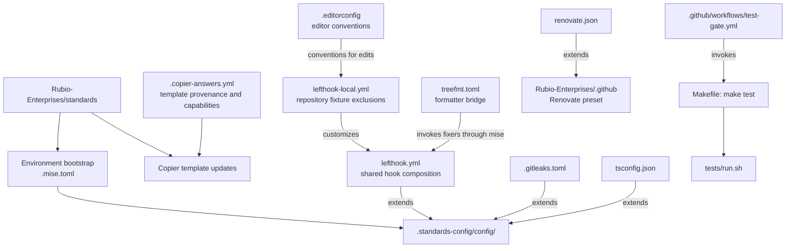
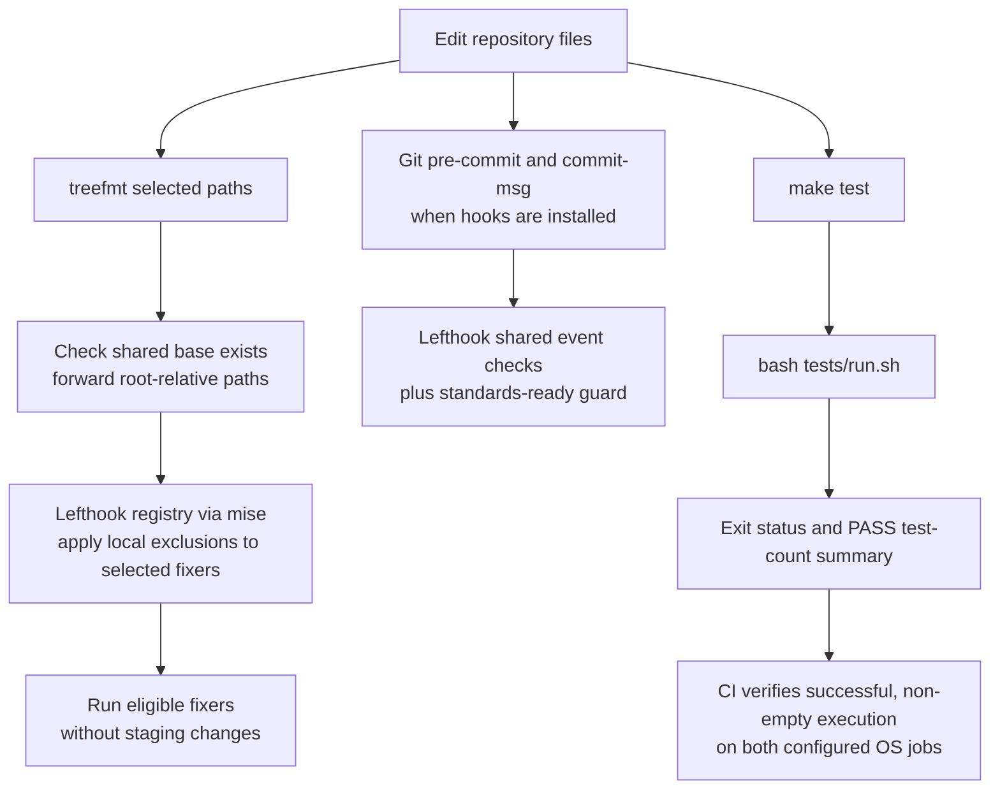

# Repository Build and Configuration

## Purpose and scope

The `repository_build_and_configuration` module defines the repository-level
contracts for editing, formatting, Git hooks, secret scanning, dependency
maintenance, compiler configuration, and the canonical test command. It is a
configuration layer for `claude-lsps`, not an application build system or an npm
package.

The repository contains Bash installers and Node.js language-server proxies.
Its `Makefile` deliberately exposes only a thin test dispatcher, while most
validation policy is inherited from Rubio-Enterprises' shared standards.
`.copier-answers.yml` identifies the project as a native, public plugin
marketplace with JavaScript enabled and TypeScript, container images, and
release artifacts disabled.

Sources: `.copier-answers.yml`, `Makefile`.

## Place in the system

- [Engineering platform and validation](../engineering_platform_and_validation.md)
  describes the surrounding engineering platform.
- [Development environment bootstrap](development_environment_bootstrap.md)
  owns tool provisioning, the `.standards-config/` checkout, and setup scripts.
  This module consumes those tools and shared configuration files.
- [Continuous integration](continuous_integration.md) owns workflow triggers,
  runner setup, and test-gate aggregation. This module supplies the `make test`
  command those workflows execute.
- [Language intelligence integration](../language_intelligence_integration.md)
  documents the runtime proxies and installers validated by these tools.

## Architecture and dependencies

The architecture separates template provenance, runtime configuration
inheritance, repository-specific exceptions, and test execution. The external
standards checkout is a required input for several tools; it is not copied into
each local configuration file.



Arrows are labeled where they represent configuration inheritance or command
invocation. EditorConfig supplies editing conventions; it does not execute
formatters or tests.

### Shared configuration is a runtime dependency

The principal shared inputs are explicit in the root files:

| Consumer | Shared dependency | Repository responsibility |
| --- | --- | --- |
| `lefthook.yml` | `config/lefthook/base.yml`, `biome.yml`, `biome-native.yml`, and `ts.yml` under `.standards-config/` | Compose the hook registry and guard against a missing base file. |
| `.gitleaks.toml` | `.standards-config/config/gitleaks-codewiki.toml` | Extend the shared secret-scanning policy. |
| `tsconfig.json` | `.standards-config/config/tsconfig.base.json` | Declare repository compiler options and input scope. |
| `treefmt.toml` | Lefthook's shared `fixers` job | Forward file paths instead of defining a second formatter registry. |

`.copier-answers.yml` records template version `template/v1.55.158`. This is
separate from the shared checkout's runtime revision: `.mise.toml` uses
`STANDARDS_PIN` when supplied and otherwise follows `main`. Do not infer the
active shared rules solely from the Copier version. The shared files, rather
than these adapters, define the complete rule sets and formatter inventory.

Sources: `.copier-answers.yml`, `.mise.toml`, `lefthook.yml`, `.gitleaks.toml`,
`treefmt.toml`, `tsconfig.json`.

## Sub-module guide

The detailed pages separate policy inheritance, formatting and hooks, and
executable validation. Each page documents its core components, interactions,
operating procedures, and failure modes.

| Documentation | Core files | Responsibility |
| --- | --- | --- |
| [Shared policy and maintenance][shared-policy-doc] | `.copier-answers.yml`, `.gitleaks.toml`, `renovate.json` | Template provenance, inherited secret-scanning policy, and organization-level update policy. |
| [Formatting and Git hooks][formatting-doc] | `.editorconfig`, `lefthook.yml`, `lefthook-local.yml`, `treefmt.toml` | Editing conventions, shared hook composition, formatter routing, and fixture exceptions. |
| [Validation entry points][validation-doc] | `Makefile`, `tsconfig.json` | Canonical test dispatch and the boundary between compiler configuration and proxy validation. |

## Configuration ownership

Changes should be made at the layer that owns the behavior rather than by
copying shared policy into repository files. The detailed change procedures
are in [Shared policy][shared-policy-doc], [Formatting and hooks][formatting-doc],
and [Validation entry points][validation-doc].

| File or layer | Change contract |
| --- | --- |
| `.copier-answers.yml` | Copier-managed state; the file explicitly prohibits manual edits. |
| `lefthook.yml` | Repository-owned shared-config stub; repository-specific hook changes belong in `lefthook-local.yml`. |
| `lefthook-local.yml` | Repository-specific overrides, currently limited to formatter and ShellCheck fixture exclusions. |
| `treefmt.toml` | Canonical bridge copied verbatim from standards; its header says repositories never edit it. |
| `.gitleaks.toml` | Shared-policy adapter; repository allowlist entries may be added in one singular `[allowlist]` table. |
| `renovate.json` | Inherits `github>Rubio-Enterprises/.github`; there are no local package rules in this file. |
| `.editorconfig` | Defines root-level editing conventions, including tab indentation for `Makefile`. |
| `Makefile` | Keep `test` a thin dispatcher; test implementation belongs in `tests/run.sh` and its harness. |
| `tsconfig.json` | Extends the shared compiler baseline and declares local compiler settings and input scope. |
| `.standards-config/` | Provisioned shared dependency; manage its revision through the environment's standards-pin mechanism. |

Sources: the headers and configuration in the listed files; `.mise.toml` for
shared-checkout provisioning and revision selection.

## Validation and formatting flow

Formatting, full Git-hook validation, and tests are related but distinct paths.
Calling the treefmt bridge runs only the `fixers` job, not all pre-commit checks
or the test suite.



### Working from the repository root

Provision tools and the shared checkout using the
[bootstrap documentation](development_environment_bootstrap.md) before running
shared-policy tools. For example, once provisioned:

```sh
# Format selected configuration files through the shared fixers.
mise exec -- treefmt lefthook-local.yml tsconfig.json

# Run the canonical repository test entry point.
make test
```

The formatter bridge uses NUL-delimited file paths and asks Lefthook not to
stage changes, fail merely because formatting changed a file, or auto-install
hooks. The fixture exclusions live in `lefthook-local.yml`, so the bridge and
Git hooks use the same repository exceptions. See
[Formatting and Git hooks][formatting-doc] for flag semantics and the full
hook-execution process.

`Makefile` delegates to `bash tests/run.sh`. The harness requires `node`,
`bash`, `jq`, and `shellcheck`; missing tools cause an early exit. The test-gate
workflow invokes `make test` separately on its Ubuntu and macOS jobs and checks
for a positive executed-test count before aggregation.
[Validation entry points][validation-doc] describes the harness result
contract; the [CI documentation](continuous_integration.md) owns the workflow
configuration. A positive count does not prove that every optional live-server
scenario ran.

Sources: `treefmt.toml`, `lefthook-local.yml`, `Makefile`, `tests/run.sh`,
`tests/lib/framework.sh`, `tests/cases/08-live.sh`,
`.github/workflows/test-gate.yml`.

### Compiler configuration is not a proxy build pipeline

`tsconfig.json` declares an ES2022/ESNext configuration with bundler-style
module resolution, `src/**/*` inputs, and `dist` as its output directory. Those
settings describe a compiler configuration; the `Makefile` provides no
`make build` target, and the repository has no root npm package manifest. The
language-server proxies live in plugin directories, not in the configured
`src/` input scope.

Do not treat the existence of `tsconfig.json`, or template enforcement flags,
as proof that the JavaScript proxies are compiled or type-checked by that
file. The canonical gate entry point here is `make test`. The
[validation page][validation-doc] explains compiler scope and the local mise
task overrides; task provisioning and organization-level enforcement belong
to the bootstrap and CI modules respectively.

Sources: `tsconfig.json`, `.copier-answers.yml`, `Makefile`, `.mise.local.toml`.

## Failure modes and maintenance boundaries

| Symptom or risk | Explanation and action |
| --- | --- |
| A commit reports `shared config missing` | Both `pre-commit` and `commit-msg` have a `standards-ready` existence check. Provision the shared checkout rather than removing the guard. |
| treefmt reports missing shared configuration | The bridge checks for the shared Lefthook base before dispatch, preventing a silent no-fixer run. Follow the bootstrap instructions. |
| Gitleaks cannot resolve its extended configuration | Run from the repository root and ensure `.standards-config/config/gitleaks-codewiki.toml` is present. A missing parent is a load error, not a fallback to default rules. |
| Malformed fixtures are reformatted or linted as source | Preserve the narrowly scoped `tests/fixtures/**` exclusions for `shfmt`, `yaml-prettier`, and `shellcheck` in `lefthook-local.yml`. They are not blanket exclusions from all checks. |
| An npm-based test command fails | This repository is not an npm package. Use `make test` for the gate or `bash tests/run.sh` for direct harness execution. |
| Compiler configuration fails to resolve or misses plugin files | Its shared base must exist, and its declared input scope is `src/**/*`. It is not a substitute for the proxy test harness. |

The `standards-ready` guard checks only for
`.standards-config/config/lefthook/base.yml`; it does not validate every shared
file, verify the checkout revision, or install tools. Those responsibilities
remain with environment provisioning and the consuming tools.

For scanner and Renovate diagnostics, see [Shared policy][shared-policy-doc].
For hook availability, staging, and fixture issues, see
[Formatting and Git hooks][formatting-doc]. For harness failures, test-count
proof, and compiler resolution, see [Validation entry points][validation-doc].

Sources: `lefthook.yml`, `treefmt.toml`, `.gitleaks.toml`, `lefthook-local.yml`,
`Makefile`, `tsconfig.json`.

[shared-policy-doc]: repository_build_and_configuration/repository_build_and_configuration_shared_policy.md
[formatting-doc]: repository_build_and_configuration/repository_build_and_configuration_formatting_and_hooks.md
[validation-doc]: repository_build_and_configuration/repository_build_and_configuration_validation_entry_points.md
