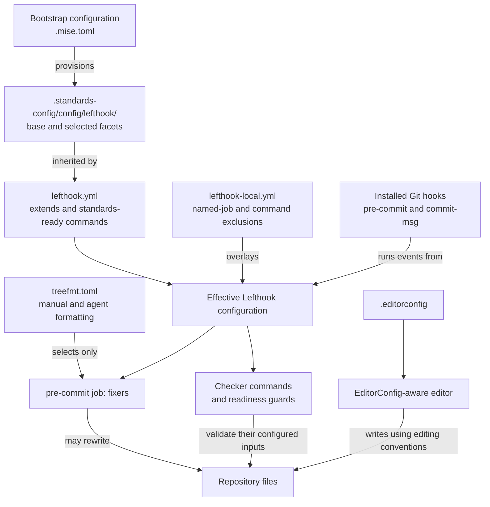
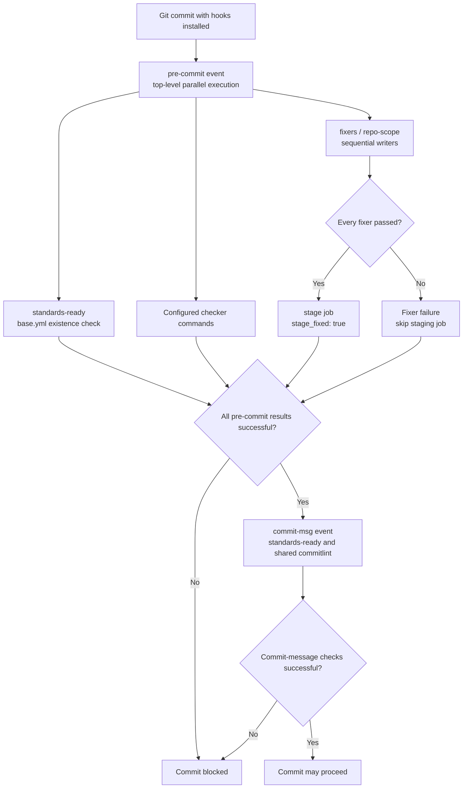

# Repository Build and Configuration: Formatting and Hooks

The `repository_build_and_configuration_formatting_and_hooks` module defines
editing conventions, composes shared Git hooks, protects malformed test
fixtures from selected tools, and exposes the same formatter registry to
manual and agent-driven formatting. It is an engineering configuration layer,
not part of the language-server proxies' runtime or LSP message handling.

## Responsibilities and system boundaries

| File | Responsibility |
| --- | --- |
| `.editorconfig` | Root editing conventions and indentation exceptions. |
| `lefthook.yml` | Shared hook composition and availability guards. |
| `lefthook-local.yml` | Repository-specific fixture exclusions. |
| `treefmt.toml` | Path-forwarding bridge to Lefthook's `fixers` job. |

The central contract is **one formatter registry**: Lefthook defines the
fixers, while treefmt delegates to them. EditorConfig supplies editing
conventions but does not execute those tools.

Related responsibilities are documented separately:

- [Repository build and configuration][repository-doc] describes the parent
  configuration layer and its ownership model.
- [Development environment bootstrap][bootstrap-doc] owns tool provisioning,
  the `.standards-config/` checkout, and standards-pin handling.
- [Shared policy][policy-doc] covers template provenance and secret-scanning
  policy; this page only describes how the hook registry invokes checks.
- [Validation entry points][validation-doc] covers the test command and
  compiler configuration. Formatting is not a substitute for those checks.
- [Continuous integration][ci-doc] covers workflow ownership and enforcement.

Sources: `.editorconfig`, `lefthook.yml`, `lefthook-local.yml`, `treefmt.toml`.

## Architecture and configuration ownership

The repository keeps small adapters around a separately provisioned standards
checkout. Lefthook loads its shared parents through native `extends`, then
applies the repository overlay. Both Git hooks and treefmt consume that
resulting registry.



The ownership boundaries are deliberate:

- `.editorconfig` expresses repository editing defaults.
- `lefthook.yml` is a repository-owned composition stub. Preserve its shared
  parents and guards; repository-specific hook changes belong in
  `lefthook-local.yml`. Its comments explain that the lint-config gate allows
  standard-event additions in this stub through `commands`, not `jobs`.
- `lefthook-local.yml` is the supported overlay for local exclusions and
  repository-owned fixers. Its current contents add exclusions only.
- `treefmt.toml` is the canonical standards bridge. Its header says it is
  copied verbatim and repositories never edit it. Do not add a second
  formatter registry or repository-specific exclusions there.
- `.standards-config/` supplies the shared implementation. Shared rule changes
  belong upstream rather than in copied local hook definitions.

The active shared implementation depends on the provisioned checkout.
`.mise.toml` selects `STANDARDS_PIN` when supplied and otherwise `main`;
formatter and linter pins come from shared mise includes. The inherited
behavior summarized below describes the inspected shared files, not an
immutable rule set embedded in the four repository adapters.

Sources: `lefthook.yml`, `lefthook-local.yml`, `treefmt.toml`, `.mise.toml`,
`.standards-config/config/lefthook/README.md`.

## Editor conventions

`.editorconfig` sets `root = true`, stopping an EditorConfig consumer from
searching parent directories for additional configuration. Its default
section applies to all files, with later sections overriding selected keys.

| Scope | Setting | Value |
| --- | --- | --- |
| All files | Character set | UTF-8 |
| All files | Line endings | LF |
| All files | Final newline | Insert when missing |
| All files | Trailing whitespace | Trim |
| Default | Indentation | Spaces, width 2 |
| `*.{py,go,rs}` | Indentation width | 4 |
| `Makefile` | Indentation style | Tabs |

The `Makefile` section changes the indentation style, not `indent_size` or
`tab_width`. Do not interpret the default width of two as permission to replace
recipe-leading tabs with spaces. The Python, Go, and Rust section is an editor
convention; it does not enable those languages' hook facets.

These settings take effect only in consumers that honor EditorConfig. They
are not a commit-time validator by themselves, and individual tools still
resolve their own configuration. In particular, saving a file in an editor
and running the shared fixer registry are distinct operations.

Source: `.editorconfig`.

## Shared hook composition

### Parent order and effective tool selection

`lefthook.yml` extends the following files, in order, under
`.standards-config/config/lefthook/`:

| Parent | Contribution |
| --- | --- |
| `base.yml` | Universal fixers, checker commands, and commitlint. |
| `biome.yml` | Expands the Biome fixer to JavaScript and TypeScript. |
| `biome-native.yml` | Adds Biome's `--error-on-warnings` behavior. |
| `ts.yml` | Adds the manifest/lockfile-drift checker. |

The two Biome facets modify the existing named fixer rather than adding
independent competing writers. `biome.yml` replaces the JSON-only leaf's
scope and command; `biome-native.yml` then replaces its command while keeping
that expanded scope. The final scope is
`*.{js,jsx,ts,tsx,mjs,cjs,json,jsonc}`.

The inspected registry runs these fixers sequentially inside `repo-scope`:

- `markdownlint`: Markdown through `markdownlint-cli2 --fix`.
- `yaml-prettier`: YAML through `prettier --write`.
- `shfmt`: Shell files matching `*.{sh,bash}` through `shfmt -w`.
- `biome`: JavaScript, TypeScript, and JSON through `biome check --write`,
  with warnings treated as errors by the native facet.
- `tombi`: TOML through `tombi format`. Its leaf checks that `tombi.toml`
  resolves to a file and skips symlink inputs, avoiding writes through the
  shared-configuration link.

Biome also consumes the repository's `biome.jsonc`, which extends shared
configuration. The hook command chooses the execution mode and file scope;
it is not a complete definition of Biome's rules.

Checker commands remain outside `fixers` and do not write files. The inspected
pre-commit parents provide `gitleaks`, `yamllint`, `shellcheck`, and
`lockfile-drift`. The `ts.yml` parent is not a TypeScript compiler invocation:
its checker selects root or nested `package.json` files. Merely extending it
does not establish an npm build or type-check pipeline.

The shared base also defines `commitlint` for `commit-msg`. Secret-scanner
rules and exceptions are covered in [Shared policy][policy-doc], rather than
repeated here.

Sources: `lefthook.yml`, `biome.jsonc`,
`.standards-config/config/lefthook/base.yml`,
`.standards-config/config/lefthook/biome.yml`,
`.standards-config/config/lefthook/biome-native.yml`,
`.standards-config/config/lefthook/ts.yml`.

### Missing-configuration guards

Lefthook can silently skip a missing `extends` file. Without an explicit
guard, an unprovisioned checkout could appear to pass despite loading no
shared checks or fixers.

The repository therefore adds a `standards-ready` command to both
`pre-commit` and `commit-msg`. Each tests for:

```text
.standards-config/config/lefthook/base.yml
```

If that file is absent, the command writes the following diagnostic to stderr
and exits with status 1:

```text
shared config missing: run mise bootstrap --only repos,tools
```

Repeating the check in `commit-msg` protects the commit-message validation
path even when pre-commit has no meaningful file work, such as an empty
commit. These commands are event checks, not a guaranteed sequential
preflight before all other commands.

The current repository guards test **only `base.yml`**. They do not test every
selected facet, verify the checkout revision, validate formatter configs, or
install tools. Other provisioning and tool-level checks may catch additional
problems, but a successful `standards-ready` result alone is not a complete
readiness or integrity check.

Sources: `lefthook.yml`, `treefmt.toml`,
`.standards-config/config/lefthook/base.yml`.

## Git-hook execution process

Once hooks are installed and enabled, Git's normal commit path invokes the
pre-commit event and then the commit-message event. The shared pre-commit
event is parallel at the top level: checker commands can run alongside the
single `fixers` job. Inside that job, writers run one at a time.



The shared `fixers` group is piped so that its final `stage` job runs only
after all fixers succeed. Within `repo-scope`, a failing fixer does not prevent
the remaining fixers from running. Staging depends on fixer success, not on
all independent checker commands having passed. Review the index after a
failed commit attempt; it can contain successful formatter changes.

This is different from the treefmt path, which explicitly disables staging.
Neither path runs the repository test harness merely by selecting `fixers`.

Hook installation is a separate prerequisite. `.mise.toml` defines a
`postinstall` hook that runs `mise exec -- lefthook install` only when `CI` is
empty. Its comments specify that CI invokes Lefthook directly rather than
relying on Git to fire installed hooks. Having the YAML files present does
not, by itself, prove hooks are installed or enabled.

Sources: `.mise.toml`, `lefthook.yml`,
`.standards-config/config/lefthook/base.yml`,
`.standards-config/config/lefthook/README.md`.

## Repository fixture exclusions

`lefthook-local.yml` identifies malformed LSP fixtures as test data rather than
shell or YAML source. It excludes `tests/fixtures/**` from exactly three
configured consumers:

| Consumer | Overlay target within `pre-commit` |
| --- | --- |
| `shfmt` | `fixers` → `repo-scope` → `shfmt` → `invoke.exclude` |
| `yaml-prettier` | `fixers` → `repo-scope` → `yaml-prettier` → `invoke.exclude` |
| `shellcheck` | `commands.shellcheck.exclude` |

The formatter targets are named jobs nested through `group.jobs`; the table
shows their logical path, not flattened YAML keys. ShellCheck remains a
checker command and therefore uses the separate `commands` overlay surface.

Placing the exclusions at each fixer's `invoke` leaf preserves the shared
registry and its parent-level exclusions. The shared registry also has floor
exclusions for machine-written and shared content, including
`.standards-config/**`; this local overlay does not replace those lists.

Important limits of these exceptions are:

- They are not a blanket exclusion of `tests/fixtures/**` from every fixer,
  checker, secret scan, or test. Other consumers retain their own selection
  rules; this overlay does not add a YAML-lint exemption, for example.
- They apply to both Git-hook formatting and treefmt because both use the
  same effective Lefthook registry.
- Matching uses repository-root-relative paths. The inspected registry
  documentation specifies case-sensitive exclusions.
- The exact named-job hierarchy matters. Moving these lists onto the entire
  `fixers` job or a shared tool group is not equivalent and is outside the
  documented local overlay surface.
- EditorConfig-aware saves are independent of Lefthook's exclusions. These
  exceptions do not instruct an editor to preserve fixture bytes.

Keep exclusions narrowly scoped so intentionally malformed fixtures remain
useful without exempting ordinary source files.

Sources: `lefthook-local.yml`, `.editorconfig`,
`.standards-config/config/lefthook/base.yml`,
`.standards-config/config/lefthook/README.md`.

## Treefmt bridge and path data flow

`treefmt.toml` declares one formatter, `lefthook`, implemented with `sh -c`.
It does not enumerate language-specific formatting tools.

- `tree-root-file = "treefmt.toml"` identifies the tree root. The bridge passes
  root-relative paths, keeping hook exclusions consistent when invoked from
  a subdirectory.
- `includes = ["*"]` routes candidate paths to the single bridge. Lefthook's
  globs and exclusions still decide which fixers accept each path.
- `on-unmatched = "debug"` sets treefmt's unmatched-file reporting level; it
  does not assert that every file type has an applicable fixer.
- The `--` argument after the shell script occupies `sh -c`'s `$0` position,
  leaving every supplied file path in `"$@"`.

When dispatched, the shell first checks that the shared hook base exists. It
exits with status 1 before invoking Lefthook if that check fails, reporting:

```text
treefmt: shared config missing: run mise bootstrap --only repos,tools
```

This separate guard matters because selecting only the `fixers` job does not
run the event's `standards-ready` command. Like the root hook guards, it tests
only `base.yml`.

The dispatch inside the shell is equivalent to the following, wrapped for
readability:

```sh
printf '%s\0' "$@" |
  mise exec -- lefthook run pre-commit \
    --job fixers \
    --no-stage-fixed \
    --no-fail-on-changes \
    --no-auto-install \
    --files-from-stdin
```

NUL-delimited input preserves filename boundaries during the transfer to
Lefthook, including names containing spaces or newlines. `mise exec` selects
the provisioned tool environment; it is not a replacement for bootstrapping
the shared checkout.

```mermaid
sequenceDiagram
    actor Caller as Developer or agent
    participant T as treefmt
    participant S as Shell bridge
    participant L as Lefthook via mise exec
    participant F as Repository files

    Caller->>T: Format selected paths
    T->>T: Resolve tree root and root-relative paths
    T->>S: Invoke script with paths as arguments
    S->>F: Test shared base.yml exists
    alt Shared base missing
        S-->>T: stderr diagnostic and exit 1
    else Shared base present
        S->>L: NUL-delimited paths on stdin; select fixers
        L->>L: Load shared parents and local overlay
        L->>L: Apply job globs and exclusions
        loop Fixers in registry order
            L->>F: Process eligible working-tree files
            F-->>L: Tool result and possible edits
        end
        Note over L,F: Do not stage formatter changes
        L-->>S: Delegated exit status
        S-->>T: Shell exit status
    end
    T-->>Caller: Formatting result
```

The delegated flags define the bridge's side-effect boundary:

- `--job fixers` selects only formatting/fixing work, not all pre-commit
  checker commands or `commit-msg` validation.
- `--no-stage-fixed` prevents staging formatter changes.
- `--no-fail-on-changes` tells Lefthook not to fail merely because a file was
  rewritten. Actual fixer failures, including remaining Biome diagnostics,
  can still fail the run.
- `--no-auto-install` suppresses Lefthook's automatic hook installation. It
  does not install formatter binaries.
- `--files-from-stdin` supplies explicit paths instead of relying on the
  ordinary staged-file selection.

Consequently, a successful formatting run is not proof that all hooks or
tests pass. A supplied path can also have no eligible fixer after filtering.
The caller may impose additional checks, such as requiring a clean diff.

Source: `treefmt.toml`; registry selection and exclusions are defined by
`lefthook.yml`, `lefthook-local.yml`, and the shared hook parents.

## Developer workflows

Run the following examples from the repository root. A native checkout can
explicitly provision its shared configuration and tools, then install Git
hooks:

```sh
mise bootstrap --only repos,tools --yes
mise exec -- lefthook install
```

The explicit hook installation is useful when verifying an existing checkout;
local mise installation also has the postinstall behavior described above.
For provisioned cloud or CI environments, follow the trusted-pin procedure
in [Development environment bootstrap][bootstrap-doc] rather than replacing
its revision selection with an arbitrary ref.

Format selected files and review the unstaged changes:

```sh
mise exec -- treefmt lefthook-local.yml pyright/lsp-proxy.js
git diff -- lefthook-local.yml pyright/lsp-proxy.js
```

Run the full pre-commit event against its normal staged selection:

```sh
mise exec -- lefthook run pre-commit
```

For a broader local pass without staging formatter changes:

```sh
mise exec -- lefthook run pre-commit --all-files --no-stage-fixed
```

The last command still allows fixers to rewrite working-tree files; disabling
staging does not make it read-only. `--all-files` expands path-selected inputs,
but commands can retain their own scope: the shared Gitleaks command, for
example, explicitly scans staged Git changes. Neither pre-commit command
runs `commit-msg` or the test harness.

Use the separate test contract in [Validation entry points][validation-doc].
For automated lint-hook enforcement and clean-diff checks, see
[Continuous integration][ci-doc]. The repository workflow comments assign
lint-hooks to organization-required governance workflows, not a local
`standards.yml` lint-hooks job.

Sources: `.mise.toml`, `treefmt.toml`, `.github/workflows/standards.yml`,
`.standards-config/config/lefthook/base.yml`,
`.standards-config/config/lefthook/README.md`.

## Troubleshooting and maintenance

- **A commit or treefmt reports missing shared configuration:** provision
  `.standards-config/` and the tools through the bootstrap workflow. Keep the
  guards; removing them can turn missing policy into an apparent success.
- **The base file exists but behavior is incomplete:** inspect all four
  selected hook parents and tool-specific configurations. The current root
  and bridge guards do not prove the facets are present. Record the active
  checkout SHA when comparing environments.
- **Tools are unavailable despite mise configuration loading:** the root
  `.mise.toml` can load the empty `.config/mise-bootstrap.toml` fallback on a
  cold checkout. Successful config loading does not mean the shared toolchain
  or registry has been provisioned.
- **Fixtures are rewritten or checked as source:** verify the root-relative
  `tests/fixtures/**` pattern and the exact named-job overlay targets. Also
  identify whether an editor or an independently invoked tool changed them;
  those paths do not automatically consume Lefthook's exclusions.
- **treefmt succeeds but a commit fails:** inspect checker and commit-message
  output. The bridge intentionally omits those checks and does not run tests.
- **Formatting changed the index:** the normal shared pre-commit path stages
  changes after successful fixers. The treefmt bridge disables that behavior.
  Verify the actual entry point before changing staging policy.

When changing this module:

- Put repository-specific hook exclusions in `lefthook-local.yml`, preserving
  the named-job structure. Do not rewrite shared `run` or `glob` definitions
  through the local overlay.
- Change shared fixer behavior in the standards repository. Keep the canonical
  treefmt bridge free of local policy and preserve both hook guards.
- Check an excluded fixture and an ordinary source file when adjusting an
  exception, so the intended exemption does not widen to normal code.
- Exercise both selected-path formatting and full pre-commit validation;
  inspect the working tree and index because their staging contracts differ.
- Run the separately documented repository tests when fixture or source
  changes can affect proxy behavior.

Sources: `.editorconfig`, `lefthook.yml`, `lefthook-local.yml`, `treefmt.toml`,
`.mise.toml`, `.config/mise-bootstrap.toml`,
`.standards-config/config/lefthook/base.yml`,
`.standards-config/config/lefthook/README.md`.

[repository-doc]: ../repository_build_and_configuration.md
[bootstrap-doc]: ../development_environment_bootstrap.md
[policy-doc]: repository_build_and_configuration_shared_policy.md
[validation-doc]: repository_build_and_configuration_validation_entry_points.md
[ci-doc]: ../continuous_integration.md
