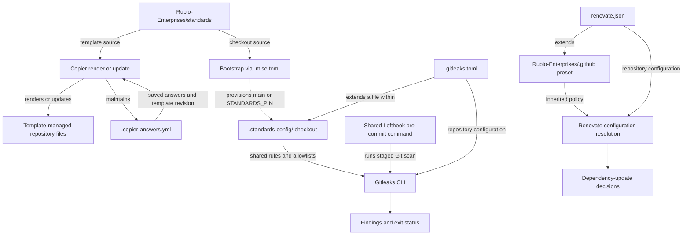
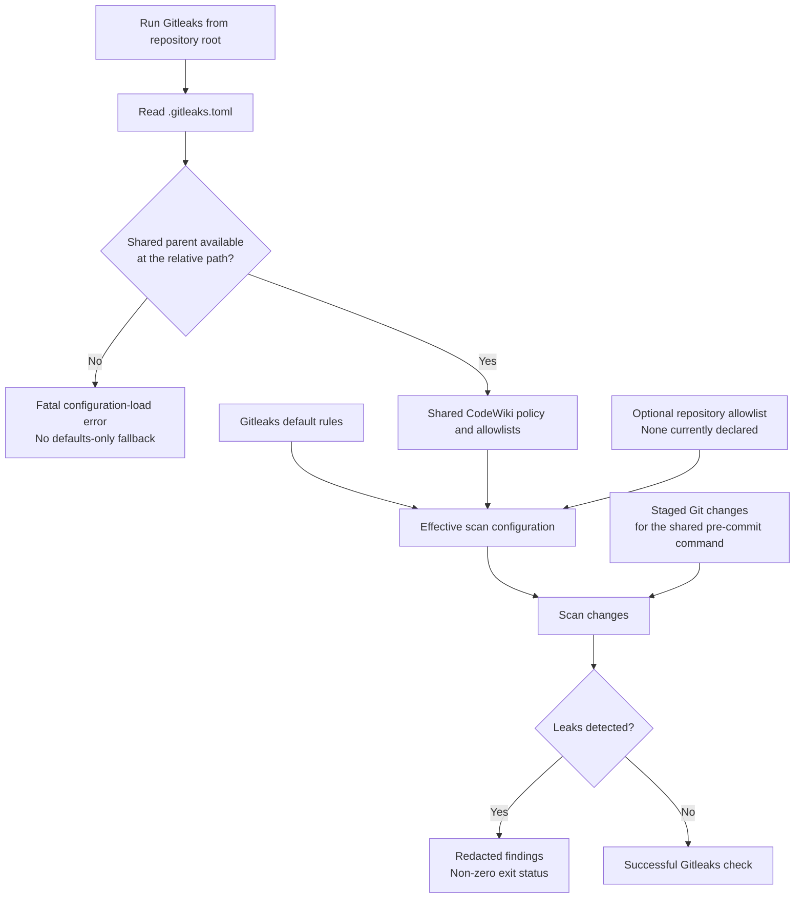

# Repository Build and Configuration: Shared Policy

The `repository_build_and_configuration_shared_policy` module connects
`claude-lsps` to organization-wide repository standards. It records the
Copier template profile, delegates secret-scanning rules to the shared
standards checkout, and delegates dependency-update policy to an organization
Renovate preset. These are declarative configuration contracts, not runtime
components of the language-server proxies.

## Responsibilities and system boundaries

| Repository file | Contract | Consumer |
| --- | --- | --- |
| `.copier-answers.yml` | Template profile and provenance | Copier |
| `.gitleaks.toml` | Shared CodeWiki-aware scan policy | Gitleaks |
| `renovate.json` | Organization dependency-update preset | Renovate |

This module does not provision the shared checkout, implement Git hooks, run
tests, or implement dependency-update logic. Those responsibilities belong to
bootstrap tooling, shared tool configuration, validation entry points, and
Renovate respectively. The root files define which external policies those
consumers use.

For the surrounding configuration layer, see
[Repository Build and Configuration](../repository_build_and_configuration.md).

Sources: `.copier-answers.yml`, `.gitleaks.toml`, `renovate.json`,
`.standards-config/config/lefthook/base.yml`.

## Architecture and dependencies

There are three distinct configuration-resolution paths. The shared standards
repository supplies both templates and a provisioned configuration checkout,
but those two uses need not resolve to the same revision. Renovate resolves a
preset from a different repository and does not use `.standards-config/` for
that resolution.



The arrows distinguish template generation, checkout provisioning,
configuration inheritance, and tool execution. None represents an application
import or a request path through an LSP proxy.

### Revision and availability boundaries

- **Copier template:** `_commit` and `_rubio_template_version` currently record
  `template/v1.55.158`. This identifies template provenance, not the active
  Gitleaks rule revision.
- **Shared configuration checkout:** `.mise.toml` uses `STANDARDS_PIN` when
  supplied; otherwise its bootstrap ref is `main`. Effective shared rules
  depend on the checkout actually provisioned for the environment.
- **Renovate preset:** `github>Rubio-Enterprises/.github` has no explicit
  preset revision in this file. Neither the Copier tag nor `STANDARDS_PIN`
  pins that preset.

`.standards-config/` is ignored by Git and must be provisioned separately.
The root `.mise.toml` can load an empty bootstrap fragment when shared tool
configuration is absent; successful configuration loading is not evidence
that Gitleaks is ready to run. Gitleaks requires its extended file to exist.

Provisioned cloud paths additionally verify a clean, full-history standards
checkout at the expected SHA. The pin-validation and provisioning mechanics
are documented in
[Development Environment Bootstrap](../development_environment_bootstrap.md).

Sources: `.copier-answers.yml`, `.mise.toml`, `.config/mise-bootstrap.toml`,
`.gitignore`, `.gitleaks.toml`, `renovate.json`,
`scripts/common/standards-pin.sh`, `scripts/common/cloud-setup.sh`.

## Copier-managed repository profile

`.copier-answers.yml` is managed state for the standards template. Its header
explicitly prohibits manual editing and warns that Copier overwrites changes.
Use the supported Copier update and answer workflow to change the repository
profile, then review the resulting generated-file changes.

### Template provenance

- `_src_path` is `https://github.com/Rubio-Enterprises/standards.git`, the
  template source.
- `_commit` is `template/v1.55.158`, the recorded template revision.
- `_rubio_template_version` is `template/v1.55.158`, the standards-specific
  template-version marker.

The two version fields currently agree. Neither selects the independently
provisioned `.standards-config/` revision or the remote Renovate preset.

### Repository identity and capabilities

- **Identity:** `project_name: claude-lsps`, `repo_type: native`, and
  `default_branch: main`.
- **Visibility and governance:** `is_public: true` and
  `enforcement_tier: internal`.
- **Repository shape:** `is_marketplace: true`, `is_claude_carrier: true`,
  `is_monorepo: false`, and `is_mcp_server: false`.
- **Enabled capabilities:** `has_javascript: true` and `has_codewiki: true`.
- **Disabled language capabilities:** `has_typescript: false`,
  `has_python: false`, `has_go: false`, `has_ruby: false`, `has_rust: false`,
  and `has_swift: false`.
- **Disabled infrastructure and test capabilities:** `has_ansible: false`
  and `has_playwright: false`.
- **Disabled knowledge and plugin capabilities:** `has_knowledgebase: false`,
  `has_codex_plugin: false`, and `has_herdr_plugin: false`.
- **Disabled packaging capabilities:** `has_container_image: false`,
  `has_release_artifact: false`, and `has_homebrew_formulae: false`.
- **Registry metadata:** `container_registry: ghcr.io/Rubio-Enterprises`.
- **Release automation:** `uses_release_please: false` and
  `fork_release_please: false`.
- **Upstream metadata:** `upstream_url` and `upstream_branch` are empty strings.
- **Platform metadata:** `supported_platforms: []`.

These are template answers, not an inventory of installed tools or executable
checks. In particular:

- Public visibility and the `internal` enforcement tier are separate recorded
  properties; the tier does not make the repository private.
- Registry metadata does not enable container publishing when
  `has_container_image` is false.
- An empty `supported_platforms` answer does not mean CI has no platform jobs.
  Actual workflow execution is described in
  [Continuous Integration](../continuous_integration.md).
- The CodeWiki-aware Gitleaks parent is consistent with `has_codewiki: true`.
  The actual include is declared in `.gitleaks.toml`; the answers file does
  not perform a runtime include.

### Enforcement and tooling choices

- **Enabled enforcement:** `enforce_audit: true`, `enforce_build: true`,
  `enforce_lint_config: true`, `enforce_lint_hooks: true`, `enforce_tests: true`,
  and `enforce_typecheck: true`.
- **Disabled enforcement:** `enforce_e2e: false`.
- **Linter baseline:** `linter_floor: biome`.
- **Workload classifications:** `lint_hooks_workload_class: small` and
  `typecheck_workload_class: small`.

Enforcement flags describe policy intent; the YAML itself runs no checks.
They are not evidence that this module supplies a build target or that
`tsconfig.json` checks every JavaScript proxy. See
[Validation Entry Points](repository_build_and_configuration_validation_entry_points.md)
for the executable test contract and compiler-configuration scope.

The generated `.github/workflows/standards.yml` describes organization-required
governance workflows as owners of audit, lint-config, secret-scan, typecheck,
and lint-hooks, while `.github/workflows/test-gate.yml` owns the canonical
non-E2E tests. Detailed workflow behavior belongs in the CI documentation.

Sources: `.copier-answers.yml`, `.gitleaks.toml`, `Makefile`, `tsconfig.json`,
`.github/workflows/standards.yml`, `.github/workflows/test-gate.yml`.

## Shared Gitleaks secret-scanning policy

### Configuration inheritance

The repository configuration is intentionally a small adapter:

```toml
[extend]
path = ".standards-config/config/gitleaks-codewiki.toml"
```

The inheritance chain is repository configuration, then the shared
CodeWiki-aware configuration, then Gitleaks defaults. The inspected shared
file contains `[extend]` with `useDefault = true`. As documented in the stub,
this uses Gitleaks' maximum of two extension levels. Do not insert another
intermediate parent into that chain.

At the inspected shared checkout, the parent also contains a singular
`[allowlist]` table with these path expressions:

- `\.copier-answers\.yml$` matches paths ending in `.copier-answers.yml`.
  The shared policy describes these as Copier-managed public-key/SHA manifests.
- `^docs/codewiki/temp/` matches CodeWiki temporary dependency-graph data,
  which can contain copies of analyzed files.

These exclusions are inherited, not repository-local additions. They describe
the shared file inspected for this documentation and can change with its
revision. Inspect the active parent before diagnosing an unexpected match or
exclusion. Never treat an allowlisted path as a safe place to store real
credentials.

Sources: `.gitleaks.toml`,
`.standards-config/config/gitleaks-codewiki.toml`.

### Scan data flow and failure behavior

Gitleaks resolves the extension `path` from its working directory, not from
the directory containing the TOML file. Run it from the repository root.
A missing parent is a fatal configuration-load error, not a fallback to
Gitleaks defaults.



The shared Lefthook base currently invokes the following staged-change scan:

```sh
mise exec -- gitleaks git --staged --redact --no-banner
```

This is the actual Gitleaks command in the shared pre-commit registry, not a
separate test implemented by this module. It checks staged changes rather
than every untracked or unstaged file. A successful Gitleaks result does not
imply that other pre-commit checks have passed; load and scan errors can also
fail the command.

The fixture exclusions in `lefthook-local.yml` apply to designated formatting
and ShellCheck jobs, not to Gitleaks. See
[Formatting and Hooks](repository_build_and_configuration_formatting_and_hooks.md)
for hook composition and repository-specific exclusions.

Sources: `.gitleaks.toml`, `.standards-config/config/lefthook/base.yml`,
`lefthook.yml`, `lefthook-local.yml`.

### Repository-local exceptions

The current `.gitleaks.toml` declares no local rules or allowlist. Its supported
exception surface is a singular `[allowlist]` table below `[extend]`.
According to the stub, Gitleaks adds that table alongside the shared
allowlists; it does not replace the parent policy.

For a confirmed false positive, keep the exception narrowly scoped and record
why the content is non-secret. Validate both the intended exemption and an
unrelated synthetic finding. Changes to organization-wide rules or shared
CodeWiki exclusions belong in the standards repository, not in a copied
repository-local rule set.

The separate TruffleHog workflow is not configured by this TOML file.
`.github/workflows/standards.yml` invokes the organization secret-scan workflow
with `mode: trufflehog` on its weekly schedule or a manual dispatch. Do not
assume a Gitleaks allowlist will suppress that scanner. See the CI module for
workflow ownership and triggers.

Sources: `.gitleaks.toml`, `.github/workflows/standards.yml`.

## Renovate dependency-update policy

`renovate.json` delegates update policy rather than defining it locally:

```json
{
  "$schema": "https://docs.renovatebot.com/renovate-schema.json",
  "extends": ["github>Rubio-Enterprises/.github"]
}
```

The schema URL supports configuration validation and editor assistance. The
`extends` entry tells Renovate to resolve the preset hosted in the
`Rubio-Enterprises/.github` repository. This is a remote Renovate preset, not
the local `.github/` directory or the standards checkout.

The file has no local package rules, schedules, automerge settings, or version
constraints. Their absence does not mean those behaviors are disabled: the
effective policy depends on the resolved organization preset and Renovate's
configuration. The preset contents were not supplied with this module, so
specific update grouping, timing, and merge behavior cannot be inferred from
this file alone.

The configuration also does not establish that the Renovate service is
installed, enabled, or authorized for the repository. When update behavior
changes unexpectedly, inspect Renovate's resolved configuration and preset
access rather than changing Copier answers or reprovisioning
`.standards-config/`. Organization-wide update-policy changes belong in the
preset; any intentional repository-specific override should be reviewed as a
local deviation from that policy.

Source: `renovate.json`.

## Operating and changing the policy

### Prepare and inspect a native checkout

From the repository root, a native checkout can explicitly provision the
shared configuration and tools, confirm the Gitleaks parent exists, and run
the same scanner command used by the shared hook:

```sh
mise bootstrap --only repos,tools --yes
test -f .standards-config/config/gitleaks-codewiki.toml
git -C .standards-config rev-parse HEAD
mise exec -- gitleaks git --staged --redact --no-banner
```

The existence test is a diagnostic, not revision or integrity validation.
Record the checkout SHA when comparing results across machines. In a
provisioned environment, follow the bootstrap module's trusted-pin workflow;
do not replace its pin with the Copier template tag or an arbitrary ref.
The staged scan only validates the staged content selected for that run.

Sources: `.mise.toml`, `lefthook.yml`,
`.standards-config/config/lefthook/base.yml`,
`scripts/common/standards-pin.sh`.

### Route changes to the owning layer

- **Repository capabilities or template version:** use the Copier update
  and answer workflow. Review `.copier-answers.yml` and the generated diff;
  do not hand-edit managed answers.
- **Shared Gitleaks rules or CodeWiki exclusions:** change
  `Rubio-Enterprises/standards`. Validate the shared policy, then inspect the
  revision provisioned for consumers.
- **Repository-specific Gitleaks false positives:** add one singular
  `[allowlist]` table in `.gitleaks.toml`. Preserve the parent extension and
  verify that the exemption is narrow.
- **Organization dependency-update behavior:** change the Renovate preset in
  `Rubio-Enterprises/.github`. Validate it and inspect the resolved configuration.
- **Intentional local Renovate overrides:** change `renovate.json`. Retain the
  shared preset unless an approved policy change requires otherwise, and
  validate the combined configuration.
- **Standards checkout provisioning or pinning:** use the bootstrap
  configuration and scripts. Follow the bootstrap module rather than altering
  secret-scanner inheritance.

For Renovate changes, validate preset resolution as well as JSON syntax; this
module defines no repository-local Renovate validator command. For ordinary
repository regression testing, use the contract documented in
[Validation Entry Points](repository_build_and_configuration_validation_entry_points.md).
A passing proxy test suite alone does not demonstrate that a remote preset
resolves or that a Gitleaks exception is correctly scoped.

## Failure modes and diagnostics

- **Gitleaks reports a missing extended configuration.** The shared checkout
  may be absent or incomplete, or the working directory may be wrong. Run
  from the repository root and provision the expected checkout. Do not remove
  `[extend]` to obtain a defaults-only scan.
- **Gitleaks differs despite identical Copier answers.** Template provenance
  and runtime shared policy have different revision selectors. Compare the
  active `.standards-config/` SHA and shared file, not only `_commit`.
- **Files are excluded despite no local allowlist.** The parent supplies
  inherited allowlists. Inspect `gitleaks-codewiki.toml` at the active revision.
- **Fixtures are scanned despite formatting exclusions.** Formatter and
  ShellCheck exclusions do not configure Gitleaks. Review scanner policy
  separately and add only justified, narrow exceptions.
- **TruffleHog reports a Gitleaks-allowlisted value.** The scanners have
  separate configuration paths. Investigate the CI scanner and its policy;
  do not assume local TOML controls it.
- **Manual answer-file changes disappear.** Copier owns `.copier-answers.yml`.
  Change answers through the template workflow and review the rendered result.
- **Renovate cannot resolve its preset.** Check the remote preset's availability,
  Renovate logs, and permissions. Local standards bootstrap does not resolve
  this dependency.
- **Renovate grouping or merge behavior changes without a local edit.** The
  inherited preset is not explicitly revision-pinned here. Inspect the effective
  preset and Renovate configuration before adding overrides.

## Related documentation

- [Repository Build and Configuration](../repository_build_and_configuration.md)
  explains the complete repository configuration layer.
- [Formatting and Hooks](repository_build_and_configuration_formatting_and_hooks.md)
  owns formatter routing, hook inheritance, and fixture exclusions.
- [Validation Entry Points](repository_build_and_configuration_validation_entry_points.md)
  owns the canonical test dispatcher and compiler-configuration boundary.
- [Development Environment Bootstrap](../development_environment_bootstrap.md)
  owns tools, shared-checkout provisioning, and standards-pin verification.
- [Continuous Integration](../continuous_integration.md)
  owns governance integration, secret-scan workflows, and the test gate.
- [Language Intelligence Integration](../../language_intelligence_integration.md)
  describes the runtime LSP integrations supported by this engineering policy.
