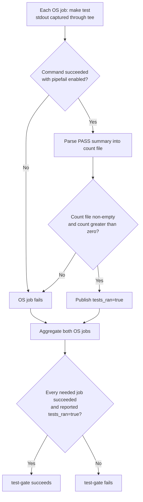

# Repository Build and Configuration: Validation Entry Points

The `repository_build_and_configuration_validation_entry_points` module
provides the repository's canonical test command and its TypeScript compiler
configuration. It consists of `Makefile` and `tsconfig.json`, two small
adapters with separate responsibilities: dispatching executable tests and
inheriting shared compiler policy.

This repository is a plugin marketplace of Bash installers and Node.js
language-server proxies, not an npm package. Neither file establishes an
application build or packaging pipeline.

## Responsibilities and system boundaries

| Component | Responsibility | What it does not do |
| --- | --- | --- |
| `Makefile` | Expose the gate-recognized `make test` command and invoke `bash tests/run.sh`. | Implement tests, install tools, run formatters, or invoke a TypeScript compiler. |
| `tsconfig.json` | Extend the shared TypeScript baseline and declare local compiler options and source scope. | Execute validation, compile the plugin proxies automatically, or create a distributable package. |

The test implementation lives in `tests/run.sh`, `tests/lib/framework.sh`,
and the test cases. Tool provisioning belongs to
[Development environment bootstrap][bootstrap-doc]; workflow execution and
aggregation belong to [Continuous integration][ci-doc]. Formatting and Git
hooks are a separate validation path documented in
[Formatting and hooks][formatting-doc].

Sources: `Makefile`, `tsconfig.json`, `.mise.local.toml`.

## Architecture and dependency paths

The executable test path and the compiler-configuration path are independent.
The former consumes installed tools and the repository test harness; the
latter requires a provisioned shared base and a tool that explicitly reads the
configuration.

```mermaid
flowchart TD
    subgraph Tests["Executable test path"]
        Developer["Developer"]
        CI[".github/workflows/test-gate.yml"]
        Make["Makefile<br/>make test"]
        Harness["tests/run.sh"]
        Cases["tests/lib/framework.sh<br/>tests/cases/*.sh and helpers"]
        Results["Console output and process status"]
        Proof["CI validates positive test count<br/>and aggregates both OS jobs"]

        Developer -->|canonical command| Make
        Developer -->|direct invocation| Harness
        CI -->|runs| Make
        Make -->|bash tests/run.sh| Harness
        Harness -->|loads and executes| Cases
        Cases --> Results
        Results -->|through harness and Make| Proof
    end

    subgraph Compiler["Compiler configuration path"]
        Bootstrap["Environment bootstrap<br/>.mise.toml"]
        Base[".standards-config/config/tsconfig.base.json"]
        Local["tsconfig.json"]
        Consumer["TypeScript-aware tool<br/>when explicitly invoked"]
        Source["src/**/*<br/>declared input pattern"]
        Output["dist<br/>configured emit directory"]

        Bootstrap -->|provisions| Base
        Base -->|inherited through extends| Local
        Local -->|settings| Consumer
        Source -->|inputs, if present| Consumer
        Consumer -.->|when emitting| Output
    end
```



There is deliberately no invocation edge from `make test` to `tsconfig.json`.
The Make recipe does not call `tsc`, npm, mise, or the shared standards
checkout. A TypeScript tool, by contrast, must resolve the `extends` file
before it can use the effective compiler configuration.

Sources: `Makefile`, `tests/run.sh`, `tsconfig.json`, `.mise.toml`,
`.github/workflows/test-gate.yml`.

## Canonical test entry point

### Make target contract

`Makefile` declares `test` as phony and gives it one recipe command,
`bash tests/run.sh`.

- `test` is the only task target in this Makefile. It has no prerequisites.
- `.PHONY: test` makes the recipe run even if a file named `test` exists.
- The recipe invokes Bash explicitly; it does not depend on the runner script
  being executable.
- The relative path `tests/run.sh` assumes the recipe runs from the repository
  root. The Makefile does not change directories or provision an environment.
- A nonzero harness status makes the Make command fail. Make need not return
  the same numeric exit code as the Bash process.

Keep the recipe-leading tab intact. The repository's `.editorconfig`
explicitly selects tab indentation for `Makefile`.

The Makefile header records the reason for this adapter: the repository-local
Test Gate's recognized-command allowlist accepts `make test`, but not the raw
`bash tests/run.sh` invocation. It references Rubio standards ADR-0020 and
`Rubio-Enterprises/standards#387`. The harness remains the implementation;
the Makefile provides the recognized command interface.

Sources: `Makefile`, `.editorconfig`.

### Developer commands

Run these commands from the repository root after provisioning the required
tools:

```sh
# Canonical command used by the repository test gate.
make test

# Direct harness entry point for development.
bash tests/run.sh
```

These are alternative ways to run the same suite; running both is not
necessary. The harness checks for `node`, `bash`, `jq`, and `shellcheck` on
`PATH`. The Make route additionally requires `make`.

No `npm install` or npm test script is required for this entry point. The
repository has no root `package.json`, and its Node proxies have no npm
dependencies. See the [bootstrap documentation][bootstrap-doc] for tool
installation rather than adding setup logic to the Make recipe.

Sources: `Makefile`, `tests/run.sh`, `.mise.local.toml`.

### Relationship to mise tasks

The shared task defaults and repository overrides must be distinguished:

| Layer | Test behavior |
| --- | --- |
| `.mise.toml` | Includes shared task files, including `.standards-config/config/tasks/typescript.toml`. |
| Shared TypeScript task file | Defines `test` as a composite depending on `test:*`, with `test:ts` defaulting to `npm run test`. |
| `.mise.local.toml` | Overrides `test:ts` to run `bash tests/run.sh` and makes `setup:ts` a no-op because the proxies have no npm dependencies. |
| Repository test-gate workflow | Invokes `make test` directly, not a mise task. |

The npm warning in the Makefile concerns the unadapted template default. With
the repository's local task configuration loaded, `mise run test:ts` is
another route to the harness. The composite `mise run test` depends on the
loaded `test:*` tasks and their overrides; it is not the canonical gate
interface. Do not replace `make test` in CI merely because a local mise task
can run the suite.

Task loading and environment management are covered in
[Development environment bootstrap][bootstrap-doc].

Sources: `Makefile`, `.mise.toml`, `.mise.local.toml`,
`.standards-config/config/tasks/typescript.toml`,
`.github/workflows/test-gate.yml`.

## Harness interaction and result contract

The dispatcher leaves discovery, execution, logging, and cleanup to the Bash
harness. After successful preflight, the components interact as follows:

```mermaid
sequenceDiagram
    actor Caller as Developer or CI
    participant M as Make
    participant H as tests/run.sh
    participant F as tests/lib/framework.sh
    participant C as Test case files and functions

    Caller->>M: make test
    M->>H: bash tests/run.sh
    H->>H: Check tools; initialize temporary directory and coverage
    H->>F: Source registration and execution functions
    H->>H: Derive plugin list from marketplace.json
    H->>C: Source tests/cases/*.sh
    C->>F: register_test(name, function)
    H->>F: run_all()
    loop Each registered test
        F->>C: Run function in a subshell; capture its log
        C-->>F: Exit status and test output
        F->>F: Record result; print failure log when needed
    end
    F-->>H: Summary and success or failure status
    H->>H: EXIT trap removes tests/tmp
    H-->>M: Harness process status
    M-->>Caller: Command success or failure and console output
```

The important boundary behavior is:

- **Preflight:** `tests/run.sh` uses `set -euo pipefail` and checks required
  tools before loading cases. Missing tools produce a diagnostic and exit 2.
  Strict error handling also prevents a broken sourced case file from
  silently continuing to a misleading success summary.
- **Plugin discovery:** The runner derives `PLUGINS` from
  `.claude-plugin/marketplace.json` using jq and sorting, rather than keeping
  a second plugin list in the Makefile. An empty derived list exits 2.
- **Case discovery:** The runner sources `tests/cases/*.sh`. The framework
  stores the names and functions supplied through `register_test`, then runs
  them in registration order.
- **Results:** `run_all` treats a test function's zero status as success. It
  captures per-test logs, prints failing tests' logs, continues through the
  registered tests, and returns 1 if any test failed.
- **Temporary data:** Logs and Node V8 coverage are written under
  `tests/tmp/`, which is cleared at startup and removed by an EXIT trap.
  Do not expect these files to remain after a normal completed run. The
  coverage case consumes the collected data before cleanup.

A successful framework run prints this exact summary shape:

```text
PASS: <n> tests, 0 failures
```

A failed framework run prints a `FAIL:` summary with the test count, failure
count, and failed names. Startup or case-loading errors can terminate the
runner before either summary appears.

Live tests are conditional: `tests/cases/08-live.sh` registers individual
scenarios only when their language-server binaries are available on `PATH`.
Consequently, a successful run does not prove every live scenario ran, and
the executed-test count can vary by environment. `.mise.local.toml` provides
a `live-setup` task for those servers; use the
[language integration documentation][language-doc] for server-specific setup
and runtime behavior.

Sources: `tests/run.sh`, `tests/lib/framework.sh`, `tests/cases/08-live.sh`,
`tests/cases/99-coverage.sh`, `.mise.local.toml`.

## CI hand-off and execution proof

`.github/workflows/test-gate.yml` runs `make test` in separate Ubuntu and
macOS jobs. Each job uses `set -euo pipefail` and pipes stdout through `tee`
so that it can retain the log without hiding a failing Make process.

The workflow, not the Makefile, adds the non-empty-execution check. It
extracts the numeric second field from a line matching
`^PASS: [0-9]+ tests`, writes it to the path in
`RUBIO_TEST_GATE_COUNT_OUTPUT`, requires that file to be non-empty, and
requires the value to be greater than zero. Only then does the step set
`tests_ran=true` in `GITHUB_OUTPUT`. The harness does not write this gate
count file itself.



The aggregate runs with `always()` and requires both jobs' successful results
and execution-proof outputs. A missing summary, zero count, failed job, or
skipped job cannot satisfy that contract. By comparison, the Makefile itself
checks only the harness process result; it does not assert a positive count
or that all optional live tests were available.

Treat the success-summary format as an interface consumed by CI. If it
changes, update the workflow parser in coordination with the framework.
Runner provisioning, version pins, triggers, and aggregation details belong
in [Continuous integration][ci-doc].

Sources: `Makefile`, `tests/lib/framework.sh`,
`.github/workflows/test-gate.yml`.

## TypeScript compiler configuration

### Shared policy inheritance

`tsconfig.json` declares the JSON Schema Store tsconfig schema and extends:

```text
./.standards-config/config/tsconfig.base.json
```

The schema supports configuration-aware tooling; it does not run a compiler.
The shared base supplies the policy floor, while the root file owns the local
environment, module behavior, input scope, and output settings.

The inspected shared base defines these inherited options:

| Option | Value | Effect |
| --- | --- | --- |
| `strict` | `true` | Enable TypeScript's strict checking family. |
| `noUncheckedIndexedAccess` | `true` | Include possible `undefined` in unchecked indexed access results. |
| `noImplicitReturns` | `true` | Check that value-returning functions return on all code paths. |
| `noFallthroughCasesInSwitch` | `true` | Report unintended fallthrough in switch statements. |
| `skipLibCheck` | `true` | Skip type checking of declaration files, not ordinary source files. |

These inherited rules reflect the inspected shared checkout. Its revision is
managed by the bootstrap layer, not embedded into `tsconfig.json`.
`.mise.toml` provisions `.standards-config/` from `STANDARDS_PIN` when supplied
and otherwise from `main`. See [Development environment bootstrap][bootstrap-doc]
for revision selection and recovery of a missing checkout.

Sources: `tsconfig.json`, `.standards-config/config/tsconfig.base.json`,
`.mise.toml`.

### Repository compiler options

These are the local settings, not commands. Emit-related settings take effect
only when a compiler is invoked with applicable inputs and emission enabled.

| Setting | Value | Meaning |
| --- | --- | --- |
| `target` | `ES2022` | Select the JavaScript language target for emitted code. |
| `module` | `ESNext` | Use ECMAScript module output. |
| `moduleResolution` | `Bundler` | Resolve modules using TypeScript's bundler-oriented rules; this does not run a bundler. |
| `lib` | `["ES2022"]` | Include ES2022 standard-library declarations; this does not install runtime APIs or Node typings. |
| `declaration` | `false` | Do not emit declaration files. |
| `sourceMap` | `true` | Generate source maps when emitting JavaScript. |
| `outDir` | `dist` | Place emitted output under `dist/`. |
| `rootDir` | `src` | Set the source root used to organize emitted paths. |
| `esModuleInterop` | `true` | Enable TypeScript's CommonJS/ES module interoperability behavior. |
| `forceConsistentCasingInFileNames` | `true` | Enforce consistent casing in file references. |
| `resolveJsonModule` | `true` | Allow JSON module imports with inferred types. |
| `include` | `["src/**/*"]` | Select the initial compiler input files under `src/`. |

`rootDir` is not an input-selection mechanism and does not create a source
directory. `include` selects the initial files; imported files can also enter
a compiler's dependency graph. Likewise, `outDir` and `sourceMap` do not create
artifacts merely because the configuration exists. `resolveJsonModule` is
not a repository-wide JSON validator or an LSP configuration check.

Source: `tsconfig.json`.

### Boundary with JavaScript proxy validation

The repository's proxies live in plugin directories such as
`pyright/lsp-proxy.js` and `vtsls/lsp-proxy.js`, not in a root `src/` tree.
They are not selected by `src/**/*`. Neither the root configuration nor the
inspected shared base enables `allowJs` or `checkJs`.

The template profile records `has_javascript: true` and
`has_typescript: false`. The local `lint:ts` mise override runs `biome check .`,
which is separate from TypeScript compilation. The Makefile defines no build
or type-check target. Therefore:

- Do not infer that the plugin proxies are compiled or type-checked by this
  file because `tsconfig.json` exists.
- Do not interpret ES2022/ESNext compiler settings as changing how Node loads
  the current proxy files at runtime.
- Do not assume `dist/` is a marketplace installation artifact or that a
  `make build` target exists.
- Adding a TypeScript source tree requires an explicit compiler command,
  tool provisioning, and validation integration; changing this JSON file
  alone does not add those steps.

Organization-level typecheck enforcement is a separate concern; the comments
in `.github/workflows/standards.yml` assign it to organization-required
workflows. This module does not define that external workflow's execution or
coverage. See [Continuous integration][ci-doc] rather than treating template
enforcement flags as evidence of local compiler execution.

Sources: `tsconfig.json`, `.standards-config/config/tsconfig.base.json`,
`Makefile`, `.copier-answers.yml`, `.mise.local.toml`,
`.github/workflows/standards.yml`.

## Failure modes and diagnosis

| Symptom | Likely boundary and action |
| --- | --- |
| `make` cannot find the `test` target, or Bash cannot find `tests/run.sh` | Run from the repository root, or use Make's `-C` option to select it. The recipe uses a root-relative path. |
| Make reports a recipe separator error | Preserve the tab before `bash tests/run.sh`; follow `.editorconfig` rather than converting the recipe to spaces. |
| `missing required tools: ...` | The harness exits 2 before executing tests. Provision the listed tools on `PATH`; the Makefile does not install them. |
| A registered case fails | The framework prints its captured output and returns failure. Investigate that case rather than adding test-specific branches to Make. |
| `make test` succeeds locally but CI rejects execution proof | Check the captured `PASS:` summary and extracted count. A zero count or changed summary format does not satisfy the workflow. |
| npm reports a missing `package.json` | An npm-based default was used instead of the shell entry point. Use `make test` or the configured local harness task. |
| A TypeScript consumer cannot resolve the extended config | Provision `.standards-config/config/tsconfig.base.json` through bootstrap. The root configuration has no standalone fallback. |
| A TypeScript consumer reports no inputs, or ignores plugin proxies | Inspect `src/**/*` and the lack of JavaScript-checking options. This configuration is not the proxy test harness. |
| Live scenarios are absent from the executed-test count | Check server availability on `PATH` and the conditional registrations in `tests/cases/08-live.sh`; a positive total does not prove all live tests ran. |

Sources: `Makefile`, `.editorconfig`, `tests/run.sh`,
`tests/lib/framework.sh`, `tests/cases/08-live.sh`, `tsconfig.json`,
`.mise.local.toml`, `.github/workflows/test-gate.yml`.

## Maintenance guidance

- Keep `test` a thin dispatcher. Add test behavior to the harness, cases, or
  helpers rather than introducing a second implementation in Make.
- Preserve `make test` as the gate interface. Any replacement must account
  for both the recognized-command contract documented in `Makefile` and its
  callers in `.github/workflows/test-gate.yml`.
- Coordinate changes to the framework's success summary with both OS jobs'
  count parsers. Preserve nonzero failure propagation through `tee`.
- Keep shared compiler policy in the shared base and repository-specific
  environment settings in `tsconfig.json`. Review the effective configuration
  when the shared checkout changes.
- If TypeScript compilation is introduced, deliberately update source scope,
  tooling, commands, and CI. Do not conflate compiler configuration, Biome
  checks, optional live tests, and the canonical test gate.

## Related documentation

- [Repository build and configuration][repository-doc] describes the parent
  configuration layer and ownership model.
- [Formatting and hooks][formatting-doc] covers EditorConfig, Lefthook, and
  the formatter bridge, which are distinct from the test dispatcher.
- [Shared policy][policy-doc] covers the template profile and inherited
  repository policy.
- [Development environment bootstrap][bootstrap-doc] covers tool provisioning,
  task configuration, and the shared standards checkout.
- [Continuous integration][ci-doc] covers workflow ownership and the full
  repository test-gate lifecycle.
- [Language intelligence integration][language-doc] links to the setup,
  protocol, and document-lifecycle behavior exercised by the suite.

[repository-doc]: ../repository_build_and_configuration.md
[formatting-doc]: repository_build_and_configuration_formatting_and_hooks.md
[policy-doc]: repository_build_and_configuration_shared_policy.md
[bootstrap-doc]: ../development_environment_bootstrap.md
[ci-doc]: ../continuous_integration.md
[language-doc]: ../../language_intelligence_integration.md
