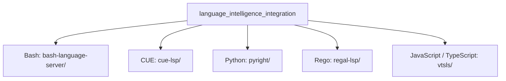
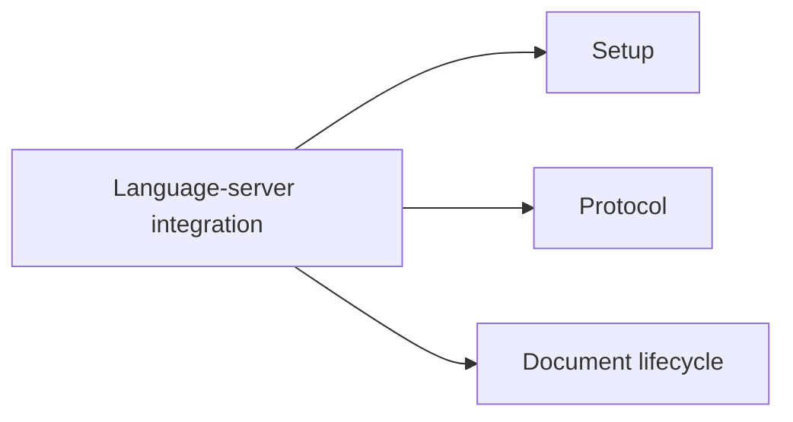

# Language Intelligence Integration

> Source note: No file-reading tool is available in this session, so this
> overview is based on the supplied repository structure rather than the
> contents of the child documentation.

## Purpose

The `language_intelligence_integration` module groups the repository's
language-server integrations for Bash, CUE, Python, Rego, and
JavaScript/TypeScript. Each integration has dedicated documentation areas for
setup, protocol, and document lifecycle.

## Architecture

The module is organized into five server-specific directories. This diagram
shows repository organization, not a verified runtime dependency graph.

Every server integration follows the same documentation breakdown:

This structure separates language-specific integrations while keeping their
documentation organized around consistent concerns.

## Core Components and Documentation

| Integration | Repository path | Documentation |
| --- | --- | --- |
| Bash | `bash-language-server/` | [Bash language server][bash-doc] |
| CUE | `cue-lsp/` | [CUE language server][cue-doc] |
| Pyright | `pyright/` | [Pyright language server][pyright-doc] |
| Regal | `regal-lsp/` | [Regal language server][regal-doc] |
| vtsls | `vtsls/` | [vtsls language server][vtsls-doc] |

Consult each component's documentation for its setup, protocol, and
document-lifecycle details.

[bash-doc]: language_intelligence_integration/bash_language_server.md
[cue-doc]: language_intelligence_integration/cue_language_server.md
[pyright-doc]: language_intelligence_integration/pyright_language_server.md
[regal-doc]: language_intelligence_integration/regal_language_server.md
[vtsls-doc]: language_intelligence_integration/vtsls_language_server.md
