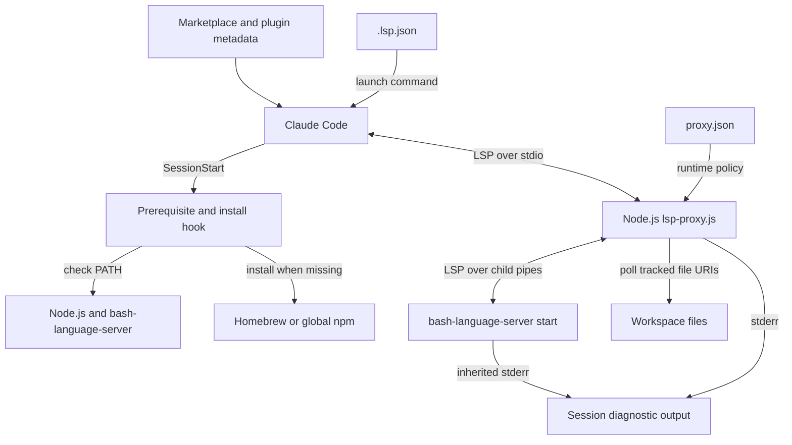
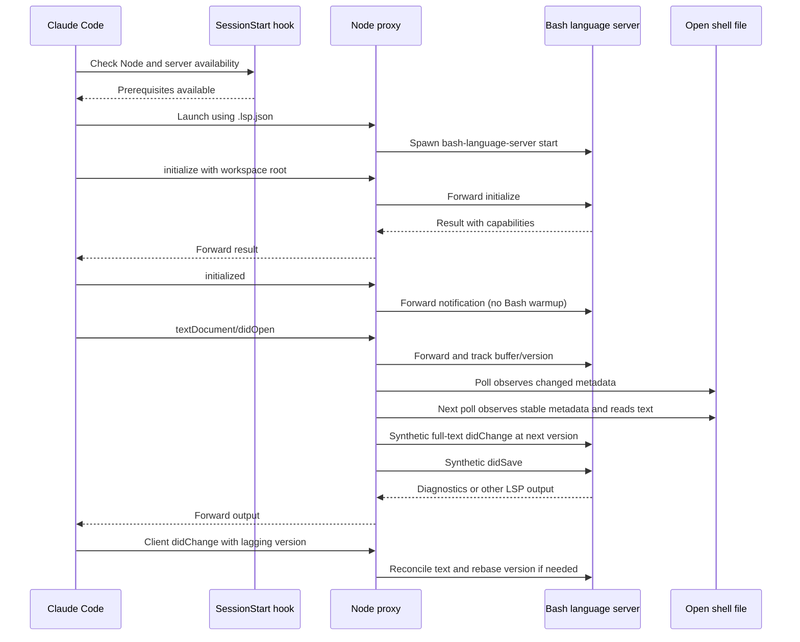

# Bash Language Server Integration

## Purpose and scope

The `bash_language_server` module connects Claude Code to the external
`bash-language-server` process. It registers shell-file extensions, checks
runtime prerequisites at session start, and places a Node.js proxy between the
client and the language server.

The proxy supplies protocol compatibility and refreshes open server buffers
when shell commands, formatters, or other sessions edit files on disk. Shell
parsing, language analysis, and diagnostics remain the upstream server's
responsibility; this module does not implement them.

This plugin belongs to the
[language intelligence integration](../language_intelligence_integration.md)
layer. Its source directory and marketplace name are `bash-language-server`.

## Architecture



Three logical sub-modules separate the responsibilities. They are not separate
packages: protocol transport and document lifecycle share one `lsp-proxy.js`
process and its `openDocs` map.

| Detailed guide | Responsibility |
| --- | --- |
| [Setup and registration][setup] | Routing, prerequisites, installation. |
| [Protocol transport][protocol] | Framing, compatibility, child lifecycle. |
| [Document lifecycle][lifecycle] | Buffer tracking, disk sync, warmup. |

The setup layer combines `.lsp.json` with the session-start check script.
The transport layer handles both message directions, selective interception,
and child-process supervision. The lifecycle layer reconciles client buffers
with stable disk reads and manages synthetic changes, closes, and reopens.
Its workspace-warmup mechanism is optional and inactive in the Bash profile.

## Effective Bash configuration

The shipped runtime policy is `bash-language-server/proxy.json`:

```json
{
  "server": ["bash-language-server", "start"],
  "blocked": []
}
```

That file and the proxy defaults produce the following behavior:

- The child command is `bash-language-server start`, resolved through `PATH`.
- No client methods are blocked; the generic blocking mechanism is inactive.
- No `warmup` section is present, so there is no workspace scan or pre-opening.
- Disk synchronization is enabled at a default interval of 300 ms. A supplied
  nonzero numeric interval is clamped to at least 50 ms; omitted or zero values
  use 300 ms. Setting `"sync": false` disables polling and client-change
  reconciliation, but retains open/close tracking and duplicate-open handling.
- Four fixed server-request methods are auto-acknowledged independently of
  `blocked`.

`bash-language-server/.lsp.json` maps `.sh`, `.bash`, `.zsh`, and `.ksh` to
`shellscript`. This declares client routing, not equivalent upstream support
for every shell dialect. Extensionless files are not explicitly mapped.

The host expands `${CLAUDE_PLUGIN_ROOT}` in the registered arguments to run:

```sh
node "${CLAUDE_PLUGIN_ROOT}/lsp-proxy.js" \
  --config "${CLAUDE_PLUGIN_ROOT}/proxy.json"
```

The proxy uses only Node standard-library modules and runs as shipped
JavaScript, without a module-specific compilation step. The external server
package is installed separately by the hook or the operator. See the
[setup guide][setup] for the complete registration and installation contract.

## Runtime message flow

This example shows successful dependency preparation, launch, and a subsequent
disk update. The hook and launcher are separate host entry points; the hook
does not start the proxy itself.



Ordinary traffic retains its original framed bytes unless a compatibility rule
or lifecycle transformation applies. The proxy consumes and answers these
server requests locally:

- `client/registerCapability`: `null` result.
- `client/unregisterCapability`: `null` result.
- `workspace/configuration`: an array containing one `null` per requested item.
- `window/workDoneProgress/create`: `null` result.

Other server messages continue to the client. These acknowledgments prevent
unsupported client requests from blocking server progress; they do not provide
a registration store, configuration overrides, or progress UI. Framing,
interception order, and permissive malformed-message fallbacks are detailed in
the [protocol guide][protocol].

## Synchronization contract

Only tracked documents participate in polling. With the shipped Bash profile,
tracking starts at a client `textDocument/didOpen`, not by scanning the workspace.

- A document needs a usable `file:` URI and reconstructable buffer text for
  polling. Non-file URIs remain in lifecycle bookkeeping but are not polled.
- Detection compares `mtimeMs`, `ctimeMs`, `size`, and `ino`. A changed tuple
  arms an update; an unchanged tuple on the next poll permits a UTF-8 read.
- Matching disk and buffer text produces no notification. Divergent text
  produces a full-text `didChange` followed by `didSave`, without writing the
  file or sending an edit to the client.
- Synthetic changes increment the tracked version. Subsequent client changes
  are rebased when necessary to maintain increasing server-facing versions.
- Incremental changes still reach the server, but suspend polling for that
  document while its final text is unknown. A later full-text replacement
  restores synchronization; ordering within a change batch matters.
- Two consecutive failed stat checks produce a synthetic `didClose`. Tracking
  remains so a stable disk reappearance or a full-text client change can reopen
  the buffer. A client `didClose` removes tracking entirely.

The stability gate is best-effort, not an atomic-write guarantee. Nominal
propagation takes roughly one to two poll intervals after a final disk write,
plus filesystem, event-loop, and server processing time. Coarse timestamps can
hide a same-size in-place rewrite. Stat errors are treated as absence, even if
permissions rather than deletion caused them. Filesystem operations are
synchronous, so cost grows with the tracked set.

The proxy does not merge competing edits, apply incremental ranges, or protect
unsaved client text from divergent disk content. The [lifecycle guide][lifecycle]
provides state transitions, version formulas, recovery paths, and optional
warmup behavior.

## Installation and operational boundaries

`bash-language-server/hooks/hooks.json` runs the prerequisite script at
`SessionStart` with a 60-second timeout. The script requires `node` even when
the server already exists, and does not install Node itself. An available
server produces an immediate successful return. Otherwise it selects Homebrew
first, or global npm if Homebrew is absent; a failed Homebrew install does not
trigger an npm retry.

Installation uses package-manager-wide locks through `flock` or a `mkdir`
fallback, with availability rechecked inside the lock and afterward. The
120-second lock-wait budget exceeds the host's 60-second hook timeout, so slow
installs or contention can be cut short by the host. Preinstall dependencies
when startup must be predictable. Lock paths, cleanup, and failure-status
nuances are covered in the [setup guide][setup].

Proxy runtime diagnostics use stderr with the prefix
`[lsp-proxy:bash-language-server]`; early configuration errors use `[lsp-proxy]`.
Child stderr is inherited. Stdout is intended for client-facing protocol
traffic. Configuration failures, an empty `server` array, and child spawn
errors terminate the proxy with status 1.

Client stdin EOF sends `SIGTERM` to the child; received `SIGTERM` and `SIGINT`
are forwarded. Numeric child exit codes are preserved. A signal-only child exit
maps to 0 during expected shutdown and 1 otherwise. There is no restart policy
or forced-kill escalation; see [process lifecycle][protocol] for details.

## Packaging and maintenance

`.claude-plugin/marketplace.json` points to `./bash-language-server`, and
`bash-language-server/.claude-plugin/plugin.json` identifies the plugin. These
artifacts define distribution, not the upstream server version. The installer
uses unversioned package-manager commands and does not upgrade an available
binary.

Every plugin ships a real copy of the unified proxy because plugin directories
are installed independently. `tests/cases/02-consistency.sh` requires those
copies to be byte-identical and checks registration arguments, server commands,
installer binaries, and hook references. Put Bash-specific policy in
`bash-language-server/proxy.json`; propagate shared-code changes to every proxy
copy rather than creating a Bash-only implementation fork.

Sibling integrations share the wrapper but have separate policies:

- [CUE language server](cue_language_server.md).
- [Pyright language server](pyright_language_server.md).
- [Regal language server](regal_language_server.md).
- [VTSLS language server](vtsls_language_server.md).

## Validation

Run the repository test entry point from the repository root:

```sh
make test
```

`Makefile` delegates to `bash tests/run.sh`. The runner requires `node`, `bash`,
`jq`, and `shellcheck`; marketplace entries determine which plugins are checked.
Relevant test groups are:

- `tests/cases/01-manifests.sh` and `tests/cases/02-consistency.sh`: configuration
  structure, deployment wiring, and proxy-copy identity.
- `tests/cases/03-installer-lint.sh`,
  `tests/cases/04-installer-behavior.sh`, and
  `tests/cases/05-installer-concurrency.sh`: installer syntax, selection, failures,
  and serialization, including the Bash directory-lock fallback.
- `tests/cases/06-proxy.sh`: transport, acknowledgments, blocking, shutdown,
  disk synchronization, rebasing, and duplicate-open handling.
- `tests/cases/07-warmup.sh`: optional discovery and the no-warmup path.
- `tests/cases/08-live.sh`: Bash clean/broken-file checks, registered only when
  `bash-language-server` is available. Missing binaries are reported as skipped.

`.github/workflows/test-gate.yml` runs `make test` in separate Linux and macOS
jobs with Node 24.22.0 and requires successful, non-empty execution from both.
That CI pin is not a runtime minimum enforced by the hook. A green test gate
does not by itself prove that optional live Bash checks ran.

Repository-wide concerns are documented separately:

- [Build and configuration][build].
- [Environment bootstrap][bootstrap].
- [Continuous integration][ci].

## Source map

- `bash-language-server/.lsp.json`: client registration and shell-file routing.
- `bash-language-server/proxy.json`: effective Bash runtime policy.
- `bash-language-server/hooks/hooks.json`: session-start command and timeout.
- `bash-language-server/hooks/check-bash-language-server.sh`: prerequisite
  checks, installation, and locking.
- `bash-language-server/lsp-proxy.js`: framing, compatibility responses, child
  lifecycle, document tracking, polling, and optional warmup.
- `bash-language-server/.claude-plugin/plugin.json` and
  `.claude-plugin/marketplace.json`: plugin identity and distribution wiring.

[setup]: bash_language_server/bash_language_server_setup.md
[protocol]: bash_language_server/bash_language_server_protocol.md
[lifecycle]: bash_language_server/bash_language_server_document_lifecycle.md
[build]: ../engineering_platform_and_validation/repository_build_and_configuration.md
[bootstrap]: ../engineering_platform_and_validation/development_environment_bootstrap.md
[ci]: ../engineering_platform_and_validation/continuous_integration.md
