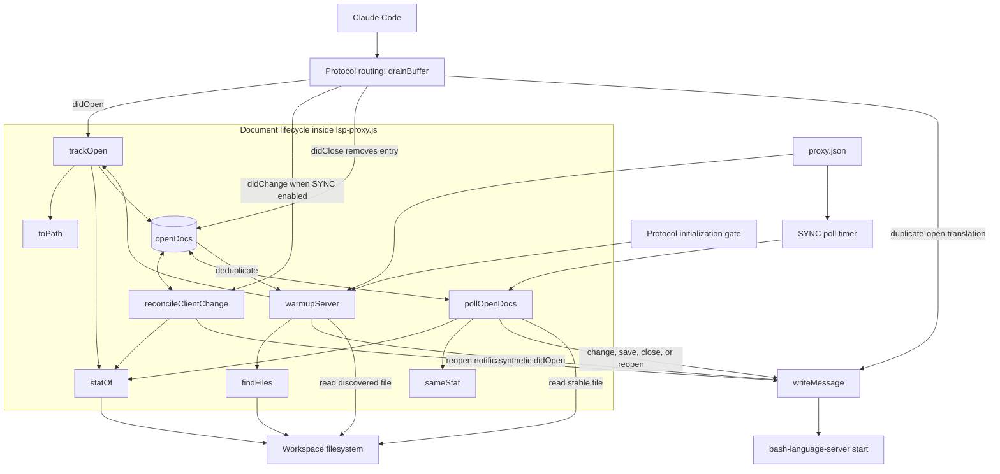
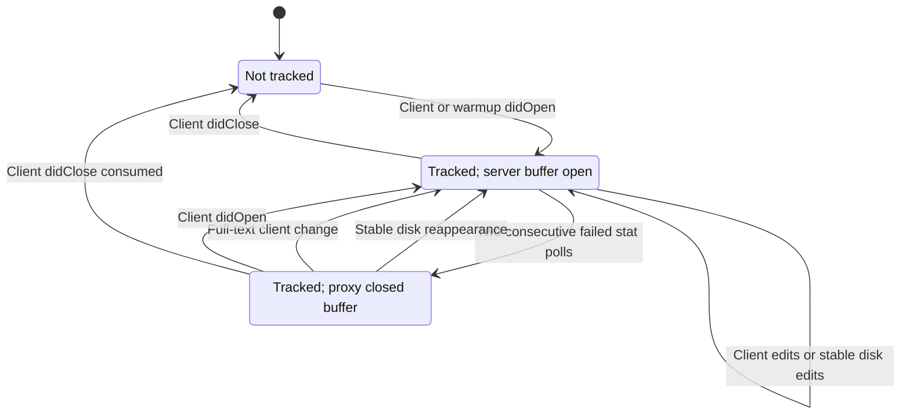
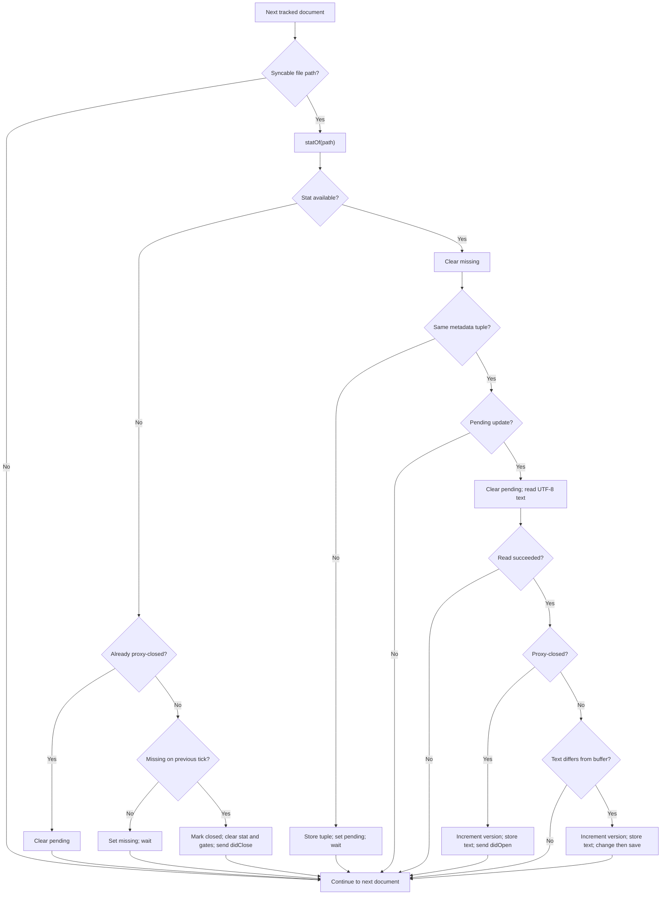
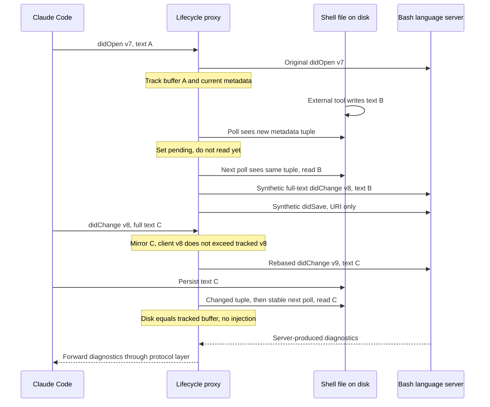

# Bash Language Server Document Lifecycle

The `bash_language_server_document_lifecycle` module keeps the Bash language
server's open buffers aligned with client notifications and out-of-band disk
changes. It also provides optional workspace warmup for servers that begin
indexing only after a document opens.

These are logical responsibilities inside `bash-language-server/lsp-proxy.js`,
not a separate service. The proxy tracks complete buffer text, reconciles version
numbers, and synthesizes lifecycle notifications. It does not parse shell code,
write workspace files, merge edits, or produce diagnostics itself.

## Scope and system context

Claude Code reports its own edits through LSP, but external operations such as
shell commands, formatters, Git operations, or another session may change files
without notifying the server. The lifecycle layer detects these changes for
tracked documents and updates the server-facing buffers.

Related documentation defines the surrounding responsibilities:

- [Bash integration overview][overview]: plugin architecture and runtime policy.
- [Setup and registration][setup]: shell-file routing, prerequisites, and launch.
- [Protocol transport][protocol]: framing, message routing, compatibility
  responses, and process shutdown.
- [Language intelligence integration][integration]: the wider integration layer.

The transport layer calls lifecycle helpers before forwarding client messages.
Polling and warmup emit notifications directly to the child server through
`writeMessage(child.stdin, ...)`. They do not send synthetic edits to the client.
Server diagnostics return through the normal protocol forwarding path.

### Architecture and component dependencies



Duplicate-open translation runs in `drainBuffer`, rather than in `trackOpen`.
Ordinary client frames and version-rebased frames also reach the server through
that router; the diagram emphasizes state access and synthetic notifications.

The helpers use Node standard-library APIs only:

- `node:fs`: synchronous stat, directory enumeration, and UTF-8 file reads.
- `node:path`: path joining and extension extraction for discovery.
- `node:url`: conversion between file URIs and filesystem paths.
- `Map`, `Set`, and timers: tracking, exact-match filters, and polling.

## Effective Bash configuration

`bash-language-server/.lsp.json` launches the proxy with
`--config ${CLAUDE_PLUGIN_ROOT}/proxy.json`.
`bash-language-server/proxy.json` selects `bash-language-server start` and has no
`warmup` or `sync` properties. Consequently, the shipped Bash behavior is:

| Concern | Effective behavior |
| --- | --- |
| Disk synchronization | Enabled by default. |
| Poll interval | 300 ms. |
| Workspace warmup | Disabled; no startup scan or synthetic workspace opens. |
| Initial tracking | Client `textDocument/didOpen` notifications. |

Synchronization configuration is evaluated as follows:

```javascript
const SYNC = config.sync === false
  ? null
  : { pollMs: Math.max(50, config.sync?.pollMs || 300) };
```

A positive numeric interval below 50 ms is clamped to 50 ms. An omitted or zero
`pollMs` uses 300 ms because the expression uses `||`, not `??`.

Setting `"sync": false` disables both the poll timer and
`reconcileClientChange` calls for client changes. It does **not** disable
open/close bookkeeping, warmup deduplication, or duplicate-open translation.
The map remains useful even when no files are being polled.

Client registration maps `.sh`, `.bash`, `.zsh`, and `.ksh` to `shellscript` in
`bash-language-server/.lsp.json`. Polling itself does not filter extensions: any
tracked document with a usable file path and reconstructable text is eligible.
Routing details belong to the [setup guide][setup].

## Core components and shared state

All eight helpers are file-scoped functions in the same executable; none is an
independently exported API.

| Component | Responsibility |
| --- | --- |
| `toPath` | Safely convert a file URI to a filesystem path. |
| `statOf` | Obtain the metadata tuple used for change detection. |
| `sameStat` | Compare two available metadata tuples. |
| `trackOpen` | Create or reset a document's tracking entry. |
| `reconcileClientChange` | Mirror client text and adjust outgoing versions. |
| `pollOpenDocs` | Detect stable disk edits, absence, and reappearance. |
| `findFiles` | Discover files for optional warmup. |
| `warmupServer` | Open discovered files and enroll them in tracking. |

### The openDocs map

`openDocs` is keyed by the exact document URI string. Each entry contains:

| Field | Meaning |
| --- | --- |
| `version` | Latest version tracked for the server-facing buffer. |
| `text` | Last known complete buffer content. |
| `languageId` | Language identifier reused for synthetic opens. |
| `path` | Converted filesystem path, or `null`. |
| `stat` | Last observed metadata tuple, or `null`. |
| `pending` | A metadata change needs one unchanged poll before reading. |
| `missing` | One failed stat has armed the deletion gate. |
| `closed` | The proxy closed the server buffer but retained tracking. |
| `unsyncable` | Complete buffer text is unknown; polling must skip it. |

`trackOpen(uri, text, version, languageId)` replaces the entry and initializes
all four flags to `false`. It uses the supplied numeric version, otherwise `1`;
nullish text becomes `''`, and a missing or falsy language ID becomes
`plaintext`. It also records the current stat when the URI has a usable path.

The text represents the last known **buffer**, not simply the last disk read.
With synchronization enabled, full-text client changes update it immediately.
A later disk write matching that text is therefore a no-op rather than an echo
of the client's own edit. When synchronization is disabled, ordinary client
changes bypass this reconciliation and do not refresh the tracked text/version.

### URI and metadata helpers

`toPath(uri)` accepts strings beginning with `file:` and delegates to
`fileURLToPath`. Non-file URIs, malformed inputs, and conversion failures return
`null`. Such documents remain tracked for lifecycle and deduplication purposes,
but cannot participate in filesystem polling. Client URI keys are not
canonicalized or resolved through real paths.

`statOf(path)` returns `{ mtimeMs, ctimeMs, size, ino }`, or `null` for any stat
failure. The tuple deliberately includes more than modification time and size:

- `ctimeMs` helps detect rewrites that restore the original modification time.
- `ino` helps detect atomic replacement by write-then-rename.
- `mtimeMs` and `size` detect ordinary content and length changes.

`sameStat(a, b)` is truthy only when both tuples exist and all four fields match.
Two `null` values do not count as equal; absence has a separate polling branch.

## Client document lifecycle

The following states describe whether the server has a buffer and whether the
proxy retains a tracking entry. Disk-triggered transitions require polling to be
enabled, a usable file path, and `unsyncable === false`.



`pending`, `missing`, and `unsyncable` are additional flags, not independent
buffer-open states. In particular, an unsyncable entry can still be server-open
or proxy-closed, but the poller skips it in either case.

### Opening and duplicate-open handling

On a client `textDocument/didOpen`, `drainBuffer` inspects existing state:

- **No entry, or a proxy-closed entry:** call `trackOpen` and forward the
  original notification. A normal client reopen uses its supplied version;
  it does not use the synthetic-reopen version formula.
- **Already open server-side:** consume the original open and emit a synthetic
  full-text `didChange` instead. This prevents an open-after-open sequence when
  warmup or an earlier client open already created the buffer.

For the duplicate-open case, the client's text becomes authoritative. The
router preserves or updates the language ID, refreshes the stat baseline,
clears `pending`, `missing`, and `unsyncable`, and selects this version:

```javascript
Math.max(typeof td.version === 'number' ? td.version : 0, st.version + 1)
```

The translation sends one `didChange`, not a second `didOpen` or a `didSave`.
It runs even with disk synchronization disabled. The shared wrapper avoids
undefined duplicate-open behavior that can disrupt diagnostics in servers such
as Regal; the same protection is applied to Bash.

### Reconciling client changes

When `SYNC` is enabled, `drainBuffer` calls
`reconcileClientChange(msg, rawMessage)`. An untracked URI returns its original
frame unchanged. For a tracked URI, the helper first scans `contentChanges` in
order to determine whether the final buffer can be reconstructed.

A full replacement has `range === undefined` and string `text`; an empty
string is valid. The helper does not apply incremental ranges. Each non-full
replacement makes the text unknown until a later full replacement in the same
batch restores it.

| Ordered batch | Final text known? | Polling outcome |
| --- | --- | --- |
| `[full]` | Yes | Enable or retain disk sync. |
| `[incremental, full]` | Yes | Last full replacement restores disk sync. |
| `[full, incremental]` | No | Disable disk sync for this document. |
| `[incremental]` | No | Disable disk sync for this document. |

When final text is known, it replaces `st.text` and clears `unsyncable`. A
transition back to syncability is logged. When an incremental or otherwise
non-full entry leaves the final text unknown, `unsyncable` is set and logged
once on that transition. Incremental changes still reach the server; only
proxy-side disk synchronization is suspended.

An empty or non-array `contentChanges` value does not itself establish new text
or newly mark the document unsyncable. This helper is not an LSP payload
validator. A later full-text change, or a duplicate client open, restores known
buffer content and allows polling again.

### Reopening after a client edit

If `st.closed` is true and the batch yields known full text, reconciliation
converts the change into a synthetic `didOpen` using the retained language ID.
It clears `closed`, `missing`, and `pending`, refreshes the stat, and chooses the
larger of the supplied numeric version and `st.version + 1`.

The helper then returns `null`, consuming the original `didChange`. No
synthetic save accompanies this reopen. A range-only change cannot use this
path: it remains subject to forwarding/version handling, leaves the buffer
unknown, and does not reopen the document for the server.

### Version rebasing and return values

For changes not converted into a reopen, the outgoing version follows these
rules:

- A numeric client version greater than the tracked version is adopted, and the
  original frame is returned.
- Otherwise, increment the tracked version and return a newly framed copy with
  `params.textDocument.version` replaced. This includes missing client versions.

Only the version field is rewritten; the client change batch is preserved.
Version rebasing continues for unsyncable documents while `SYNC` is enabled.
The client is not informed of the proxy's higher counter, so several successive
client changes may each require rebasing.

| Return value | Caller action |
| --- | --- |
| Original `rawMessage` | Forward the original bytes. |
| Reframed `Buffer` | Forward the version-rebased message. |
| `null` | Forward nothing; a synthetic reopen was already emitted. |

### Closing from the client

A client `textDocument/didClose` always deletes the map entry. It is forwarded
normally unless `st.closed` was already true, in which case it is consumed to
avoid closing the server buffer twice. Once removed, the document is no longer
polled and will not reopen merely because a file appears on disk.

Client `didSave` notifications do not update lifecycle state; they follow the
ordinary transport path. A save alone does not enroll an untracked document.

## Disk polling process

The poll timer is created at proxy startup when `SYNC` is enabled. It calls
`pollOpenDocs` at the configured interval, is unreferenced when supported, and
is cleared during proxy shutdown. It does not keep an otherwise finished
process alive. Shutdown details belong to the [protocol module][protocol].

Each tick visits every tracking entry. Unsyncable documents and documents with
no filesystem path are skipped before any stat check.



### Stable edits and content comparison

A new metadata tuple updates `st.stat` and sets `pending`, without reading the
file. Only an unchanged tuple on a subsequent poll permits a content read.
Further metadata changes restart that wait. This is the two-tick stability gate.

After a successful stable read of an open document:

- If text equals `st.text`, send nothing. This covers a metadata-only touch or a
  client's own write already mirrored into the tracked buffer.
- If text differs, increment `st.version`, store the new text, and send a
  full-text `textDocument/didChange` followed by `textDocument/didSave`.

The change carries `{ uri, version }` in `textDocument` and
`contentChanges: [{ text }]`, without a range. The save carries only the document
URI: it has no text or version field. Both are JSON-RPC notifications sent only
to the server. The proxy neither writes the file nor emits a filesystem-watcher
notification such as `workspace/didChangeWatchedFiles`.

With interval `P`, nominal propagation is about `P` to `2P` after the last
metadata-changing write, plus filesystem, event-loop, and server processing
latency. At the default 300 ms, this is roughly 300–600 ms under idle conditions,
not a timing guarantee.

### Deletion and reappearance

Any failed stat is treated as absence, including failures unrelated to actual
deletion. The first failed poll sets `missing`; a second consecutive failure
emits `textDocument/didClose`, sets `closed`, clears `stat` and both gates, and
retains the tracking entry. The version and last buffer text are retained.

Closing tells the server to drop its buffer. Any resulting diagnostic clearing
is the server's responsibility; the proxy does not fabricate empty diagnostics.
While the file remains absent, an already-closed entry sends no further closes.

When stat succeeds again, the null baseline guarantees a new pending update.
After one unchanged tuple and a successful read, the proxy increments the
retained version and sends `didOpen` with disk text and the retained language ID.
It reopens even if that text equals the old buffer, and sends no accompanying
`didSave`.

A normal client close removes the retained entry altogether. Renaming a file
does not move its tracking entry to a new URI: the old path becomes absent, and
the new path needs its own open or warmup discovery.

### Example interaction and version continuity



This is reconciliation, not a backoff window. The proxy remembers client text
instead of temporarily ignoring the filesystem after an edit. It does not
implement conflict resolution: a later observed, stable, divergent disk value
can still replace the server-facing buffer without changing the client's copy.

## Optional workspace warmup

Warmup is available in the shared implementation but is **not enabled by the
shipped Bash configuration**. Its purpose is to open selected workspace files
for servers that defer indexing until first-open, such as the Regal integration.
Warmup does not wait for indexing or diagnostics to complete.

### Initialization gate

The protocol layer records `initialize.params.rootUri`, falling back to
`rootPath`. It also records a server response with a truthy
`result.capabilities`. Warmup is scheduled when a subsequent client
`initialized` notification arrives and both a root and `WARMUP` are available.

The router forwards `initialized` first, then uses `setImmediate` to call
`warmupServer(rootDir)`. This preserves write ordering without requiring an
acknowledgment from the server. A root beginning with `file://` is converted by
`fileURLToPath`; otherwise it is used as a filesystem path. A valid root URI/path
is required; unlike document conversion through `toPath`, this root conversion
is not wrapped in a conversion-error handler.

This is a scan of one captured root, not multi-root workspace discovery. The
code does not enumerate `workspaceFolders` or rescan on workspace-folder changes.

### Discovery with findFiles

`findFiles(rootDir, extensions, excludeDirs)` builds exact-match sets and uses a
stack for recursive directory traversal without JavaScript call-stack growth.
It returns an array of matching paths before warmup begins opening them.

- Extensions match `extname(entry.name)` exactly and case-sensitively.
- Exclusions match entry basenames at every depth, not globs or relative paths.
  The exclusion check applies to files as well as directories.
- Only regular-file entries are collected. Discovered symbolic-link entries
  are neither traversed as directories nor included as regular files.
- Unreadable directories are skipped silently; discovery continues elsewhere.
- There are no built-in exclusions, file-count limits, or file-size limits.

For example, this is an **opt-in illustration**, not the shipped profile:

```json
{
  "server": ["bash-language-server", "start"],
  "blocked": [],
  "sync": { "pollMs": 300 },
  "warmup": {
    "extensions": [".sh"],
    "exclude": [".git", "node_modules"]
  }
}
```

### Opening and enrolling discovered files

`warmupServer` returns immediately unless `WARMUP.extensions` is a nonempty
array. Otherwise it discovers files, converts each path to a URI with
`pathToFileURL`, and skips any URI already present in `openDocs`. It also skips
files when the UTF-8 read fails.

For each remaining file, it sends `didOpen` with complete text and immediately
calls `trackOpen`. Thus warmup opens participate in disk sync exactly like
client opens, provided synchronization is enabled.

Synthetic warmup versions start at `0` and increment once per successfully sent
open across the batch. Later versions evolve independently for each entry; this
is not a global version clock. Discovery order is not explicitly sorted.

Language IDs come from the shared extension map: `.sh` becomes `shellscript`;
other mapped languages include Rego, Python, TypeScript, JavaScript, CUE, YAML,
and Swift. An unmapped extension falls back to its suffix without the dot.
Notably, adding `.bash`, `.zsh`, or `.ksh` to warmup extensions would yield
`bash`, `zsh`, or `ksh`, not the `shellscript` IDs declared by `.lsp.json`.
Registration and warmup language mapping are separate mechanisms.

Both possible client/warmup orderings avoid duplicate server opens:

- If the client opens first, the map makes warmup skip that URI.
- If warmup opens first, a later client open is translated into a full-text
  change, adopting the client's buffer and an increasing version.

Warmup deduplication also works with `sync: false`, because tracking remains
active. Warmup is a startup scan, not continuous discovery of newly created
workspace files.

## Operational limits and diagnostics

The synchronization contract has several important boundaries:

- **Tracked documents only:** the default Bash profile does not cover unopened
  workspace files. An untracked disk edit produces no lifecycle notification.
- **Unknown buffers:** incremental-only client changes suspend all polling for
  that entry, including deletion and reappearance detection, until full text is
  known again.
- **Best-effort stability:** equal metadata across two polls is not an atomic
  read guarantee. A writer can pause mid-write, or change the file between stat
  and read. There is no lock or post-read stat validation.
- **Metadata blind spots:** a same-size in-place rewrite within a coarse
  timestamp quantum can leave the entire tuple unchanged. Files are not hashed
  on every tick.
- **Stat failures:** permission or transient errors can trigger the deletion
  path. A newly opened file URI with no disk file is treated the same way.
- **Read failures:** stable-read errors are silently skipped after `pending` is
  cleared. Without a later metadata change, that read is not automatically
  retried. Warmup read failures are also skipped without retry.
- **Resource cost:** polling stats all eligible tracked files synchronously.
  Discovery and file reads also run synchronously, so large tracked sets or
  warmup trees can delay message processing. Entries retain complete text and
  proxy-closed entries remain until a client close or process termination.
- **No dirty-buffer merge:** client and disk changes are not merged, and there
  is no separate dirty-buffer protection or write-back to the client.

Lifecycle messages go to stderr with the prefix
`[lsp-proxy:bash-language-server]`; stdout remains reserved for protocol traffic.
Useful log phrases include:

| Log phrase | Interpretation |
| --- | --- |
| `disk-sync: injected didChange` | Stable divergent disk text was sent. |
| `disk-sync: rebased client didChange` | Client version needed advancement. |
| `incremental didChange` | Polling was disabled for an unknown buffer. |
| `disk-sync re-enabled` | A full replacement restored known text. |
| `disk-sync: closed` | Repeated stat failure closed the server buffer. |
| `disk-sync: reopened` | Disk return or a client edit reopened the buffer. |
| `translated client didOpen -> didChange` | An already-open URI was updated. |
| `warmup:` | Discovery/open counts, or no matching files. |

A warmup discovery count can exceed the sent count because already-tracked and
unreadable files are skipped. Stat/read failures and content-identical polls
have no dedicated log message. Missing injection logs alone do not identify
which of these conditions occurred.

## Maintenance and validation

The lifecycle code is part of the unified proxy copied into each plugin.
`tests/cases/02-consistency.sh` requires those copies to be byte-identical.
Changes to helper logic must reach every deployed copy; Bash-only runtime policy
belongs in `bash-language-server/proxy.json`.

Run the repository test entry point from the repository root:

```sh
make test
```

`Makefile` dispatches to `bash tests/run.sh`.
`.github/workflows/test-gate.yml` runs this entry point on Linux and macOS.
Repository-wide test setup and CI requirements are documented in the
[integration validation guide][validation].

The relevant scenario registrations are:

- `tests/cases/06-proxy.sh`: disk injection, client reconciliation, incremental
  suspension and full-text recovery, no-op writes and client close, disabled
  sync, warmup enrollment, deletion/reappearance, version rebasing, and both
  client/warmup open orderings.
- `tests/cases/07-warmup.sh`: file discovery/opening, multiple extensions, empty
  trees, and the no-warmup configuration path.
- `tests/cases/02-consistency.sh`: identical proxy copies and consistent launch
  wiring across plugins.

When changing lifecycle behavior, preserve batch ordering, monotonic outgoing
change versions, suppression of duplicate opens/closes, and the distinction
between a retained proxy-closed entry and a client-removed entry. Also verify
that disabling synchronization leaves deduplication intact and that warmup
remains opt-in for the shipped Bash profile.

[overview]: ../bash_language_server.md
[setup]: bash_language_server_setup.md
[protocol]: bash_language_server_protocol.md
[integration]: ../../language_intelligence_integration.md
[validation]: ../bash_language_server.md#validation
