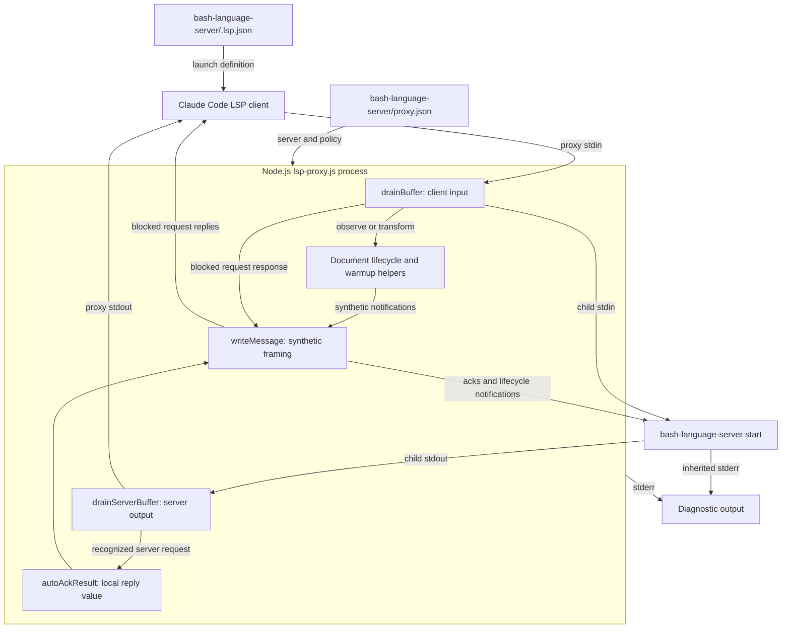
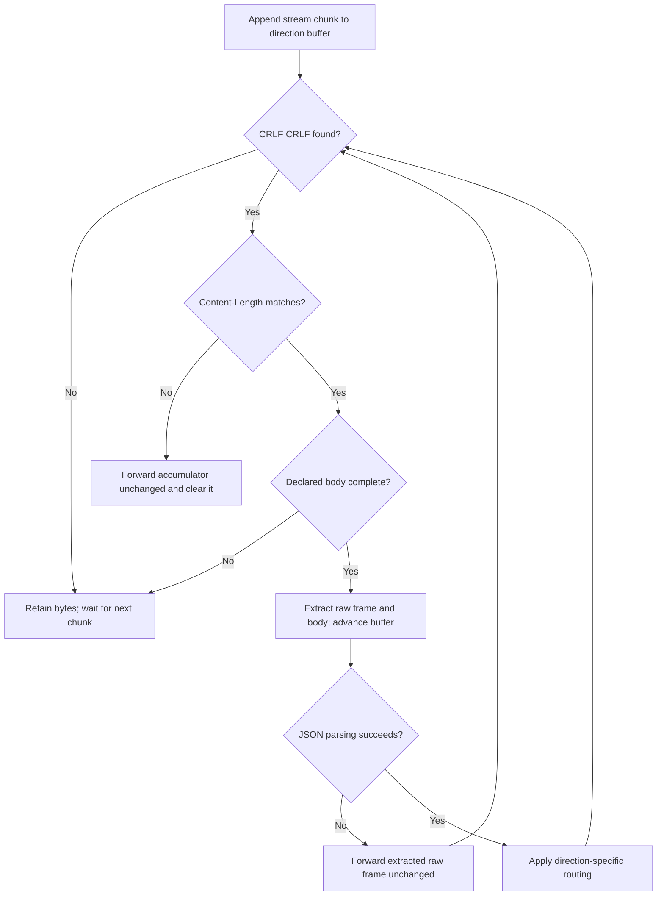
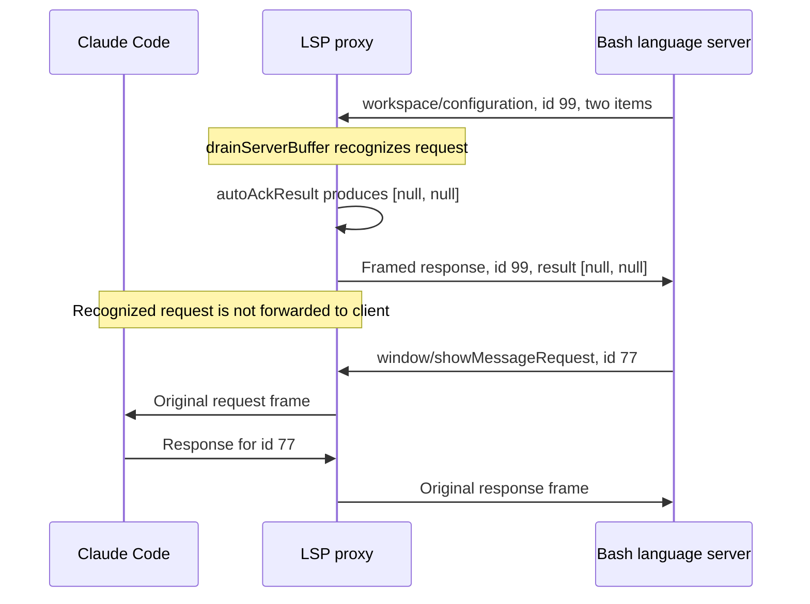
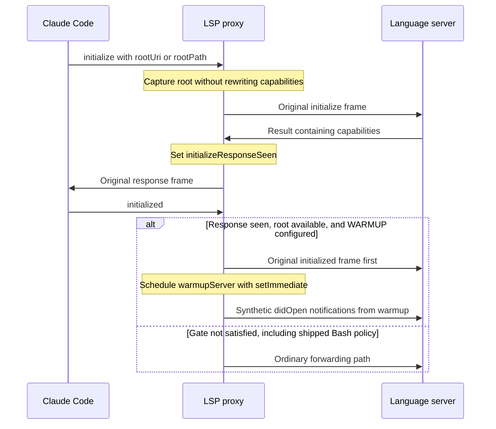

# Bash Language Server Protocol

The `bash_language_server_protocol` module is the transport and compatibility
layer inside `bash-language-server/lsp-proxy.js`. It relays Language Server
Protocol (LSP) messages between Claude Code and the external Bash language
server, preserving original wire bytes unless a compatibility rule or document
lifecycle transformation applies.

This page covers framing, bidirectional routing, synthetic responses,
initialization coordination, and process shutdown. It does not implement shell
analysis or diagnostics; those remain the upstream server's responsibility.

## Scope and system context

This is a logical module within one executable proxy, not a separate package or
service. Its four core functions are `writeMessage`, `drainBuffer`,
`drainServerBuffer`, and `autoAckResult`.

- [Bash language-server integration](../bash_language_server.md) describes the
  plugin's overall architecture and deployment responsibilities.
- [Setup and registration](bash_language_server_setup.md) covers `.lsp.json`,
  prerequisites, installation, and host launch configuration.
- [Document lifecycle and disk synchronization][lifecycle] covers tracked
  buffers, version rebasing, disk polling, and workspace warmup.
- [Language intelligence integration](../../language_intelligence_integration.md)
  places this plugin alongside the other language-server integrations.

### Architecture and dependencies



The implementation uses Node standard-library APIs only. `Buffer` provides
byte-oriented framing; `node:child_process` spawns the server; `node:fs` and
`node:path` load configuration and support the lifecycle helpers; `node:url`
converts workspace and document URIs. There is no external JSON-RPC library,
network transport, or module-specific compilation step.

The child is spawned with `stdio: ['pipe', 'pipe', 'inherit']`. Proxy stdin and
stdout connect to the client; child stdin and stdout carry server protocol
traffic. Child stderr is inherited, keeping diagnostic text out of the framed
stdout channel.

### Effective Bash policy

`bash-language-server/.lsp.json` launches Node with the plugin's `lsp-proxy.js`
and `--config ${CLAUDE_PLUGIN_ROOT}/proxy.json`. The host resolves the plugin-root
placeholder. The shipped `bash-language-server/proxy.json` contains:

```json
{
  "server": ["bash-language-server", "start"],
  "blocked": []
}
```

| Setting | Bash behavior |
| --- | --- |
| Child command | `bash-language-server start` via `PATH`. |
| Client blocking | Off: empty `blocked` list. |
| Server auto-ack | On: four fixed request methods. |
| Warmup | Off: no `warmup` configuration. |
| Disk sync | On: default 300 ms polling interval. |

The generic wrapper supports `blocked`, `warmup`, and `sync` configuration, but
these mechanisms must not be confused with Bash-specific enabled features.
Setting `sync` to `false` disables polling and client-change reconciliation; it
does not disable all open/close bookkeeping or duplicate-open handling. See the
lifecycle page for those distinctions and poll interval configuration.

## Component responsibilities and state

All four functions are defined at file scope in the same executable. They are
not independently exported APIs.

| Function | Main role |
| --- | --- |
| `writeMessage(stream, body)` | Frame a serialized body. |
| `drainBuffer()` | Route client input and observe lifecycle. |
| `drainServerBuffer()` | Route server output and auto-ack requests. |
| `autoAckResult(msg)` | Construct an auto-ack result value. |

Relevant shared state is deliberately small:

- `buffer` and `serverBuffer` independently accumulate bytes in each direction.
- `rootUri` records `initialize.params.rootUri`, falling back to `rootPath`, then
  `null`.
- `initializeResponseSeen` becomes `true` when server output has a truthy
  `result.capabilities` value.
- `openDocs` is shared with lifecycle helpers; protocol handling observes opens,
  changes, and closes before ordinary forwarding.
- `shuttingDown` distinguishes expected signal-based termination from an
  unexpected child termination. `pollTimer` is cleared during shutdown.

There is no general pending-request table, request-ID remapping, or capability
negotiation engine. Ordinary request/response correlation remains the endpoints'
responsibility.

## Wire format and incremental parsing

### Writing synthetic messages

`writeMessage` accepts a body that is already serialized. It keeps a supplied
`Buffer`, otherwise constructs one with `Buffer.from(body)`, and performs two
ordered writes:

```javascript
const buf = Buffer.isBuffer(body) ? body : Buffer.from(body);
stream.write(`Content-Length: ${buf.length}\r\n\r\n`);
stream.write(buf);
```

`Content-Length` counts body bytes, not JavaScript characters. This matters for
non-ASCII text, including full-document lifecycle notifications. Strings use
Node's default UTF-8 encoding. The generated header uses CRLF line endings and
ends with an empty line; no extra newline is appended after the body.

Synthetic responses and notifications are serialized with `JSON.stringify`
before reaching this helper. The helper supplies neither JSON-RPC fields nor
request IDs on its own.

These two writes are not an atomic transport operation. Receivers must handle
arbitrary chunk boundaries, just as the proxy does. The helper also does not
wait for stream backpressure or return a delivery acknowledgment.

### Reading messages in either direction

Each stream's `data` handler concatenates its chunk onto the corresponding
buffer and calls its drain function. Both drain functions use the same framing
algorithm:

1. Search for `HEADER_DELIM`, the bytes `\r\n\r\n`. If absent, retain the
   accumulator and wait for more data.
2. Decode the header as ASCII and find `Content-Length` using the
   case-insensitive, multiline expression `/^content-length:\s*(\d+)\s*$/im`.
3. Calculate the body start and message end in bytes. If the declared body is
   incomplete, retain the accumulator and wait.
4. Take the complete original frame as `rawMessage`, take its body bytes, and
   remove that frame from the accumulator.
5. Decode the body as UTF-8 and attempt `JSON.parse`.
6. Apply direction-specific routing, then loop to process any remaining complete
   frames.

Consequently, a header or body may be split over many chunks, and one chunk may
contain several frames. Extra header fields are retained when the original
frame is forwarded; the parser interprets only `Content-Length`.



### Preservation and fallback behavior

The normal forwarding path writes `rawMessage` directly. It does not stringify
the parsed object, normalize headers, or alter JSON whitespace. Only a deliberate
lifecycle rewrite or synthetic message gets a newly constructed frame.

| Condition | Both drain functions |
| --- | --- |
| Incomplete header or body | Retain bytes and wait. |
| No matching length header | Forward whole buffer unchanged; clear it. |
| Invalid JSON in a complete frame | Forward raw frame; continue draining. |
| No interception or rewrite | Forward raw frame normally. |

Forwarding means writing to child stdin in `drainBuffer`, or to proxy stdout
in `drainServerBuffer`. The missing-length fallback requires that a header
delimiter has been found first.

These are permissive forwarding fallbacks, not protocol repair. A missing length
header causes the whole current accumulator, potentially including later
messages, to be passed through without inspection. Invalid JSON bypasses method
interception because it cannot be classified. The proxy does not generate a
parse-error response or search for a replacement frame boundary.

## Client-to-server routing

`process.stdin.on('data')` appends client bytes and invokes `drainBuffer`. Once a
complete frame parses, processing order is significant:

1. Capture workspace-root information from an `initialize` request with params.
2. Observe document lifecycle messages, preparing `outFrame` as original bytes,
   rewritten bytes, or `null` when the input is consumed.
3. If the warmup initialization gate is satisfied, forward the original
   `initialized` notification, schedule warmup, and continue to the next frame.
4. Check `BLOCKED_METHODS`. Respond to a blocked request locally, or discard a
   blocked notification, and continue.
5. Forward `outFrame` to child stdin if it is not `null`.

Responses from the client to ordinary server requests follow the last path;
the proxy does not maintain a separate correlation map for them.

### Configured method blocking

`BLOCKED_METHODS` is a `Set` constructed from `config.blocked || []`. Matching is
by exact method name. The purpose is to avoid forwarding known unsupported
methods whose `-32601` method-not-found responses can leave Claude Code's LSP
client unusable.

- A matching message with `msg.id !== undefined` receives a local response on
  proxy stdout: `{"jsonrpc":"2.0","id":<original-id>,"result":null}`.
- A matching notification, with no ID, is discarded without a response.
- Neither input reaches the server through the normal forwarding path.
- Nonmatching messages, including ordinary error responses from the server,
  are not rewritten by this mechanism.

The ID check is not a truthiness check: an ID of `0` is retained. The reply is a
successful `null` result rather than a JSON-RPC unsupported-method error. This
is a compatibility workaround, not an implementation of the requested feature;
clients may interpret it as an empty result rather than an unavailable method.
It is inactive in the shipped Bash configuration.

Blocking happens after lifecycle observation and after the special warmup
branch. It is not a pre-parse security filter or a general method allowlist.
Do not configure lifecycle methods as blocked expecting their state changes or
already emitted synthetic notifications to be undone.

### Document lifecycle handoff

The transport layer participates in lifecycle processing without implementing
all synchronization policy itself:

- `textDocument/didOpen` tracks a new open, or translates an open of an
  already-open document into a synthetic full-text `didChange` and consumes the
  original open.
- `textDocument/didChange`, when `SYNC` is enabled, calls
  `reconcileClientChange(msg, rawMessage)`; its return value becomes `outFrame`.
- `textDocument/didClose` removes tracking and consumes the notification if the
  proxy already closed the document server-side.

`reconcileClientChange` may preserve the raw frame, reframe it with a rebased
version, or return `null` after emitting a replacement `didOpen`. Polling and
warmup also use `writeMessage(child.stdin, ...)` for synthetic notifications.
These notifications are not echoed to the client.

For buffer authority, incremental-change handling, monotonic versions,
deletion/reappearance, and stability gating, use the
[document lifecycle documentation](bash_language_server_document_lifecycle.md).

## Server-to-client routing

`child.stdout.on('data')` appends server bytes and invokes `drainServerBuffer`.
For each parsed message, the function:

1. Checks for a request whose ID is defined and whose method belongs to
   `SERVER_REQUESTS_AUTO_RESPOND`.
2. If recognized, serializes a response using `autoAckResult`, writes it to child
   stdin, consumes the original request, and continues.
3. Otherwise, observes a truthy `result.capabilities` value to record that an
   initialize-like response has been seen.
4. Forwards the original frame to the client through proxy stdout.

Notifications, responses, and unrecognized server requests are forwarded.
A notification named like an auto-acknowledged method is not intercepted,
because it has no ID. For example, `window/showMessageRequest` is not in the
recognized set and must be handled by the client normally.

### Auto-acknowledged methods

These acknowledgments prevent servers from waiting indefinitely on requests
that Claude Code's client cannot handle. They are hard-coded and independent
of `config.blocked`; there is no per-method auto-ack configuration switch.

| Server request method | Result |
| --- | --- |
| `client/registerCapability` | `null` |
| `client/unregisterCapability` | `null` |
| `workspace/configuration` | One `null` per item, in an array. |
| `window/workDoneProgress/create` | `null` |

Every acknowledgment has `jsonrpc: '2.0'`, the original request ID, and a
`result` field. It is sent only to the server; the originating request is not
shown to the client. The proxy neither maintains a dynamic capability
registration store nor implements progress UI. Configuration results supply no
override for each requested item. Acknowledgment does not mean that the
requested client feature has actually been implemented.

### Configuration result shape

For `workspace/configuration`, `autoAckResult` checks that `params.items` is an
array and returns `items.map(() => null)`. Missing params, missing items, and
non-array items all produce `[]`.

For example, this server request:

```json
{
  "jsonrpc": "2.0",
  "id": 99,
  "method": "workspace/configuration",
  "params": {
    "items": [
      { "section": "bashIde" },
      { "section": "editor" }
    ]
  }
}
```

receives the following JSON body, framed by `writeMessage`:

```json
{"jsonrpc":"2.0","id":99,"result":[null,null]}
```

Returning a bare `null` would lose the per-item array contract and can break
servers that index the result. The shared proxy specifically protects this
shape for integrations such as Pyright and VTSLS as well as Bash. It does not
read configuration sections or forward this request to Claude Code.



## Initialization and optional warmup coordination

The two drain functions share just enough initialization state to schedule
optional warmup after the normal handshake:



The root is captured as `params.rootUri || params.rootPath || null`. When warmup
runs, a root beginning with `file://` is converted through `fileURLToPath`;
otherwise the stored value is used as a path. This trigger does not derive a
root from `workspaceFolders`.

`initializeResponseSeen` is a structural heuristic, not an ID-correlated
initialize-response check. Any server message reaching the forwarding path
with a truthy `result.capabilities` sets it. Warmup is considered only when an
`initialized` notification is processed while the response flag, root, and
`WARMUP` are all present. There is no deferred retry if that notification
arrives before the gate is satisfied, and no separate one-shot latch in the
routing code.

The warmup branch writes `initialized` before calling
`setImmediate(() => warmupServer(rootDir))`. This preserves enqueue order and
gives the event loop an opportunity to flush the notification before the
synthetic-open burst; it does not wait for a server acknowledgment. The branch
also bypasses the later blocked-method check for that notification.

Bash's shipped policy omits `warmup`, so its normal handshake generates no
workspace scan or synthetic warmup opens. File discovery and open deduplication
belong to the lifecycle module.

## Process lifecycle and operational behavior

### Startup and failures

The proxy resolves the path following `--config`, reads it synchronously as
UTF-8 JSON, and requires `config.server` to be a non-empty array. It passes the
first array element to `spawn` as the command and the remainder as arguments.

Startup failures write to stderr and exit with status 1:

- A missing `--config` flag or following value prints usage.
- A configuration read or JSON parse failure logs `Failed to read config`.
- A `server` value that is not a non-empty array logs the requirement.
- A child process `error` event logs the child error.

On child exit, the proxy clears polling. A numeric child status is preserved,
even during expected shutdown. With no numeric status, the proxy exits 0 if
`shuttingDown` is set, otherwise 1.

Configuration diagnostics before the command is known use `[lsp-proxy]`.
Subsequent proxy logs use `[lsp-proxy:bash-language-server]` for the shipped
command. Root capture and lifecycle actions are logged on stderr. The proxy
does not log every forwarded frame or every auto-acknowledgment.

### Shutdown propagation

Client stdin EOF sets `shuttingDown`, clears the poll timer, and sends `SIGTERM`
to the child. Receiving `SIGTERM` or `SIGINT` similarly sets the flag, clears
polling, and forwards the same signal to the child. The proxy then follows the
child's exit event rather than immediately exiting from those handlers.

The null-exit-code rule matters because a child killed by a signal normally has
no numeric exit code. Expected signal-based shutdown must not be reported as a
failure. Conversely, an unexpected signal termination without a shutdown flag
is reported as status 1.

LSP `shutdown` requests and `exit` notifications have no special transport
handler; with the shipped empty block list, they are forwarded normally. The
proxy does not initiate an LSP shutdown handshake on EOF, restart the child,
or implement a grace-period timeout with forced-kill escalation.

## Constraints and maintenance invariants

This is a compatibility relay for trusted local endpoints, not a validating
JSON-RPC gateway.

- Both directions require the exact CRLF header delimiter. LF-only input is not
  recognized as a complete header.
- There is no explicit maximum frame size, buffer-size bound, or incomplete-frame
  timeout. A declared body that never completes can retain data indefinitely.
- Successful `JSON.parse` is not schema validation. Routing assumes normal LSP
  message objects and does not support JSON-RPC batch dispatch.
- Malformed-header and malformed-JSON fallbacks preserve bytes; they do not make
  corrupt traffic valid or guarantee downstream recovery.
- Stream writes do not explicitly coordinate backpressure. There is no queued
  delivery confirmation, retry policy, or exactly-once guarantee.
- Method blocking neither rewrites advertised capabilities nor detects
  unsupported methods dynamically. Ordinary server error responses remain
  untouched.
- Auto-acknowledgment provides minimal successful responses, not the
  corresponding client-side capabilities or configuration UI.

When modifying the protocol layer, preserve these implementation contracts:

- Calculate generated lengths from encoded bytes, never string character counts.
- Keep ordinary forwarded frames byte-identical unless a documented
  transformation requires replacement.
- Preserve request IDs exactly, including ID `0`; do not use truthiness to decide
  whether a request needs a response.
- Keep `workspace/configuration` results array-shaped with one entry per item.
- Consume auto-acknowledged server requests so the client cannot also respond.
- Preserve initialization and lifecycle ordering relative to forwarding.
- Keep logs on stderr and framed client-facing output on stdout.

Every plugin ships a real copy of the unified `lsp-proxy.js` because plugin
directories are installed independently. `tests/cases/02-consistency.sh` checks
byte identity across marketplace plugins and validates the `.lsp.json` proxy
invocation against the configured and installed server. Change Bash policy in
`bash-language-server/proxy.json`; propagate shared-code changes to every proxy
copy. See the parent integration page for packaging context.

## Validation and troubleshooting

Run the repository's canonical test entry point from its root:

```sh
make test
```

`Makefile` delegates to `bash tests/run.sh`. The runner requires `node`, `bash`,
`jq`, and `shellcheck`. Protocol scenarios are registered by
`tests/cases/06-proxy.sh` and implemented in `tests/helpers/proxy-suite.js`, using
`tests/helpers/stub-server.js` and shared LSP test utilities.

Relevant registered scenarios include:

- Original-frame preservation: `proxy/passthrough` and
  `proxy/passthrough-server-to-client`.
- Configured interception: `proxy/blocked-request` and
  `proxy/blocked-notification`.
- Permissive fallbacks: `proxy/malformed-header` and `proxy/unparseable-body`.
- Incremental framing: `proxy/split-buffer`, with byte-split client input and
  chunked server responses.
- Recognized server requests: `proxy/auto-ack-register`,
  `proxy/auto-ack-unregister`, `proxy/auto-ack-configuration`, and
  `proxy/auto-ack-workdone`.
- Unrecognized server requests: `proxy/server-req-forwarded`.
- Process lifecycle: `proxy/sigterm`, `proxy/sigint`, `proxy/stdin-eof`,
  `proxy/stdin-eof-exit-code`, and `proxy/exit-code`.
- Startup failures: `proxy/config-missing`, `proxy/config-unreadable`,
  `proxy/config-empty-server`, and `proxy/child-spawn-error`.

Additional scenarios exercise lifecycle rewrites and optional warmup; their
behavior is documented on the lifecycle page. Tests for blocking use explicit
test configurations, not the shipped empty Bash block list.

`.github/workflows/test-gate.yml` invokes `make test` in separate Linux and
macOS jobs with Node 24.22.0 and requires successful, non-empty execution from
both. That CI version is not a runtime minimum enforced by this proxy. For
repository-wide execution and gate details, see
[build and configuration][build] and [continuous integration][ci].

Useful diagnostic distinctions are:

- If startup fails before protocol exchange, inspect stderr for usage,
  configuration, or child-spawn errors and verify the setup page's prerequisites.
- If the client never sees a server request, check the hard-coded auto-ack set
  before treating its absence as lost traffic.
- If a client request returns `null` without reaching the server, inspect the
  effective `blocked` configuration; shipped Bash does not enable this behavior.
- If an apparently valid frame stalls, verify CRLF framing and the UTF-8 body byte
  count, not the text character count.
- If document versions or notification kinds change in transit, inspect lifecycle
  reconciliation rather than assuming ordinary framing rewrote the message.

## Source map

- `bash-language-server/lsp-proxy.js`: core framing functions, routing, auto-ack
  method set, initialization state, child process, and shutdown handlers.
- `bash-language-server/proxy.json`: effective command and Bash protocol policy.
- `bash-language-server/.lsp.json`: host launch through Node and `--config`.
- `tests/cases/02-consistency.sh`: shared-copy identity and deployment checks.
- `tests/cases/06-proxy.sh`: protocol and lifecycle regression registration.
- `tests/helpers/proxy-suite.js`: framing, interception, acknowledgment-shape,
  and process-behavior assertions.
- `Makefile` and `tests/run.sh`: canonical entry point and required test tools.
- `.github/workflows/test-gate.yml`: cross-platform execution and aggregate gate.

[lifecycle]: bash_language_server_document_lifecycle.md
[build]: ../../engineering_platform_and_validation/repository_build_and_configuration.md
[ci]: ../../engineering_platform_and_validation/continuous_integration.md
