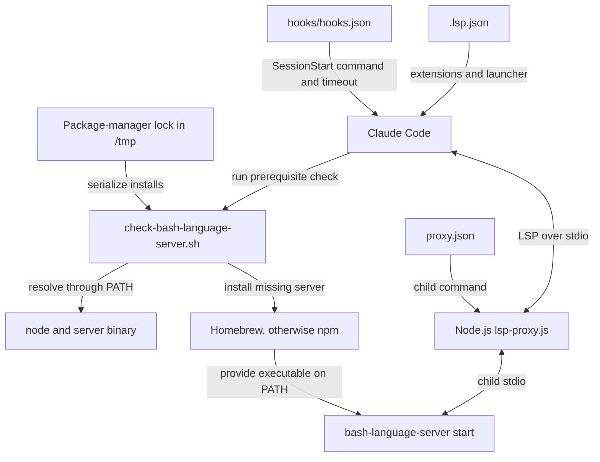
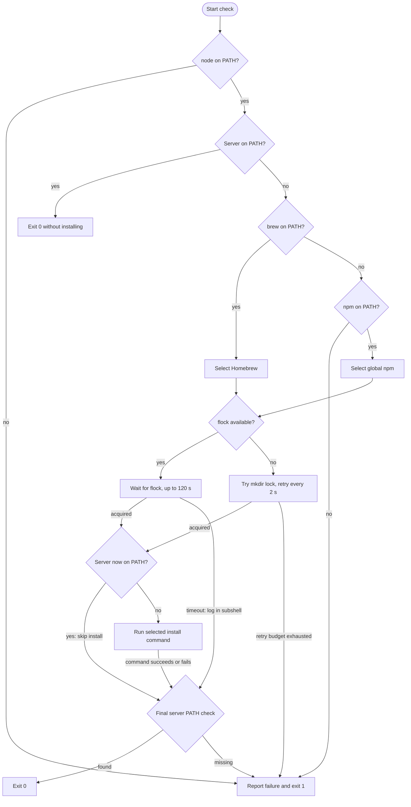
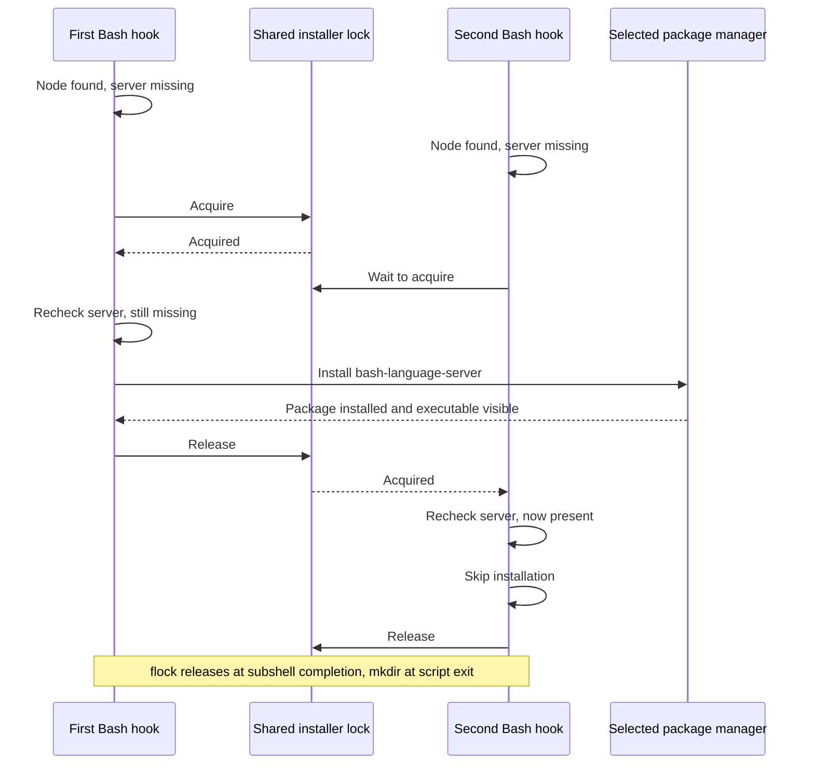

# Bash Language Server Setup

The `bash_language_server_setup` module registers shell files with Claude Code
and checks the external dependencies needed to run the Bash language server.
It combines declarative client configuration with a session-start script that
installs `bash-language-server` when it is missing.

This is the setup layer of the
[Bash language server integration](../bash_language_server.md), within the
[language intelligence integration](../../language_intelligence_integration.md)
system. It does not implement shell analysis or LSP message handling.

## Architecture and system fit

The module has two host entry points: `.lsp.json` defines file routing and the
launcher, while the session-start hook prepares runtime dependencies. The hook
does not launch the server, rewrite configuration, or update the host's `PATH`.



The core source files are:

- `bash-language-server/.lsp.json`: registers the launcher and shell extensions.
- `bash-language-server/hooks/check-bash-language-server.sh`: checks Node.js,
  discovers the server, selects an installer, and serializes installation.

Adjacent configuration completes the integration:

- `bash-language-server/hooks/hooks.json` invokes the script at `SessionStart`.
- `bash-language-server/proxy.json` tells the proxy which server command to run.
- `bash-language-server/lsp-proxy.js` launches the server and handles runtime
  traffic. See [protocol transport](bash_language_server_protocol.md) and
  [document lifecycle](bash_language_server_document_lifecycle.md) for those
  responsibilities.

The marketplace entry in `.claude-plugin/marketplace.json` selects the
`./bash-language-server` plugin directory. Its metadata is in
`bash-language-server/.claude-plugin/plugin.json`. Plugin metadata versions do
not pin the separately installed upstream language-server version.

## Registration and launch contract

### Client registration

The effective registration in `bash-language-server/.lsp.json` is:

```json
{
  "bash": {
    "command": "node",
    "args": [
      "${CLAUDE_PLUGIN_ROOT}/lsp-proxy.js",
      "--config",
      "${CLAUDE_PLUGIN_ROOT}/proxy.json"
    ],
    "extensionToLanguage": {
      ".sh": "shellscript",
      ".bash": "shellscript",
      ".zsh": "shellscript",
      ".ksh": "shellscript"
    }
  }
}
```

The registration has the following implications:

- `bash` identifies the registration entry; all four mapped extensions use the
  LSP language identifier `shellscript`.
- The host launches `node`, resolved through its `PATH`, not the server binary
  directly. Node.js is therefore required even if the server is installed.
- `${CLAUDE_PLUGIN_ROOT}` locates the proxy and its configuration inside the
  installed plugin. These paths do not depend on the workspace directory.
- `.sh`, `.bash`, `.zsh`, and `.ksh` are explicitly routed to this integration.
  Extensionless files are not explicitly covered by this mapping. Routing a
  suffix does not guarantee equivalent upstream support for every shell
  dialect.

The proxy is shipped JavaScript using Node standard-library modules. It does
not require a module-specific compilation step or a project-local npm install.

### Server command

`bash-language-server/proxy.json` supplies the actual child command:

```json
{
  "server": ["bash-language-server", "start"],
  "blocked": []
}
```

The resulting launch chain is:

```text
Claude Code -> node lsp-proxy.js --config proxy.json
            -> bash-language-server start
```

The proxy resolves the server through its inherited environment. The installer
must therefore make `bash-language-server` discoverable in the session's
`PATH`, not merely download a package somewhere. The empty `blocked` array
configures no blocked client methods; runtime behavior belongs to the protocol
and document-lifecycle modules linked above.

### Session-start wiring

`bash-language-server/hooks/hooks.json` registers a command-type `SessionStart`
hook with this command:

```sh
bash ${CLAUDE_PLUGIN_ROOT}/hooks/check-bash-language-server.sh
```

The manifest sets `timeout` to **60 seconds**. The script requires Bash rather
than a generic POSIX `sh`; it uses Bash redirection and arithmetic syntax.

The hook reports prerequisite or installation results to the host. It neither
performs an LSP initialization handshake nor decides how Claude Code handles a
failed hook or when the host launches the registered server.

## Prerequisites and installation policy

The script checks dependencies in a deliberate order:

- `node` must be discoverable first. If it is absent, the script reports the
  missing dependency and exits before checking the server or package managers.
  It suggests installing Node.js but does not install it automatically.
- If `bash-language-server` is already discoverable, the script exits
  successfully without installation, locking, or package-manager checks.
- Only a missing server requires Homebrew or npm. Homebrew takes precedence
  whenever `brew` is discoverable; npm is selected only when Homebrew is absent.
- Installation requires the selected package manager's normal network access
  and write permissions. The script does not invoke `sudo`, configure package
  registries, or modify `PATH`.

Discovery uses `command -v`. It does not execute Node.js or the server to check
versions, test executable health, or validate LSP compatibility. In particular,
an already available server is not upgraded or repaired.

The installer contains these fixed assignments:

| Script setting | Value |
| --- | --- |
| `BINARY` | `bash-language-server` |
| `FORMULA` | `bash-language-server` |
| `NPM_PACKAGE` | `bash-language-server` |
| `LOCK_TIMEOUT` | `120` seconds |

These are script settings, not environment-variable overrides. Both install
commands are unversioned:

- Homebrew: `brew install bash-language-server`.
- npm: `npm install -g bash-language-server`.

The npm command installs the external server globally; it is not installing
proxy dependencies into the workspace. Selection is based on command
availability, not an operating-system check. A failed Homebrew install does
**not** trigger an npm retry, even when npm is also available.

## Installer process flow

After choosing an installer, the script acquires a lock and checks the server
again. That second check allows another session to satisfy the prerequisite
while this session waits, avoiding a redundant install.



The final availability check is important: a package manager reporting success
is not sufficient if its executable is still outside `PATH`. Conversely, the
script is not configured with `set -e`, so an install error is followed by that
check rather than automatically terminating the whole script.

## Concurrency and timeout behavior

### Lock scope and locations

The selected package manager determines the base lock path:

| Installer | Base lock path |
| --- | --- |
| Homebrew | `/tmp/claude-lsp-brew.lock` |
| npm | `/tmp/claude-lsp-npm.lock` |

The paths are hardcoded under `/tmp`; `TMPDIR` does not redirect them. They are
package-manager-wide rather than Bash-specific. Other installers, such as
[Pyright](../pyright_language_server.md), use the same paths and contend for
the same resources.

This coordinates cooperating hooks only. It does not lock every independent
Homebrew or npm invocation on the machine. Different package-manager paths do
not coordinate, and the `flock` and directory-lock mechanisms use different
resources and do not coordinate with each other.

### Lock implementations

When `flock` is available:

- A subshell opens the base lock file on file descriptor 9.
- `flock --timeout "$LOCK_TIMEOUT" 9` waits for an exclusive lock.
- Once locked, the subshell rechecks the server and installs only if necessary.
- Normal subshell completion closes its locking descriptor before the parent's
  final `PATH` check. The base lock file can remain after the lock is released;
  file existence alone does not mean an installation is active.

When `flock` is unavailable, the script uses an atomic `mkdir` fallback:

- The lock directory is the base path plus `.d`, for example
  `/tmp/claude-lsp-brew.lock.d` or `/tmp/claude-lsp-npm.lock.d`.
- Failed acquisition attempts sleep for two seconds. A counter tracks that
  sleep budget and reports a timeout when it reaches 120 seconds and another
  acquisition attempt fails.
- After acquisition, the script rechecks the server before installing.
- An `EXIT` trap runs `rmdir` to remove the directory. This lock remains held
  through the final availability check until the script exits.

Directory-lock cleanup is best-effort. Abnormal termination can leave a stale
directory, and there is no PID, age check, or automatic stale-lock recovery.
Acquisition errors are suppressed, so an unwritable lock location can also
appear as repeated contention and eventually a timeout.

### Concurrent startup interaction

This successful example assumes both hooks use the same lock mechanism and can
see the installed binary through their respective `PATH` values:



If the first installation fails and the executable remains missing, the next
lock holder can attempt installation itself. The lock prevents overlapping
cooperating installs; it is not a persistent record of installation success.

### Timeout budgets and limits

Two different budgets apply:

- The host hook timeout is 60 seconds, configured in
  `bash-language-server/hooks/hooks.json`.
- The script's lock-wait budget is 120 seconds. It is not an installation
  timeout; the package-manager command has no explicit timeout in the script.

The host can therefore time out a first-time install or lock wait before the
script reports its own timeout. Do not interpret the 120-second value as a
guaranteed startup allowance. Preinstall dependencies when startup must be
predictable, especially on slow networks or hosts starting multiple plugins.
Changing either timeout requires considering the other and the intended
installation duration.

## Outcomes and diagnostics

### Exit-status contract

An already discoverable Node.js and server produce an immediate, silent
`exit 0`. On the installation path, the final server-availability check normally
determines success: a discoverable server produces status 0, while a missing
server produces a diagnostic and status 1.

Missing Node.js, missing both package managers, and a directory-lock timeout
explicitly exit the main script with status 1.

A `flock` timeout is different: it logs `Lock timeout` and exits the locking
subshell with status 1, but the parent still performs its final availability
check. Similarly, `do_install` returns 1 after a package-manager failure without
unconditionally terminating the parent. If another process makes the server
available before the final check, the hook can return 0 despite an earlier
error message. Otherwise the final missing-binary check returns 1.

All script-authored messages begin with `[bash-language-server]`. Missing-Node
messages go to stderr; the other explicit progress and failure messages use
stdout. Package-manager output is not redirected or given this prefix by the
script. Hook output is separate from the proxy's LSP stdio transport.

### Common failures and recovery

- **Node.js is missing:** the hook reports `node is required` even if the server
  is present. Install Node.js, make it visible to the Claude Code process, and
  restart the session. The suggested Homebrew command is `brew install node`.
- **No installer is available:** `Neither Homebrew nor npm found` means the
  server is missing and neither supported package manager is discoverable.
  Provide one, or preinstall the server using your environment's provisioning
  mechanism.
- **The selected install fails:** `brew install failed` or `npm install failed`
  identifies the attempted route. Inspect package-manager output for network,
  registry, or permission issues. If Homebrew was selected, an npm alternative
  must be run manually; the script does not switch after failure.
- **Lock acquisition times out:** check for an active cooperating installation
  first. For directory locks, confirm no installer is using the directory before
  removing an empty stale directory with `rmdir`. Do not delete an active lock
  or treat a persistent `flock` file as evidence of a stale held lock.
- **The executable is still missing:** `Not in PATH after install` means the
  final check could not discover the server, including after a nominally
  successful package-manager command. Check the package manager's executable
  directory against the host's `PATH`. The diagnostic always suggests
  `brew install bash-language-server`, even if npm was the selected installer.
- **The host reports a hook timeout:** the 60-second host budget may have
  expired before the script's lock or install operation finished. Check for
  remaining installer activity and preprovision dependencies before retrying.

A successful hook is only a dependency-discovery result. It does not prove that
the proxy can read its configuration, that the server starts successfully, or
that LSP initialization and language features work.

## Operator workflow

For a predictable session, install Node.js and the server before startup, and
ensure both are visible in the environment that launches Claude Code. A command
available in an interactive terminal may not be on the host process's `PATH`.
The hook does not source shell startup files or persist environment changes.

From the repository root, run the actual setup script to exercise the same
selection and locking policy:

```sh
bash bash-language-server/hooks/check-bash-language-server.sh
```

This command may install a Homebrew package or a global npm package. To inspect
discovery without installing anything, run these in the relevant environment:

```sh
command -v node
command -v bash-language-server
```

For managed, offline, or restricted environments, provision approved versions
externally and expose them on `PATH`; the existing-binary path avoids package
manager use. The hook itself does not enforce those versions. See
[environment bootstrap][bootstrap-doc] for repository-wide environment setup,
rather than treating this hook as a general development-environment installer.

## Maintenance and validation

### Configuration invariants

When changing setup behavior, preserve these relationships:

- `.lsp.json` must invoke `node` with the bundled proxy and `--config` arguments
  rooted at `${CLAUDE_PLUGIN_ROOT}`. Both referenced files must ship inside the
  plugin directory.
- `proxy.json`'s `server[0]` must agree with the installer's `BINARY` value.
  Package identifiers in `FORMULA` and `NPM_PACKAGE` must provide that command.
- `hooks/hooks.json` must reference the existing check script. Script renames
  require updating the hook command as well.
- Changes to extensions alter host routing, not upstream dialect support.
- Lock naming and locking changes affect coordination with other plugins.
  Timeout changes must account for both the script and host budgets.

Packaging and shared-proxy maintenance are described in the
[Bash integration overview](../bash_language_server.md); protocol and document
synchronization changes do not belong in the installer.

### Repository checks

The canonical repository test command is:

```sh
make test
```

`Makefile` delegates to `bash tests/run.sh`. The runner requires `node`, `bash`,
`jq`, and `shellcheck`. Setup-related coverage is provided by:

- `tests/cases/01-manifests.sh`: validates JSON and the structures of client,
  hook, plugin, marketplace, and proxy configuration.
- `tests/cases/02-consistency.sh`: checks the standard Node-proxy invocation,
  agreement between the server command and installer binary, plugin-root paths,
  and hook-script existence.
- `tests/cases/03-installer-lint.sh`: runs Bash syntax checks and ShellCheck.
- `tests/cases/04-installer-behavior.sh`: covers Bash's existing-binary no-op,
  Homebrew and npm installs, install failures, absent package managers,
  post-install missing binaries, and directory-lock cleanup. The shared
  missing-Node policy is explicitly exercised through the CUE installer.
- `tests/cases/05-installer-concurrency.sh`: checks that concurrent Bash hooks
  produce one install, including a forced directory-lock fallback, and verifies
  fallback lock-directory cleanup.

Behavior and concurrency tests use mocked package managers. They verify
installer control flow, not compatibility with a particular upstream server
release or a successful real LSP handshake.

`.github/workflows/test-gate.yml` runs `make test` in separate Linux and macOS
jobs. Its tool-version pins are CI configuration, not version requirements
enforced by this hook. See [build and configuration][build-doc] and
[continuous integration][ci-doc] for repository-wide validation details.

[bootstrap-doc]: ../../engineering_platform_and_validation/development_environment_bootstrap.md
[build-doc]: ../../engineering_platform_and_validation/repository_build_and_configuration.md
[ci-doc]: ../../engineering_platform_and_validation/continuous_integration.md
