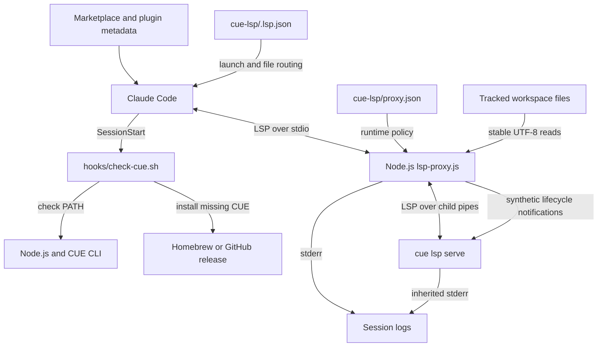
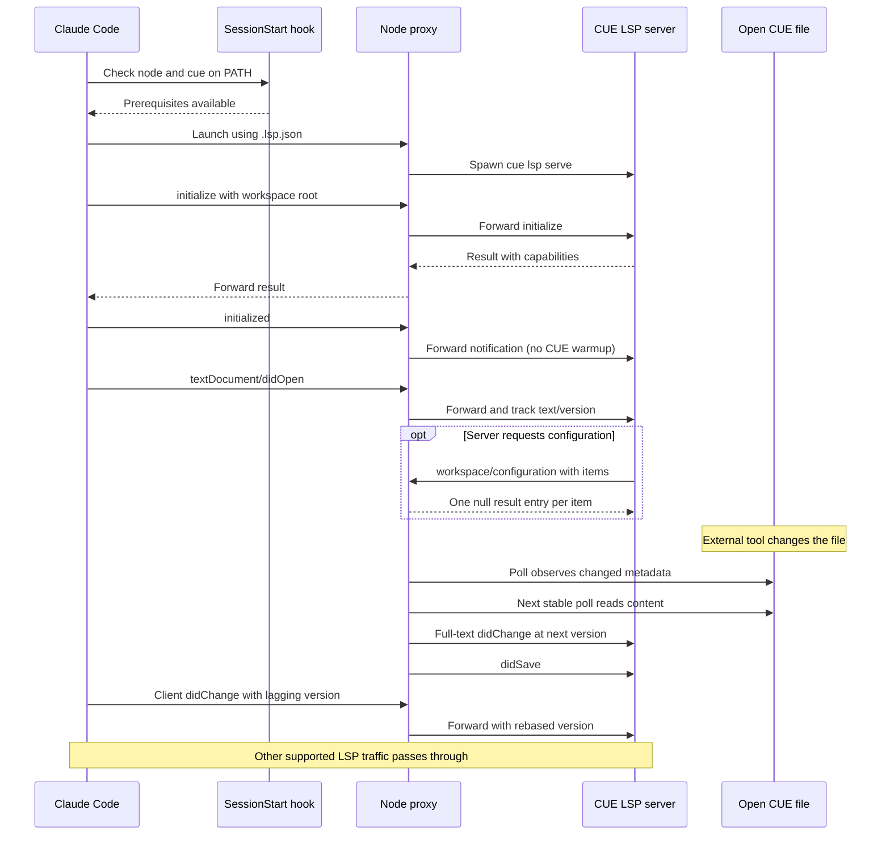

# CUE Language Server Integration

## Purpose and scope

The `cue_language_server` module connects Claude Code to the CUE CLI's
`cue lsp serve` process. Distributed as the `cue-lsp` plugin, it registers
`.cue` files, checks prerequisites at session start, and places a Node.js
proxy between the client and the external language server.

The proxy handles protocol compatibility and keeps tracked server buffers in
step with out-of-band disk edits, such as shell commands, formatters, and Git
operations. CUE parsing, language features, and diagnostic support belong to
the upstream CUE server, not this integration. This plugin is part of the
[language intelligence integration](../language_intelligence_integration.md)
layer.

**Upstream capability boundary:** the repository's live tests document that
CUE v0.16.0 neither publishes diagnostics nor supports
`textDocument/diagnostic`. Its CUE smoke test verifies initialization, document
opening, and process survival; it is not a broken-file diagnostic test. The
proxy can update buffers but cannot add missing analysis capabilities. See
`tests/cases/08-live.sh` and `tests/helpers/live-suite.js`.

## Architecture



The module has three logical sub-modules. They are documentation boundaries,
not separately deployed packages: transport and document lifecycle share one
`lsp-proxy.js` process and its `openDocs` map.

| Detailed guide | Responsibility |
| --- | --- |
| [Setup and registration][setup] | Routing, runtime checks, installation. |
| [Protocol transport][protocol] | Framing, acknowledgments, child lifecycle. |
| [Document lifecycle][lifecycle] | Buffer tracking, disk sync, optional warmup. |

The setup layer combines `.lsp.json` with the session-start prerequisite hook.
The protocol layer parses both message directions, applies compatibility
rules, and supervises the child process. The document-lifecycle layer observes
client notifications and injects server-facing updates when stable disk
content diverges from the tracked buffer. Workspace warmup exists in the
shared implementation but is inactive in the shipped CUE configuration.

## Effective CUE configuration

`cue-lsp/.lsp.json` maps `.cue` to language ID `cue` and launches:

```sh
node "${CLAUDE_PLUGIN_ROOT}/lsp-proxy.js" \
  --config "${CLAUDE_PLUGIN_ROOT}/proxy.json"
```

The host expands `${CLAUDE_PLUGIN_ROOT}`. The proxy reads the configuration
path supplied by `--config`; it does not discover CUE settings automatically.
The shipped `cue-lsp/proxy.json` is:

```json
{
  "server": ["cue", "lsp", "serve"],
  "blocked": []
}
```

This policy and the defaults in `cue-lsp/lsp-proxy.js` produce these behaviors:

- The child command is `cue lsp serve`, resolved through `PATH`, without a
  shell wrapper or an explicit child working-directory override.
- No client methods are blocked. The generic unsupported-method protection is
  available but inactive; methods not implemented upstream are not
  automatically detected or filtered.
- There is no `warmup` section, so the proxy does not scan the workspace or
  pre-open CUE files. Polling starts with client-opened documents.
- Disk synchronization defaults to a 300 ms interval. A supplied nonzero
  numeric `sync.pollMs` is clamped to at least 50 ms; omitted or zero values
  use 300 ms. Setting `"sync": false` disables polling and client-change
  reconciliation, but retains open/close tracking and duplicate-open handling.
- Four fixed server-request methods are auto-acknowledged independently of
  the empty `blocked` list.

The proxy uses Node standard-library modules only and runs as shipped
JavaScript; there is no CUE-specific compilation or npm dependency-install
step. The external CUE CLI is supplied separately. Configuration fields and
launch validation are described in the [protocol guide][protocol].

## Runtime interaction

The prerequisite hook and LSP launcher are separate host entry points. The
hook checks or installs dependencies; it does not start the proxy itself.



Ordinary traffic keeps its original framed bytes unless an interception or
lifecycle transformation applies. The proxy locally consumes and answers
these server-initiated requests:

- `client/registerCapability`: `null` result.
- `client/unregisterCapability`: `null` result.
- `workspace/configuration`: one `null` array entry per requested item.
- `window/workDoneProgress/create`: `null` result.

These replies let the server proceed without waiting for unsupported client
handlers. They do not implement dynamic registration storage, configuration
overrides, or a progress UI. Other messages, including server error responses,
continue to the client. See [protocol transport][protocol] for framing,
interception order, malformed-message fallbacks, and shutdown behavior.

## Document synchronization contract

With the shipped configuration, only client-opened documents participate in
polling. The proxy is not a workspace-wide file watcher or an indexer.

- `trackOpen` records the URI, buffer text, server-facing version, language ID,
  file path, metadata, and lifecycle flags. Non-file URIs are tracked but not
  polled.
- `pollOpenDocs` compares `mtimeMs`, `ctimeMs`, `size`, and `ino`. A changed
  tuple arms an update; the same tuple on the next poll permits a UTF-8 read.
  Identical disk and buffer text is a no-op.
- Divergent text produces a synthetic full-document `didChange` followed by
  `didSave`. The proxy does not write the file or send a replacement buffer
  to the client.
- `reconcileClientChange` mirrors full-text client changes and rebases lagging
  versions so synthetic and client edits remain monotonically ordered at the
  server. Incremental ranges are forwarded but not applied locally: polling
  pauses for that document until its final buffer text is known again.
- Two consecutive failed stat checks cause a synthetic `didClose`, retaining
  the tracking entry. Stable reappearance or a full-text client edit can
  reopen it. A client `didClose` removes tracking altogether.

At the default interval, a settled disk change is normally propagated after
roughly one to two polls, plus event-loop and server processing time. This is
a best-effort stability gate, not an atomic-read guarantee. Stat failures are
treated as absence, coarse filesystem timestamps can hide some rewrites, and
synchronous filesystem work grows with the tracked document count.

The proxy does not merge competing edits or protect unsaved client text from
divergent disk content. Duplicate opens, ordered change batches, version
formulas, deletion recovery, and optional warmup discovery are detailed in the
[document-lifecycle guide][lifecycle]. Buffer refresh does not imply CUE
v0.16.0 will emit diagnostics.

## Setup and operational boundaries

`cue-lsp/hooks/hooks.json` invokes `hooks/check-cue.sh` at `SessionStart` with
a 60-second host timeout. The script requires `node` even if `cue` is already
installed, because CUE's Go binary does not supply the Node proxy runtime.
It does not install Node or enforce a Node/CUE version minimum.

An available `cue` executable is accepted immediately. Otherwise Homebrew is
preferred using `brew install cue-lang/tap/cue`; if Homebrew is absent, the
hook downloads CUE v0.16.0 into `${HOME}/.local/bin`. A failed Homebrew install
does not trigger a binary-download retry, and the hook does not modify `PATH`.
Existing executables and Homebrew installs are not pinned to v0.16.0.

Installation is serialized using method-wide `/tmp` locks, via `flock` or a
`mkdir` fallback. The script's 120-second lock-wait budget exceeds the host's
60-second timeout, so contention or slow downloads may be interrupted early.
Preinstall dependencies when startup must be predictable. Download integrity,
platform selection, lock cleanup, and shell failure-handling limitations are
covered in the [setup guide][setup].

Proxy diagnostics use stderr with prefix `[lsp-proxy:cue]`; early configuration
errors use `[lsp-proxy]`. Child stderr is inherited, while stdout carries
client-facing LSP traffic. Missing/unreadable configuration, an empty `server`
array, and child spawn errors terminate with status 1. Client stdin EOF and
received termination signals are forwarded to the child. There is no restart
policy or forced-kill escalation; see [process lifecycle][protocol].

## Packaging and maintenance

`.claude-plugin/marketplace.json` distributes `./cue-lsp`, and
`cue-lsp/.claude-plugin/plugin.json` identifies the plugin. Plugin metadata
versions describe this integration, not the upstream CUE CLI version.

Each plugin ships a real copy of the unified proxy because plugin directories
are installed independently. `tests/cases/02-consistency.sh` requires those
copies to be byte-identical and checks launch arguments, installer/server
agreement, and hook references. Put CUE-specific policy in
`cue-lsp/proxy.json`; propagate shared-code changes to every deployed proxy
copy rather than creating a CUE-only fork.

Sibling integrations have separate server commands and runtime policies:

- [Bash language server](bash_language_server.md).
- [Pyright language server](pyright_language_server.md).
- [Regal language server](regal_language_server.md).
- [VTSLS language server](vtsls_language_server.md).

## Validation

Run the repository test entry point from its root:

```sh
make test
```

`Makefile` delegates to `bash tests/run.sh`, which requires `node`, `bash`,
`jq`, and `shellcheck` and derives plugin membership from marketplace metadata.
Relevant checks include:

- `tests/cases/01-manifests.sh` and `tests/cases/02-consistency.sh`: manifest
  shape, registration wiring, hook targets, and proxy-copy identity.
- `tests/cases/03-installer-lint.sh`,
  `tests/cases/04-installer-behavior.sh`, and
  `tests/cases/05-installer-concurrency.sh`: installer syntax, the CUE Node
  prerequisite, existing-binary no-op, Homebrew selection, the pinned binary
  URL/platform mapping, and serialized CUE Homebrew installation.
- `tests/cases/06-proxy.sh` and `tests/cases/07-warmup.sh`: shared transport,
  acknowledgments, synchronization, rebasing, deletion/reappearance,
  duplicate-open handling, and optional warmup behavior.
- `tests/cases/08-live.sh`: `live/cue-clean` is registered only when `cue` is
  on `PATH`; otherwise it is reported as skipped. The test does not require
  diagnostics to be published, but does require the process to survive its
  observation window. A CUE broken-file test is intentionally absent.

`.github/workflows/test-gate.yml` runs `make test` in separate Linux and macOS
jobs using Node 24.22.0 and requires successful, non-empty execution from both.
That CI pin is not a runtime minimum enforced by the hook, and a green gate
does not prove optional live CUE checks ran. This documentation describes the
checked-in validation paths; it does not report a test execution.

Repository-wide procedures are documented separately:

- [Build and configuration][build].
- [Development environment bootstrap][bootstrap].
- [Continuous integration][ci].

## Source map

- `cue-lsp/.lsp.json`: Node launcher and `.cue` language routing.
- `cue-lsp/proxy.json`: effective CUE child command and compatibility policy.
- `cue-lsp/hooks/hooks.json`: session-start command and host timeout.
- `cue-lsp/hooks/check-cue.sh`: prerequisite checks, installation, and locking.
- `cue-lsp/lsp-proxy.js`: framing, acknowledgments, child supervision,
  document tracking, disk synchronization, and optional warmup.
- `cue-lsp/.claude-plugin/plugin.json` and
  `.claude-plugin/marketplace.json`: plugin identity and distribution wiring.

[setup]: cue_language_server/cue_language_server_setup.md
[protocol]: cue_language_server/cue_language_server_protocol.md
[lifecycle]: cue_language_server/cue_language_server_document_lifecycle.md
[build]: ../engineering_platform_and_validation/repository_build_and_configuration.md
[bootstrap]: ../engineering_platform_and_validation/development_environment_bootstrap.md
[ci]: ../engineering_platform_and_validation/continuous_integration.md
