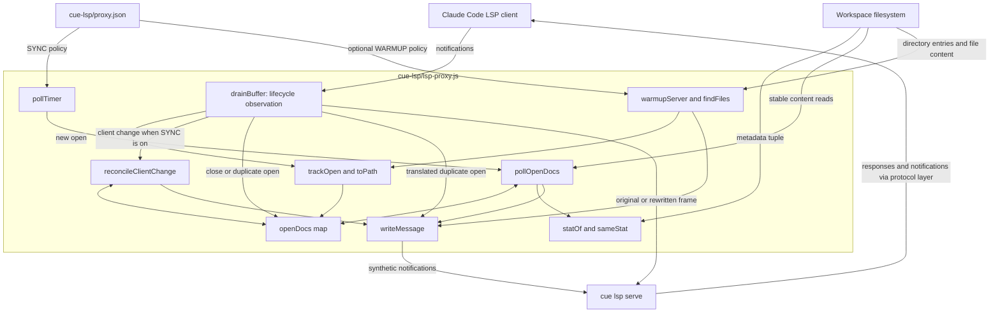
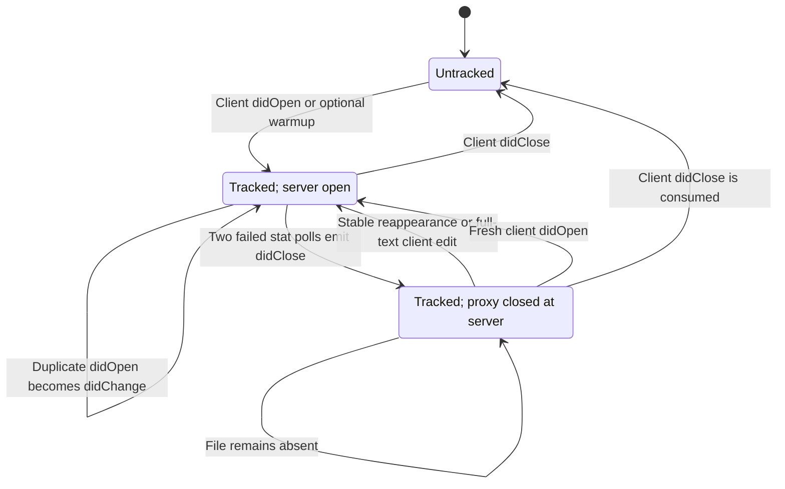
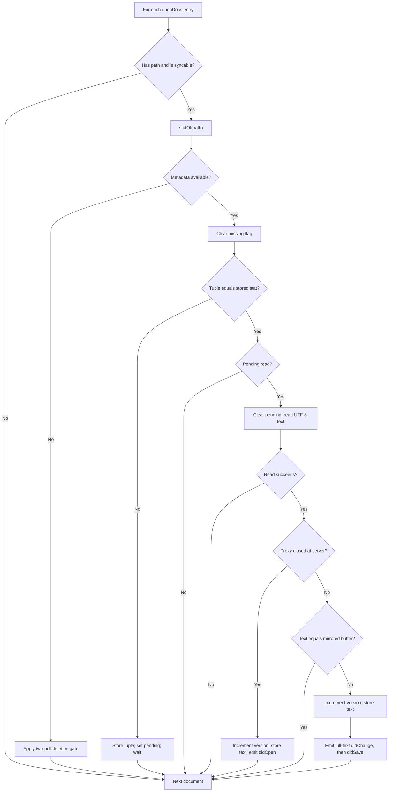
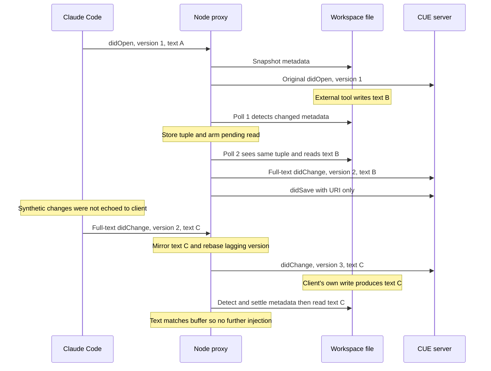
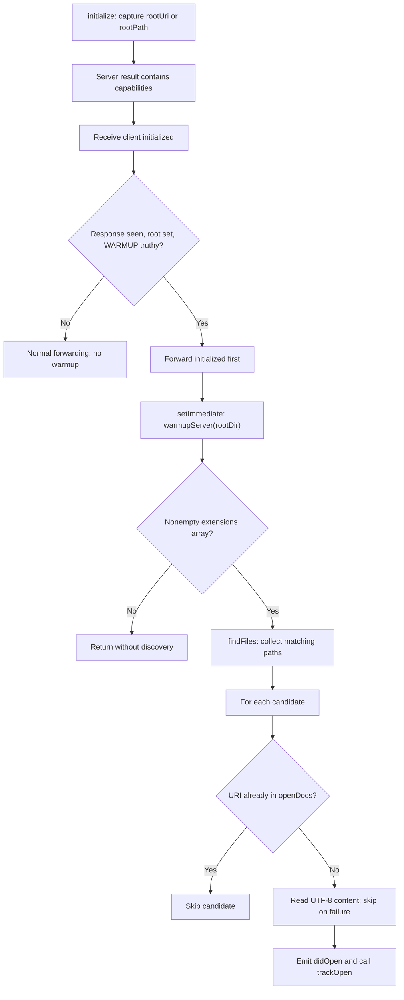

# CUE Language Server Document Lifecycle

The `cue_language_server_document_lifecycle` module keeps the CUE server's
tracked document buffers aligned with client notifications and stable disk
changes. It handles duplicate opens, reconciles full-text client edits,
rebases versions after synthetic updates, and closes or reopens documents
when files disappear or return. Optional workspace warmup uses the same
tracking mechanism.

All eight core functions live inside `cue-lsp/lsp-proxy.js`. This is a logical
module in the shared Node.js proxy, not a separately deployed service or a CUE
parser. Its synthetic notifications go to `cue lsp serve`, not back to the
client, and it never writes workspace files.

## Scope and effective CUE behavior

Shell commands, formatters, Git operations, and other sessions can change files
without a client LSP change notification. Polling bridges that gap for tracked
documents; it is not a replacement for the client's document protocol.

The shipped configuration matters when interpreting the shared proxy code:

- `cue-lsp/.lsp.json` maps `.cue` files to language ID `cue` and launches the
  Node proxy with `--config ${CLAUDE_PLUGIN_ROOT}/proxy.json`.
- `cue-lsp/proxy.json` selects `['cue', 'lsp', 'serve']` and contains no
  `warmup` or `sync` setting. Consequently, warmup is **disabled**, while disk
  synchronization is **enabled** at the default 300 ms interval.
- Only documents opened by the client are initially tracked in this CUE
  configuration. There is no workspace scan or general file-creation watcher.
  The lifecycle helpers themselves do not filter tracked URIs by extension.

The behavior is controlled by these values in `cue-lsp/lsp-proxy.js`:

| Setting | Behavior |
| --- | --- |
| `sync` omitted | Poll every 300 ms; reconcile client changes. |
| `sync.pollMs` | Apply `Math.max(50, config.sync?.pollMs \|\| 300)`. |
| `sync: false` | Disable polling and client-change reconciliation. |
| `warmup` omitted | Do not discover or synthetically open workspace files. |
| `warmup.extensions` | A nonempty array is required to perform warmup. |
| `warmup.exclude` | Exact entry names to skip; defaults to an empty array. |

For numeric intervals, values below 50 ms are clamped to 50 ms, except that
zero falls back to 300 ms. The proxy does not fully validate these optional
configuration fields. Disabling synchronization does **not** disable
open/close bookkeeping or duplicate-open translation; those remain active to
support warmup deduplication.

See the [CUE integration overview][integration] for system context and upstream
capability boundaries, [setup and registration][setup] for prerequisites and
launch wiring, and [protocol transport][protocol] for framing, routing,
acknowledgments, and process supervision.

## Architecture and dependencies



The protocol layer calls the lifecycle helpers after parsing each client
message and before normal forwarding. Lifecycle state updates occur before
the configured blocked-method check; blocking is not a way to undo those
updates or suppress already emitted synthetic notifications. CUE's shipped
blocked-method list is empty. Routing details belong to the
[protocol guide][protocol].

### Core component responsibilities

These functions are file-local helpers, not exported library APIs.

| Component | Responsibility |
| --- | --- |
| `toPath(uri)` | Convert a valid `file:` URI to a native path, else `null`. |
| `statOf(path)` | Read the four-field metadata tuple, else `null`. |
| `sameStat(a, b)` | Compare two present tuples field by field. |
| `trackOpen(uri, text, version, languageId)` | Initialize tracking state. |
| `reconcileClientChange(msg, rawMessage)` | Choose the forwarding frame. |
| `pollOpenDocs()` | Detect stable edits, absence, and reappearance. |
| `findFiles(rootDir, extensions, excludeDirs)` | Discover warmup candidates. |
| `warmupServer(rootDir)` | Open readable, untracked candidates at the server. |

The lifecycle implementation uses only Node standard-library facilities:

- `node:fs`: synchronous `statSync`, `readFileSync`, and `readdirSync`.
- `node:path`: `join` and `extname` for warmup traversal and matching.
- `node:url`: `fileURLToPath` and `pathToFileURL` for URI conversion.
- Built-in timers and `setImmediate`: polling and deferred warmup scheduling.
- The shared `child.stdin` and `writeMessage` transport helper: server-facing
  notification delivery.

There is no filesystem-watcher library, local CUE analysis engine, or separate
worker. Filesystem work runs synchronously on the proxy's event loop.

## Tracked-document state

`openDocs` is an in-memory map keyed by the document's exact URI string. It is
both a buffer mirror for disk synchronization and a deduplication set for
warmup. It does not record separate client/warmup ownership or reference
counts. A client close removes the entry regardless of how it was opened.

| Field | Meaning |
| --- | --- |
| `version` | Last tracked server-facing document version. |
| `text` | Last known buffer content, not necessarily current disk content. |
| `languageId` | Language ID reused for synthetic reopens. |
| `path` | Native file path, or `null` for an unsupported/invalid URI. |
| `stat` | Last observed metadata tuple, or `null`. |
| `pending` | Changed metadata awaits a second, stable poll. |
| `missing` | One failed stat check has armed the deletion gate. |
| `closed` | The proxy has closed the document at the server. |
| `unsyncable` | Local buffer text is unknown after a non-full-text change. |

`trackOpen` preserves numeric versions, including zero, and otherwise uses
version 1. Nullish text becomes `''`; a falsy language ID becomes `plaintext`.
It snapshots metadata when a file path is available and initializes all four
flags to `false`. This baseline does not force an immediate disk read or
replace a differing client buffer; ordinary polling needs a later metadata
transition. These are tracking defaults, not validation or rewriting of the
original client `didOpen` frame.

Non-file URIs can still be tracked and participate in version reconciliation,
but polling skips them. Invalid file URIs also get `path: null`; `toPath`
catches conversion errors. No canonical-path or URI-alias deduplication is
performed beyond exact map-key equality.



The diagram shows the main server-open/closed states. `unsyncable` is an
independent flag: while set, polling skips the document entirely, including
its deletion and reappearance checks. A known full-text buffer restores
eligibility.

## Client notification handling

`drainBuffer` observes client document notifications and prepares an output
frame for the normal forwarding path.

| Client input | Lifecycle action |
| --- | --- |
| New `didOpen` | Call `trackOpen`; forward the original frame. |
| `didOpen` for a proxy-closed entry | Reset tracking; forward a fresh open. |
| Already-open URI: `didOpen` | Emit full-text `didChange`; consume open. |
| Tracked `didChange`, sync enabled | Reconcile text/version; possibly reopen. |
| Untracked `didChange` | Forward unchanged; do not enroll it in tracking. |
| `didChange`, sync disabled | Forward without reconciliation. |
| `didClose` | Remove tracking; suppress a duplicate server-side close. |
| `didSave` | No special bookkeeping; use normal protocol forwarding. |

### Duplicate-open translation

If a client opens a URI already open at the server, the proxy does not send a
second `didOpen`. This handles both repeated client opens and the race in
which warmup opens a file before the client does. Duplicate opens are
spec-undefined; the shared implementation also guards against servers that
drop diagnostics when they receive them.

Instead, the proxy:

1. Makes the client's supplied full text the tracked buffer.
2. Updates the language ID when supplied and chooses a version at least one
   above the tracked version.
3. Refreshes the disk metadata snapshot and clears `pending`, `missing`, and
   `unsyncable`.
4. Emits one full-text `didChange`, without a synthetic `didSave`, and consumes
   the original `didOpen`.

The same translation occurs even when `sync` is `false`. A proxy-closed entry
is different: the server really considers it closed, so a client `didOpen`
uses ordinary `trackOpen` initialization and is forwarded as an open.

### Full-text reconciliation and ordered batches

With synchronization enabled, `reconcileClientChange` scans `contentChanges`
in order. It does not implement range application. An entry is a full
replacement only when it is truthy, `c.range === undefined`, and its `text`
is a string.

A full replacement establishes known text. Any subsequent ranged or otherwise
non-full entry makes the final text unknown again, until another full
replacement restores it.

| Ordered batch | Final buffer knowledge | Polling eligibility |
| --- | --- | --- |
| Full text | Known replacement text | Enabled. |
| Incremental only | Unknown | Disabled for this document. |
| Incremental, then full text | Known final replacement | Enabled/restored. |
| Full text, then incremental | Unknown final text | Disabled. |

When final text is known, it replaces `st.text`; an existing `unsyncable`
flag is cleared and a re-enabled message is logged. When final text is unknown
and the scan encountered a non-full entry, the flag is set and a disabled
message is logged only on that transition. A later full replacement or
full-text duplicate-open translation restores synchronization.

An empty or non-array change list does not itself toggle syncability or
replace the stored text, although version handling still runs. These handlers
assume normal LSP message structure; they are not a complete notification
validator.

Ordinary client changes do not resnapshot disk metadata or clear a pending
disk check. This lets a later settled read compare disk content against the
most recently mirrored client text rather than blindly injecting another
change for the client's own write.

### Version rules and forwarding contract

Synthetic changes advance the proxy's server-facing version without informing
the client. The client's next counter can therefore lag behind it. The rules
in `cue-lsp/lsp-proxy.js` are:

- A synthetic disk edit or disk-based reopen increments the tracked version
  by one.
- A client `didChange` with a numeric version greater than the tracked value
  adopts that version and preserves the original frame.
- Otherwise, including an absent numeric version, the tracked value increases
  by one and the forwarded frame is serialized with that new version.
- A duplicate client open or a full-text client change on a proxy-closed
  document uses the greater of the numeric client version, defaulting to
  zero, and the previous tracked version plus one.
- A fresh client `didOpen` for a closed or untracked document starts tracking
  from its supplied version again. Versions are document-lifecycle state,
  not a persistent global counter.

For a tracked document, `reconcileClientChange` returns one of three results:

| Return value | Forwarding behavior |
| --- | --- |
| `rawMessage` | Forward the original complete LSP frame. |
| New framed `Buffer` | Forward the same change with a rebased version. |
| `null` | Consume the change after emitting a replacement `didOpen`. |

Only the numeric version is changed during rebasing; content changes and
other JSON fields are retained. JSON serialization and framing are regenerated
for that case. Exact byte-preservation and framing rules are described in the
[protocol guide][protocol]. Version reconciliation also applies to incremental
changes even while their document is excluded from disk polling.

## Disk polling and data flow

The proxy creates a `setInterval` timer when synchronization is enabled. The
timer starts independently of initialization, but there is no document work
until entries exist. It is unreferenced where supported, so it does not alone
keep the process alive. The timer is cleared on client EOF, forwarded
termination signals, and child exit; shutdown details are in the
[protocol guide][protocol].

### Metadata detection and stability gate

`statOf` returns the actual tuple `{ mtimeMs, ctimeMs, size, ino }`. All four
fields must match for `sameStat` to regard two present snapshots as equal.
Missing snapshots never compare equal.

- `mtimeMs` and `size` detect ordinary writes and length changes.
- `ctimeMs` helps detect rewrites that restore the original modification time.
- `ino` helps detect atomic write-and-rename replacements that retain size and
  modification time.

On a changed tuple, `pollOpenDocs` stores it, marks `pending: true`, and waits.
A subsequent poll with the same tuple permits a synchronous UTF-8 read. Further
metadata changes restart this settling wait. If the text equals the mirrored
buffer, no notification or version increment is necessary.



This is a best-effort two-observation gate, not an atomic-read guarantee.
A writer that pauses longer than a poll interval can still expose unfinished
content, and a write can race the stat/read pair. The implementation does not
rehash unchanged files or perform a second stat immediately after reading.
An in-place, same-size rewrite within the filesystem's timestamp resolution
can leave all observed fields unchanged and escape detection.

At the default interval, a settled edit is normally propagated in roughly
300–600 ms from its last metadata change, plus event-loop and server processing
time. Continuous writes keep postponing injection; synchronous filesystem work
and server load mean this is not a latency guarantee.

### External edit and client reconciliation



A synthetic update consists of two notifications, in order:

- `textDocument/didChange` with `{ uri, version }` and one
  `contentChanges: [{ text }]` full replacement.
- `textDocument/didSave` with `{ textDocument: { uri } }`; it carries neither
  the saved text nor a version.

There is no write-back to disk, client-buffer replacement, merge, or conflict
resolution. Full-text client messages update the mirror immediately, but a
later detected disk divergence can still replace the server's buffer. The
proxy does not protect unsaved client content against competing disk edits.

## Deletion, reappearance, and final close

`statOf` returns `null` on any stat exception. Polling therefore treats access
failures and other stat errors like file absence, not just confirmed deletion.
For a syncable file-backed entry, the transitions are:

1. The first failed stat sets `missing: true` and emits nothing.
2. A second consecutive failed stat clears `missing` and `pending`, sets
   `closed: true` and `stat: null`, and emits `textDocument/didClose`.
3. The entry remains in `openDocs`, retaining its text, language ID, and
   version. Continued absence does not emit more closes.
4. Successful metadata on a later poll clears `missing`. For a closed entry,
   the new tuple arms a pending read; the next stable poll reads the file,
   increments the version, clears `closed`, and emits `didOpen` with disk text.

Reappearance is reopened even if its text equals the retained buffer. A reopen
is not followed by a synthetic `didSave`. If a file returns after only one
failed stat, the deletion gate is disarmed without a close.

There are two client-driven recovery paths:

- A full-text `didChange` on a proxy-closed entry becomes a synthetic `didOpen`
  with the retained language ID and reconciled version. The proxy clears
  deletion/pending flags, snapshots current metadata, and consumes the original
  change. It does not require the file to exist on disk first.
- A client `didOpen` resets the closed entry through `trackOpen` and forwards
  the original open normally.

An incremental-only change cannot supply the full buffer needed for reopening.
It is still forwarded or version-rebased, but does not repair the server's
closed state and marks the entry unsyncable. A later full-text change or
client open is required for that recovery path.

A client `didClose` always deletes the entry. If the proxy had already closed
it server-side, the client close is swallowed to avoid a second close;
otherwise it is forwarded. Once removed, that URI is no longer polled or
automatically reopened by disk reappearance.

## Optional workspace warmup

Warmup is implemented by the unified proxy but is **not enabled by the shipped
CUE configuration** in `cue-lsp/proxy.json`. It exists for servers that defer
work until documents are opened. Enabling it changes which documents are held
open; it does not implement additional CUE analysis capabilities.

For example, this illustrative replacement configuration would discover CUE
files and enroll readable candidates in synchronization:

```json
{
  "server": ["cue", "lsp", "serve"],
  "blocked": [],
  "warmup": {
    "extensions": [".cue"],
    "exclude": [".git", "node_modules"]
  },
  "sync": { "pollMs": 300 }
}
```

The exclusions above are examples, not built-in defaults.

### Initialization trigger

The protocol layer captures `params.rootUri`, falling back to `rootPath`, from
`initialize`. A server response containing truthy `result.capabilities` sets
`initializeResponseSeen`; the proxy does not correlate this flag to a request
ID. On a subsequent `initialized` notification, warmup is scheduled only if
that flag, a root, and `WARMUP` are all present.



A root beginning with `file://` is converted with `fileURLToPath`; otherwise
the captured root is passed as a path. `workspaceFolders` is not used for
multi-root discovery. Deferral preserves the ordering of `initialized` before
the open burst on the child input stream; it is not an acknowledgment that
the server has finished processing initialization.

There is no separate warmup-completed flag or ongoing directory watcher.
Another qualifying `initialized` could schedule another scan, but the tracking
map prevents reopening already tracked URIs. New files are not discovered by
the ordinary document polling loop.

### Discovery and synthetic opens

`findFiles` uses an explicit LIFO directory stack rather than recursive calls.
It collects all candidates before `warmupServer` starts opening them.

- Extensions are exact, case-sensitive `extname` matches, including the leading
  dot. Matching `.cue` does not match `.CUE` or `.cue.bak`.
- Exclusions are exact entry basenames, not globs or relative paths. The check
  runs before the directory/file distinction, so matching files are skipped
  too. There is no automatic `.gitignore` or hidden-directory filtering.
- Directory-entry symlinks are neither traversed nor added as files; only
  `isDirectory()` and `isFile()` entries are used.
- An unreadable directory is silently skipped. There is no explicit ordering,
  file-count limit, or size limit.

For each discovered path, `warmupServer` constructs a file URI using
`pathToFileURL(...).href` and skips it if `openDocs.has(uri)`. Read failures are
also skipped. The built-in extension map selects language ID `cue` for `.cue`;
it also covers the other shared-proxy languages. An unlisted extension falls
back to its suffix without the leading dot.

Each successful candidate produces a full-text `didOpen` followed by
`trackOpen`. The first sent notification uses version 0; the local counter
increases only after an actual send. These initial numbers span the warmup
batch, but subsequent versions are maintained independently per document.
Warmup tracking and deduplication work even with synchronization disabled.

The race is safe in both directions for matching URI strings:

- If a client open is processed first, warmup sees the map entry and skips it.
- If warmup opens first, the later client open is translated into a full-text
  change, as described in the client notification handling section.

Discovery, reads, and sends are synchronous once the deferred callback starts.
Large trees can delay other proxy work and produce a large notification burst;
there is no batching or backpressure coordination in this lifecycle code.

## Operational limits and troubleshooting

### Failure handling and consistency boundaries

The implementation intentionally uses lightweight metadata polling rather than
continuous content hashing. Important consequences are:

- Only tracked, file-backed, syncable entries are polled. New unrelated files,
  non-file buffers, and incremental-only buffers are outside that coverage.
- A stable read failure clears `pending` before returning. It is silent and
  is not automatically retried on every tick if metadata stays unchanged;
  another metadata transition is needed to arm a new ordinary read.
- Metadata equality is not proof of content equality, and stat/read races are
  not eliminated by the stability gate.
- Synchronous work grows with the number of tracked documents and changed
  file sizes. Warmup additionally traverses the configured directory tree.
- Synthetic full-text changes and saves are not selected through downstream
  text-sync capability negotiation in this code.
- State is process-local. Restarting the proxy does not restore the previous
  tracking map.

The repository's live-test registration omits a broken-file diagnostic test
for CUE v0.16 because that server does not publish diagnostics
(`tests/cases/08-live.sh`). Updating the server buffer must not be interpreted
as adding diagnostic support. See the [integration overview][integration] for
the upstream capability boundary.

### Logs and symptom checks

Lifecycle logs go to stderr with prefix `[lsp-proxy:cue]` for the shipped
command. They report injected changes, version rebases, synthetic closes and
reopens, duplicate-open translation, syncability transitions, and warmup
candidate/sent counts. A warmup candidate count can exceed its sent count
because tracked or unreadable files are skipped.

Content-identical reads and individual filesystem errors are not logged
separately; resulting lifecycle transitions, such as a synthetic close, may be.
The disabled/re-enabled messages occur on flag transitions, not on every poll.

| Symptom | First checks |
| --- | --- |
| Disk edit produces no update | Tracking, file URI, `sync`, and `unsyncable`. |
| New CUE file is never opened | Warmup is off; polling is not discovery. |
| File closes unexpectedly | Check permissions and other stat failures. |
| Reappearance does not reopen | Check readability and later metadata changes. |
| Client versions jump | Expected rebasing after synthetic versions. |
| Updated buffer has no diagnostics | Check upstream CUE capabilities. |

## Validation and maintenance

Run the canonical repository test entry point from the repository root:

```sh
make test
```

`Makefile` delegates to `bash tests/run.sh`. That runner requires `node`,
`bash`, `jq`, and `shellcheck`. Relevant registered checks are:

- `tests/cases/06-proxy.sh`, backed by `tests/helpers/proxy-suite.js`: disk
  injection, client reconciliation, incremental disabling and full-text
  recovery, no-op/close behavior, synchronization opt-out, warmup tracking,
  deletion/reappearance, version rebasing, and both warmup/client-open races.
- `tests/cases/07-warmup.sh`, backed by `tests/helpers/warmup-suite.js`:
  matching files, empty trees, absent warmup configuration, and multiple
  extensions.
- `tests/cases/02-consistency.sh`: all independently distributed proxy copies
  must be real, byte-identical files with consistent launcher/config wiring.
- `tests/cases/08-live.sh`: optional `live/cue-clean` registration when `cue`
  is on `PATH`; it is not a CUE disk-sync diagnostic assertion.

When changing lifecycle code, preserve the ordered-batch text rules, exact
metadata tuple, version ordering, both duplicate-open races, and the distinction
between proxy-close retention and client-close removal. Shared implementation
changes must reach every deployed proxy copy; put CUE-specific policy in
`cue-lsp/proxy.json` rather than forking this copy.

`.github/workflows/test-gate.yml` invokes `make test` in separate Linux and
macOS jobs. Test registration and configuration describe available validation;
this documentation does not report a test execution. See [repository build
and configuration][build] and [continuous integration][ci] for repository-wide
validation procedures.

[integration]: ../cue_language_server.md
[setup]: cue_language_server_setup.md
[protocol]: cue_language_server_protocol.md
[build]: ../../engineering_platform_and_validation/repository_build_and_configuration.md
[ci]: ../../engineering_platform_and_validation/continuous_integration.md
