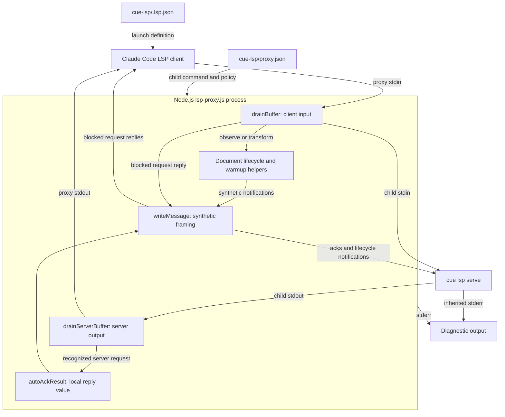
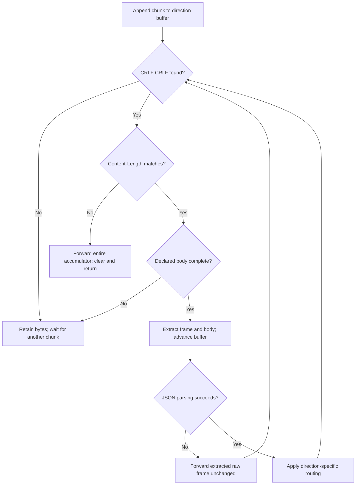
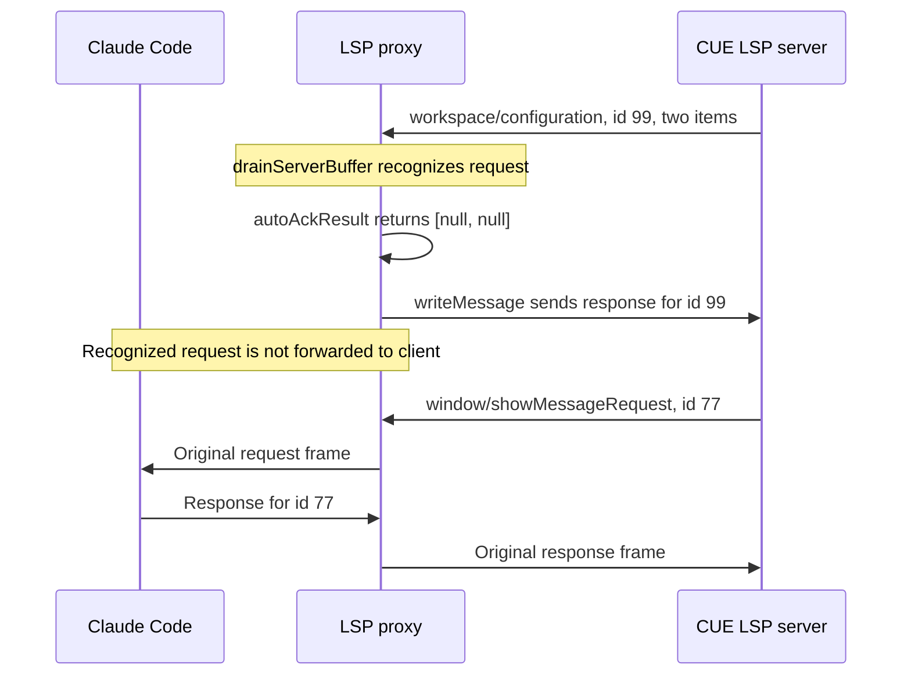
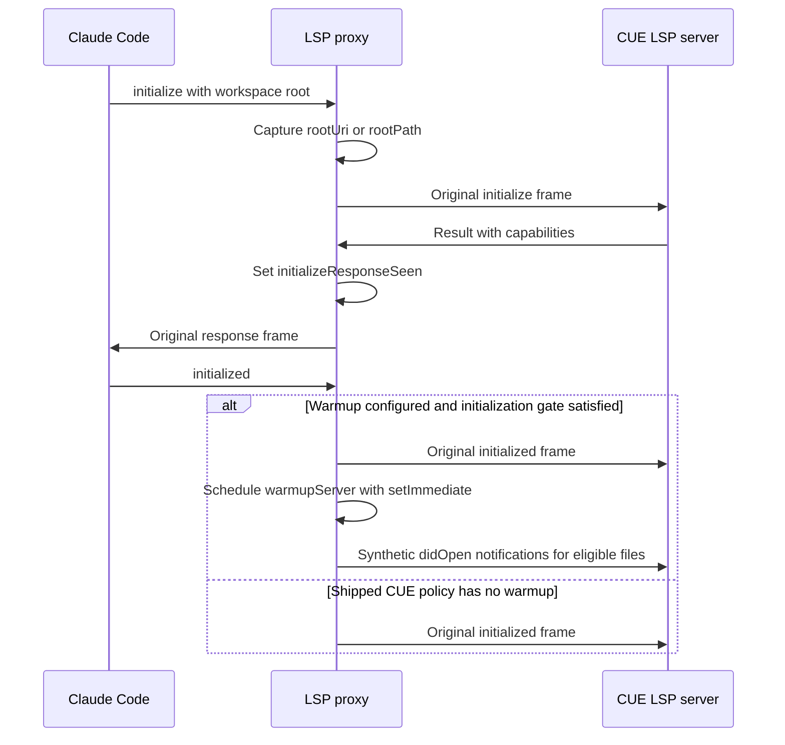

# CUE Language Server Protocol

The `cue_language_server_protocol` module is the transport and compatibility
layer inside `cue-lsp/lsp-proxy.js`. It relays Language Server Protocol (LSP)
messages between Claude Code and `cue lsp serve`, preserving original framed
bytes unless a compatibility rule or document-lifecycle transformation applies.

This page documents message framing, bidirectional routing, local responses,
initialization coordination, and child-process shutdown. The proxy does not
implement CUE analysis or add language features missing from the upstream
server.

## Scope and system context

This is a logical module within one Node.js executable, not a separate package
or service. Its core functions are `writeMessage`, `drainBuffer`,
`drainServerBuffer`, and `autoAckResult`.

Related responsibilities are documented separately:

- [CUE language server integration][integration] describes the plugin's overall
  architecture, packaging, and upstream capability boundaries.
- [Setup and registration][setup] covers language routing, prerequisites,
  installation, and host launch configuration.
- [Document lifecycle and disk synchronization][lifecycle] covers tracked
  buffers, version rebasing, disk polling, deletion recovery, and warmup.
- [Language intelligence integration][language-integration] places the CUE
  plugin alongside the other language-server integrations.

## Architecture and dependencies



The executable uses Node standard-library APIs only:

- `Buffer` supplies byte-oriented framing and independent input accumulators.
- `node:child_process` supplies `spawn` for the downstream language server.
- `node:fs` and `node:path` support configuration loading and lifecycle work.
- `node:url` converts file URIs for workspace and document handling.

There is no external JSON-RPC library or network transport. The child uses
`stdio: ['pipe', 'pipe', 'inherit']`: protocol traffic uses its stdin/stdout
pipes, while child stderr is inherited. Proxy stdout is reserved for
client-facing protocol traffic; proxy diagnostics also go to stderr.

### Effective CUE policy

`cue-lsp/.lsp.json` launches `node` with the plugin's `lsp-proxy.js` and
`--config ${CLAUDE_PLUGIN_ROOT}/proxy.json`. The host expands the plugin-root
placeholder. The shipped `cue-lsp/proxy.json` contains:

```json
{
  "server": ["cue", "lsp", "serve"],
  "blocked": []
}
```

Together with defaults in `cue-lsp/lsp-proxy.js`, this produces:

| Concern | Effective behavior |
| --- | --- |
| Child command | `cue lsp serve`, resolved through `PATH`. |
| Client method blocking | Inactive: the configured list is empty. |
| Server-request auto-ack | Active for four fixed methods. |
| Workspace warmup | Inactive: no `warmup` configuration. |
| Disk synchronization | Active with a default 300 ms polling interval. |

The generic wrapper's optional mechanisms are not all enabled CUE features.
In particular, it does not discover unsupported methods from server errors:
an unblocked method-not-found response is forwarded unchanged. Setting
`"sync": false` disables polling and client-change reconciliation, but not all
open/close bookkeeping or duplicate-open handling. Detailed synchronization
settings belong to the [lifecycle guide][lifecycle].

## Core components and shared state

All four functions are defined at file scope in `cue-lsp/lsp-proxy.js`; they are
not independently exported APIs.

| Function | Responsibility |
| --- | --- |
| `writeMessage(stream, body)` | Frame an already serialized body. |
| `drainBuffer()` | Parse and route client input; observe lifecycle. |
| `drainServerBuffer()` | Parse server output; intercept fixed requests. |
| `autoAckResult(msg)` | Construct the result value for a local server reply. |

The functions coordinate through the following state:

- `buffer` accumulates client bytes; `serverBuffer` accumulates server bytes.
  Neither direction depends on the other's chunk boundaries.
- `BLOCKED_METHODS` holds configured client-method names;
  `SERVER_REQUESTS_AUTO_RESPOND` holds the fixed server-request names.
- `rootUri` stores the workspace root captured during initialization.
- `initializeResponseSeen` records a server result with truthy `capabilities`.
- `openDocs` is shared with lifecycle helpers for open/change/close processing.
- `shuttingDown` distinguishes expected termination from an unexpected child
  signal exit. `pollTimer` is cleared during shutdown.

There is no general pending-request table, ID remapping, or capability
negotiation engine. Ordinary request/response correlation remains the
responsibility of the client and CUE server.

## Message framing and byte preservation

### Writing synthetic messages

`writeMessage` accepts serialized bytes or a string, not a JSON-RPC object to
serialize. It preserves a supplied `Buffer`; otherwise it calls
`Buffer.from(body)`, using UTF-8 for strings. It then performs two ordered
writes:

```javascript
const buf = Buffer.isBuffer(body) ? body : Buffer.from(body);
stream.write(`Content-Length: ${buf.length}\r\n\r\n`);
stream.write(buf);
```

`Content-Length` counts body bytes, not JavaScript characters. This keeps
non-ASCII content correctly framed. The generated header uses CRLF line
endings and an empty line before the body; the helper adds no trailing body
newline or `Content-Type` header.

Callers construct JSON-RPC fields and use `JSON.stringify` before calling this
helper. Its principal destinations are:

- `process.stdout` for replies to blocked client requests.
- `child.stdin` for server-request acknowledgments and synthetic document
  lifecycle notifications.

The two writes are not an atomic transport operation. Receivers must handle
arbitrary chunk boundaries. The helper does not wait for backpressure or
provide a delivery acknowledgment.

### Incremental frame parsing

Each stream's `data` handler concatenates the new chunk onto its accumulator
and invokes the corresponding drain function. Both functions use the same
framing algorithm:

1. Find `HEADER_DELIM`, the bytes `\r\n\r\n`. If absent, retain the bytes and
   return until more input arrives.
2. Decode the header as ASCII and match a content length with
   `/^content-length:\s*(\d+)\s*$/im`.
3. Calculate the body start and message end in bytes. If the declared body is
   incomplete, retain the bytes and return.
4. Extract the complete original frame as `rawMessage`, extract its body, and
   advance the accumulator past that frame.
5. Decode the body as UTF-8 and attempt `JSON.parse`.
6. Apply direction-specific routing, then loop over any remaining frames.



This supports split headers, split bodies, and multiple frames in one chunk.
Header matching is case-insensitive. Other header fields are not interpreted,
but remain present when the original frame is forwarded.

### Normal forwarding and malformed-input fallbacks

Ordinary forwarding writes `rawMessage` directly rather than reserializing the
parsed object. It preserves header spelling, extra headers, JSON whitespace,
and original body bytes. Only deliberate lifecycle rewrites and synthetic
messages receive newly generated framing.

| Input condition | Parser behavior |
| --- | --- |
| Header delimiter not yet present | Retain bytes and wait. |
| Declared body not yet complete | Retain bytes and wait. |
| Delimiter present, no matching length | Forward whole buffer; clear it. |
| Complete frame with invalid JSON | Forward that raw frame; keep draining. |
| Parsed message without interception | Forward its original frame. |

Forwarding means writing to `child.stdin` in `drainBuffer`, or to
`process.stdout` in `drainServerBuffer`.

These fallbacks preserve opaque traffic; they do not repair malformed LSP.
A missing length header flushes the entire current accumulator, potentially
including later messages, without inspecting them. Invalid JSON bypasses
method interception. Neither path generates a JSON-RPC parse-error response
or searches for a replacement frame boundary.

There is no configured frame-size limit or incomplete-frame timeout. A missing
delimiter or excessive declared length can retain bytes indefinitely. Only
`JSON.parse` is guarded here; the handlers do not fully validate the structure
of syntactically valid JSON-RPC messages.

## Client-to-server routing

`process.stdin.on('data')` appends bytes and calls `drainBuffer`. For each parsed
message, the processing order is:

1. Capture workspace-root information from a message named `initialize` with
   params.
2. Observe document lifecycle notifications. Prepare `outFrame` as original
   bytes, rewritten bytes, or `null` if the input has been consumed.
3. If the warmup initialization gate is satisfied, forward the original
   `initialized` frame, schedule warmup, and continue to the next frame.
4. Check the configured blocked-method set. Reply locally to a matching
   request, or discard a matching notification, then continue.
5. Forward `outFrame` to the child if it is not `null`.

Client responses to ordinary server requests follow the normal forwarding
path. The proxy does not need a separate request-correlation map for them.

### Configured method blocking

`BLOCKED_METHODS` is a `Set` built from `config.blocked || []`. Matching uses
exact method names. The mechanism exists to avoid known unsupported client
methods whose JSON-RPC `-32601` responses can leave Claude Code's LSP client
unusable.

- A matching message with `msg.id !== undefined` receives a local response on
  proxy stdout, using the original ID and `result: null`.
- A matching notification, with no ID, is discarded without a response.
- The blocked input is not sent to the child through the normal forwarding
  path.
- Nonmatching traffic and server error responses are not rewritten by this
  mechanism.

For example, a blocked request with ID 42 receives this body, framed by
`writeMessage`:

```json
{"jsonrpc":"2.0","id":42,"result":null}
```

The ID guard checks definedness, not truthiness, so ID `0` is preserved. The
reply is a successful empty result, not a method-not-found error and not an
implementation of the feature. A client can therefore interpret it as
"no result" rather than "unsupported."

**CUE currently blocks no methods.** The behavior above describes the shared
wrapper's configuration contract, not an active CUE filter.

Blocking follows lifecycle observation and the special warmup branch. It is
not a security filter or general allowlist. Blocking a lifecycle method does
not undo state changes or synthetic messages already emitted while observing
that input.

### Document-lifecycle handoff

The transport layer observes these methods before normal forwarding:

- `textDocument/didOpen` tracks a new document. If the server already has the
  document open, the proxy emits a full-text `didChange` instead and consumes
  the original open, avoiding a duplicate `didOpen`.
- `textDocument/didChange`, when `SYNC` is enabled, calls
  `reconcileClientChange(msg, rawMessage)`. The returned frame becomes
  `outFrame`.
- `textDocument/didClose` removes tracking. If the proxy already closed the
  document server-side, it consumes the client close rather than closing it
  twice.

`reconcileClientChange` can preserve the raw frame, reframe it with a rebased
version, or return `null` after emitting a replacement `didOpen`. Polling and
warmup also call `writeMessage(child.stdin, ...)` to inject notifications.
These server-facing injections are not echoed to Claude Code.

For buffer authority, incremental-change handling, version calculations, and
file deletion/reappearance, see the [document-lifecycle guide][lifecycle].

## Server-to-client routing and acknowledgments

`child.stdout.on('data')` appends bytes and calls `drainServerBuffer`. For each
parsed message, it:

1. Checks for a defined ID and a method in `SERVER_REQUESTS_AUTO_RESPOND`.
2. If recognized, builds a JSON-RPC response with `autoAckResult`, sends it to
   `child.stdin` through `writeMessage`, consumes the request, and continues.
3. Otherwise, records a truthy `msg.result?.capabilities` value for warmup
   coordination.
4. Forwards the original frame through proxy stdout to the client.

Notifications, responses, and unrecognized server requests are forwarded. A
notification named like an auto-acknowledged method is not intercepted because
it has no ID. For example, `window/showMessageRequest` is not in the fixed set
and remains the client's responsibility.

### Fixed auto-acknowledged methods

These local replies prevent the server from waiting indefinitely on requests
that Claude Code's client cannot handle. They are independent of
`config.blocked`, have no per-method configuration switch, and remain active
with the shipped CUE policy.

| Server request method | Result value |
| --- | --- |
| `client/registerCapability` | `null` |
| `client/unregisterCapability` | `null` |
| `workspace/configuration` | Array containing one `null` per item. |
| `window/workDoneProgress/create` | `null` |

Each reply includes `jsonrpc: '2.0'`, the original request ID, and `result`.
The originating request never reaches the client. Acknowledgment is not a full
implementation of the requested client feature: the proxy keeps no dynamic
registration store, provides no progress UI, and supplies no configuration
overrides.

### Configuration result contract

For `workspace/configuration`, `autoAckResult` uses `params.items` only when it
is an array and returns `items.map(() => null)`. The result preserves the
number and order of requested items. Missing params, missing items, or
non-array items produce `[]`, not a bare `null`.

For example, this illustrative server request:

```json
{
  "jsonrpc": "2.0",
  "id": 99,
  "method": "workspace/configuration",
  "params": {
    "items": [
      { "section": "example.first" },
      { "section": "example.second" }
    ]
  }
}
```

receives this body, framed by `writeMessage`:

```json
{"jsonrpc":"2.0","id":99,"result":[null,null]}
```

The proxy does not look up the named sections or forward the request to the
host. The per-item `null` values mean no overrides are supplied. Returning a
bare `null` would violate the result-array contract and break servers that
index into it; the shared implementation explicitly protects this shape.



## Initialization coordination and optional warmup

Both drain functions participate in the generic warmup trigger:

1. `drainBuffer` captures `params.rootUri`, falling back to `params.rootPath`,
   then `null`, when it sees `initialize` with params. It logs that value.
2. `drainServerBuffer` sets `initializeResponseSeen = true` for a message with
   truthy `result.capabilities`, then forwards the response.
3. A subsequent `initialized` message triggers scheduling only if
   `initializeResponseSeen`, `rootUri`, and `WARMUP` are all truthy.
4. The proxy first writes the original `initialized` frame to the child. It
   converts a `file://` root with `fileURLToPath`, otherwise uses the root as a
   path, and schedules `warmupServer(rootDir)` with `setImmediate`.



The deferred callback preserves write ordering: the `initialized` frame is
written before the warmup notification burst. It is not an acknowledgment that
the server has processed initialization. File discovery, extension filtering,
and open deduplication are owned by the [lifecycle module][lifecycle].

Important implementation boundaries are:

- Detection is based on `result.capabilities`, not correlation with a stored
  initialize request ID.
- An early `initialized` that misses the gate is forwarded normally; receiving
  the server response later does not retroactively schedule warmup.
- There is no separate warmup-completed latch in the drain functions.
- The successful warmup branch continues before the blocked-method check.
- With the shipped CUE configuration, `WARMUP` is `null`, so no workspace scan
  or synthetic warmup opens are scheduled.

## Process lifecycle and shutdown

### Startup and configuration validation

Before attaching the stream handlers, `cue-lsp/lsp-proxy.js` reads the path
following `--config`, resolves it, and parses the file as JSON. It explicitly
requires `config.server` to be a non-empty array.

| Startup condition | Outcome |
| --- | --- |
| Missing `--config` or following argument | Usage on stderr; exit 1. |
| Unreadable file or JSON parse failure | Config error on stderr; exit 1. |
| Missing, non-array, or empty `server` | Validation error; exit 1. |
| Child emits a spawn error | Child error on stderr; exit 1. |

This is partial validation, not a complete configuration schema. The first
`server` element becomes the command; remaining elements become its arguments.
`spawn` is used without a shell, custom environment, or working-directory
override. The CUE command therefore depends on the inherited `PATH` and
runtime environment established outside this module; see [setup][setup].

### Termination and exit status

| Event | Proxy action |
| --- | --- |
| Client stdin ends | Mark expected shutdown; stop polling; send `SIGTERM`. |
| Proxy receives `SIGTERM` | Mark shutdown; stop polling; forward `SIGTERM`. |
| Proxy receives `SIGINT` | Mark shutdown; stop polling; forward `SIGINT`. |
| Child exits | Stop polling and compute the proxy's exit status. |

The polling timer is unreferenced when supported, so it does not by itself
keep Node alive. The child exit handler uses:

```javascript
process.exit(code ?? (shuttingDown ? 0 : 1));
```

A numeric child exit code is preserved, including a nonzero code during
expected shutdown. A `null` code, typical of signal termination, maps to 0
when shutdown was expected and to 1 otherwise.

LSP `shutdown` requests and `exit` notifications are ordinary forwarded
messages unless configured as blocked. Client stdin EOF instead takes the
process-level signal path; it does not synthesize a graceful LSP shutdown
exchange.

There is no restart policy, signal escalation, or forced-kill timeout. A child
that ignores the forwarded signal can delay termination. The proxy exits from
the child's `exit` event rather than waiting for a separate pipe-drain or
`close` event, and it does not flush incomplete framing accumulators on EOF.

### Diagnostics and operational boundaries

Configuration errors use `[lsp-proxy]`; runtime messages use
`[lsp-proxy:cue]` with the shipped command. The initialization root, lifecycle
transformations, and child errors are reported on stderr. Child diagnostics
are inherited directly and need not carry the proxy prefix.

There is no general wire trace or per-request acknowledgment log. A server
request absent from client logs may have been intentionally auto-acknowledged.
A method-not-found error reaching Claude Code is not automatically suppressed,
because the CUE blocked-method list is empty.

The proxy is a compatibility relay, not a defensive protocol gateway. It has
permissive malformed-input fallbacks, unbounded framing accumulators, and no
explicit writable-stream backpressure coordination. Large traffic bursts and
synchronous lifecycle filesystem work can delay the event loop.

## Validation and maintenance

Run the repository test entry point from the repository root:

```sh
make test
```

`Makefile` delegates to `bash tests/run.sh`. That runner requires `node`,
`bash`, `jq`, and `shellcheck`. Relevant checked-in validation paths are:

- `tests/cases/06-proxy.sh` and `tests/helpers/proxy-suite.js`: byte-preserving
  forwarding in both directions, split input and output, blocked requests and
  notifications, malformed-header and invalid-JSON fallbacks, all four
  auto-acknowledgments, and forwarding of unrecognized server requests.
- The same proxy suite checks missing/unreadable configuration, empty server
  commands, spawn errors, forwarded signals, child exit-code propagation, and
  stdin EOF handling. It also exercises lifecycle handoffs such as rebasing,
  deletion/reappearance, and duplicate-open translation.
- `tests/cases/07-warmup.sh`: configured warmup, an empty tree, multiple
  extensions, and absence of a warmup section.
- `tests/cases/02-consistency.sh`: proxy launch/configuration consistency and
  byte-identical proxy copies across plugin directories.

The protocol scenarios run against shared proxy copies in other plugins;
consistency tests enforce identity with the CUE copy. Stub-based protocol
checks do not establish which language features the installed CUE server
supports. See the [CUE integration guide][integration] for live CUE validation
and capability boundaries.

Each plugin is installed independently and ships a real copy of the unified
proxy. Put CUE-specific method policy in `cue-lsp/proxy.json`; changes to the
shared transport implementation must reach every deployed proxy copy.

`.github/workflows/test-gate.yml` runs `make test` in separate Linux and macOS
jobs. Broader build and gate procedures belong to
[repository build and configuration][build] and [continuous integration][ci].
The validation paths described here are not a report of tests executed while
writing this page.

[integration]: ../cue_language_server.md
[setup]: cue_language_server_setup.md
[lifecycle]: cue_language_server_document_lifecycle.md
[language-integration]: ../../language_intelligence_integration.md
[build]: ../../engineering_platform_and_validation/repository_build_and_configuration.md
[ci]: ../../engineering_platform_and_validation/continuous_integration.md
