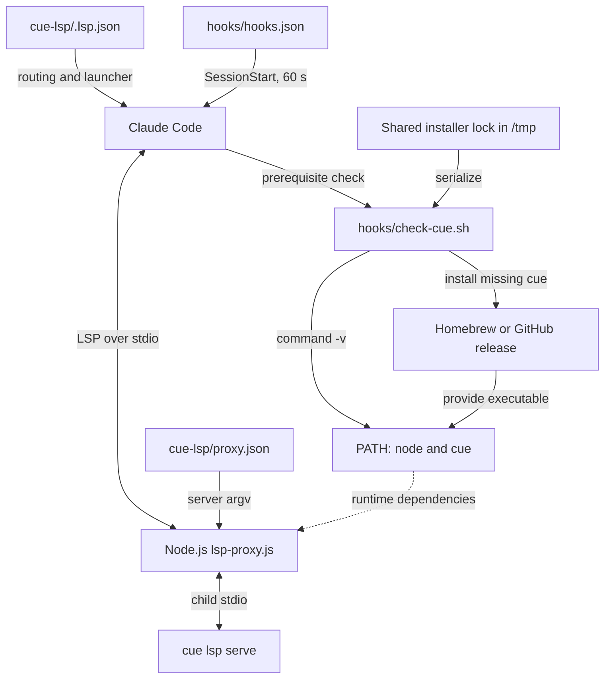
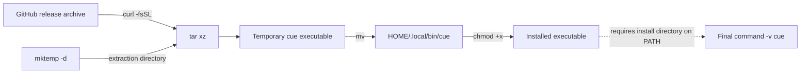
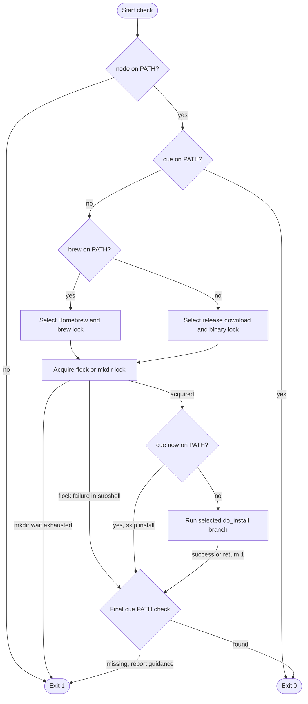
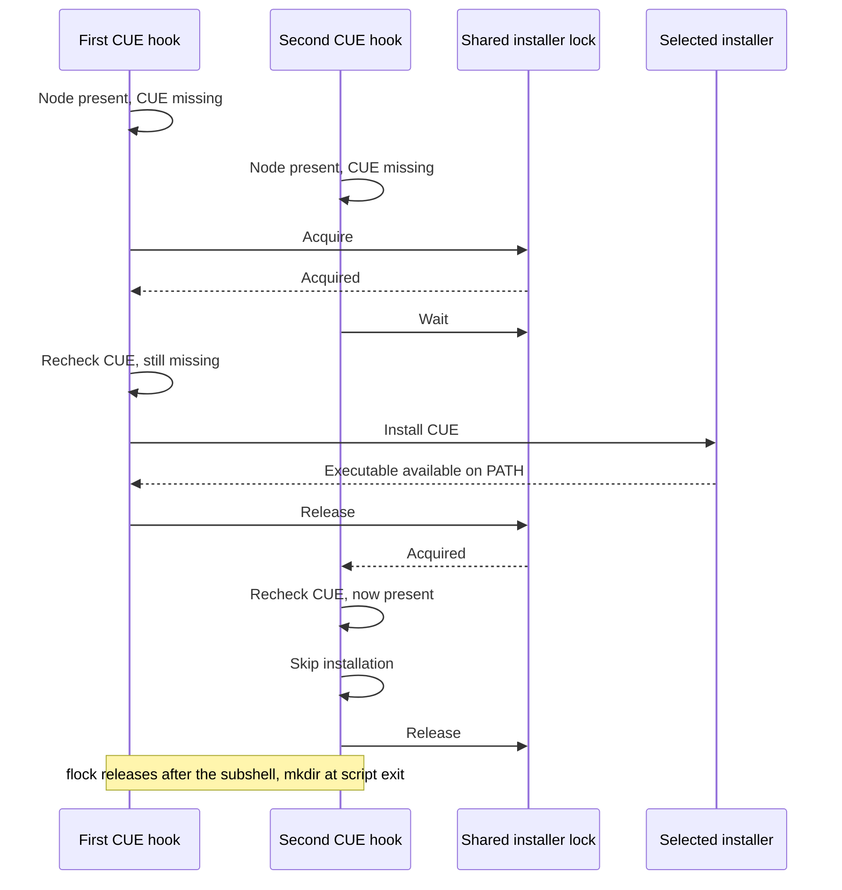

# CUE Language Server Setup

The `cue_language_server_setup` module registers `.cue` files with Claude Code
and prepares the external dependencies needed to run the CUE language server.
It combines a declarative Node.js launcher with a session-start script that
checks for Node.js and installs the CUE CLI when it is missing.

This is the setup layer of the
[CUE language server integration](../cue_language_server.md), within the
[language intelligence integration](../../language_intelligence_integration.md)
system. It does not implement CUE analysis, LSP transport, or document
synchronization.

## Architecture and system fit

Setup has two separate host entry points: `.lsp.json` defines language routing
and the proxy launcher, while `hooks/hooks.json` invokes the prerequisite check
at session start. The check script does not launch the proxy or server.



The core files own these responsibilities:

- `cue-lsp/.lsp.json`: language registration and the bundled proxy invocation.
- `cue-lsp/hooks/check-cue.sh`: prerequisite discovery, installer selection,
  installation, locking, and the final CUE availability check.

Adjacent files complete the integration:

- `cue-lsp/hooks/hooks.json`: session-start command and host timeout.
- `cue-lsp/proxy.json`: the actual CUE server command and runtime policy.
- `cue-lsp/lsp-proxy.js`: configuration loading, child-process launch, and LSP
  traffic. See [protocol transport][protocol] and
  [document lifecycle][lifecycle] rather than implementing those concerns in
  the installer.

`.claude-plugin/marketplace.json` distributes the `./cue-lsp` directory, and
`cue-lsp/.claude-plugin/plugin.json` identifies the plugin. Plugin metadata
versions describe the integration, not the separately installed CUE CLI.

## Registration and launch contract

### Client registration

`cue-lsp/.lsp.json` contains the following registration, reformatted here:

```json
{
  "cue": {
    "command": "node",
    "args": [
      "${CLAUDE_PLUGIN_ROOT}/lsp-proxy.js",
      "--config",
      "${CLAUDE_PLUGIN_ROOT}/proxy.json"
    ],
    "extensionToLanguage": {
      ".cue": "cue"
    }
  }
}
```

The configuration establishes these boundaries:

- `cue` names the registration entry; `.cue` files use LSP language ID `cue`.
  No additional extensions or extensionless filenames are explicitly mapped.
- The host launches `node`, resolved through its `PATH`, rather than invoking
  CUE directly. CUE is a Go binary, so having `cue` installed does not imply
  that the Node.js proxy runtime is available.
- The host expands `${CLAUDE_PLUGIN_ROOT}` to locate the bundled proxy and its
  configuration inside the installed plugin, independently of the workspace.
- `--config` explicitly selects `proxy.json`; the proxy does not infer the
  server command from the language ID or filename extension.

The proxy uses Node standard-library modules and runs as shipped JavaScript.
There is no CUE-specific compilation step, Go build, or project-local npm
installation required to run it. See `cue-lsp/lsp-proxy.js`.

### Child server command

`cue-lsp/proxy.json` supplies the downstream command:

```json
{
  "server": ["cue", "lsp", "serve"],
  "blocked": []
}
```

The resulting launch chain is:

```text
Claude Code -> node lsp-proxy.js --config proxy.json
            -> cue lsp serve
```

The proxy spawns `cue` using its inherited environment, without a shell wrapper
or an explicit child working-directory override. Consequently, the installer
must make the CLI discoverable through the session's `PATH`; placing a binary
on disk is not sufficient. The empty `blocked` list configures no blocked
client methods. Runtime configuration details belong to the
[protocol guide][protocol].

### Session-start wiring

`cue-lsp/hooks/hooks.json` registers a command-type `SessionStart` hook:

```sh
bash ${CLAUDE_PLUGIN_ROOT}/hooks/check-cue.sh
```

The manifest sets `timeout` to **60 seconds**. Bash is required: the script uses
Bash redirection, local variables, and arithmetic syntax rather than only
portable POSIX `sh` features.

The script reports prerequisite and installation results. It does not perform
an LSP initialization handshake, modify the host environment, or define how
Claude Code handles hook failure or schedules the registered LSP launcher.

## Prerequisites and installation policy

The check order in `cue-lsp/hooks/check-cue.sh` is deliberate:

- Require `node` first. If it is missing, print guidance to stderr and exit 1,
  even if `cue` is already installed. Node.js is not installed automatically.
- If `cue` is discoverable, exit 0 silently, without locking or installing.
- Otherwise select Homebrew whenever `brew` is discoverable. Select the binary
  download route only when Homebrew is absent.
- Acquire the selected installer lock, recheck for `cue`, and install only if
  the executable is still missing.
- After the locking branch, check `cue` through `PATH` again.

Discovery uses `command -v`; it does not execute Node.js or CUE to verify
versions, executable health, or support for `cue lsp serve`. Existing CUE
installations are neither upgraded nor repaired. No minimum Node.js or CUE
version is enforced.

The script fixes the following settings internally:

| Setting | Value |
| --- | --- |
| `BINARY` | `cue` |
| `FORMULA` | `cue-lang/tap/cue` |
| Binary-download version | `0.16.0` |
| Binary-download directory | `${HOME}/.local/bin` |
| `LOCK_TIMEOUT` | `120` seconds |

These assignments are not environment-variable overrides. The hook does not
install Homebrew, invoke npm, use `sudo`, or change `PATH`. Installation needs
network access and permission to write to the selected installation location.

### Homebrew route

The selected command is:

```sh
brew install cue-lang/tap/cue
```

Selection depends on command availability, not an operating-system check. A
Linux host with Homebrew available also takes this route. The formula is
unversioned, so this path is not pinned to CUE v0.16.0.

A failed Homebrew install logs `brew install failed` and returns 1 from
`do_install`. It does **not** trigger a GitHub-download retry. The parent
script still reaches the final availability check under its normal invocation.

### GitHub release route

When Homebrew is absent, the hook downloads the prebuilt CLI from
[the CUE GitHub releases](https://github.com/cue-lang/cue/releases). Architecture
selection is limited to these mappings:

| `uname -m` result | Release architecture |
| --- | --- |
| `x86_64` | `amd64` |
| `aarch64` | `arm64` |
| `arm64` | `arm64` |
| Any other value | Report unsupported architecture; return 1 |

The operating-system component is `uname -s` converted to lowercase, for
example `Linux` becomes `linux` and `Darwin` becomes `darwin`. There is no OS
allowlist or native Windows-specific branch: a recognized architecture still
needs a matching upstream archive for the derived OS name.

Equivalent URL construction is:

```sh
version="0.16.0"
release="https://github.com/cue-lang/cue/releases/download/v${version}"
url="${release}/cue_v${version}_${os}_${arch}.tar.gz"
```

For Linux on `x86_64`, the asset name is
`cue_v0.16.0_linux_amd64.tar.gz`. The version pin applies only to this download
route, not to an existing CLI or a Homebrew installation.

The installation data flow is:



The script creates `${HOME}/.local/bin` before moving the extracted top-level
`cue` executable into it. It removes the temporary directory on the normal
success path and on the explicit extraction-failure path.

The download pipeline in the script is:

```sh
curl -fsSL "$url" | tar xz -C "$tmp_dir"
```

This route needs `curl`, `tar` with gzip support, `uname`, `tr`, `mktemp`, and
normal filesystem utilities. These tools are not proactively checked. The
script does not add `${HOME}/.local/bin` to `PATH`, so a successful download can
still end with `Not in PATH after install`.

## Installer process flow

The second CUE check, inside the lock, avoids redundant work when another
session installs the CLI while this invocation waits.



The final check tests discovery, not installation provenance or correctness.
The script does not enable `set -e`, so installation errors do not necessarily
terminate the parent before this check. The distinct lock-failure behaviors are
important when interpreting logs and exit status.

## Concurrency and timeout behavior

### Shared lock resources

Installer selection determines the base lock path:

| Installer | Base lock path |
| --- | --- |
| Homebrew | `/tmp/claude-lsp-brew.lock` |
| GitHub binary | `/tmp/claude-lsp-binary.lock` |

These paths are hardcoded under `/tmp`; setting `TMPDIR` does not relocate
them. They are installation-method-wide, not CUE-specific or user-specific.
For example, `regal-lsp/hooks/check-regal.sh` uses the same base paths; see the
[Regal integration](../regal_language_server.md) for its installer policy.

The locks coordinate cooperating hooks only, not every independent package
manager or download on the machine. Different base paths do not coordinate.
The `flock` and directory-lock implementations also use different resources
and do not coordinate with each other.

### Lock implementations

When `flock` is discoverable:

- Open the base lock file on file descriptor 9 in a subshell.
- Run `flock --timeout "$LOCK_TIMEOUT" 9` to acquire an exclusive lock.
- Recheck CUE and call `do_install` only when it is still missing.
- On normal completion, close the subshell's locking descriptor before the
  parent's final availability check. The lock file can remain; its existence
  alone does not indicate a held lock.

When `flock` is unavailable:

- Use atomic `mkdir` on the base path plus `.d`, such as
  `/tmp/claude-lsp-binary.lock.d`.
- Retry failed acquisitions every two seconds, tracking a 120-second sleep
  budget. Another failed attempt after that budget reports `Lock timeout`.
- After acquisition, install an `EXIT` trap that attempts to remove the lock
  directory with `rmdir`, then recheck CUE before installing.
- Hold the directory lock through the final availability check until exit.

Directory cleanup is best-effort. Abnormal termination can leave a stale lock,
and there is no PID, age check, or automatic stale-lock recovery. Suppressed
`mkdir` errors can also make permission failures look like contention. The
installation's temporary download directory has no dedicated exit trap, so an
interrupted download can leave temporary files as well.

### Concurrent startup interaction

This successful example assumes both sessions use the same lock mechanism and
can discover the installed executable through their respective `PATH` values:



If the first install fails and CUE remains missing, the next lock holder may
attempt installation itself. The lock is not a persistent success marker.

### Timeout budgets

Two independent budgets apply:

- `cue-lsp/hooks/hooks.json` gives the host hook **60 seconds**.
- `cue-lsp/hooks/check-cue.sh` permits **120 seconds** of lock waiting. This is
  not an installation timeout; neither `brew` nor `curl` receives an explicit
  command timeout from the script.

The host can time out an installation or lock wait before the script reaches
its own timeout. Do not treat 120 seconds as a guaranteed startup allowance.
Preinstall dependencies when predictable startup matters, especially when many
plugins start together. Changes to either timeout must consider the other.

## Outcomes, limitations, and diagnostics

### Exit status and logging

An already discoverable Node.js and CUE produce an immediate, silent status 0.
Missing Node.js, a directory-lock timeout, and a failed final CUE discovery
explicitly exit the main script with status 1.

A `flock` failure logs `Lock timeout` and exits the locking **subshell** with
status 1, but the parent continues to its final check. Likewise, a
`do_install` failure does not unconditionally terminate the parent. If another
process makes CUE discoverable before the final check, the script can return 0
despite an earlier error message. Otherwise it reports the missing CLI and
exits 1.

All script-authored messages use the `[cue]` prefix. The missing-Node messages
go to stderr; the other explicit progress and failure messages use stdout.
Package-manager output and download-tool errors may appear with their own
formatting; the script does not add its prefix to those messages. Hook output
is separate from the proxy's LSP stdio stream.

### Installation guarantees and gaps

The hook is a dependency-discovery helper, not a complete installation or
compatibility validator:

- The GitHub route pins a release URL but does not verify a checksum or
  signature.
- The script does not enable `pipefail`; the `curl`/`tar` pipeline is judged by
  `tar`'s status. A failing `curl` status is not independently checked.
- `mktemp`, directory creation, `mv`, and `chmod` results are not explicitly
  guarded. A progress message such as `Installed to ...` is therefore not proof
  that every installation operation succeeded.
- The final `command -v cue` check does not run the binary, check its version,
  or validate LSP initialization. It cannot detect every corrupt or
  incompatible installation.

The setup layer also cannot add missing upstream language features. For the
CUE v0.16.0 capability boundary and live-test expectations, see the
[CUE integration overview](../cue_language_server.md).

### Common failures and recovery

- **`node is required`:** install Node.js, expose it to the Claude Code
  process, and restart the session. The hook suggests `brew install node`, but
  does not execute that command itself.
- **`brew install failed`:** inspect Homebrew output for formula, network, and
  permission problems. The download route is not automatically retried; use
  your approved manual provisioning method if Homebrew cannot be used.
- **`Unsupported architecture`:** the binary route accepts only the mappings
  listed above. Provision a compatible CUE executable manually if available
  for the platform; the architecture check is not applied to the Homebrew
  route.
- **`Binary download failed`:** the extraction pipeline returned failure.
  Check release-asset availability, network access, `curl`, `tar`, and temporary
  directory permissions. Curl failure reporting has the pipeline limitation
  described above.
- **`Not in PATH after install`:** ensure the installation directory is visible
  in the host's environment. For binary downloads, check
  `${HOME}/.local/bin/cue`. The diagnostic always suggests
  `brew install cue-lang/tap/cue`, even when Homebrew was absent.
- **`Lock timeout`:** inspect active cooperating installations first. Remove an
  empty stale `.d` directory with `rmdir` only after confirming it is unused.
  Do not delete an active lock or mistake a persistent `flock` file for a held
  lock.
- **Host hook timeout:** the 60-second host budget may expire during contention
  or installation. Check for remaining installer activity and provision the
  dependencies before retrying.
- **Hook succeeds but LSP startup fails:** check that the discovered CUE supports
  `cue lsp serve` and that the bundled proxy/configuration are readable. See
  [protocol transport][protocol] for launch errors and process diagnostics.

## Operator workflow

Run discovery checks in the environment used to launch Claude Code:

```sh
command -v node
command -v cue
```

An executable visible in an interactive terminal may not be visible to an
already running host process. The hook does not source shell startup files or
persist environment changes. Optional manual version checks, such as
`node --version` and `cue version`, provide information the hook does not check.

To exercise the actual installer from the repository root:

```sh
export PATH="${HOME}/.local/bin:${PATH}"
bash cue-lsp/hooks/check-cue.sh
```

This command can install a Homebrew package or download CUE into the user's
home directory. The `export` prepares the current shell for the binary route;
it is not performed by the script and does not update an existing host
process. Launch or restart Claude Code with the intended environment.

For offline or managed environments, preprovision approved Node.js and CUE
versions and expose both through `PATH`. The existing-binary path then avoids
network and installer use. Repository-wide provisioning is documented in
[development environment bootstrap][bootstrap], not implemented by this hook.

## Maintenance and validation

### Configuration invariants

Preserve these relationships when changing setup:

- `.lsp.json` must launch `node` with the bundled `lsp-proxy.js`, `--config`,
  and `proxy.json` paths rooted at `${CLAUDE_PLUGIN_ROOT}`.
- `proxy.json`'s `server[0]` must match the installer's `BINARY` value, `cue`.
  The Homebrew formula and downloaded archive must supply that command.
- `hooks/hooks.json` must reference the existing check script. Renaming the
  script requires updating the registered hook command.
- Language-extension mappings control host routing, not upstream analysis
  capabilities.
- Lock-path changes affect cross-plugin coordination. Timeout changes must
  consider both the host manifest and the script's lock-wait budget.
- A binary-version bump requires updating the download expectations in
  `tests/cases/04-installer-behavior.sh` and reviewing upstream compatibility.

Shared-proxy packaging and byte-identical-copy requirements are covered in the
[CUE integration overview](../cue_language_server.md). CUE-specific runtime
policy belongs in `proxy.json`, not a divergent proxy implementation.

### Repository checks

From the repository root, use the canonical test entry point:

```sh
make test
```

`Makefile` delegates to `bash tests/run.sh`. The runner requires `node`, `bash`,
`jq`, and `shellcheck`, and derives plugin membership from marketplace metadata.
Relevant setup checks are:

- `tests/cases/01-manifests.sh`: JSON validity, configuration shapes, and
  agreement between plugin and marketplace metadata.
- `tests/cases/02-consistency.sh`: plugin-root launch paths, the standard Node
  proxy invocation, installer/server command agreement, hook-script references,
  and byte-identical deployed proxy copies.
- `tests/cases/03-installer-lint.sh`: Bash syntax and ShellCheck checks.
- `tests/cases/04-installer-behavior.sh`: CUE's existing-binary no-op, missing
  Node.js failure even when CUE exists, Homebrew formula selection, and the
  pinned release URL and Linux/x86_64-to-amd64 mapping through mocked tools.
- `tests/cases/05-installer-concurrency.sh`: concurrent CUE Homebrew hooks must
  produce one install, with the second invocation skipping after its recheck.
  The forced directory-lock test targets Bash, not CUE specifically.

The installer behavior tests mock installation tools; they do not prove that
real downloads, archive contents, permissions, or an upstream LSP handshake
work. The CUE download-failure path is not directly exercised by the shared
curl-failure test, which targets Regal; its source comments explicitly note
CUE's missing `pipefail` behavior.

`tests/cases/08-live.sh` registers `live/cue-clean` only when `cue` is on `PATH`;
otherwise it is reported as skipped. That optional smoke test exercises the
registered runtime launcher, not session-start installation. Its capability
limits are documented in the [integration overview](../cue_language_server.md).

`.github/workflows/test-gate.yml` runs `make test` in separate Linux and macOS
jobs with Node 24.22.0, requiring successful, non-empty execution in both. That
Node pin is CI configuration, not a runtime minimum enforced by this hook, and
a green gate does not prove the optional live CUE test ran. See
[build and configuration][build] and [continuous integration][ci] for the
repository-wide validation procedures.

[protocol]: cue_language_server_protocol.md
[lifecycle]: cue_language_server_document_lifecycle.md
[bootstrap]: ../../engineering_platform_and_validation/development_environment_bootstrap.md
[build]: ../../engineering_platform_and_validation/repository_build_and_configuration.md
[ci]: ../../engineering_platform_and_validation/continuous_integration.md
