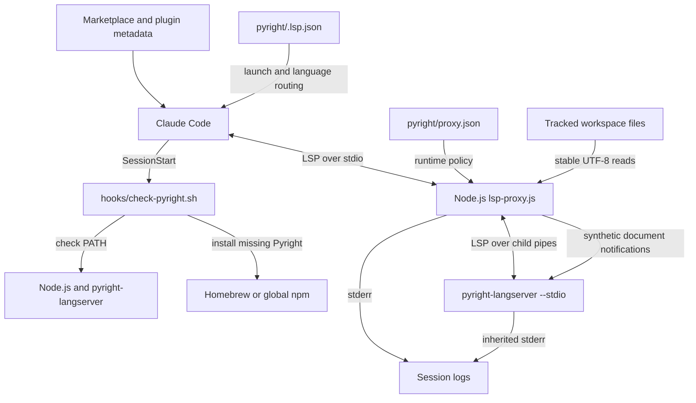
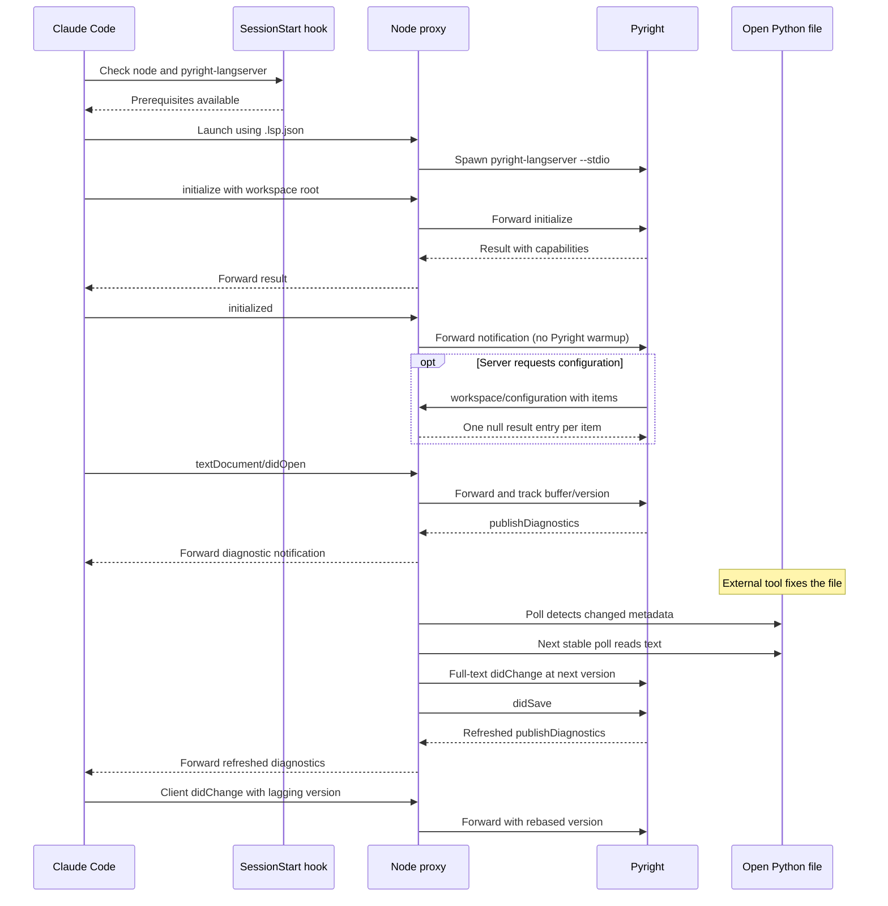

# Pyright Language Server Integration

## Purpose and scope

The `pyright_language_server` module connects Claude Code to the external
Pyright language server for Python source (`.py`) and stub (`.pyi`) files.
Distributed as the `pyright` plugin, it registers language routing, checks
runtime prerequisites at session start, and launches Pyright through a
Node.js LSP proxy.

The integration supplies protocol compatibility and server-buffer updates
for edits made outside the client's normal document notifications, such as
shell commands, formatters, Git operations, and other sessions. Python
analysis, type checking, project configuration, and language-feature
capabilities remain the responsibility of upstream Pyright. The proxy does
not implement a Python analyzer or add missing server capabilities.

This plugin belongs to the
[language intelligence integration](../language_intelligence_integration.md)
layer. The repository's Pyright live tests exercise push diagnostics,
including clearing errors after client changes and disk-only fixes; see
`tests/helpers/live-suite.js`.

## Architecture



The module has three logical sub-modules. These are documentation boundaries,
not separate packages: protocol handling and document lifecycle share one
proxy process, the child server, and the `openDocs` map.

| Detailed guide | Responsibilities |
| --- | --- |
| [Setup and registration][setup] | Routing, prerequisites, installs, locks. |
| [Protocol transport][protocol] | Framing, compatibility, child lifecycle. |
| [Document lifecycle][lifecycle] | Buffer tracking, disk sync, warmup. |

Setup combines `pyright/.lsp.json` with the session-start hook. The protocol
layer parses both directions and supplies local compatibility responses.
The document-lifecycle layer observes client notifications, reconciles
versions, and injects server-facing updates when stable disk content differs
from its tracked buffer. Optional file discovery and warmup are part of the
shared proxy but are not enabled for Pyright.

## Effective Pyright configuration

`pyright/.lsp.json` maps both `.py` and `.pyi` to language ID `python` and
launches the following command after the host expands `${CLAUDE_PLUGIN_ROOT}`:

```sh
node "${CLAUDE_PLUGIN_ROOT}/lsp-proxy.js" \
  --config "${CLAUDE_PLUGIN_ROOT}/proxy.json"
```

The inspected `pyright/proxy.json` contains:

```json
{
  "server": ["pyright-langserver", "--stdio"],
  "blocked": []
}
```

Combined with defaults in `pyright/lsp-proxy.js`, this has the following
runtime effects:

- The child command is `pyright-langserver --stdio`, resolved through `PATH`.
  The proxy does not use a shell or override the child's working directory.
- No client methods are blocked. Unsupported methods are not automatically
  discovered, and ordinary server error responses are not rewritten.
- There is no `warmup` section, so the proxy neither scans the workspace nor
  pre-opens Python files. Only client-opened documents enter disk polling.
- Disk synchronization defaults to a 300 ms polling interval. A configured
  nonzero numeric `sync.pollMs` is clamped to at least 50 ms; omitted or zero
  values use 300 ms. Setting `"sync": false` disables polling and client-change
  reconciliation, but retains open/close tracking and duplicate-open handling.
- Four fixed server-request methods are auto-acknowledged independently of
  `blocked`, `warmup`, and `sync` settings.

The proxy uses only Node standard-library modules and runs as shipped
JavaScript. There is no proxy compilation or local npm dependency-install
step; the external Pyright package is installed separately. The repository
is a plugin marketplace rather than an npm application, as described in
`Makefile`. Launch validation is detailed in the [protocol guide][protocol];
synchronization and warmup settings belong to the [lifecycle guide][lifecycle].

## Runtime interaction and data flow

The prerequisite hook and the LSP launcher are distinct host entry points.
The hook checks or installs prerequisites; it does not launch the proxy.
The following sequence illustrates one possible request ordering:



Ordinary messages retain their original framed bytes unless interception or
document reconciliation applies. The proxy consumes these server-initiated
requests and replies directly to Pyright:

| Server request | Local result |
| --- | --- |
| `client/registerCapability` | `null` |
| `client/unregisterCapability` | `null` |
| `workspace/configuration` | An array with one `null` per requested item |
| `window/workDoneProgress/create` | `null` |

The configuration array is important for servers such as Pyright that index
responses by item. These acknowledgments prevent waits on unsupported client
handlers; they do not provide configuration overrides, a dynamic-registration
registry, or a progress UI. Other requests and diagnostic notifications pass
through. See [protocol transport][protocol] for framing, interception order,
malformed-message fallbacks, and process shutdown.

## Document synchronization contract

The motivation for disk sync is diagnostic freshness: the repository's live
Pyright scenarios use `textDocument/publishDiagnostics`, not a pull-diagnostic
refresh. Updating an already-open server buffer with `didChange` allows
Pyright to reanalyze it after a disk-only edit.

With the shipped configuration:

- `trackOpen` records buffer text, server-facing version, language ID, file
  path, metadata, and lifecycle flags. Non-file URIs are tracked but not
  polled. The proxy is not a workspace-wide file watcher.
- `pollOpenDocs` compares `mtimeMs`, `ctimeMs`, `size`, and `ino`. A changed
  tuple arms an update; the same tuple on the next poll permits a UTF-8 read.
  Content identical to the tracked buffer causes no notification.
- Divergent disk text produces a synthetic full-document `didChange` followed
  by `didSave`. The proxy does not write the file or replace the client's
  buffer; these messages go only to the server.
- `reconcileClientChange` mirrors full-text client changes and rebases lagging
  versions to preserve increasing server-facing versions. Range-based
  changes pass through but pause polling for that document until its final
  buffer is reconstructable again from a full-text replacement.
- Two consecutive failed stat checks cause a synthetic `didClose`, while
  retaining the tracking entry. Stable file reappearance or a full-text
  client edit can reopen it. A client `didClose` removes tracking altogether.

A settled edit is normally propagated after roughly one to two polling
intervals, plus event-loop and server analysis time. The stability check is
best-effort, not an atomic-read guarantee: stat failures are treated as
absence, coarse filesystem timestamps can hide some rewrites, and synchronous
filesystem work grows with the number of tracked documents.

The proxy does not merge competing edits or protect unsaved client text from
divergent disk content. Duplicate-open translation, ordered change batches,
version formulas, deletion recovery, and optional warmup discovery are covered
in the [document-lifecycle guide][lifecycle]. That guide also explains why
adding `.pyi` to optional warmup needs an explicit language-ID mapping change;
client-opened stubs already use `python` correctly.

## Setup and operational boundaries

`pyright/hooks/hooks.json` runs `hooks/check-pyright.sh` at `SessionStart` with
a 60-second host timeout. The script first requires `node` on `PATH`, even
when `pyright-langserver` already exists. It does not install Node, enforce a
Node version minimum, provision a Python interpreter, or configure virtual
environments.

An existing `pyright-langserver` is accepted without a version check. If it
is absent, the hook selects `brew install pyright` when Homebrew exists;
otherwise it selects `npm install -g pyright`. npm is an availability fallback,
not a retry after a failed Homebrew installation. Neither route pins the
upstream Pyright version, and the script does not modify `PATH`.

Installation is serialized with package-manager-wide `/tmp` locks using
`flock` or a `mkdir` fallback. The 120-second lock-wait budget exceeds the
host's 60-second timeout, so contention or a slow install may be interrupted
before the script's own budget expires. Preinstall dependencies when session
startup must be predictable. Lock cleanup, failure handling, manual commands,
and troubleshooting are detailed in the [setup guide][setup].

Proxy logs use stderr with prefix `[lsp-proxy:pyright-langserver]`; early
configuration failures use `[lsp-proxy]`. Child stderr is inherited, while
stdout is reserved for client-facing LSP frames. Unreadable or unparseable
configuration, an absent/empty `server` array, and child spawn errors cause
status 1. Client stdin EOF sends `SIGTERM` to the child; received `SIGTERM`
and `SIGINT` are forwarded. There is no automatic restart or forced-kill
escalation. See [process lifecycle][protocol] for the full exit-status rules
and limitations of startup validation.

## Packaging and maintenance

`.claude-plugin/marketplace.json` distributes `./pyright`, and
`pyright/.claude-plugin/plugin.json` identifies the plugin as `pyright`,
currently at integration version `1.1.0`. That metadata version is not a
pin for the installed Pyright server.

Each marketplace plugin ships a real copy of the unified `lsp-proxy.js`
because plugin directories are installed independently.
`tests/cases/02-consistency.sh` requires the copies to be byte-identical and
checks the Node invocation, installer/server agreement, and hook references.
Keep Pyright-specific runtime policy in `pyright/proxy.json`; propagate shared
proxy changes to every deployed copy instead of creating a Pyright-only fork.

Sibling integrations document their own commands and runtime policies:

- [Bash language server](bash_language_server.md).
- [CUE language server](cue_language_server.md).
- [Regal language server](regal_language_server.md).
- [VTSLS language server](vtsls_language_server.md).

## Validation

Run the canonical test entry point from the repository root:

```sh
make test
```

`Makefile` dispatches to `bash tests/run.sh`, which requires `node`, `bash`,
`jq`, and `shellcheck` and derives plugin membership from marketplace metadata.
Relevant validation paths are:

- `tests/cases/02-consistency.sh`: launch/configuration agreement, hook
  targets, and identical deployed proxy copies.
- `tests/cases/04-installer-behavior.sh` and
  `tests/cases/05-installer-concurrency.sh`: Pyright existing-binary no-op,
  Homebrew/npm selection, npm failure, missing installation tools, and
  concurrent Homebrew installation. Some shared locking and prerequisite
  branches are exercised through sibling installers rather than Pyright.
- `tests/cases/06-proxy.sh` and `tests/cases/07-warmup.sh`: shared transport,
  acknowledgments, configuration errors, shutdown, synchronization, version
  rebasing, deletion/reappearance, duplicate opens, and optional warmup.
- `tests/cases/08-live.sh` and `tests/helpers/live-suite.js`: the four optional
  Pyright scenarios summarized below.

| Live scenario | Behavior asserted |
| --- | --- |
| `live/pyright-clean` | Empty diagnostic publication for a clean file. |
| `live/pyright-broken` | Matching assignment-type-error diagnostics. |
| `live/pyright-refresh` | Client full-text fix clears published errors. |
| `live/pyright-disksync` | Disk-only fix clears errors, no client change. |

These scenarios are registered only when `pyright-langserver` is on `PATH`;
otherwise the harness reports them as skipped. They use isolated fixture
workspaces and the configured proxy launcher.

`.github/workflows/test-gate.yml` runs `make test` in separate Linux and macOS
jobs with Node `24.22.0`, requiring successful, non-empty execution from both.
That CI pin is not an enforced runtime minimum, and a green gate alone does
not establish that optional live Pyright checks ran. This page describes the
checked-in validation paths; it does not report a test execution.

Repository-wide procedures are documented separately:

- [Build and configuration][build].
- [Development environment bootstrap][bootstrap].
- [Continuous integration][ci].

## Source map

- `pyright/.lsp.json`: Node launcher and Python source/stub routing.
- `pyright/proxy.json`: actual child command and compatibility policy.
- `pyright/hooks/hooks.json`: session-start command and host timeout.
- `pyright/hooks/check-pyright.sh`: prerequisite checks, installation, and locks.
- `pyright/lsp-proxy.js`: framing, acknowledgments, child supervision,
  document tracking, disk sync, and optional warmup.
- `pyright/.claude-plugin/plugin.json` and
  `.claude-plugin/marketplace.json`: plugin identity and distribution wiring.

[setup]: pyright_language_server/pyright_language_server_setup.md
[protocol]: pyright_language_server/pyright_language_server_protocol.md
[lifecycle]: pyright_language_server/pyright_language_server_document_lifecycle.md
[build]: ../engineering_platform_and_validation/repository_build_and_configuration.md
[bootstrap]: ../engineering_platform_and_validation/development_environment_bootstrap.md
[ci]: ../engineering_platform_and_validation/continuous_integration.md
