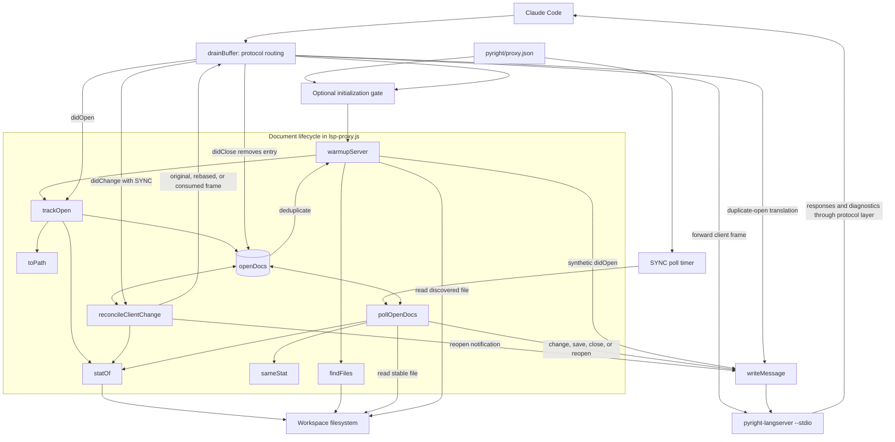
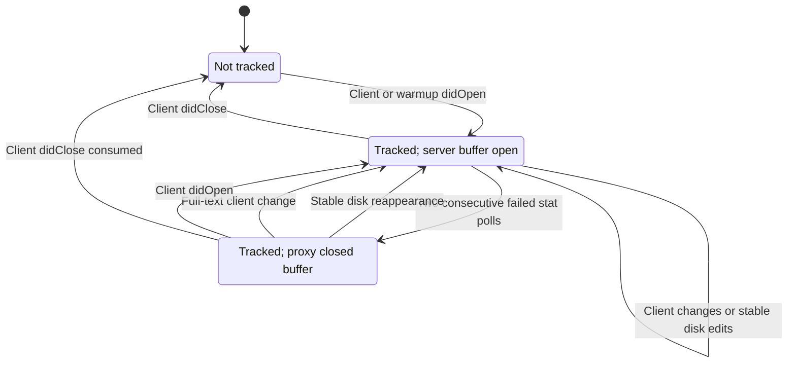
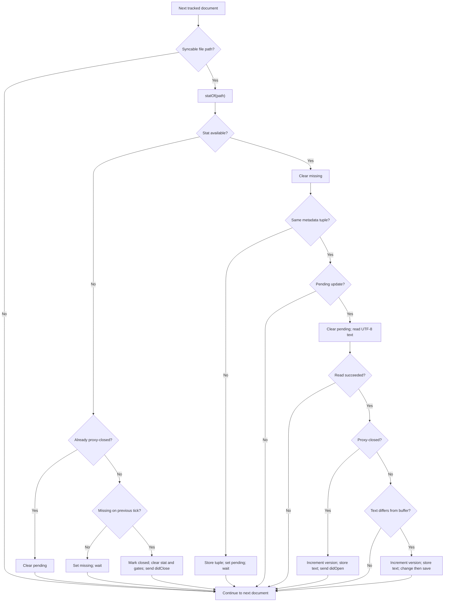
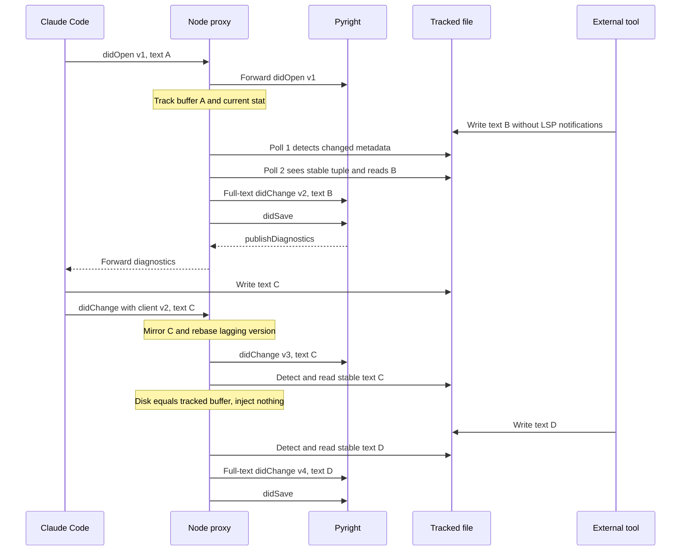

# Pyright Language Server Document Lifecycle

The `pyright_language_server_document_lifecycle` module manages the document
buffers that the Node.js proxy presents to Pyright. It tracks client opens
and changes, reconciles document versions, and sends synthetic lifecycle
notifications when files change outside the client's normal editing path.
It also provides optional workspace discovery and warmup.

These responsibilities live inside `pyright/lsp-proxy.js`, not a separate
package or service. The shipped Pyright configuration enables disk
synchronization but **does not enable warmup**. The proxy does not analyze
Python, generate diagnostics, write workspace files, or merge competing edits.

## Scope and system context

Claude Code reports its own edits through LSP notifications, but shell
commands, formatters, Git operations, and other sessions can modify files
without sending those notifications. An already-open Pyright buffer can then
remain stale. This layer detects stable disk changes for tracked documents
and updates the server-facing buffer so Pyright can refresh its analysis.
The repository's live Pyright tests exercise this through push diagnostics.

Related documentation owns the surrounding concerns:

- [Pyright integration][overview]: plugin architecture and system context.
- [Setup and registration][setup]: Python file routing, prerequisites, and
  the host's launch configuration.
- [Protocol transport][protocol]: LSP framing, message routing, compatibility
  responses, and process shutdown.
- [Language intelligence integration][integration]: the wider plugin family.

Synthetic notifications go directly to `child.stdin`. They are not sent to
Claude Code and do not update its editor buffer or version counter. Pyright's
responses and diagnostic notifications return through normal protocol
forwarding.

## Architecture and dependencies



All eight lifecycle helpers are file-scoped functions in the same executable.
They share `openDocs`, configuration, the child process, and the protocol
writer. Duplicate-open translation and client-close removal are implemented
in `drainBuffer`, rather than in `trackOpen` itself.

The implementation uses Node standard-library APIs only:

- `node:fs` supplies synchronous stat, directory enumeration, and UTF-8 reads.
- `node:path` supplies path joining and extension extraction.
- `node:url` converts file URIs and filesystem paths.
- `Map`, `Set`, `setInterval`, and `setImmediate` provide tracking, filtering,
  polling, and deferred warmup scheduling.

## Effective Pyright configuration

`pyright/.lsp.json` launches the proxy with the plugin's `proxy.json` and maps
both `.py` and `.pyi` to language ID `python`. The inspected
`pyright/proxy.json` selects `pyright-langserver --stdio` and contains neither
a `warmup` nor a `sync` property. Combined with defaults in
`pyright/lsp-proxy.js`, this produces:

| Concern | Shipped behavior |
| --- | --- |
| Disk synchronization | Enabled. |
| Poll interval | 300 ms. |
| Workspace warmup | Disabled; no startup scan or synthetic workspace opens. |
| Initial tracking | Client `textDocument/didOpen` notifications. |

The synchronization setting is evaluated as follows:

```javascript
const SYNC = config.sync === false
  ? null
  : { pollMs: Math.max(50, config.sync?.pollMs || 300) };
```

A configured nonzero numeric interval is clamped to at least 50 ms. An omitted
or zero `pollMs` uses 300 ms because the expression uses `||`, not `??`.
Configuration is loaded at startup; these settings are not hot-reloaded.

Setting `"sync": false` disables the timer and calls to
`reconcileClientChange`. It does **not** disable open/close bookkeeping,
duplicate-open translation, or optional warmup. Ordinary client changes then
pass through without updating the proxy's tracked text/version.

Polling does not filter extensions. Any tracked document with a usable file
path and reconstructable text is eligible, including client-opened `.pyi`
files. Language routing belongs to `.lsp.json`; lifecycle settings belong to
`proxy.json`, not to the Python workspace's `pyrightconfig.json`.

## Core components and shared state

| Component | Responsibility |
| --- | --- |
| `toPath` | Convert a file URI to a filesystem path, or return `null`. |
| `statOf` | Read the metadata tuple used for change detection. |
| `sameStat` | Compare two available metadata tuples. |
| `trackOpen` | Create or reset a document's tracking entry. |
| `reconcileClientChange` | Mirror client text and adjust outgoing versions. |
| `pollOpenDocs` | Detect stable edits, absence, and reappearance. |
| `findFiles` | Discover matching files for optional warmup. |
| `warmupServer` | Open discovered files and enroll them in tracking. |

### Tracking entries

`openDocs` is keyed by the exact document URI string. Each entry contains:

| Field | Meaning |
| --- | --- |
| `version` | Latest tracked server-facing document version. |
| `text` | Last known complete buffer content. |
| `languageId` | Language identifier reused for synthetic opens. |
| `path` | Converted filesystem path, or `null`. |
| `stat` | Last observed metadata tuple, or `null`. |
| `pending` | A changed tuple needs an unchanged poll before reading. |
| `missing` | One failed stat has armed the deletion gate. |
| `closed` | Proxy closed the server buffer but retained tracking. |
| `unsyncable` | Complete buffer text is unknown; polling must skip it. |

`trackOpen(uri, text, version, languageId)` replaces the entry and initializes
all four flags to `false`. A numeric version is retained, otherwise the
tracking baseline is `1`. Nullish text becomes `''`; a missing or falsy
language ID becomes `plaintext`. The current stat is recorded when the URI
has a usable path.

The stored text represents the last known **buffer**, not merely the last
disk read. Full-text client changes update it immediately while `SYNC` is
enabled. A matching disk write is therefore a no-op rather than an echo of
the client's edit. While `unsyncable` is true, the retained text is not a
reliable representation of the current buffer.

Enrollment records metadata but does not immediately read and compare disk
content. An existing difference between a client-opened buffer and disk is
not, by itself, an injection trigger; the poller first needs to observe a
metadata change.

### URI and metadata rules

`toPath(uri)` accepts inputs beginning with `file:` and delegates to
`fileURLToPath`. Non-file URIs, malformed inputs, and conversion failures
return `null`. Such documents can still participate in open/close handling
and version reconciliation, but are skipped by filesystem polling.

URI keys are not canonicalized or resolved through real paths. Different URI
strings referring to the same file can therefore have separate entries.
Warmup constructs its keys with `pathToFileURL(filePath).href`.

`statOf(path)` returns `{ mtimeMs, ctimeMs, size, ino }`, or `null` for any stat
failure. The tuple deliberately includes more than modification time and
size:

- `mtimeMs` and `size` detect ordinary content and length changes.
- `ctimeMs` helps detect rewrites that restore the original modification time.
- `ino` helps detect atomic write-then-rename replacement.

`sameStat(a, b)` is truthy only when both tuples exist and all four fields
match. Two missing tuples do not count as equal; absence follows a separate
polling branch. The proxy does not hash every open file on every tick.

## Client document lifecycle

The following states distinguish tracking from the server's buffer state.
Disk-triggered transitions require polling to be enabled, a usable file path,
and `unsyncable === false`.



`pending`, `missing`, and `unsyncable` are additional flags, not separate
buffer-open states. An unsyncable document can still be server-open or
proxy-closed, but the poller skips it in either case.

### Opening and duplicate-open translation

For a client `textDocument/didOpen`, `drainBuffer` distinguishes two cases:

- **No entry, or a proxy-closed entry:** call `trackOpen` and forward the
  original notification. A normal client reopen uses the supplied version;
  it does not apply the synthetic-reopen version formula.
- **Already open server-side:** consume the original notification and send a
  full-text `didChange` instead. This covers both a prior warmup open and an
  earlier client open, avoiding an undefined duplicate `didOpen` sequence.

On the duplicate-open path, the client's text becomes authoritative. The
router updates or retains the language ID, refreshes the stat baseline, and
clears `pending`, `missing`, and `unsyncable`. It selects this version:

```javascript
Math.max(typeof td.version === 'number' ? td.version : 0, st.version + 1)
```

The translation sends one full-text `didChange`, not a second `didOpen` or a
`didSave`. It runs even when disk synchronization is disabled. This shared
protection avoids duplicate-open behavior known to disrupt diagnostics in
servers such as Regal; it is applied to Pyright as well.

### Full-text and incremental changes

When `SYNC` is enabled, `drainBuffer` passes client changes to
`reconcileClientChange(msg, rawMessage)`. An untracked URI returns its original
frame unchanged. For a tracked URI, the helper scans `contentChanges` in
order to determine whether the final buffer text is reconstructable.

A full replacement has `range === undefined` and string `text`; an empty
string is valid. The proxy does not apply incremental ranges. Any other
change entry makes text unknown until a later full replacement restores it.
Consequently, order matters:

| Ordered batch | Final text known? | Disk synchronization |
| --- | --- | --- |
| `[full]` | Yes | Enabled or retained. |
| `[incremental, full]` | Yes | Restored by the final full replacement. |
| `[full, incremental]` | No | Disabled for this document. |
| `[incremental]` | No | Disabled for this document. |

When final text is known, the helper stores it in `st.text` and clears
`unsyncable`. Re-enabling synchronization is logged. When a non-full entry
leaves final text unknown, `unsyncable` becomes true and the disabling event
is logged once on that transition.

Incremental changes still reach Pyright. Only proxy-side disk polling is
suspended, including disk-driven deletion and reappearance handling. Version
rebasing remains active while `SYNC` is enabled. A later full-text change or
a new client open restores known text and permits polling again.

An empty or non-array `contentChanges` value neither supplies new text nor
newly marks the entry unsyncable. Non-full entries include malformed change
objects as well as valid range edits; this helper is not an LSP payload
validator. The actual change array is preserved when forwarding.

### Client edits after a proxy close

A file deleted out-of-band may already be closed server-side while the
client still considers it open. If `st.closed` is true and a client change
batch yields known full text, reconciliation:

1. Clears `closed`, `missing`, and `pending`.
2. Chooses the larger of the supplied numeric version and `st.version + 1`.
3. Refreshes the stat baseline, which can still be `null` if the file is absent.
4. Sends a synthetic `didOpen` with the retained language ID and client text.
5. Returns `null`, consuming the original `didChange`.

There is no synthetic save on this path. If the file remains absent, later
polls can close the reopened server buffer again.

A range-only change cannot reconstruct the full text needed for reopening.
It follows normal forwarding/version handling, leaves the document
unsyncable, and does not reopen the server buffer. This is a recovery limit,
not a general conversion of every post-deletion edit into an open.

### Version management and replacement frames

For tracked client changes not converted into a reopen:

- If the numeric client version exceeds `st.version`, adopt it and return
  the original frame.
- Otherwise, increment `st.version` and return a newly framed copy with
  `params.textDocument.version` replaced. This includes absent or nonnumeric
  client versions.

Only the version field is rewritten. The client does not learn the proxy's
higher counter, so successive client changes can each require rebasing.
Synthetic disk changes continue at the next tracked version; there is no
back-off period after client edits.

| Return value | Action taken by `drainBuffer` |
| --- | --- |
| Original `rawMessage` | Forward the original bytes. |
| Reframed `Buffer` | Forward the version-rebased message. |
| `null` | Forward nothing; a synthetic reopen was already sent. |

For example, an open at version 1 can receive a disk-injected change at
version 2. A subsequent client change carrying its own version 2 must reach
Pyright as version 3. The next disk injection then uses version 4.

### Client closes and saves

A client `textDocument/didClose` always removes the entry from `openDocs`.
Normally the notification is forwarded. If the proxy already closed the
server buffer, the client close is consumed to avoid closing it twice.
After removal, disk reappearance alone cannot reopen the document.

Client `didSave` notifications do not update lifecycle bookkeeping and do not
enroll untracked documents. They follow the ordinary transport path.

## Disk synchronization process

When enabled, the poll timer starts during proxy startup and calls
`pollOpenDocs` at the configured interval. It is unreferenced when supported
and cleared on client stdin EOF, forwarded termination signals, and child
exit. It therefore does not keep an otherwise finished process alive. See
[protocol transport][protocol] for shutdown and child-process behavior.

Each tick visits all entries. Documents with `unsyncable === true` or no
filesystem path are skipped before any stat call.



### Stable edits and content comparison

A changed metadata tuple updates `st.stat` and sets `pending`, without reading
content. Only the same tuple on a subsequent poll permits a UTF-8 read.
Further metadata changes restart the wait. This is the two-tick stability
gate, intended to reduce reads of partially written files.

After a successful stable read of an open document:

- If text equals `st.text`, send nothing. This covers metadata-only changes
  and a client's own disk write already mirrored into tracking.
- If text differs, increment `st.version`, store the new text, and send a
  full-document `textDocument/didChange` followed by `textDocument/didSave`.

For example, a disk injection after tracked version 1 sends this change body:

```json
{
  "jsonrpc": "2.0",
  "method": "textDocument/didChange",
  "params": {
    "textDocument": { "uri": "file:///workspace/main.py", "version": 2 },
    "contentChanges": [{ "text": "x: int = 5\n" }]
  }
}
```

It then sends a separate notification:

```json
{
  "jsonrpc": "2.0",
  "method": "textDocument/didSave",
  "params": {
    "textDocument": { "uri": "file:///workspace/main.py" }
  }
}
```

The change contains no range. The save contains neither text nor a version.
These are separate LSP frames, not a JSON-RPC batch, and both go only to the
server. The save supports servers or linters that also react to saves; the
proxy does not wait for analysis or diagnostic publication between messages.

A settled edit normally reaches the server after roughly one to two polling
intervals: about 300–600 ms with the shipped interval, plus event-loop delay
and server analysis time. Repeated writes can extend the wait. This is not an
atomic-read guarantee or a diagnostic-refresh deadline.

### Deletion and reappearance

Deletion uses a related two-tick gate:

1. The first unavailable stat sets `missing` and waits.
2. A second consecutive unavailable stat clears the gates, marks `closed`,
   sets `stat` to `null`, and sends a synthetic `didClose`.
3. Further missing ticks do not send additional closes.

The entry remains in `openDocs`, retaining its URI, text, language ID, path,
and version. Closing does not increment the version. It asks the server to
drop its buffer and associated diagnostics; the proxy does not synthesize a
diagnostic-clear notification itself.

If the file reappears, its first available tuple sets `pending`. A subsequent
unchanged tuple permits a read, increments the version, and sends a synthetic
`didOpen` with disk text and the retained language ID. This reopen happens
even when the text matches the retained pre-deletion text, because the server
no longer has an open buffer. It sends no accompanying change or save.

A stat becoming available before the second failed poll cancels the pending
deletion. Any stat error, not just file-not-found, counts as absence. Permission
or transient filesystem failures can therefore cause a synthetic close after
two failed checks.

### Component interaction example

This sequence illustrates version continuity and suppression of a client's
own disk-write echo. It assumes synchronization is enabled and writes have
time to settle.



## Optional workspace warmup

Warmup is part of the unified proxy but is **inactive in the shipped Pyright
configuration**. It exists for servers that defer indexing until files open.
Enabling it changes the number of tracked documents and therefore polling
work; it is not required for the current Pyright launch path.

The following is an illustrative `proxy.json`, not the checked-in Pyright
configuration:

```json
{
  "server": ["pyright-langserver", "--stdio"],
  "blocked": [],
  "warmup": {
    "extensions": [".py"],
    "exclude": [".git", ".venv", "__pycache__", "node_modules"]
  }
}
```

Warmup and synchronization are independent: synthetic opens and deduplication
still work with `"sync": false`, but those documents are not polled.

### Initialization trigger

The protocol layer captures `rootUri`, falling back to `rootPath`, from the
client's initialization parameters. Once it has seen a server result with
truthy `capabilities`, a subsequent `initialized` notification can schedule
warmup if a root and `WARMUP` configuration are present.

The router forwards `initialized` first, then schedules
`warmupServer(rootDir)` with `setImmediate`. A `file://` root is converted to
a path. This orders the warmup burst after the initialized write; it is not
an acknowledgment that Pyright has finished initialization work.

`warmupServer` returns immediately unless `WARMUP.extensions` is a nonempty
array. The trigger uses a single captured root, not `workspaceFolders`.
There is no once-only latch or background discovery watcher: another
qualifying `initialized` can schedule another scan, but an early one is not
queued for retry. The [protocol guide][protocol] details the gate and its
lightweight response detection.

### File discovery

`findFiles(rootDir, extensions, excludeDirs)` uses an explicit directory stack,
not recursive JavaScript calls. It accumulates matching regular files before
warmup starts opening them.

Discovery has these rules:

- Extensions are exact, case-sensitive matches against `extname(entry.name)`.
- Exclusions match exact entry names at every visited level, not glob patterns
  or path substrings. The check applies to both files and directories.
- Hidden directories are traversed unless explicitly excluded. There are no
  implicit exclusions and no `.gitignore` interpretation.
- Directory entries identified as symbolic links are not followed; only
  directory and regular-file entries are used.
- Directory-read failures are skipped silently. The result is not sorted, so
  notification order follows filesystem enumeration and stack traversal.

The exclusions in the example above are policy choices, not proxy defaults.
If `warmup.exclude` is absent, the helper receives an empty exclusion list.

### Synthetic opens and deduplication

For each discovered file, `warmupServer`:

1. Converts the path to a URI with `pathToFileURL(filePath).href`.
2. Skips it if `openDocs.has(uri)` is already true.
3. Reads its full UTF-8 content, silently skipping read failures.
4. Derives a language ID from the extension.
5. Sends a synthetic `textDocument/didOpen` to the child.
6. Calls `trackOpen` and advances its local version and sent counters.

The local version counter starts at `0` for each warmup invocation and advances
only for successfully sent files. Thus different documents can start at 0, 1,
2, and so on; they do not all start at the same version. Subsequent updates
use each document's own tracked counter.

The built-in extension table maps `.py` to `python`; unmapped extensions use
the extension without its leading dot. **It does not map `.pyi` to `python`.**
Adding `.pyi` to `warmup.extensions` would therefore emit language ID `pyi`,
unlike the correct client registration in `pyright/.lsp.json`. Warmup does not
consult that registration. Stub-file warmup needs an explicit language-map
change; client-opened stubs already retain `python` correctly.

Deduplication handles both initialization races:

- If a client open arrives before deferred warmup, its map entry makes warmup
  skip the URI.
- If warmup opens first, a later client open is translated into a full-text
  change, making the client's buffer authoritative without a second open.

The `openDocs.has` check also skips retained proxy-closed entries; their
reappearance is handled by polling, not by a second warmup open. Warmup opens
are not automatically closed after indexing. They remain tracked until a
client close or proxy shutdown; a disk-driven close retains the entry for
recovery.

Warmup logs the number of candidate files, then the actual number of opens
sent. These can differ because of deduplication or read failures. An empty
result logs `warmup: no files found`.

## Operational limits and observability

The lifecycle layer is a best-effort server-buffer synchronization mechanism,
not a conflict-resolution service or workspace-wide watcher:

- **Coverage:** with the shipped configuration, only client-opened documents
  are tracked. New workspace files do not automatically enter the map.
- **Concurrent edits:** a known client buffer is mirrored, but later divergent
  disk text can replace the server-facing buffer. There is no merge, conflict
  prompt, or protection for unsaved client text, and no synthetic update is
  sent back to the client.
- **Metadata limits:** a same-size in-place rewrite within one timestamp
  quantum can evade the tuple comparison on coarse filesystems. There is no
  per-tick content hashing.
- **Stability limits:** unchanged metadata across two polls reduces partial
  reads but does not lock the file or perform a post-read stat check.
- **Read failures:** the poller clears `pending` before reading. If that read
  fails, it skips the document; an unchanged tuple does not immediately retry
  the read. A later observed metadata change can arm another attempt.
- **Filesystem errors:** stat errors count as absence; discovery and content
  read failures are otherwise skipped without per-file error logs.
- **Cost:** polling performs synchronous work proportional to tracked entries,
  while changed files require full reads and full-text notifications. Warmup
  synchronously scans and reads the tree. There are no file-count or file-size
  caps, and large workloads can delay other proxy traffic.
- **Identity and encoding:** deduplication uses exact URI strings, not file
  identity. Content reads always use UTF-8.

Proxy lifecycle logs go to stderr with prefix
`[lsp-proxy:pyright-langserver]`. Useful message fragments include:

- `disk-sync: injected didChange`: divergent stable text was sent to Pyright.
- `disk-sync: rebased client didChange`: a client version was raised; this is
  expected after proxy injections, not itself an error.
- `disk-sync disabled for it`: a change left the complete buffer unknown.
- `disk-sync re-enabled`: a full-text change restored polling eligibility.
- `disk-sync: closed`: two consecutive stat failures closed the server buffer.
- `disk-sync: reopened`: disk reappearance or a full-text client edit reopened
  a retained entry.
- `translated client didOpen -> didChange`: duplicate-open protection ran.
- `warmup: sent`: optional warmup finished sending its open notifications.

For stale diagnostics, first confirm that synchronization is not disabled,
the URI was opened and has a valid file path, and no incremental-change log
has marked it unsyncable. Then check metadata/readability and distinguish the
polling interval from Pyright's analysis latency. A proxy injection log proves
that a notification was written, not that the server finished analysis or the
client displayed a new diagnostic publication.

## Validation and maintenance

Run the canonical test entry point from the repository root:

```sh
make test
```

`Makefile` dispatches to `bash tests/run.sh`; the harness requires `node`,
`bash`, `jq`, and `shellcheck`. The following checked-in validation paths are
relevant to document lifecycle:

- `tests/cases/06-proxy.sh` dispatches scenarios in
  `tests/helpers/proxy-suite.js`. Synchronization scenarios target the Pyright
  proxy copy with a 60 ms test interval and a stub server, rather than the
  shipped 300 ms interval and real Pyright.
- `sync-injects-on-disk-edit` checks full-text injection and change-before-save
  ordering. `sync-reconciles-client-didchange` checks that client writes are
  not echoed and later disk changes continue from the client's version.
- `sync-incremental-disables` and `sync-resync-after-fulltext` check disabling
  after range edits and recovery after a later full replacement.
- `sync-noop-and-didclose` and `sync-disabled-by-config` check content-identical
  no-ops, removal on client close, and disabled polling.
- `sync-delete-and-reappear` checks close, stable disk reopen, continued
  synchronization, and suppression of a duplicate client close.
  `sync-version-rebase` checks lagging client versions and later injection.
- `sync-tracks-warmup-opens`, `warmup-skips-client-opened`, and
  `warmup-then-client-open-translated` check tracking and both open races.
- `tests/cases/07-warmup.sh` and `tests/helpers/warmup-suite.js` exercise the
  shared implementation through the Regal copy: exclusions, empty results,
  absent warmup configuration, and multiple extensions.
- `tests/cases/08-live.sh` registers real-server checks only when
  `pyright-langserver` is on `PATH`. In `tests/helpers/live-suite.js`,
  `live/pyright-refresh` verifies that a client full-text fix clears errors;
  `live/pyright-disksync` verifies a fresh empty diagnostic publication after
  a disk-only fix with no client change notification.

These are source-backed validation paths, not a report of executed tests.
Repository-wide procedures belong to [build and configuration][build] and
[continuous integration][ci].

Each plugin ships a real copy of the unified `lsp-proxy.js` because plugin
directories are installed independently. `tests/cases/02-consistency.sh`
requires those copies to be byte-identical and checks launch/configuration
agreement. Keep Pyright-specific policy in `pyright/proxy.json`; propagate
shared lifecycle changes to every deployed proxy copy.

When modifying this code, preserve these contracts:

- Distinguish retained proxy-closed entries from documents explicitly closed
  by the client.
- Preserve increasing versions for injected and reconciled changes while
  synchronization is enabled.
- Determine reconstructability from the ordered final change batch, rather
  than rejecting every batch that contains a range edit.
- Keep client text authoritative for its notifications and avoid echoing
  matching disk writes.
- Never send a second open for an already-open URI; handle both warmup races.
- Keep synthetic notifications server-facing and logs on stderr.

[overview]: ../pyright_language_server.md
[setup]: pyright_language_server_setup.md
[protocol]: pyright_language_server_protocol.md
[integration]: ../../language_intelligence_integration.md
[build]: ../../engineering_platform_and_validation/repository_build_and_configuration.md
[ci]: ../../engineering_platform_and_validation/continuous_integration.md
