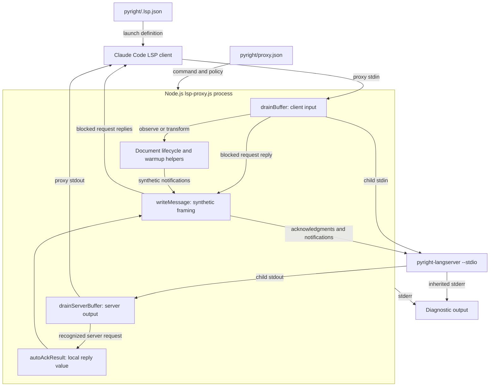
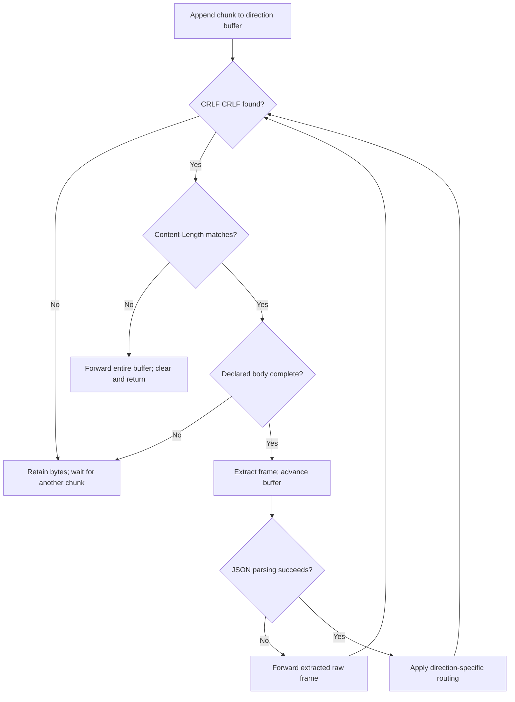
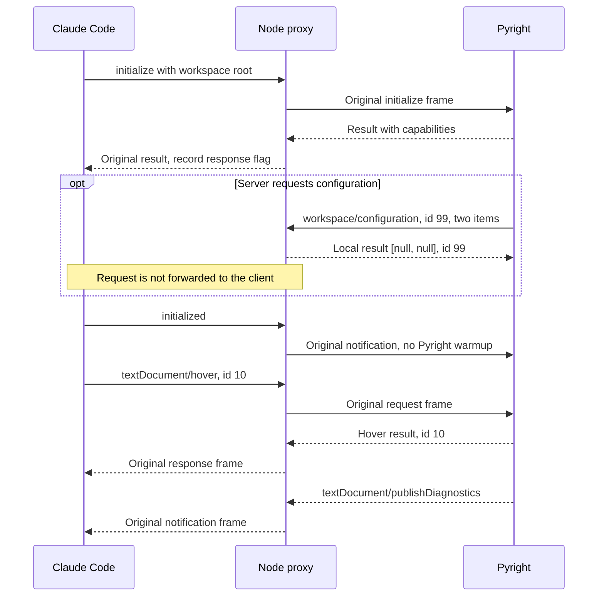
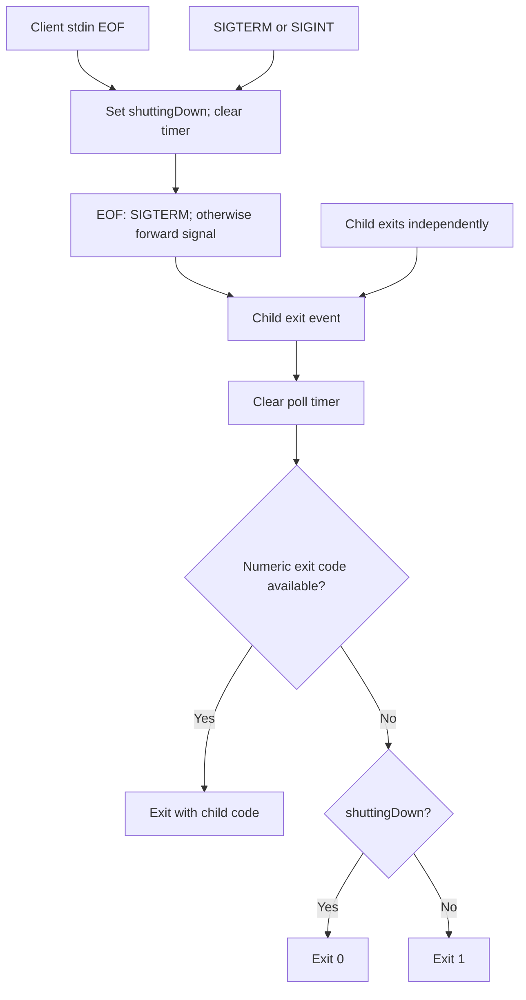

# Pyright Language Server Protocol

The `pyright_language_server_protocol` module is the transport and
compatibility layer in `pyright/lsp-proxy.js`. It relays Language Server
Protocol (LSP) messages between Claude Code and the external Pyright server,
answers selected requests locally, and coordinates with document tracking.
Ordinary traffic retains its original framed bytes unless an interception
or document-lifecycle transformation applies.

This is a logical module inside one Node.js executable, not a separate
package or language server. It does not analyze Python, add upstream language
features, or implement a complete JSON-RPC framework.

Related documentation separates the surrounding responsibilities:

- [Pyright integration][integration] describes the plugin and its place in
  the language-intelligence system.
- [Setup and registration][setup] covers prerequisites, installation, language
  routing, and the host's launch configuration.
- [Document lifecycle][lifecycle] covers buffer authority, version rebasing,
  disk polling, deletion recovery, and optional workspace warmup.
- [Language intelligence integration][language-integration] covers the wider
  family of language-server plugins.

## Architecture and dependencies



The executable uses Node standard-library APIs only:

- `Buffer` supplies byte-oriented framing and input accumulation.
- `node:child_process` supplies `spawn` for the real language server.
- `node:fs` and `node:path` support configuration loading and lifecycle work.
- `node:url` supports workspace and document URI conversion.

There is no external JSON-RPC library or network transport. The child runs
with `stdio: ['pipe', 'pipe', 'inherit']`. Its stdin and stdout carry LSP
traffic; its stderr is inherited. The proxy also writes diagnostics to
stderr, keeping its stdout for client-facing protocol traffic.

### Effective Pyright policy

`pyright/.lsp.json` launches `node` with the plugin's `lsp-proxy.js` and
`--config ${CLAUDE_PLUGIN_ROOT}/proxy.json`. The host expands the plugin-root
placeholder. The inspected `pyright/proxy.json` contains:

```json
{
  "server": ["pyright-langserver", "--stdio"],
  "blocked": []
}
```

Together with defaults in `pyright/lsp-proxy.js`, this yields:

| Concern | Effective behavior |
| --- | --- |
| Child command | `pyright-langserver --stdio`, resolved through `PATH`. |
| Client-method blocking | Inactive: the configured list is empty. |
| Server-request auto-ack | Active for four fixed methods. |
| Workspace warmup | Inactive: no `warmup` configuration. |
| Disk synchronization | Active, with a default 300 ms polling interval. |

The child is spawned without a shell and without a working-directory or
environment override. The wrapper does not discover unsupported methods from
server errors. With the shipped empty block list, an upstream
method-not-found response passes through unchanged.

`blocked`, `warmup`, and `sync` control different mechanisms. In particular,
setting `"sync": false` does not disable auto-acknowledgments or all document
bookkeeping. See the [lifecycle guide][lifecycle] for synchronization settings
and their exact effects.

## Core components and shared state

The four core functions are file-scoped helpers, not exported APIs:

| Function | Responsibility |
| --- | --- |
| `writeMessage(stream, body)` | Frame an already serialized body. |
| `drainBuffer()` | Parse and route client input; observe lifecycle. |
| `drainServerBuffer()` | Parse server output; intercept fixed requests. |
| `autoAckResult(msg)` | Build the result value for a local server reply. |

They coordinate through the following state:

- `buffer` accumulates client bytes; `serverBuffer` accumulates server bytes.
  Each direction is independent of the other's stream chunk boundaries.
- `HEADER_DELIM` is the byte sequence `\r\n\r\n`.
  `CONTENT_LENGTH_RE` extracts a length from the ASCII header.
- `BLOCKED_METHODS` holds configured client-method names.
  `SERVER_REQUESTS_AUTO_RESPOND` holds the four fixed server-request names.
- `rootUri` stores the workspace root captured from initialization.
  `initializeResponseSeen` records a server result with truthy `capabilities`.
- `openDocs` is shared with lifecycle helpers; those helpers also use the
  child process and `writeMessage` to inject notifications.
- `shuttingDown` distinguishes expected termination from an unexpected
  signal-based child exit. `pollTimer` is cleared during shutdown.

There is no general pending-request table, ID remapping, or capability
negotiation engine. Ordinary request/response correlation remains the
responsibility of Claude Code and Pyright.

## LSP message framing

### Writing synthetic messages

`writeMessage(stream, body)` accepts an already serialized string or `Buffer`.
Callers construct the JSON-RPC object and call `JSON.stringify` themselves.
The helper preserves a supplied `Buffer`; strings become UTF-8 bytes through
`Buffer.from`:

```javascript
function writeMessage(stream, body) {
  const buf = Buffer.isBuffer(body) ? body : Buffer.from(body);
  stream.write(`Content-Length: ${buf.length}\r\n\r\n`);
  stream.write(buf);
}
```

`Content-Length` counts body bytes, not JavaScript characters. Non-ASCII
content therefore receives the correct byte length. Generated framing uses
CRLF line endings and an empty line before the body. It adds neither a
`Content-Type` header nor a trailing body newline.

The main destinations are:

- `process.stdout` for locally synthesized replies to blocked client requests.
- `child.stdin` for server-request acknowledgments and synthetic document
  notifications.

The two writes are ordered but not an atomic transport operation. The helper
does not check the return value of `stream.write`, wait for `drain`, or provide
a delivery acknowledgment. Receivers must tolerate arbitrary chunk boundaries.

### Reading frames incrementally

A stream's `data` handler concatenates each chunk onto its accumulator and
calls the corresponding drain function. Both directions use the same framing
algorithm:

1. Find `HEADER_DELIM`. If absent, retain the bytes and return.
2. Decode the header as ASCII and match
   `/^content-length:\s*(\d+)\s*$/im`.
3. Calculate the body start and message end using byte offsets. If the declared
   body is incomplete, retain the bytes and return.
4. Extract the complete frame as `rawMessage`, extract its body, and advance
   the accumulator past the frame.
5. Decode the body as UTF-8 and attempt `JSON.parse`.
6. Apply direction-specific routing, then loop over any remaining frames.



This supports split headers, split bodies, and several messages arriving in
one chunk. Header matching is case-insensitive and multiline. Other header
fields are not interpreted, but are preserved when forwarding a raw frame.
The parser requires the CRLF delimiter; LF-only framing is not normalized.

### Byte preservation and malformed-input fallbacks

Normal forwarding writes `rawMessage` directly. It preserves header spelling,
extra headers, JSON whitespace, and the original body bytes. Parsing a message
does not by itself cause reserialization. Lifecycle rewrites and synthetic
responses deliberately generate replacement framing instead.

| Input condition | Behavior |
| --- | --- |
| No header delimiter yet | Retain bytes and wait. |
| Declared body incomplete | Retain bytes and wait. |
| Delimiter but no matching length | Forward the entire buffer; clear it. |
| Complete frame with invalid JSON | Forward that frame; keep draining. |
| Parsed message without interception | Forward its original frame. |

Forwarding means writing to `child.stdin` for client input, or to
`process.stdout` for server output.

These are opaque-traffic fallbacks, not protocol repair. A missing length
flushes the whole current accumulator, potentially including later frames,
without inspecting them. Invalid JSON bypasses method interception. Neither
case generates a JSON-RPC parse-error response or searches for a replacement
frame boundary.

There is no frame-size limit or incomplete-frame timeout. A missing delimiter
or excessive declared length can retain bytes indefinitely. Only JSON parsing
is guarded here: syntactically valid JSON is not fully validated as JSON-RPC.
Unexpected shapes, including `null`, can cause uncaught property-access errors;
batch arrays are not handled as collections of requests.

## Client-to-server processing

`process.stdin.on('data')` appends bytes and calls `drainBuffer()`. After
successfully parsing each frame, the function processes it in this order:

1. Capture workspace-root information from an `initialize` message with params.
2. Observe document lifecycle methods. Set `outFrame` to the original frame,
   a rewritten frame, or `null` when the input has been consumed.
3. If the warmup initialization gate is satisfied, forward the original
   `initialized` frame, schedule warmup, and continue to the next message.
4. Check the configured blocked-method set. Reply locally to a matching
   request or discard a matching notification, then continue.
5. Forward `outFrame` to the child if it is not `null`.

Client responses to ordinary server requests use the normal forwarding path.
The proxy does not need to remember the originating request to relay them.

### Configured method blocking

`BLOCKED_METHODS` is a `Set` built from `config.blocked || []`. Matching uses
exact method names. The shared wrapper provides this mechanism for known
unsupported methods whose JSON-RPC `-32601` replies can leave Claude Code's
LSP client unusable.

For a matching method:

- A message with `msg.id !== undefined` receives a local response on proxy
  stdout, preserving its ID and using `result: null`.
- A notification without an ID is discarded without a response.
- The original frame is not sent through the normal child-forwarding path.

For example, a blocked request with ID 42 receives this body through
`writeMessage`:

```json
{"jsonrpc":"2.0","id":42,"result":null}
```

The ID check tests definedness, not truthiness, so ID `0` also works. The
synthetic response is a successful empty result, not an implementation of the
feature and not a method-not-found error. This can make an unsupported feature
appear to have no results, a semantic limitation also noted in
`tests/helpers/proxy-suite.js`.

**Pyright currently blocks no methods.** The behavior above is an optional
shared-wrapper path, not an active Pyright filter. Ordinary server errors are
not rewritten into successful responses.

Blocking happens after lifecycle observation and the special warmup branch.
It is not a security filter or general allowlist: blocking a lifecycle method
does not undo bookkeeping or synthetic messages already produced while
observing that input. A qualifying warmup-triggering `initialized` message
also bypasses the later block check.

### Document-lifecycle handoff

The protocol layer observes three document methods before normal forwarding:

- `textDocument/didOpen` enrolls a document in tracking. If it is already open
  server-side, the proxy sends a full-text `didChange` instead and consumes
  the original open, avoiding a duplicate `didOpen`.
- `textDocument/didChange`, when `SYNC` is enabled, calls
  `reconcileClientChange(msg, rawMessage)`. Its returned frame becomes
  `outFrame`.
- `textDocument/didClose` removes tracking. If the proxy already closed the
  document server-side, the client close is consumed to avoid closing twice.

Reconciliation can return the original bytes, a fully framed version-rebased
rewrite, or `null` after emitting a replacement `didOpen`. Open/close tracking
and duplicate-open translation still operate with disk synchronization off.

Polling and optional warmup also use `writeMessage(child.stdin, ...)` to send
notifications directly to the server. These injections are not echoed to the
client. The [lifecycle guide][lifecycle] owns the buffer/version algorithms,
incremental-change handling, and disk deletion/reappearance behavior.

### Initialization and the optional warmup gate

Initialization tracking is deliberately lightweight:

- An `initialize` message with params sets
  `rootUri = msg.params.rootUri || msg.params.rootPath || null` and logs it.
  Workspace folders are not used as an alternative root by this code.
- A server message with truthy `msg.result?.capabilities` sets
  `initializeResponseSeen = true`. This is a shape check, not correlation
  against a recorded initialize request ID.
- A later `initialized` message triggers warmup only when the response flag,
  root, and `WARMUP` configuration are all present.

On that path, the proxy writes the original `initialized` frame to the child
first. It converts a `file://` root with `fileURLToPath`, otherwise uses the
root directly, and schedules `warmupServer(rootDir)` with `setImmediate`.
This orders warmup after the initialized write without waiting for a server
acknowledgment. The lifecycle helper checks extensions and deduplicates opens.

The gate has no separate once-only latch: another qualifying `initialized`
message can schedule another scan. Conversely, an early `initialized` received
before the response flag is set is not queued for a later retry.

The shipped Pyright configuration has no `warmup` section, so this branch is
inactive. Its `initialized` notification follows normal forwarding; the
proxy does not scan the workspace or pre-open Python files.

## Server-to-client processing

`child.stdout.on('data')` appends bytes and calls `drainServerBuffer()`. For
each successfully parsed frame, it:

1. Checks for a defined ID and a method in `SERVER_REQUESTS_AUTO_RESPOND`.
2. If matched, creates a JSON-RPC reply using `autoAckResult(msg)`, sends it
   through `writeMessage(child.stdin, ...)`, and consumes the request.
3. Otherwise, records a truthy result `capabilities` value for initialization.
4. Forwards the original frame to Claude Code through proxy stdout.

Unrecognized requests, notifications, and ordinary responses pass through.
A notification named like an auto-acknowledged method is not intercepted
because it has no ID. For example, `window/showMessageRequest` is outside the
fixed set and remains the client's responsibility. Diagnostic notifications
such as `textDocument/publishDiagnostics` also retain their original frames.

### Fixed server-request acknowledgments

These local replies prevent Pyright from waiting on client handlers that
Claude Code cannot provide. They are independent of `config.blocked`,
`warmup`, and `sync`, and have no per-method configuration switch.

| Server request method | Local result value |
| --- | --- |
| `client/registerCapability` | `null` |
| `client/unregisterCapability` | `null` |
| `workspace/configuration` | Array with one `null` per requested item. |
| `window/workDoneProgress/create` | `null` |

Every reply contains `jsonrpc: '2.0'`, the original request ID, and `result`.
The intercepted request never reaches Claude Code. The guard uses
`msg.id !== undefined`, so ID `0` is preserved here too.

Acknowledgment is not a complete implementation of the client feature. The
proxy keeps no dynamic-registration registry, supplies no progress UI, and
does not relay configuration requests to the host. It does not modify the
capabilities exchanged during initialization.

### The configuration result contract

For `workspace/configuration`, `autoAckResult` uses `params.items` only when
it is an array, then returns `items.map(() => null)`. The result has one
entry per item in the original order. Missing params, missing items, or
non-array items produce `[]`, not a bare `null`.

For example, this illustrative request has two configuration items:

```json
{
  "jsonrpc": "2.0",
  "id": 99,
  "method": "workspace/configuration",
  "params": {
    "items": [
      { "section": "python" },
      { "section": "python.analysis" }
    ]
  }
}
```

The proxy replies to Pyright with this framed body:

```json
{"jsonrpc":"2.0","id":99,"result":[null,null]}
```

Per-item `null` means no client-supplied override is provided. The proxy does
not look up sections or scope URIs. A bare `null` would violate the array
contract and break servers, including Pyright, that index configuration
results by item.

For all other methods, `autoAckResult` returns `null`. That helper's fallback
does not expand interception: `drainServerBuffer` calls it only after matching
the fixed request set.

### Example interaction

This sequence illustrates ordinary initialization, a locally answered server
request, and subsequent pass-through traffic. The optional configuration
request is shown at one possible point, not as a required server ordering.



## Process lifecycle and failure handling

### Startup

Before spawning the child, the executable requires `--config` and a following
path, resolves that path, and reads it as UTF-8 JSON. Startup exits with status
1 when the argument is missing, configuration reading/parsing fails, or
`config.server` is not a nonempty array.

The first `server` element becomes the command and the remainder become
arguments. Validation is intentionally limited; this is not a complete
configuration schema validator. Invalid field or argument types can fail
outside the explicit validation paths.

A child-process `error` event writes a diagnostic and exits with status 1.
There is no automatic restart. Installation and executable availability are
covered in the [setup guide][setup].

### Shutdown and exit status

Client stdin EOF sets `shuttingDown`, clears the poll timer, and sends
`SIGTERM` to the child. Received `SIGTERM` or `SIGINT` similarly sets the flag,
clears the timer, and forwards the same signal.



The exact exit-code rule is:

```javascript
process.exit(code ?? (shuttingDown ? 0 : 1));
```

A numeric child exit code always wins, including a nonzero code during an
expected shutdown. Only a nullish child code, normally a signal-based exit,
uses the expected-shutdown fallback. Unexpected signal termination therefore
becomes status 1; expected signal termination becomes status 0.

The poll interval is unreferenced when supported, so it does not by itself
keep the proxy alive. The child exit handler clears it as well.

The proxy does not synthesize LSP `shutdown` or `exit` messages when stdin
ends or a signal arrives. With the shipped policy, explicit LSP shutdown
traffic is ordinary pass-through. There is no forced-kill timeout, signal
escalation, restart loop, or explicit wait for pending output to drain before
`process.exit`. Incomplete input frames are not flushed on EOF.

### Diagnostic channels and operational boundaries

Early configuration failures use prefix `[lsp-proxy]`. Runtime proxy messages
use `[lsp-proxy:pyright-langserver]`, including workspace-root capture, child
errors, and lifecycle transformations. Child stderr shares the inherited
diagnostic channel. There is no per-message trace for ordinary forwarding,
blocking, or auto-acknowledgment.

Keep both proxy and server stdout free of banners and debug logs. The proxy's
malformed-header fallback forwards opaque bytes rather than sanitizing them;
server stdout contamination can therefore reach the client unchanged.

This wrapper assumes a cooperative local client and server. It is not a
security boundary, protocol validator, workspace configuration provider, or
buffering service with resource limits. In particular, backpressure handling,
frame limits, and malformed-message rejection must not be inferred from its
incremental parsing support.

## Validation and maintenance

Run the canonical repository test entry point from the repository root:

```sh
make test
```

`Makefile` dispatches to `bash tests/run.sh`. The harness requires `node`,
`bash`, `jq`, and `shellcheck`. Relevant checked-in validation paths are:

- `tests/cases/06-proxy.sh` dispatches scenarios in
  `tests/helpers/proxy-suite.js` using `tests/helpers/stub-server.js`.
  Protocol scenarios cover byte-preserving forwarding in both directions,
  blocked requests and notifications, all four acknowledgment methods,
  forwarding an unrecognized server request, split framing, malformed-input
  fallbacks, configuration failures, spawn errors, signals, EOF, and exit codes.
- The `auto-ack-configuration` scenario verifies a two-item request receives
  `[null, null]` and that the originating request does not reach the client.
  It protects the configuration-array contract required by Pyright.
- `tests/cases/07-warmup.sh` covers optional warmup behavior, including the
  no-warmup-section path. Lifecycle scenarios in the proxy suite are detailed
  in the [document-lifecycle guide][lifecycle].
- `tests/cases/02-consistency.sh` checks launch/configuration agreement and
  byte-identical deployed proxy copies. Shared protocol scenarios exercise
  multiple plugin copies, not just the Pyright file.

These are checked-in validation paths, not a report of test execution. Real
Pyright diagnostic scenarios are summarized in the
[integration guide][integration]. Repository-wide test procedures and gate
behavior belong to [build and configuration][build] and
[continuous integration][ci].

Each plugin ships a real copy of the unified proxy because plugin directories
are installed independently. Keep Pyright-specific policy in
`pyright/proxy.json`; propagate shared implementation changes to every deployed
`lsp-proxy.js` copy rather than creating a Pyright-only fork.

When changing the protocol implementation, preserve these contracts:

- Count serialized body bytes, not characters, in `Content-Length`.
- Keep original frames for traffic that needs no transformation.
- Preserve request IDs in local replies and never forward an auto-acked
  request to the client as well.
- Return one configuration result entry per requested item.
- Keep lifecycle observation and interception ordering explicit.
- Send diagnostics to stderr, not protocol stdout.

[integration]: ../pyright_language_server.md
[setup]: pyright_language_server_setup.md
[lifecycle]: pyright_language_server_document_lifecycle.md
[language-integration]: ../../language_intelligence_integration.md
[build]: ../../engineering_platform_and_validation/repository_build_and_configuration.md
[ci]: ../../engineering_platform_and_validation/continuous_integration.md
