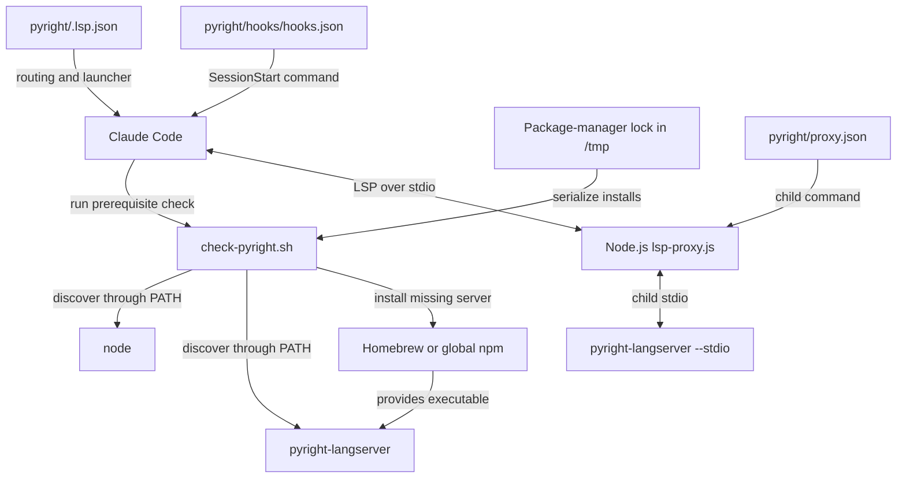
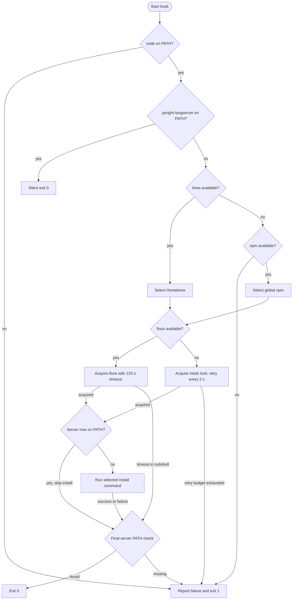
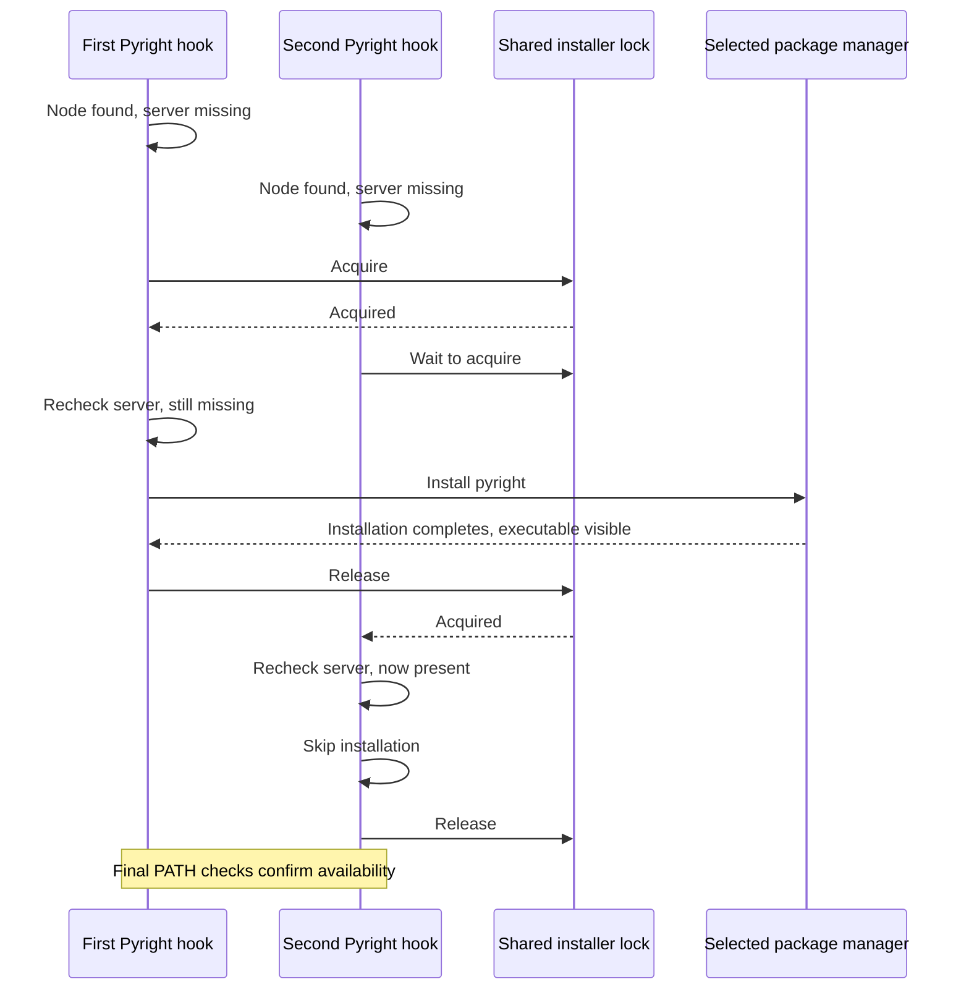

# Pyright Language Server Setup

The `pyright_language_server_setup` module registers Python files with Claude
Code and prepares the external dependencies needed to run Pyright. Its two
core components are `pyright/.lsp.json`, which declares file routing and the
launcher, and `pyright/hooks/check-pyright.sh`, which checks prerequisites and
installs Pyright when its language-server executable is missing.

This is the setup layer of the [Pyright integration][pyright], within the
[language intelligence integration][integration] system. It does not implement
Python analysis, LSP message handling, or document synchronization. Those
runtime responsibilities belong to Pyright and the integration's
[protocol][protocol] and [document-lifecycle][lifecycle] modules.

## Architecture and responsibilities

Setup has two distinct host entry points. The session-start hook prepares
dependencies; the LSP registration tells the host how to launch the proxy.
The hook does not launch the proxy or perform LSP initialization.



The configuration and script boundaries are:

| Source path | Responsibility |
| --- | --- |
| `pyright/.lsp.json` | Python file routing and Node proxy invocation. |
| `pyright/hooks/check-pyright.sh` | Prerequisite checks, installs, and locks. |
| `pyright/hooks/hooks.json` | Hook event, command, and host timeout. |
| `pyright/proxy.json` | Actual language-server command. |
| `pyright/lsp-proxy.js` | Child launch and runtime LSP handling. |

`.claude-plugin/marketplace.json` distributes the `./pyright` plugin directory;
`pyright/.claude-plugin/plugin.json` supplies its plugin identity. The proxy,
configuration, and hook paths are resolved inside that installed directory,
not inside the user's Python workspace.

## Registration and launch configuration

### Python file routing

`pyright/.lsp.json` contains the following registration, reformatted here for
readability:

```json
{
  "python": {
    "command": "node",
    "args": [
      "${CLAUDE_PLUGIN_ROOT}/lsp-proxy.js",
      "--config",
      "${CLAUDE_PLUGIN_ROOT}/proxy.json"
    ],
    "extensionToLanguage": {
      ".py": "python",
      ".pyi": "python"
    }
  }
}
```

This establishes the following contract:

- The registration entry is named `python`. Both Python source files (`.py`)
  and type-stub files (`.pyi`) use the LSP language identifier `python`.
- The declared launcher is `node`, resolved through the host's `PATH`, rather
  than `pyright-langserver` directly. Node.js is required even when Pyright is
  already installed.
- The host expands `${CLAUDE_PLUGIN_ROOT}` to locate the shipped proxy and
  configuration. The declared paths do not depend on the workspace directory.
- Only `.py` and `.pyi` are explicitly mapped. This registration does not add
  notebook or extensionless-file routing.

The proxy runs as shipped JavaScript using Node standard-library modules;
it does not require compilation or a workspace-local npm installation. The
repository is a plugin marketplace rather than an npm application, as noted
in `Makefile`. See [repository build and configuration][build] for the wider
build conventions.

### Proxy child command

`pyright/proxy.json` supplies the server executable and arguments:

```json
{
  "server": ["pyright-langserver", "--stdio"],
  "blocked": []
}
```

The resulting launch chain is:

```text
Claude Code -> node lsp-proxy.js --config proxy.json
            -> pyright-langserver --stdio
```

`pyright/lsp-proxy.js` spawns this child without a shell or an environment
override. The child inherits the proxy's environment, so the installed
executable must be discoverable through the session's `PATH`. The empty
`blocked` array configures no blocked client methods; it does not disable the
proxy's other behavior. See [protocol transport][protocol] and
[document lifecycle][lifecycle] for runtime configuration semantics.

The installer checks for `pyright-langserver`, not the separate `pyright`
CLI command. Its `BINARY` value must agree with `proxy.json`'s `server[0]`.

### Session-start entry point

`pyright/hooks/hooks.json` registers a command-type `SessionStart` hook:

```sh
bash ${CLAUDE_PLUGIN_ROOT}/hooks/check-pyright.sh
```

The manifest sets `timeout` to **60 seconds**. Bash is required: the script
uses Bash redirection and arithmetic syntax rather than only POSIX `sh`.

The hook reports a prerequisite-check result to the host. It does not decide
how Claude Code handles a failed hook or when the host launches a registered
language server. The hook and launcher remain separate entry points.

## Prerequisites and installation policy

`pyright/hooks/check-pyright.sh` checks prerequisites in this order:

- **Node.js first:** if `command -v node` fails, the hook writes an error and
  installation advice to stderr and exits with status 1. It does not attempt
  to install Node, even if Homebrew is available.
- **Existing server next:** if `pyright-langserver` is discoverable, the hook
  exits silently with status 0. No lock or package manager is needed.
- **Installer selection only for a missing server:** Homebrew is preferred
  whenever `brew` is discoverable. npm is selected only when Homebrew is
  absent. If neither is available, the hook reports the problem and exits 1.

The script assigns these fixed values:

| Setting | Value |
| --- | --- |
| `BINARY` | `pyright-langserver` |
| `FORMULA` | `pyright` |
| `NPM_PACKAGE` | `pyright` |
| `LOCK_TIMEOUT` | `120` seconds |

These assignments are not environment-variable overrides. The selected
package manager determines the installation command:

| Selection | Command |
| --- | --- |
| Homebrew available | `brew install pyright` |
| Homebrew absent, npm available | `npm install -g pyright` |

npm is an **availability fallback**, not a retry after a failed Homebrew
installation. Selection is based on command availability, not an operating
system check. The npm route installs the external server globally; it does
not install proxy dependencies into the Python workspace.

Discovery uses `command -v`; it does not execute Node or Pyright to verify
versions, health, or LSP compatibility. An existing server is not upgraded or
repaired. Neither installation command pins a Pyright version, and the plugin
metadata version is not an upstream server-version pin.

Installation uses the package manager's normal network configuration and
write permissions. The script does not invoke `sudo`, modify `PATH`, source
shell startup files, provision Python, configure virtual environments, or
write Python project configuration.

## Installer process flow

After selecting a package manager, the script acquires a lock and checks for
the server again. Another session may have installed it while this hook was
waiting, making a second installation unnecessary.



The final check is stronger than trusting the package manager's exit status:
a successful install is insufficient if the executable remains outside
`PATH`. However, it is still only a discovery check, not a server startup or
LSP handshake test.

## Concurrent startup and locking

### Lock scope and locations

The selected package manager determines the base lock path:

| Installer | Base path |
| --- | --- |
| Homebrew | `/tmp/claude-lsp-brew.lock` |
| npm | `/tmp/claude-lsp-npm.lock` |

These paths are hardcoded under `/tmp`; setting `TMPDIR` does not change them.
They are package-manager-wide, not Pyright-specific. For example,
`bash-language-server/hooks/check-bash-language-server.sh` uses the same
paths; see the [Bash setup guide][bash-setup].

The locks coordinate cooperating hooks using the same mechanism and path.
They do not coordinate every independent Homebrew or npm invocation. Different
package-manager paths do not coordinate, and the file-lock and directory-lock
mechanisms use different resources and do not coordinate with each other.

### Lock implementations

When `flock` is discoverable:

- A subshell opens the base lock file on file descriptor 9.
- `flock --timeout "$LOCK_TIMEOUT" 9` waits for an exclusive lock.
- After acquisition, the subshell rechecks the server and installs only if
  it is still missing.
- Normal subshell completion releases its locking descriptor before the
  parent's final availability check. The file may remain on disk; its
  existence alone does not mean a lock is held.

Without `flock`, the hook uses an atomic `mkdir` fallback:

- The lock directory is the base path plus `.d`, such as
  `/tmp/claude-lsp-brew.lock.d` or `/tmp/claude-lsp-npm.lock.d`.
- Failed acquisition attempts sleep for two seconds. A counter tracks the
  sleep budget and reports a timeout when it reaches 120 seconds and another
  acquisition attempt fails.
- After acquisition, the hook rechecks the server before installing.
- An `EXIT` trap attempts `rmdir` cleanup. Unlike the subshell lock, this lock
  remains held through the final availability check until the script exits.

Directory cleanup is best-effort. Abnormal termination can leave a stale
lock directory, and there is no PID record, age check, or automatic stale-lock
recovery. Acquisition errors are suppressed, so permission problems can also
look like contention and eventually produce `Lock timeout`.

### Concurrent hook interaction

This successful example assumes both hooks use the same package manager and
lock mechanism, and both can see the installed executable through `PATH`:



If the first installation fails and the binary remains missing, the next lock
holder can attempt installation itself. The lock serializes installation; it
is not a persistent record of success.

### Timeout budgets

Two independent budgets apply:

- `pyright/hooks/hooks.json` gives the host hook a 60-second timeout.
- `pyright/hooks/check-pyright.sh` allows a 120-second lock wait. This is not
  an installation timeout; the package-manager command has no explicit
  timeout in the script.

The host can therefore time out a lock wait or first-time install before the
script's own budget expires. The 120-second setting is not a guaranteed
startup allowance. Preinstall dependencies when session startup must be
predictable, especially with slow networks or multiple simultaneous plugins.
Changing either timeout requires considering the other budget.

## Results and failure handling

### Exit status and output

With Node and the server already discoverable, the hook immediately returns
status 0 without output. Missing Node, missing both installation tools, and a
directory-lock timeout explicitly exit the main script with status 1.

On the installation path, the final server check normally determines the
result: a discoverable server yields status 0; a missing server produces the
`Not in PATH after install` diagnostic and status 1.

There are two important control-flow details:

- A `flock` timeout logs `Lock timeout` and exits the locking **subshell** with
  status 1. The parent still reaches the final server check.
- `do_install` returns 1 after a failed package-manager command, but the script
  has no `set -e` and still performs the final check. It does not automatically
  retry with another package manager.

Consequently, an earlier install error or `flock` timeout can coexist with an
overall status 0 if another process makes the executable visible before the
final check. Otherwise the missing-binary check returns status 1.

All script-authored messages use the prefix `[pyright-langserver]`. The
missing-Node messages go to stderr; other explicit progress and failure
messages use stdout. Package-manager output is inherited without prefixing
or redirection. Hook output is separate from the proxy's LSP stdio stream.

### Troubleshooting

- **Node.js is missing:** `node is required` is reported even if Pyright is
  installed. Install Node, ensure the host can discover it, and restart the
  session. The script suggests `brew install node` but does not run it.
- **No installer is available:** `Neither Homebrew nor npm found` means the
  server is missing and neither supported installer is discoverable. Provide
  one, or preinstall Pyright through your environment's provisioning system.
- **Installation fails:** inspect the package-manager output following
  `brew install failed` or `npm install failed` for network, registry, or
  permission errors. A failed Homebrew attempt never triggers automatic npm
  fallback; use an alternative manually if appropriate.
- **Lock acquisition times out:** first check for an active installation.
  For a stale directory lock, confirm that no cooperating hook is using it
  before removing the empty directory with `rmdir`. Do not remove an active
  lock or delete a persistent `flock` file merely because it exists.
- **The final executable check fails:** `Not in PATH after install` can occur
  even after a nominally successful install. Check the package manager's
  executable directory against the host's `PATH`. The diagnostic always
  suggests `brew install pyright`, including after the npm route.
- **The host reports a hook timeout:** the 60-second host budget may have
  expired before lock acquisition or installation completed. Check for
  remaining installer activity and possible stale directory locks before
  retrying; preprovisioning avoids this startup dependency.

A successful hook does not prove that the proxy can read its configuration,
that Pyright can start, or that Python analysis works. Investigate subsequent
launch and LSP initialization failures through the [protocol guide][protocol].

## Operating and maintaining the setup

### Manual preparation and checks

Install Node and Pyright before starting Claude Code when reproducible or
noninteractive startup is required. Use the installation commands documented
above, or your normal environment-provisioning mechanism. Ensure both
executables are visible in the environment that launches the host; an
interactive terminal can have a different `PATH`.

From the repository root, inspect discovery and run the same prerequisite
script manually:

```sh
command -v node
command -v pyright-langserver
bash pyright/hooks/check-pyright.sh
```

The last command may install Pyright if it is absent. Running it directly does
not apply the host manifest's 60-second timeout. It also does not register the
plugin or start an LSP session.

For repository-wide tool provisioning, see
[development environment bootstrap][bootstrap]. Python interpreter selection,
virtual environments, and project analysis settings are outside this setup
module's responsibilities.

### Maintenance checklist

- Keep `.lsp.json` arguments rooted at `${CLAUDE_PLUGIN_ROOT}` so installed
  plugins remain independent of checkout and workspace locations.
- Keep the hook's `BINARY` aligned with `pyright/proxy.json`'s `server[0]`.
  Package names and executable names are deliberately different here.
- Update `pyright/hooks/hooks.json` when renaming or relocating the hook.
- Review the 60-second host timeout and 120-second lock-wait budget together
  when changing installation behavior.
- Preserve shared lock-path conventions if installations must coordinate
  with sibling plugins. Changing just one hook can break that coordination.
- Keep Pyright-specific runtime policy in `pyright/proxy.json`; shared proxy
  changes must reach every shipped copy. Packaging and copy consistency are
  covered in the [Pyright integration overview][pyright].

## Validation

Run the repository's canonical test entry point from the repository root:

```sh
make test
```

`Makefile` dispatches to `bash tests/run.sh`. The runner requires `node`,
`bash`, `jq`, and `shellcheck`, and derives plugin membership from
`.claude-plugin/marketplace.json`.

Relevant test definitions are:

- `tests/cases/02-consistency.sh`: validates plugin-root-relative launch
  paths, the exact Node proxy invocation, agreement between installer
  `BINARY` and configured server, existing hook targets, and byte-identical
  deployed proxy copies.
- `tests/cases/04-installer-behavior.sh`: directly exercises Pyright's
  existing-server no-op, Homebrew selection, npm selection, npm failure, and
  absence of both supported installation tools.
- `tests/cases/05-installer-concurrency.sh`: runs overlapping Pyright
  Homebrew checks and asserts that only one installation occurs.

Some shared branches are tested through sibling installers rather than
Pyright: the missing-Node guard uses CUE, while directory-lock cleanup,
directory-lock concurrency, Homebrew failure, and a successful install that
leaves no executable are exercised through Bash. These tests should not be
mistaken for exhaustive Pyright-specific branch coverage.

`.github/workflows/test-gate.yml` runs `make test` in separate Linux and macOS
jobs and requires successful, non-empty execution from both. Its Node pin is
a CI setting, not a minimum enforced by this hook. See
[continuous integration][ci] for gate behavior and the
[Pyright integration overview][pyright] for optional live analysis checks.

[pyright]: ../pyright_language_server.md
[integration]: ../../language_intelligence_integration.md
[protocol]: pyright_language_server_protocol.md
[lifecycle]: pyright_language_server_document_lifecycle.md
[bash-setup]: ../bash_language_server/bash_language_server_setup.md
[build]: ../../engineering_platform_and_validation/repository_build_and_configuration.md
[bootstrap]: ../../engineering_platform_and_validation/development_environment_bootstrap.md
[ci]: ../../engineering_platform_and_validation/continuous_integration.md
