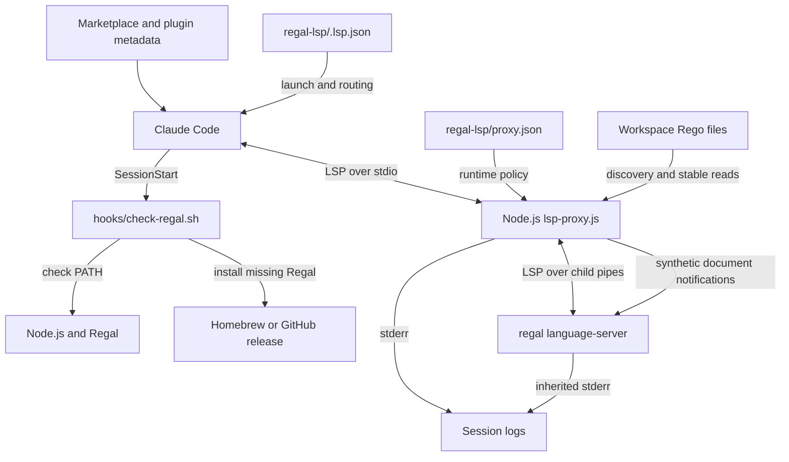
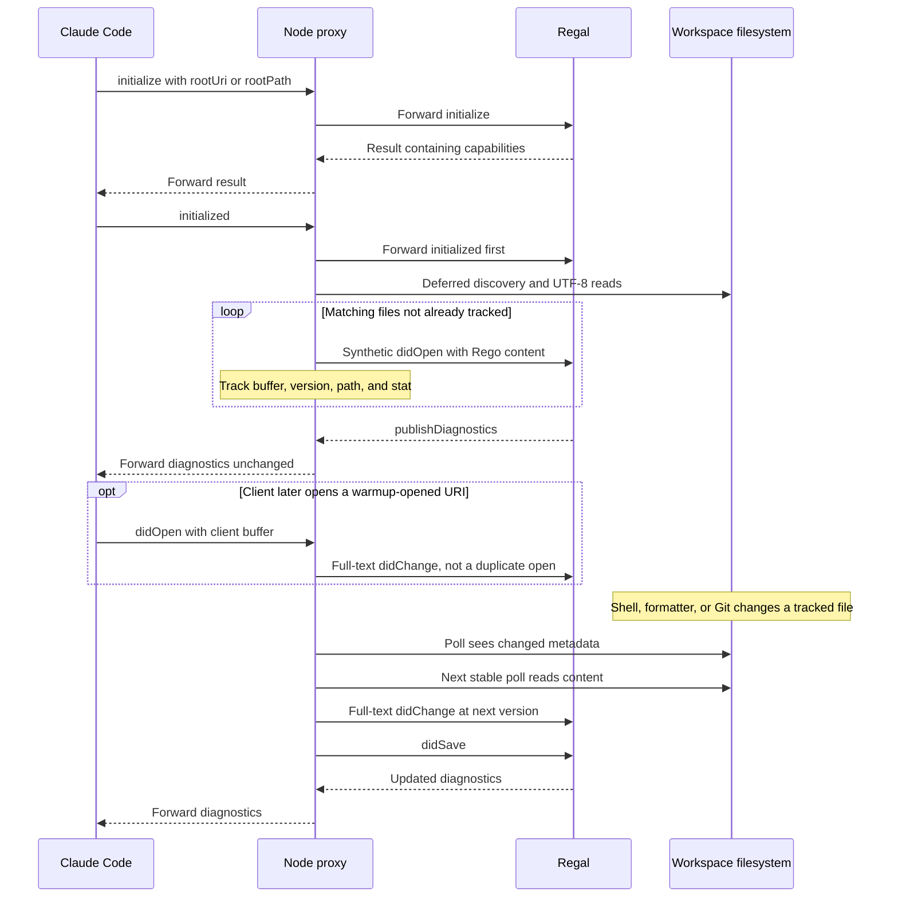

# Regal Language Server Integration

## Purpose and scope

The `regal_language_server` module connects Claude Code to Regal's Rego
language server. Packaged as the `regal-lsp` plugin, it registers `.rego`
files, checks runtime prerequisites at session start, and launches
`regal language-server` behind a Node.js LSP proxy.

The integration supplies compatibility handling, initialization-time
workspace warmup, and synchronization of tracked server buffers after
out-of-band disk edits. Regal itself owns Rego parsing, lint rules, indexing,
and language-feature results. The proxy does not analyze policies or generate
diagnostics. This module belongs to the wider
[language intelligence integration](../language_intelligence_integration.md)
layer.

## Architecture



The setup hook and LSP launcher are separate host entry points: the hook
checks or installs prerequisites; it does not start the proxy. The proxy
spawns the configured server with piped stdin/stdout and inherited stderr.
Neither a shell wrapper nor a child working-directory override is supplied.

### Documentation map

The module has three logical sub-modules, not three independently deployed
services. The setup layer owns registration and the Bash prerequisite hook.
Protocol handling and document lifecycle share one executable and its
`openDocs` map.

| Detailed guide | Responsibility |
| --- | --- |
| [Setup and registration][setup] | Routing, prerequisites, and installation. |
| [Protocol transport][protocol] | Framing, replies, and child supervision. |
| [Document lifecycle][lifecycle] | Warmup, buffers, versions, and disk sync. |

The [setup guide][setup] covers `.lsp.json` and `check-regal.sh`. The
[protocol guide][protocol] follows `writeMessage`, both drain handlers, and
`autoAckResult`. The [document-lifecycle guide][lifecycle] covers all eight
tracking, reconciliation, polling, and discovery helpers. Each guide links
back to this overview and to the cooperating sub-modules.

## Effective Regal configuration

`regal-lsp/.lsp.json` maps `.rego` to language ID `rego` and launches:

```sh
node "${CLAUDE_PLUGIN_ROOT}/lsp-proxy.js" \
  --config "${CLAUDE_PLUGIN_ROOT}/proxy.json"
```

The host expands `${CLAUDE_PLUGIN_ROOT}`. The proxy requires an explicit
`--config` path and reads it at startup. The inspected
`regal-lsp/proxy.json` contains:

```json
{
  "server": ["regal", "language-server"],
  "blocked": ["textDocument/references", "textDocument/implementation"],
  "warmup": {
    "extensions": [".rego"],
    "exclude": ["node_modules", ".git", "vendor", ".venv", ".claude"]
  }
}
```

Combined with defaults in `regal-lsp/lsp-proxy.js`, this policy means:

- The child command is `regal language-server`, resolved through `PATH`.
- Requests for `textDocument/references` and `textDocument/implementation`
  receive a local JSON-RPC success response with `result: null`. Notifications
  for those methods are dropped. This avoids unsupported-method responses
  that can break the host's LSP client; it does not implement those features.
- Warmup discovers `.rego` files under the initialization root, skips the
  configured entry names, and sends server-facing `textDocument/didOpen`
  notifications to start Regal indexing without an explicit client open.
- Disk synchronization is enabled at 300 ms because `sync` is omitted.
  A nonzero numeric `sync.pollMs` is clamped to at least 50 ms; omitted or
  zero values use 300 ms. Setting `"sync": false` disables polling and
  client-change reconciliation, but retains open/close tracking,
  duplicate-open translation, and configured warmup.
- Four fixed server-request methods are auto-acknowledged independently of
  the blocked-method list: `client/registerCapability`,
  `client/unregisterCapability`, `workspace/configuration`, and
  `window/workDoneProgress/create`. Configuration receives one `null` array
  entry per requested item; the other methods receive `null`.

Acknowledgments prevent the server from waiting on unsupported client
handlers; they do not implement a configuration service, dynamic capability
registry, or progress UI. Other traffic, including unblocked server errors
and Regal diagnostics, passes through normally. See the
[protocol guide][protocol] for framing, routing order, and error handling.

## Initialization and runtime data flow



Warmup requires an observed server result containing `capabilities`, a
subsequent client `initialized`, a root, and a configured warmup section.
The proxy prefers `rootUri`, falls back to `rootPath`, and does not discover
roots from `workspaceFolders`. `setImmediate` defers the scan until after
forwarding `initialized`; the scan and file reads themselves are synchronous.

Warmup and client opens are deduplicated in both directions. A file already
tracked when discovery runs is skipped. If warmup opened it first, a later
client open becomes a full-text change with a monotonically increasing
version. Sending Regal a second `didOpen` for an open URI is deliberately
avoided because it can discard that URI's diagnostics.

Discovery is not an ongoing workspace watcher. Newly created files that were
never opened or discovered are not enrolled automatically. Directory-name
exclusions govern warmup discovery, not whether an explicitly client-opened
file can participate in synchronization. Detailed discovery rules and
lifecycle transitions are in the [document-lifecycle guide][lifecycle].

## Document synchronization contract

The proxy tracks both client-opened and warmup-opened documents. It updates
only Regal's buffer: synthetic notifications do not change client buffers,
client version counters, or workspace files.

- `trackOpen` records URI, text, server-facing version, language ID, local
  path, metadata, and lifecycle flags. Non-file URIs can be tracked but are
  not polled.
- `pollOpenDocs` compares `mtimeMs`, `ctimeMs`, `size`, and `ino`. A changed
  tuple arms an update; the same tuple on the next poll permits a UTF-8 read.
  Disk text identical to the tracked buffer is a no-op.
- Divergent text causes a synthetic full-document `didChange`, followed by
  `didSave`. Client full-text changes are mirrored into the same state, and
  lagging client versions are rebased so Regal sees increasing versions.
- Range-based client changes are forwarded but not applied locally. Disk
  synchronization pauses for a document whose final text is unknown, and
  resumes when a later full-text replacement makes it reconstructable.
- Two consecutive failed stat checks cause a synthetic `didClose`, while
  retaining the tracking entry. Stable reappearance or a full-text client
  edit can reopen it. A client `didClose` removes tracking entirely.

At the default interval, a settled edit is normally propagated after roughly
one to two polls, plus filesystem, event-loop, and server processing time.
This is a best-effort stability gate, not an atomic-read guarantee or a bound
on diagnostic latency. Stat failures are treated as absence; some coarse
filesystem timestamp collisions can hide changes. Synchronous scanning and
polling costs grow with the discovered and tracked file counts.

The proxy does not merge competing edits or protect unsaved client text from
later divergent disk content. Ordered change batches, version formulas,
deletion recovery, and duplicate-open behavior are detailed in the
[document-lifecycle guide][lifecycle].

## Setup and operational boundaries

`regal-lsp/hooks/hooks.json` runs
`bash ${CLAUDE_PLUGIN_ROOT}/hooks/check-regal.sh` at `SessionStart` with a
60-second host timeout. The script checks for `node` before accepting an
existing `regal`, since Regal's Go binary does not supply the proxy runtime.
It does not install Node or enforce a Node/Regal version minimum.

If Regal is missing, installation follows these rules:

- On macOS with Homebrew, run `brew install styrainc/tap/regal`.
- On Linux, or macOS without Homebrew, download Regal v0.39.0 from GitHub to
  `${HOME}/.local/bin/regal`. Binary downloads support `x86_64` and
  `aarch64`/`arm64`, mapped to Regal's `x86_64` and `arm64` assets.
- Accept an existing executable without a version check. The download pin
  does not constrain an existing binary or the Homebrew formula version.
- Recheck availability after installation without changing `PATH`. The
  session must already include `${HOME}/.local/bin` for a downloaded binary
  to be found. A Homebrew failure does not trigger a download retry.

Installation uses method-wide `/tmp` locks, with `flock` or a `mkdir`
fallback and a 120-second lock-wait budget. That exceeds the host's
60-second hook timeout; contention or slow installation can be interrupted
earlier. Downloads go directly to the destination without checksum
verification or atomic replacement. Preinstall dependencies when predictable
startup is required. See [setup and registration][setup] for platform
selection, lock cleanup, failure handling, and troubleshooting.

Proxy messages use stderr with prefix `[lsp-proxy:regal]`; early config
errors use `[lsp-proxy]`. Regal's stderr is inherited. Stdout is reserved for
client-facing LSP frames. Missing/unreadable configuration, an invalid
`server` array, or child spawn errors terminate with status 1. Client stdin
EOF sends `SIGTERM`; received `SIGTERM` and `SIGINT` are forwarded. There is
no automatic restart or forced-kill escalation; process-exit details belong
to the [protocol guide][protocol].

## Packaging and maintenance

`.claude-plugin/marketplace.json` distributes `./regal-lsp`, and
`regal-lsp/.claude-plugin/plugin.json` identifies the plugin. The inspected
metadata uses integration version 1.2.0, distinct from the downloaded Regal
version 0.39.0.

Each marketplace plugin carries a real copy of the unified Node proxy,
because plugin directories are installed independently.
`tests/cases/02-consistency.sh` requires those copies to be byte-identical and
checks launcher arguments, installer/server agreement, and hook references.
Put Regal-specific policy in `regal-lsp/proxy.json`; propagate shared proxy
changes to every deployed copy instead of creating a Regal-only fork. The
proxy uses Node standard-library APIs and needs no npm install or compilation
step.

Sibling integrations use the same wrapper with their own runtime policies:

- [Bash language server](bash_language_server.md).
- [CUE language server](cue_language_server.md).
- [Pyright language server](pyright_language_server.md).
- [VTSLS language server](vtsls_language_server.md).

## Validation

Run the repository test entry point from the repository root:

```sh
make test
```

`Makefile` dispatches to `bash tests/run.sh`. The harness requires `node`,
`bash`, `jq`, and `shellcheck`, and derives plugin membership from marketplace
metadata. Relevant checked-in validation includes:

- `tests/cases/01-manifests.sh` and `tests/cases/02-consistency.sh`: manifest
  validation, launch wiring, hook targets, and identical proxy copies.
- `tests/cases/03-installer-lint.sh`,
  `tests/cases/04-installer-behavior.sh`, and
  `tests/cases/05-installer-concurrency.sh`: installer syntax, existing-Regal
  no-op, Darwin Homebrew selection, pinned Linux download URL, download
  failure, and serialized Regal downloads. The missing-Node behavior test
  exercises CUE's equivalent guard, not a dedicated Regal case.
- `tests/cases/06-proxy.sh` and `tests/cases/07-warmup.sh`: framing, blocked
  methods, acknowledgments, synchronization, version rebasing, deletion and
  reappearance, warmup exclusions, and both duplicate-open race directions.
- `tests/cases/08-live.sh` and `tests/helpers/live-suite.js`: optional
  `live/regal-clean`, `live/regal-broken`, and `live/regal-warmup` checks,
  registered only when `regal` is on `PATH`. They let warmup drive document
  opening; the warmup case requires broken-file diagnostics without a
  client `didOpen`. The tests allow a 2000 ms diagnostic quiet period for
  Regal's cold-start configuration pass, within a 12000 ms timeout.

`.github/workflows/test-gate.yml` runs `make test` in separate Linux and macOS
jobs using Node 24.22.0, requiring successful, non-empty execution from both.
That CI pin is not a runtime minimum enforced by the hook. A green gate does
not establish that optional live Regal tests ran. This page describes the
validation implementation, not a test execution performed for these docs.

Repository-wide procedures are documented separately:

- [Build and configuration][build].
- [Development environment bootstrap][bootstrap].
- [Continuous integration][ci].

## Source map

- `regal-lsp/.lsp.json`: Node launcher and Rego file routing.
- `regal-lsp/proxy.json`: child command, blocked methods, and warmup policy.
- `regal-lsp/hooks/hooks.json`: session-start command and host timeout.
- `regal-lsp/hooks/check-regal.sh`: prerequisites, installation, and locks.
- `regal-lsp/lsp-proxy.js`: transport, child lifecycle, document tracking,
  warmup, and disk synchronization.
- `regal-lsp/.claude-plugin/plugin.json` and
  `.claude-plugin/marketplace.json`: plugin identity and distribution wiring.

[setup]: regal_language_server/regal_language_server_setup.md
[protocol]: regal_language_server/regal_language_server_protocol.md
[lifecycle]: regal_language_server/regal_language_server_document_lifecycle.md
[build]: ../engineering_platform_and_validation/repository_build_and_configuration.md
[bootstrap]: ../engineering_platform_and_validation/development_environment_bootstrap.md
[ci]: ../engineering_platform_and_validation/continuous_integration.md
