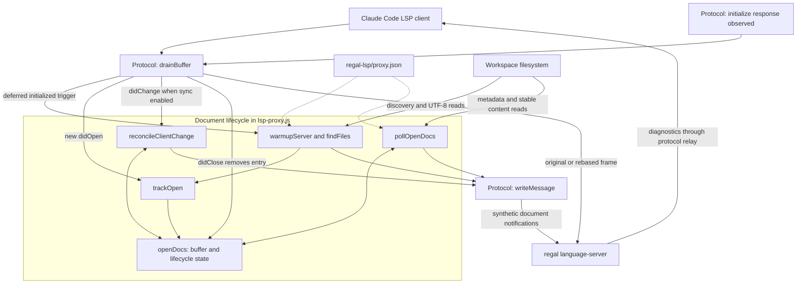
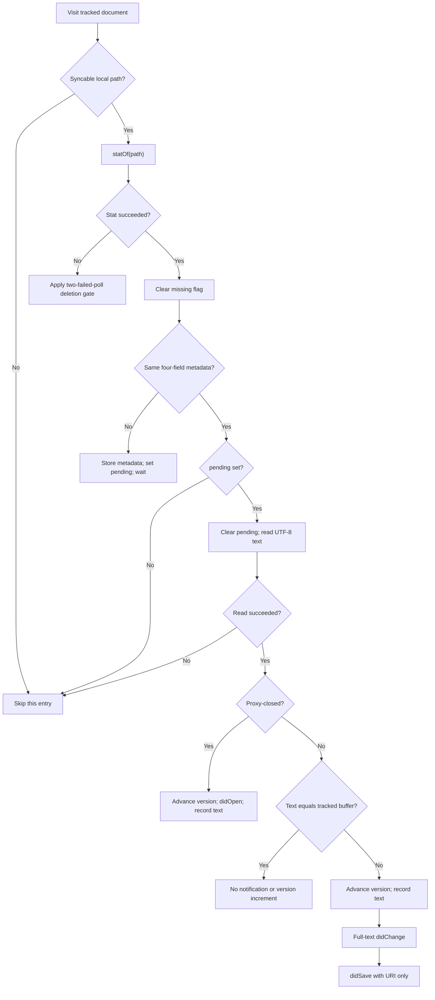

# Regal Language Server Document Lifecycle

The `regal_language_server_document_lifecycle` module manages Regal's
server-side document buffers inside `regal-lsp/lsp-proxy.js`. It opens workspace
Rego files to start indexing, tracks client and synthetic opens, reconciles
client versions, and refreshes tracked documents after out-of-band disk edits.

This addresses two integration gaps: Regal can defer indexing until a document
is opened, and Claude Code does not notify the server about every shell,
formatter, Git, or other-session filesystem change. The proxy supplies document
notifications; Regal still owns indexing, policy analysis, and diagnostics.

## Scope and system context

This is a logical subsystem of one Node.js proxy, not a separate service or an
exported library. It shares state with the protocol handlers and sends synthetic
notifications only to Regal. It does not write workspace files, update Claude
Code's buffers, or advance the client's own version counter.

Related responsibilities are documented separately:

- [Regal language server integration][integration] describes the overall plugin,
  packaging, and shared-wrapper maintenance model.
- [Protocol transport][protocol] explains framing, method interception,
  initialization observation, server-request acknowledgments, and shutdown.
- [Setup and registration][setup] covers `.rego` routing, the Node launcher, and
  Regal installation prerequisites.
- [Language intelligence integration][language-integration] provides the wider
  system context.

## Architecture and dependencies

Client document events enter through `drainBuffer`. Server initialization state
observed by `drainServerBuffer` enables warmup. The lifecycle helpers share the
URI-keyed `openDocs` map and use the protocol's `writeMessage` helper to send
synthetic LSP notifications to `child.stdin`.



The eight core components are all file-local functions in
`regal-lsp/lsp-proxy.js`:

| Component | Responsibility and direct dependencies |
| --- | --- |
| `toPath` | Convert file URIs with `fileURLToPath`, or return `null`. |
| `statOf` | Read the metadata tuple with `statSync`; catch failures. |
| `sameStat` | Compare all four metadata fields. |
| `trackOpen` | Replace URI state using `toPath` and `statOf`. |
| `reconcileClientChange` | Mirror text, rebase frames, or emit a reopen. |
| `pollOpenDocs` | Use `statOf` and `sameStat` to gate disk-driven events. |
| `findFiles` | Walk directories using `readdirSync`, `join`, and `extname`. |
| `warmupServer` | Discover, deduplicate, read, open, and call `trackOpen`. |

Filesystem work uses `node:fs`; path handling uses `node:path` and `node:url`.
Scheduling uses `setImmediate` and `setInterval`. There are no external watcher,
JSON-RPC, or filesystem libraries. All discovery, stat calls, and content reads
are synchronous, even though warmup is deferred to a later event-loop turn.

## Effective configuration

`regal-lsp/.lsp.json` launches the bundled Node proxy with
`--config ${CLAUDE_PLUGIN_ROOT}/proxy.json`. The inspected
`regal-lsp/proxy.json` selects `regal language-server`. Its lifecycle-specific
configuration is the following excerpt, not a complete launch configuration:

```json
{
  "warmup": {
    "extensions": [".rego"],
    "exclude": ["node_modules", ".git", "vendor", ".venv", ".claude"]
  }
}
```

The `sync` field is omitted, so disk synchronization is enabled at the default
300 ms interval. The proxy computes the interval as
`Math.max(50, config.sync?.pollMs || 300)` unless `config.sync === false`.

- A nonzero numeric `sync.pollMs` is clamped to at least 50 ms. An omitted or
  zero value uses 300 ms. Use a positive number; this is not schema validation.
- Setting `"sync": false` disables the poll timer and ordinary client
  `didChange` reconciliation, including version rebasing on that path.
- Open/close tracking and duplicate-open translation remain active when sync is
  disabled, because warmup still needs to avoid double opens.
- Warmup is independent of synchronization. `warmupServer` returns immediately
  unless `warmup.extensions` is a nonempty array. Removing warmup does not
  disable synchronization of documents opened by the client.
- Extensions and exclusions constrain discovery only. An explicitly
  client-opened file can be tracked and polled regardless of its extension or
  whether its directory name is excluded from warmup.

The timer starts when the proxy starts, not when warmup finishes. It is
unreferenced so it does not keep the process alive by itself, and is cleared
on child exit, client stdin EOF, or forwarded termination signals. Detailed
process handling belongs to the [protocol guide][protocol].

## Shared state and document identity

`openDocs` maps the exact document URI string to a mutable record. It is both
the synchronization registry and the warmup deduplication set. Different URI
spellings are not canonicalized into a common map key.

| Field | Meaning |
| --- | --- |
| `version` | Latest tracked server-facing document version. |
| `text` | Last known buffer text, not necessarily current disk text. |
| `languageId` | Preserved language ID for synthetic reopens. |
| `path` | Local path from `toPath`, or `null` for an unsupported URI. |
| `stat` | Last observed metadata tuple, or `null`. |
| `pending` | A metadata change is awaiting an unchanged subsequent poll. |
| `missing` | One failed stat check has armed the deletion gate. |
| `closed` | The proxy has closed the document server-side but retained it. |
| `unsyncable` | Final buffer text is unknown, so polling must skip it. |

### Initial tracking

`trackOpen(uri, text, version, languageId)` replaces any existing record. It
preserves a numeric version, including zero; otherwise it uses version 1. It
uses an empty string for nullish text and `plaintext` for a missing or falsy
language ID. All four lifecycle flags start as `false`.

`toPath(uri)` accepts a string beginning with `file:` only if `fileURLToPath`
can convert it. Non-file URIs and conversion failures produce `null`. Such
documents can still be tracked for deduplication, but are never polled.

Tracking captures current metadata without reading disk content to compare it
with the supplied buffer. It therefore does not immediately replace a newly
opened, unsaved client buffer merely because disk content differs.

### Metadata fingerprint

`statOf(path)` returns the following fields, or `null` on any stat error:

```javascript
{ mtimeMs, ctimeMs, size, ino }
```

`sameStat(a, b)` requires both inputs to exist and all four fields to match
exactly. In particular, two `null` values are not considered equal.

- `mtimeMs` and `size` detect common writes.
- `ctimeMs` detects rewrites that restore the original modification time.
- `ino` detects atomic write-and-rename replacements that preserve size and
  modification time.

The executable comparison uses all four fields, even though some nearby source
comments abbreviate the tuple as modification time and size.

### Lifecycle states

The following diagram summarizes server-open ownership. `pending`, `missing`,
and `unsyncable` are orthogonal flags, not separate mutually exclusive states.
Poll-driven transitions require enabled synchronization, a local path, and
`unsyncable === false`.

```mermaid
stateDiagram-v2
    state "Not tracked" as Untracked
    state "Tracked; server open" as Open
    state "Tracked; proxy closed server buffer" as Closed
    [*] --> Untracked
    Untracked --> Open: Client or warmup didOpen
    Open --> Open: Client change or stable disk edit
    Open --> Closed: Two failed stats; synthetic didClose
    Closed --> Open: Stable reappearance; synthetic didOpen
    Closed --> Open: Full-text client change; synthetic didOpen
    Closed --> Open: Client didOpen; fresh tracking
    Open --> Untracked: Client didClose; forward close
    Closed --> Untracked: Client didClose; consume duplicate close
    note right of Open
        Unknown text disables polling.
        Full text restores syncability.
    end note
```



A proxy-generated close retains text, language ID, and version for recovery.
A client close removes the record entirely. Warmup-opened documents otherwise
remain tracked for the process lifetime, including while their files are absent.
There is no age-based eviction.

## Initialization warmup

Warmup makes Regal index matching workspace files without requiring Claude
Code to explicitly open each one.

### Trigger and workspace root

Warmup depends on coordination with the protocol handlers:

1. A client `initialize` message records
   `params.rootUri || params.rootPath || null`.
2. A server result with a truthy `result.capabilities` sets
   `initializeResponseSeen`. This is a structural observation, not an
   initialize-request ID lookup.
3. A subsequent client `initialized` triggers warmup only if that observation,
   a root, and a truthy warmup configuration are present.
4. The proxy forwards `initialized` first. It converts a root beginning with
   `file://` using `fileURLToPath`; other root strings are used as paths.
5. `setImmediate(() => warmupServer(rootDir))` defers discovery until after
   the initial notification has been written to the child stream.

The deferral is not an acknowledgment that Regal has finished initialization.
Warmup does not derive roots from `workspaceFolders`, subscribe to root changes,
or support remote workspace URI schemes. Initialization should supply a valid
local file URI or filesystem path.

There is no explicit one-shot warmup flag. Repeated qualifying `initialized`
messages can schedule another scan, but already tracked URI strings are skipped.

```mermaid
sequenceDiagram
    participant Client as Claude Code
    participant Proxy as Node proxy
    participant Regal as Regal server
    participant Disk as Workspace filesystem
    Client->>Proxy: initialize(rootUri or rootPath)
    Proxy->>Regal: Forward initialize
    Regal-->>Proxy: Result with capabilities
    Proxy-->>Client: Forward result
    Client->>Proxy: initialized
    Proxy->>Regal: Forward initialized first
    Note over Proxy: setImmediate schedules warmup
    Proxy->>Disk: findFiles, then UTF-8 reads
    loop Readable matching URIs not already tracked
        Proxy->>Regal: Synthetic didOpen(uri, languageId, version, text)
        Note over Proxy: trackOpen records text, path, stat, and version
    end
    opt Client later opens a warmup-opened URI
        Client->>Proxy: didOpen with client buffer
        Proxy->>Regal: Full-text didChange at a newer version
        Note over Proxy: Consume original didOpen; no duplicate open
    end
    opt Regal publishes diagnostics
        Regal-->>Proxy: publishDiagnostics
        Proxy-->>Client: Forward unchanged
    end
```

### File discovery

`findFiles(rootDir, extensions, excludeDirs)` uses an explicit directory stack,
not recursive JavaScript calls. Each directory is read with
`readdirSync(dir, { withFileTypes: true })`.

- Extensions are exact, case-sensitive `extname` matches, not glob patterns.
  The shipped configuration discovers `.rego` files only.
- Exclusions match an entry's whole name at every visited directory level.
  They are not path substrings. The starting root itself is not filtered by
  its name or by an excluded name in one of its ancestors.
- The exclusion check runs before entry-type checks, so an identically named
  file is skipped too.
- Directory entries are pushed onto the stack; matching regular files are
  collected. Symbolic-link entries are neither followed as directories nor
  included as files by these `Dirent` checks.
- Failed directory reads are skipped silently. There is no `.gitignore`
  processing, additional hidden-directory rule, or guaranteed result order.

This is discovery at the initialization trigger, not an ongoing workspace
watcher. A newly created file that has never been tracked is not automatically
enrolled by the poller.

### Synthetic opens and duplicate-open races

`warmupServer(rootDir)` discovers candidate paths and processes them in order:

1. Convert the path to `pathToFileURL(filePath).href`.
2. Skip it if `openDocs.has(uri)`, even if that retained record is proxy-closed.
3. Read UTF-8 text; silently skip files that cannot be read.
4. Derive the language ID. `.rego` maps to `rego`; the shared wrapper also has
   mappings for Python, TypeScript, JavaScript, CUE, shell, YAML, and Swift.
   Unmapped extensions use the extension without its leading dot.
5. Send `textDocument/didOpen` and immediately call `trackOpen` with the same
   text, version, and language ID.

The warmup counter starts at zero and increments only for successfully sent
opens. A burst therefore assigns versions `0, 1, 2, ...` across its files;
versions are not all initialized to 1. Subsequent versions are tracked per URI.
Warmup sends no synthetic `didSave`.

Deduplication handles both race directions:

- **Client opens first:** its record exists when warmup checks the URI, so
  warmup sends no second open.
- **Warmup opens first:** a later client `didOpen` for that server-open URI is
  translated by `drainBuffer` into one full-text `didChange`. The client's text
  becomes authoritative, the language ID is refreshed if supplied, metadata is
  recaptured, and `pending`, `missing`, and `unsyncable` are cleared. The
  original open is consumed; no save is synthesized.

Duplicate-open translation selects the greater of the numeric client version
(or zero) and the tracked version plus one. It remains active with sync disabled.
It avoids the spec-undefined open-after-open sequence that can make Regal drop
that URI's diagnostics.

If a tracked record is already proxy-closed, a client `didOpen` instead follows
the normal `trackOpen` path and is forwarded. That is a genuine new server open,
not a duplicate, and its initial version is taken from the client.

## Client-change reconciliation

With synchronization enabled, `drainBuffer` passes each client `didChange` to
`reconcileClientChange(msg, rawMessage)`. The raw input is the complete framed
message, not just its JSON body. An untracked URI passes through unchanged.
Client `didSave` is forwarded normally; it does not itself reconstruct text or
refresh the tracking record.

### Ordered content changes

The proxy does not apply range edits locally. Instead, it scans
`params.contentChanges` in order to decide whether the final text is known:

- A member with `range === undefined` and string `text` is a full-document
  replacement. It sets the known text to that string.
- Any other member makes the text unknown again and records that an
  incremental or otherwise unreconstructable change was seen.
- A later full replacement restores known text, even if earlier members were
  incremental.

| Ordered batch | Final tracking outcome |
| --- | --- |
| Full text A, then full text B | Text B is known. |
| Incremental edit, then full text B | Text B is known; sync can resume. |
| Full text A, then incremental edit | Text is unknown; polling is disabled. |
| Empty or non-array changes | Text and syncability remain as previously set. |

When final text is known, it replaces `st.text`. If the document was
unsyncable, that flag is cleared and a recovery message is logged. When the
final text is unknown after an incremental member, `unsyncable` is set and
logged once per disabled period. The previous `st.text` remains stored but is
not trusted for disk synchronization.

An unsyncable document is skipped by the entire poller, including deletion and
reappearance detection. A later full-text change or duplicate client open can
restore syncability. Ordinary incremental changes still undergo version
reconciliation and forwarding; the proxy does not silently discard them.

### Return contract and version rules

The function returns one of three values to the protocol handler:

| Return | Meaning |
| --- | --- |
| Original `rawMessage` | No tracking entry, or the client version is newer. |
| Newly framed `Buffer` | The client change needs a higher server version. |
| `null` | The proxy emitted a replacement open and consumed the change. |

For a tracked, normally open document, let `tracked` be its current version and
`client` be the incoming numeric version, if present:

- If `client > tracked`, record the client version and forward the original
  bytes.
- Otherwise, increment the tracked version and rewrite
  `params.textDocument.version` to that value. Missing numeric versions take
  this path too.
- Preserve the other parsed message fields. Serialize the replacement and
  calculate a new UTF-8 `Content-Length` frame.

Disk injections advance the same tracked counter. The client's counter cannot
know about those injections, so rebasing prevents later client edits from moving
Regal's version backward or repeating an already used change version.

For example, with synchronization enabled:

| Event | Client version | Server-facing version |
| --- | --- | --- |
| Initial client open | 1 | 1 |
| Stable external disk edit | Not applicable | 2 |
| Next client change | 2 | 3, rebased |
| Later client change | 8 | 8, original frame |

Monotonic change versions do not merge text or transform range offsets between
divergent client and server buffers. They solve version ordering only. Ordinary
client-change rebasing is not performed when `sync` is disabled.

### Client edits after a proxy-generated close

If `st.closed` is true and the final client text is known, a `didChange` cannot
be forwarded as an edit to a server-closed document. The proxy instead:

1. Clears `closed`, `missing`, and `pending`.
2. Selects `max(numericClientVersionOrZero, trackedVersion + 1)`.
3. Refreshes metadata if a local path exists.
4. Sends `textDocument/didOpen` with the known client text and stored language
   ID, then returns `null` to consume the original change.

No `didSave` is synthesized on this path. The file does not have to exist on
disk for this client-driven reopen; continued absence can trigger another close
on later polls.

An incremental-only change cannot reconstruct a closed document and therefore
cannot take the reopen path. It follows ordinary forwarding/version handling
and disables polling until full text is supplied. This is a limitation, not an
incremental recovery mechanism.

## Disk polling and synthetic updates

`pollOpenDocs()` iterates the tracking map. Entries with `unsyncable === true`
or no local path are skipped. Other entries receive one `statOf` check per poll,
including retained proxy-closed entries waiting for reappearance.

### Two-poll stability gate

For an existing file, the update gate works as follows:

1. If the current metadata differs from `st.stat`, store it, set
   `pending = true`, and wait until a subsequent poll.
2. If metadata matches and `pending` is false, do nothing.
3. If metadata matches and `pending` is true, clear `pending` and read the file
   as UTF-8.
4. If the record is proxy-closed, reopen it with the read text.
5. Otherwise, compare the read text with the last known buffer text. Identical
   text is a no-op; divergent text triggers a full-text update and save.



The synthetic change carries `contentChanges: [{ text }]` and the incremented
version. The immediately following save carries only the document URI: it does
not include text or a version. Both go to the server, not back to the client.

This content comparison makes a client write that matches the mirrored buffer,
a metadata-only touch, or a content-identical replacement a no-op. There is no
back-off window based on the time of the last client edit. Reconciliation uses
content and tracked versions instead.

At the default interval, a metadata change that settles between polls is
normally propagated after roughly 300–600 ms, plus filesystem, event-loop,
transport, and server processing time. Repeated metadata changes keep rearming
the gate. This is not a bound on diagnostic latency or an atomic-read guarantee:
a writer may pause long enough to look stable and then resume.

### Deletion and reappearance

A failed stat check is treated as absence, regardless of the underlying error.
For a document that the server still considers open:

1. The first consecutive failure sets `missing = true` and waits.
2. The next failure clears `missing` and `pending`, sets `closed = true`,
   clears `stat`, and sends `textDocument/didClose`.
3. Further failed polls do not send duplicate closes. The record stays in
   `openDocs` so polling can detect a returning file.

A successful stat resets `missing`, so a single transient failure does not
close the buffer. The close lets Regal discard its buffer and clear diagnostics;
the proxy does not manufacture a diagnostics-clear notification itself.

When a proxy-closed file returns, its metadata first arms `pending`. An unchanged
subsequent poll reads the text, increments the retained version, clears
`closed`, and sends `didOpen` with the stored language ID. Reappearance sends
an open even if the text matches the old buffer, and sends no synthetic save.

A client `didClose` always removes the tracking entry. If the proxy had already
closed it server-side, the client close is consumed to avoid closing twice.
Otherwise it is forwarded normally. Once removed, the entry is no longer
eligible for automatic disk-driven recovery.

## Operational limits and observability

Synchronization is best-effort document reconciliation, not a filesystem mirror
or a conflict-resolution service.

- Only tracked URIs are polled. Warmup exclusions, an absent initialization
  root, or a client close can explain why a file is not enrolled.
- Full-text client messages update the known buffer immediately, but a later
  stable, divergent disk write can still replace Regal's buffer. Unsaved client
  text is not protected by merging, conflict detection, or a grace period.
- Range changes are not applied locally or adjusted to account for prior disk
  injections. A final incremental change pauses all polling for that document.
- Stat failures such as permission errors are indistinguishable from deletion
  and can produce a synthetic close after two failures.
- If a stable-file read fails, `pending` has already been cleared. An unchanged
  later stat does not by itself retry the read; a further metadata change or
  client lifecycle event may be needed for recovery. Read failures are silent.
- A same-size in-place rewrite within one filesystem timestamp quantum can
  leave the full fingerprint unchanged. The proxy intentionally avoids hashing
  every tracked file on every tick.
- The gate does not re-stat after a content read and cannot guarantee a
  consistent snapshot during concurrent writes.
- Synchronous scans and polling block the event loop. Poll cost grows with the
  number of syncable local entries, and retained buffer memory grows with total
  tracked text. Warmup has no batching limit or cancellation mechanism.
- Synthetic notifications have no delivery acknowledgment or retry queue.
  Stream framing and backpressure limitations are described in the
  [protocol guide][protocol].

### Lifecycle logs

For the shipped Regal command, lifecycle messages go to stderr with prefix
`[lsp-proxy:regal]`. The following are representative message patterns; `URI`
and version/count placeholders stand for runtime values:

```text
[lsp-proxy:regal] warmup: no files found
[lsp-proxy:regal] warmup: opening N file(s) for indexing
[lsp-proxy:regal] warmup: sent N didOpen notification(s)
[lsp-proxy:regal] disk-sync: injected didChange URI vN
[lsp-proxy:regal] disk-sync: rebased client didChange URI vA -> vB
[lsp-proxy:regal] disk-sync: closed URI (file deleted)
[lsp-proxy:regal] disk-sync: reopened URI vN (file reappeared)
```

Additional messages identify incremental-change opt-out, full-text recovery,
client-edit reopening after deletion, and translated duplicate client opens.
The incremental warning is emitted once per disabled period, not every poll.
Normal content-identical no-ops and skipped unreadable files produce no message.

The warmup `opening` count is the number of discovered candidates; the `sent`
count excludes already tracked and unreadable files. A difference between them
is not necessarily a failure.

### Troubleshooting

- **No startup indexing:** check the initialization root, observed capabilities,
  `initialized` ordering, configured extensions, and discovery exclusions. A
  valid warmup configuration alone is not sufficient to trigger a scan.
- **A tracked file stays stale:** check `sync`, URI-to-path conversion,
  incremental-change warnings, read permissions, and metadata changes. Warmup
  being enabled does not override an unsyncable flag.
- **Unexpected close or missing diagnostics:** check for two consecutive stat
  failures, including access failures, rather than assuming a client close.
- **Frequent version rebasing:** this is expected when synthetic changes have
  advanced the server counter beyond the client's counter.
- **Slow updates:** account for both stability polls, ongoing writes,
  synchronous scan cost, and Regal's own analysis time. A proxy injection log
  confirms a write to the server stream, not completed diagnostic processing.

## Validation and maintenance

Run the repository's canonical test entry point from the repository root:

```sh
make test
```

`Makefile` dispatches to `bash tests/run.sh`, whose prerequisites are `node`,
`bash`, `jq`, and `shellcheck`. Relevant registered checks include:

| Source | Lifecycle coverage |
| --- | --- |
| `tests/cases/06-proxy.sh` | Sync injection, no-ops, close, and disabled sync. |
| `tests/cases/06-proxy.sh` | Client reconciliation and version rebasing. |
| `tests/cases/06-proxy.sh` | Incremental opt-out and full-text recovery. |
| `tests/cases/06-proxy.sh` | Warmup tracking, deletion, and reappearance. |
| `tests/cases/06-proxy.sh` | Both client-first and warmup-first open races. |
| `tests/cases/07-warmup.sh` | Discovery, empty trees, and absent warmup. |
| `tests/cases/07-warmup.sh` | Multiple extensions and language-ID selection. |
| `tests/cases/08-live.sh` | Optional real-Regal diagnostic and warmup checks. |

Warmup cases run through `tests/helpers/warmup-suite.js`, including checks that
excluded entries are not opened and that `initialized` precedes the open burst.
Proxy scenarios use `tests/helpers/proxy-suite.js`. Live Regal cases are
registered only when `regal` is on `PATH`; a green suite does not establish that
those optional cases ran. This page describes checked-in validation, not a test
execution report.

`tests/cases/02-consistency.sh` enforces byte-identical deployed proxy copies.
Put Regal-specific discovery policy in `regal-lsp/proxy.json`; shared lifecycle
code changes must reach every plugin copy. See the
[integration guide][integration] for packaging details.

`.github/workflows/test-gate.yml` runs the test entry point in separate Linux
and macOS jobs. Repository-wide commands and CI requirements are documented in
[build and configuration][build] and [continuous integration][ci].

[integration]: ../regal_language_server.md
[protocol]: regal_language_server_protocol.md
[setup]: regal_language_server_setup.md
[language-integration]: ../../language_intelligence_integration.md
[build]: ../../engineering_platform_and_validation/repository_build_and_configuration.md
[ci]: ../../engineering_platform_and_validation/continuous_integration.md
