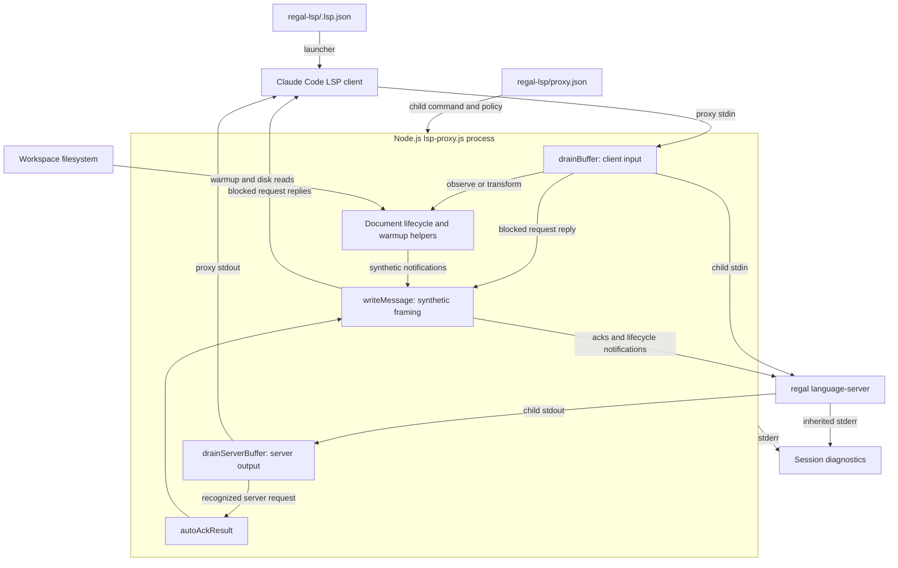
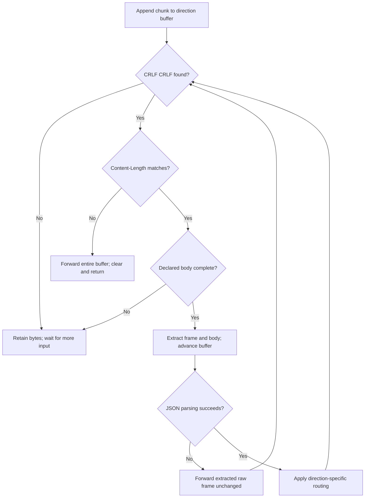
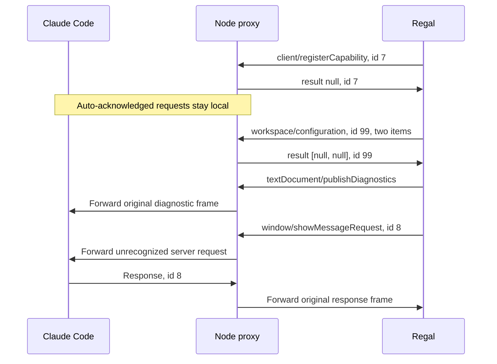
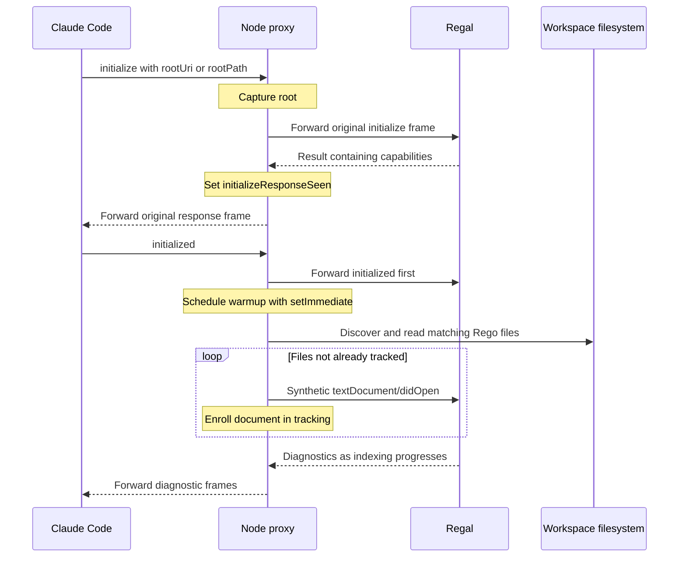

# Regal Language Server Protocol

The `regal_language_server_protocol` module provides the stdio transport and
compatibility layer between Claude Code and Regal's Rego language server.
Implemented inside `regal-lsp/lsp-proxy.js`, it relays Language Server Protocol
(LSP) frames and preserves original bytes unless a configured interception or
document-lifecycle transformation applies.

This page explains framing, bidirectional routing, synthetic replies,
initialization coordination, and process shutdown. Regal remains responsible
for policy analysis and language-feature results; the proxy does not implement
missing Rego features or generate diagnostics.

## Scope and related modules

This is a logical module within one Node.js executable, not an independently
exported library or service. Its core components are `writeMessage`,
`drainBuffer`, `drainServerBuffer`, and `autoAckResult`.

Related responsibilities are documented separately:

- [Regal language server integration][integration] covers the plugin's overall
  architecture and packaging.
- [Setup and registration][setup] covers file routing, prerequisites,
  installation, and the host launcher.
- [Document lifecycle and disk synchronization][lifecycle] covers warmup file
  discovery, tracked buffers, version reconciliation, and disk polling.
- [Language intelligence integration][language-integration] describes the
  wider family of language-server integrations.

## Architecture and dependencies



The runtime uses Node standard-library APIs only:

- `Buffer` supplies byte-oriented framing and independent stream buffers.
- `node:child_process` supplies `spawn` for the downstream server.
- `node:fs` and `node:path` support configuration loading and lifecycle work.
- `node:url` converts workspace and document file URIs.

There is no external JSON-RPC library, socket transport, or npm dependency
installation step. The child is spawned with
`stdio: ['pipe', 'pipe', 'inherit']`: stdin/stdout carry protocol traffic,
while Regal's stderr is inherited. Proxy stdout is reserved for client-facing
LSP traffic, and proxy diagnostics use stderr.

### Effective Regal policy

`regal-lsp/.lsp.json` launches `node` with the bundled `lsp-proxy.js` and
`--config ${CLAUDE_PLUGIN_ROOT}/proxy.json`. The host expands the plugin-root
placeholder. Runtime policy comes from `regal-lsp/proxy.json`, not from the
language ID or hard-coded Regal branches in the proxy.

| Concern | Effective behavior |
| --- | --- |
| Child command | `regal language-server`, resolved through `PATH`. |
| Client method blocking | References and implementation requests. |
| Server-request auto-ack | Four fixed methods, independent of config. |
| Workspace warmup | Enabled for `.rego` files. |
| Disk synchronization | Enabled at the default 300 ms interval. |

The exact blocked methods are documented below. The `sync` section is omitted
from the shipped configuration, so the proxy default applies. Setting
`"sync": false` disables polling and client-change reconciliation, but not
open/close tracking or duplicate-open translation. Warmup discovery rules and
synchronization settings belong to the [lifecycle guide][lifecycle].

## Core components and shared state

All four functions are defined at file scope in `regal-lsp/lsp-proxy.js`.

| Component | Responsibility |
| --- | --- |
| `writeMessage(stream, body)` | Frame an already serialized message body. |
| `drainBuffer()` | Parse client input, observe lifecycle, and route frames. |
| `drainServerBuffer()` | Parse server output and intercept fixed requests. |
| `autoAckResult(msg)` | Construct a local server-request result value. |

Their shared state establishes the integration points:

- `buffer` accumulates client bytes; `serverBuffer` accumulates server bytes.
  Each direction can receive independently fragmented or coalesced frames.
- `BLOCKED_METHODS` is built from `config.blocked || []`.
  `SERVER_REQUESTS_AUTO_RESPOND` contains the fixed server-request methods.
- `rootUri` stores the root captured from client initialization.
  `initializeResponseSeen` records an observed result with capabilities.
- `openDocs` is shared with lifecycle helpers to track server-side document
  state and decide whether client frames need replacement.
- `shuttingDown` distinguishes expected termination from an unexpected child
  signal exit. `pollTimer` is cleared on shutdown and child exit.

The proxy has no general pending-request table, request-ID remapping, or
capability negotiation engine. Ordinary request/response correlation remains
with Claude Code and Regal.

## Message framing and byte preservation

### Writing synthetic messages

`writeMessage(stream, body)` accepts a serialized string or a `Buffer`, not a
JSON-RPC object. Callers construct response fields and use `JSON.stringify`
before invoking it. The implementation performs two ordered writes:

```javascript
const buf = Buffer.isBuffer(body) ? body : Buffer.from(body);
stream.write(`Content-Length: ${buf.length}\r\n\r\n`);
stream.write(buf);
```

For strings, `Buffer.from` uses UTF-8. `Content-Length` counts body bytes, not
JavaScript characters, so non-ASCII content remains correctly framed. The
helper emits CRLF line endings and a blank line before the body. It adds no
body newline or `Content-Type` header.

Its destinations depend on the source of the synthetic message:

- `process.stdout` receives local replies to blocked client requests.
- `child.stdin` receives server-request acknowledgments and synthetic document
  notifications from lifecycle helpers.

The two writes are not an atomic transport operation. Receivers must tolerate
arbitrary chunk boundaries. The helper does not wait for backpressure or
provide a delivery acknowledgment. Client-change version rebasing constructs
its own replacement frame using the same byte-length convention.

### Incremental parsing

Each stream's `data` handler appends the chunk with `Buffer.concat` and calls
its drain function. Both drain functions use the same framing algorithm:

1. Search for `HEADER_DELIM`, the bytes `\r\n\r\n`. If absent, retain the
   accumulator and wait for more data.
2. Decode the header as ASCII and match
   `/^content-length:\s*(\d+)\s*$/im`.
3. Parse the decimal content length and calculate the body end in bytes. If
   the body is incomplete, retain the accumulator and wait.
4. Extract the entire original frame as `rawMessage`, extract its body bytes,
   and advance the accumulator past the frame.
5. Decode the body as UTF-8 and attempt `JSON.parse`.
6. Route the message for that direction, then repeat for remaining frames.



This supports split headers, split bodies, and multiple frames in one chunk.
Header matching is case-insensitive. Extra headers are not interpreted, but
are retained on ordinary raw forwarding.

### Pass-through and malformed-input behavior

Normal forwarding writes `rawMessage` directly rather than reserializing the
parsed object. Header spelling, extra headers, JSON whitespace, and original
body bytes survive unchanged. Deliberate replacements and synthetic messages
receive new framing instead.

| Input condition | Behavior |
| --- | --- |
| Header delimiter not yet present | Retain bytes and wait. |
| Declared body incomplete | Retain bytes and wait. |
| Delimiter present, no matching length | Forward whole buffer and clear it. |
| Complete frame with invalid JSON | Forward that frame and keep draining. |
| Parsed message without interception | Forward its original frame. |

Forwarding means writing to `child.stdin` in `drainBuffer`, or to
`process.stdout` in `drainServerBuffer`.

These are opaque pass-through fallbacks, not protocol repair. A missing
length header flushes the entire current accumulator, potentially including
later messages, without inspecting them. Invalid JSON bypasses interception.
Neither path produces a JSON-RPC parse-error response or searches for a new
frame boundary.

There is no configured frame-size limit or incomplete-frame timeout. A
missing delimiter or excessive declared length can retain bytes indefinitely.
Only JSON parsing is guarded here: syntactically valid but structurally invalid
messages are not fully validated and can fail in later property access. Batch
members are not individually parsed and routed.

## Client-to-server routing

`process.stdin.on('data')` invokes `drainBuffer`. For each successfully parsed
message, processing occurs in this order:

1. Capture the root from a message named `initialize` with params.
2. Observe document lifecycle and prepare `outFrame`: original bytes,
   rewritten bytes, or `null` when the original has been consumed.
3. If the initialization warmup gate is satisfied, forward the original
   `initialized` frame, defer warmup, and continue to the next message.
4. Check the configured blocked-method set. Reply locally to a matching
   request or discard a matching notification, then continue.
5. Forward `outFrame` to `child.stdin` if it is not `null`.

Responses to ordinary server requests also pass through this path. No local
request-correlation state is required to forward them.

### Blocked methods

The shipped `regal-lsp/proxy.json` blocks these exact method names:

- `textDocument/references`.
- `textDocument/implementation`.

Blocking avoids known unsupported-method responses with JSON-RPC error code
`-32601`, which can leave Claude Code's LSP client unusable. It is a static
compatibility policy, not a feature implementation or runtime discovery of
unsupported methods.

For a blocked message:

- If `msg.id !== undefined`, the proxy sends a success response on stdout with
  the original ID and `result: null`.
- If there is no ID, the notification is dropped without a reply.
- The original input is not forwarded through the normal child-write path.

For example, a blocked request with ID 42 receives this body, framed by
`writeMessage`:

```json
{"jsonrpc":"2.0","id":42,"result":null}
```

The ID check uses definedness rather than truthiness, so ID `0` is preserved.
This response means an empty result to the client, not an explicit
"unsupported" error. The proxy does not calculate references or
implementations, rewrite advertised capabilities, or turn other server errors
into successful replies. Unblocked `-32601` responses pass through unchanged.

Blocking follows lifecycle observation and the special warmup branch. It is
not a security boundary: configuring a lifecycle method as blocked would not
undo tracking changes or synthetic notifications already emitted while
observing that input.

### Document-lifecycle handoff

The transport observes document notifications before normal forwarding:

| Client method | Transport integration |
| --- | --- |
| `textDocument/didOpen` | Track a new open or translate a duplicate open. |
| `textDocument/didChange` | Reconcile the frame when `SYNC` is enabled. |
| `textDocument/didClose` | Remove tracking; suppress an already-sent close. |

For a new `didOpen`, `trackOpen` records the client buffer and the original
frame normally continues to Regal. If the document is already open
server-side, the proxy instead sends a full-text `didChange` and consumes the
original open. This avoids duplicate opens that can discard Regal's
diagnostics for that URI. A proxy-closed entry follows the normal reopen path.

With synchronization enabled,
`reconcileClientChange(msg, rawMessage)` returns the frame to forward. It may
preserve the original bytes, return a version-rebased replacement, or return
`null` after emitting a replacement `didOpen`. A client close removes the
tracking entry; if the proxy already closed it server-side, the duplicate
close is consumed.

Warmup and polling also call `writeMessage(child.stdin, ...)` to inject
notifications. These are server-facing messages, not changes to Claude Code's
buffers or version counters, and are not echoed to the client. Buffer
authority, version formulas, incremental changes, and deletion recovery are
specified in the [lifecycle guide][lifecycle].

## Server-to-client routing and acknowledgments

`child.stdout.on('data')` invokes `drainServerBuffer`. For each parsed message,
the function:

1. Checks for a defined ID and a method in `SERVER_REQUESTS_AUTO_RESPOND`.
2. For a recognized request, constructs a response using `autoAckResult`, sends
   it to `child.stdin` through `writeMessage`, and consumes the request.
3. Otherwise, records a truthy `msg.result?.capabilities` for warmup
   coordination.
4. Forwards the original frame to the client through `process.stdout`.

Ordinary responses, diagnostics, notifications, and unrecognized server
requests pass through unchanged. A notification named like an auto-acknowledged
method is not intercepted because it has no ID.

### Fixed auto-acknowledged methods

The fixed set prevents the server from waiting on client handlers that Claude
Code cannot provide. It is independent of `config.blocked`, is active for
Regal, and has no per-method configuration switch.

| Server request method | Result value |
| --- | --- |
| `client/registerCapability` | `null` |
| `client/unregisterCapability` | `null` |
| `workspace/configuration` | One `null` array entry per requested item. |
| `window/workDoneProgress/create` | `null` |

Every reply contains `jsonrpc: '2.0'`, the original request ID, and `result`.
The original server request never reaches Claude Code. Acknowledgment does
not implement a dynamic capability registry, configuration service, or
progress UI; the proxy maintains none of those client features.

### Configuration result contract

For `workspace/configuration`, `autoAckResult` uses `params.items` only when
it is an array and returns `items.map(() => null)`. This preserves the number
and ordering of requested items. Missing params, missing items, or non-array
items produce `[]`, not a bare `null`.

For example, this illustrative server request:

```json
{
  "jsonrpc": "2.0",
  "id": 99,
  "method": "workspace/configuration",
  "params": {
    "items": [
      { "section": "example.first" },
      { "section": "example.second" }
    ]
  }
}
```

receives this response body:

```json
{"jsonrpc":"2.0","id":99,"result":[null,null]}
```

The proxy does not look up section names or supply overrides. Per-item `null`
values preserve the LSP result-array contract; a bare `null` would break
servers that index into the array. The shared implementation explicitly
accounts for that behavior in Pyright and VTSLS as well as serving Regal.

### Component interaction



The unknown request in this example remains the client's responsibility.
There is no general fallback response for every server-initiated method.

## Initialization and warmup coordination

Protocol parsing coordinates warmup through two shared variables:

- `rootUri` is assigned `params.rootUri || params.rootPath || null` when an
  `initialize` message with params is observed. The root is logged to stderr.
- `initializeResponseSeen` becomes `true` when a non-intercepted server message
  contains a truthy `msg.result?.capabilities`.

A client `initialized` triggers the special warmup branch only when the
response flag, root, and `WARMUP` configuration are all present. This is active
for the shipped Regal policy because indexing needs synthetic first opens.



The branch writes `initialized` before scheduling `warmupServer` with
`setImmediate`. A root beginning with `file://` is converted using
`fileURLToPath`; otherwise it is passed as a path. Deferral orders proxy writes
but does not wait for Regal to finish initialization or indexing. Discovery
and reads are synchronous once the callback runs.

The coordination has deliberately limited validation:

- The result is recognized by its capabilities field, not by matching the
  original initialize request ID.
- The proxy uses one `rootUri` or legacy `rootPath`; it does not select roots
  from `workspaceFolders`.
- The response flag is not reset, and there is no separate one-shot warmup
  latch. Another qualifying `initialized` can schedule another scan, although
  warmup deduplicates documents through `openDocs`.
- If the gate is not satisfied, `initialized` follows ordinary routing. A
  later response alone does not retroactively trigger warmup.

The special branch precedes method blocking. File exclusions, duplicate-open
race handling, and enrollment in disk synchronization are detailed in the
[lifecycle guide][lifecycle].

## Startup, shutdown, and failure handling

### Startup contract

The proxy requires `--config <path-to-proxy.json>`, resolves the path, reads
JSON once, and checks that `server` is a non-empty array. It takes the first
entry as `SERVER_CMD` and the remainder as `SERVER_ARGS`.

With `regal-lsp/proxy.json`, the child is `regal language-server`. No shell,
working-directory override, or environment override is supplied to `spawn`.
Configuration is not reloaded during the session, and validation is not a full
schema check of every optional field. Dependency installation belongs to the
[setup module][setup], not the protocol process.

| Startup failure | Explicit handling |
| --- | --- |
| Missing config argument | Print usage to stderr; exit 1. |
| Config read or JSON parse failure | Print config error to stderr; exit 1. |
| Missing, empty, or non-array `server` | Print validation error; exit 1. |
| Child emits `error` | Print child error to stderr; exit 1. |

Early messages use `[lsp-proxy]`; after configuration, the prefix derives from
`SERVER_CMD`, yielding `[lsp-proxy:regal]`. Regal's inherited stderr is
separate from its protocol stdout.

### Shutdown propagation

The process-level shutdown paths are:

| Event | Proxy action |
| --- | --- |
| Client stdin EOF | Mark shutdown, clear polling, send child `SIGTERM`. |
| Proxy receives `SIGTERM` | Mark shutdown, clear polling, forward signal. |
| Proxy receives `SIGINT` | Mark shutdown, clear polling, forward signal. |
| Child exits | Clear polling and terminate with the derived status. |

On child exit, the proxy uses this status expression:

```javascript
code ?? (shuttingDown ? 0 : 1)
```

A numeric child exit code is preserved, including nonzero codes during an
expected shutdown. When the child exits by signal and supplies no numeric
code, the proxy returns 0 if it initiated shutdown, otherwise 1. The signal
name itself is not mapped to a separate proxy exit status.

LSP `shutdown` requests and `exit` notifications are ordinary traffic under
the shipped policy. The proxy does not initiate its own JSON-RPC shutdown
handshake. Client EOF immediately starts child termination; it does not flush
an incomplete parser frame first.

There is no automatic restart, signal escalation timer, or forced-kill
fallback. Signals are sent to the child process, not an explicitly managed
process group. A child that ignores the forwarded signal can delay shutdown.

## Operational guidance and limitations

- Keep both proxy and server stdout protocol-only. Unframed log output can
  disrupt parsing; malformed-input forwarding does not sanitize it.
- An empty references or implementation result is the configured local reply,
  not proof that Regal analyzed the request and found no matches.
- Auto-acknowledgment removes a server wait but does not guarantee that the
  client implements the acknowledged capability or displays progress.
- Other upstream errors and unknown server requests remain visible to the
  client; the proxy is not a universal compatibility adapter.
- Writes do not implement explicit backpressure handling. Input buffering has
  no size cap, and synchronous lifecycle work can delay protocol processing.
- If warmup does not start, inspect the logged root, capabilities-bearing
  response, subsequent `initialized`, and configured warmup section before
  investigating file discovery in the [lifecycle module][lifecycle].

## Validation and maintenance

Run the repository test entry point from the repository root:

```sh
make test
```

`Makefile` dispatches to `bash tests/run.sh`. That harness requires `node`,
`bash`, `jq`, and `shellcheck`. Relevant checked-in validation is organized as
follows:

- `tests/cases/06-proxy.sh` registers pass-through, blocked request and
  notification, malformed header, invalid JSON, split-buffer, auto-ack,
  unknown server request, configuration failure, signal, EOF, and exit-code
  scenarios. It also registers Regal-named pass-through and blocking cases,
  plus synchronization and duplicate-open cases. Implementations live in
  `tests/helpers/proxy-suite.js` and use a stub server for protocol checks.
- `tests/cases/07-warmup.sh` registers file-opening, empty-tree, absent-warmup,
  and multi-extension scenarios in `tests/helpers/warmup-suite.js`.
- `tests/cases/02-consistency.sh` checks launch arguments, server/installer
  agreement, and byte-identical proxy copies across marketplace plugins.

Each plugin is installed as its own directory and carries a real copy of the
unified proxy. Put Regal-specific policy in `regal-lsp/proxy.json`; shared
transport changes must reach every deployed copy rather than creating a
Regal-only fork. The consistency checks enforce that maintenance contract.

`.github/workflows/test-gate.yml` runs `make test` in separate Linux and macOS
jobs with Node 24.22.0 and requires successful, non-empty execution from both.
That CI pin is not a runtime minimum enforced by this module. Repository-wide
execution and gate details belong to the [continuous integration guide][ci].
This section describes checked-in validation wiring, not a test run performed
while generating this documentation.

[integration]: ../regal_language_server.md
[setup]: regal_language_server_setup.md
[lifecycle]: regal_language_server_document_lifecycle.md
[language-integration]: ../../language_intelligence_integration.md
[ci]: ../../engineering_platform_and_validation/continuous_integration.md
