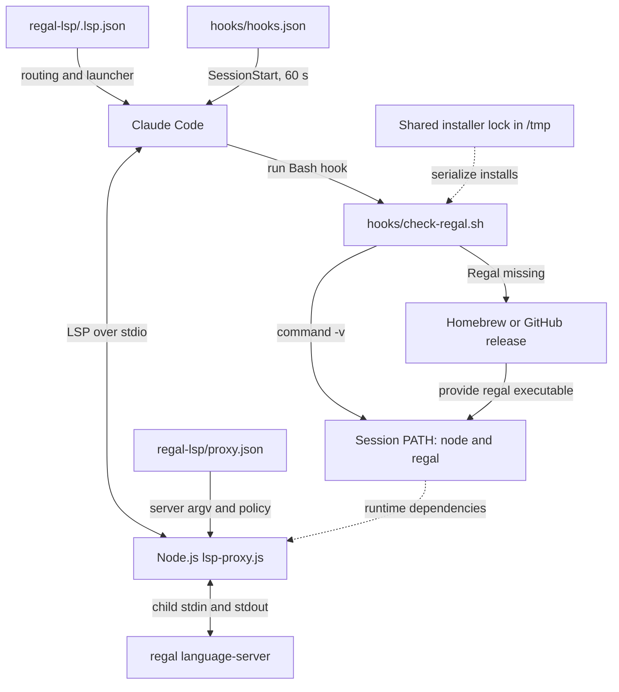
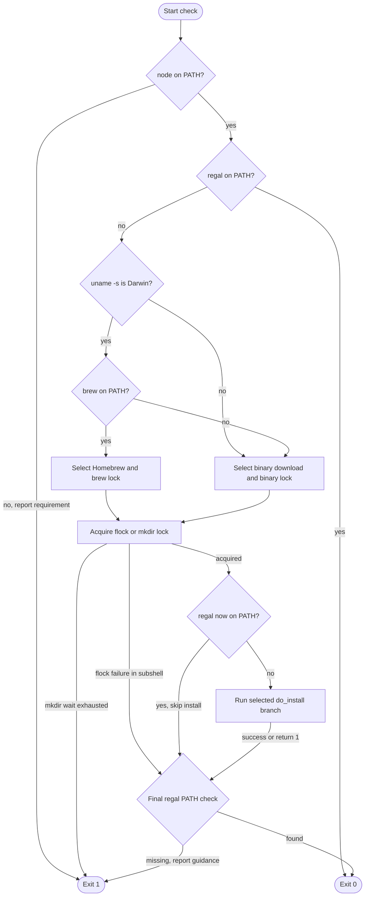
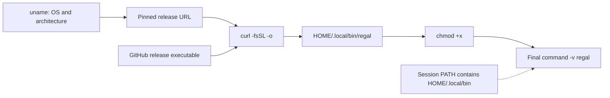

# Regal Language Server Setup

The `regal_language_server_setup` module registers Rego files with Claude Code
and prepares the external commands needed by the `regal-lsp` plugin. It combines
a declarative Node.js proxy launcher with a session-start check that installs
Regal when it is missing.

This is the setup layer of the
[Regal language server integration](../regal_language_server.md), within the
[language intelligence integration](../../language_intelligence_integration.md)
system. It does not analyze Rego, implement LSP transport, or synchronize
documents. Those runtime concerns belong to the [protocol][protocol] and
[document-lifecycle][lifecycle] modules.

## Architecture and responsibilities

Setup has two independent host entry points: `.lsp.json` supplies language
routing and a launcher, while `hooks/hooks.json` invokes the prerequisite
check. The check script does not launch either the proxy or Regal.



The core components are:

- `regal-lsp/.lsp.json`: maps `.rego` files to language ID `rego` and launches
  the bundled Node.js proxy with an explicit configuration path.
- `regal-lsp/hooks/check-regal.sh`: checks prerequisites, selects an installer,
  serializes installation, and rechecks Regal discovery through `PATH`.

Adjacent integration files complete the startup contract:

- `regal-lsp/hooks/hooks.json`: registers the session-start command and its
  host-side timeout.
- `regal-lsp/proxy.json`: selects `regal language-server` and Regal-specific
  runtime policy.
- `regal-lsp/lsp-proxy.js`: loads that configuration and spawns the server.
  Transport and document handling are documented separately.

`.claude-plugin/marketplace.json` distributes the `./regal-lsp` directory, and
`regal-lsp/.claude-plugin/plugin.json` identifies the plugin. The plugin's
metadata version describes the integration, not the installed Regal release.

## Registration and launch contract

### LSP registration

`regal-lsp/.lsp.json` contains this registration, reformatted here:

```json
{
  "rego": {
    "command": "node",
    "args": [
      "${CLAUDE_PLUGIN_ROOT}/lsp-proxy.js",
      "--config",
      "${CLAUDE_PLUGIN_ROOT}/proxy.json"
    ],
    "extensionToLanguage": {
      ".rego": "rego"
    }
  }
}
```

The configuration establishes the following behavior:

- `rego` names the registration entry, and `.rego` files use LSP language ID
  `rego`. No other extensions or extensionless filenames are explicitly mapped.
- Claude Code launches `node` through the session's `PATH`, not Regal directly.
  Regal is a Go binary; its presence does not imply Node.js is installed.
- The host expands `${CLAUDE_PLUGIN_ROOT}` to locate files inside the installed
  plugin, independently of the workspace directory.
- `--config` selects `proxy.json` explicitly. The proxy does not infer the
  server command from the language ID or file extension.

`regal-lsp/proxy.json` sets `server` to `["regal", "language-server"]`, producing
this launch chain:

```text
Claude Code -> node lsp-proxy.js --config proxy.json
            -> regal language-server
```

The proxy uses Node standard-library modules and runs as shipped JavaScript.
It needs no npm installation, Go toolchain, or compilation step. Its child
process inherits the environment and working directory; no shell wrapper or
explicit child working-directory override is supplied. Consequently, both
`node` and `regal` must be discoverable by the host's runtime environment.

The same proxy configuration also blocks selected methods and enables Rego
workspace warmup. Those policies are not installer behavior; see the
[protocol guide][protocol] and [document-lifecycle guide][lifecycle].

### Session-start hook

`regal-lsp/hooks/hooks.json` registers a command-type `SessionStart` hook:

```sh
bash ${CLAUDE_PLUGIN_ROOT}/hooks/check-regal.sh
```

The manifest sets `timeout` to **60 seconds**. Bash is required because the
script uses Bash redirection, local variables, and arithmetic syntax.

The hook reports prerequisite and installation results. It does not perform
an LSP initialization handshake, modify the host environment, or define how
Claude Code reacts to a failed hook or schedules the LSP launcher.

## Prerequisite checks and process flow

`regal-lsp/hooks/check-regal.sh` checks `node` **before** accepting an existing
`regal`. Missing Node.js prints installation guidance to stderr and exits 1,
even when Regal is present. The hook does not install Node.js automatically.

If both commands are discoverable, the script exits 0 silently, without
locking, network access, or installation. Discovery uses `command -v`, not
execution or a version check. Existing Regal installations are not upgraded
or repaired, and no minimum Node.js or Regal version is enforced.



The check inside the lock avoids a redundant install when another session
provides Regal while this invocation waits. After the locking branch, the
parent checks availability again. Installation errors do not unconditionally
terminate the parent: the script does not enable `set -e`, and the final
`PATH` check determines the normal post-install outcome.

The following settings are assigned inside the script, not read as
user-configurable environment overrides:

| Setting | Value |
| --- | --- |
| `BINARY` | `regal` |
| `FORMULA` | `styrainc/tap/regal` |
| Binary-download version | `0.39.0` |
| Binary-download directory | `${HOME}/.local/bin` |
| `LOCK_TIMEOUT` | `120` seconds |

The hook does not install Homebrew, use npm, invoke `sudo`, or change `PATH`.
Installation requires network access, a writable lock location, and permission
to write to the selected installation destination. Supporting commands such as
`uname`, `mkdir`, `chmod`, and `curl` are not proactively validated.

## Installation routes

### Platform selection

Installer selection depends on both the operating system and command
availability:

| Environment when Regal is missing | Selected route |
| --- | --- |
| macOS (`Darwin`) with `brew` on `PATH` | Homebrew |
| macOS without `brew` | GitHub binary download |
| Linux, even with `brew` available | GitHub binary download |
| Other OS | Binary route, then reject unsupported OS or architecture |

The platform checks apply only when installation is needed. An existing
`regal` with `node` available bypasses these checks.

### Homebrew installation

On macOS with Homebrew, the hook runs:

```sh
brew install styrainc/tap/regal
```

The formula is unversioned in the script, so this route is not pinned to
Regal v0.39.0. The hook does not run `brew upgrade` for an existing binary.

If `brew install` fails, `do_install` reports `brew install failed` and
returns 1. It does **not** retry through the GitHub route. The parent normally
continues to its final Regal discovery check.

### GitHub release installation

The binary route downloads a raw executable from
[Regal's GitHub releases](https://github.com/open-policy-agent/regal/releases).
It accepts only these architecture mappings:

| `uname -m` result | Release architecture |
| --- | --- |
| `x86_64` | `x86_64` |
| `aarch64` | `arm64` |
| `arm64` | `arm64` |
| Any other value | Report unsupported architecture; return 1 |

The OS component is exactly `Linux` or `Darwin`, retaining that capitalization.
Other `uname -s` values report `Unsupported OS` and return 1. Architecture is
validated before the OS, so an unsupported architecture can be reported first.
There is no native Windows installation branch.

Equivalent URL construction is:

```sh
version="0.39.0"
release="https://github.com/open-policy-agent/regal/releases/download"
url="${release}/v${version}/regal_${os}_${arch}"
```

For Linux on `x86_64`, the release asset is `regal_Linux_x86_64` under
`v0.39.0`. The version pin applies only to this download route, not to an
existing executable or the Homebrew formula.



The script creates `${HOME}/.local/bin`, then performs these operations:

```sh
curl -fsSL -o "$install_dir/regal" "$url"
chmod +x "$install_dir/regal"
```

Unlike an archive installer, this route needs no extraction tool. A nonzero
`curl` result enters the explicit `Binary download failed` branch and returns
1 from `do_install`. There is no retry loop or explicit download timeout.

The hook never adds `${HOME}/.local/bin` to `PATH`. A completed download can
therefore still end with `Not in PATH after install`, and a subsequent session
can attempt the same download again if that environment remains unchanged.

## Concurrency and timeouts

### Shared lock resources

The selected installation method determines the base lock path:

| Route | Base lock path |
| --- | --- |
| Homebrew | `/tmp/claude-lsp-brew.lock` |
| Binary download | `/tmp/claude-lsp-binary.lock` |

These paths are hardcoded under `/tmp`; `TMPDIR` does not relocate them. They
are method-wide, not Regal-specific or user-specific. Other cooperating plugin
hooks can contend on the same resources, including the
[CUE setup hook](../cue_language_server/cue_language_server_setup.md).

The locks coordinate participating hooks only. They do not prevent an
independent package manager or manual installation from running, and different
base paths do not coordinate. The file-lock and directory-lock implementations
also use different resources and do not coordinate with each other.

### Lock implementations

When `flock` is discoverable, the script:

- Opens the base lock file on descriptor 9 in a subshell.
- Acquires an exclusive lock with `flock --timeout "$LOCK_TIMEOUT" 9`.
- Rechecks Regal and installs only if it is still missing.
- Releases its locking descriptor when the subshell finishes, before the
  parent's final availability check. The lock file may remain on disk; its
  existence alone does not mean a lock is held.

When `flock` is unavailable, the script:

- Uses atomic `mkdir` on the base path plus `.d`, for example
  `/tmp/claude-lsp-binary.lock.d`.
- Retries failed acquisitions every two seconds, with a 120-second sleep
  budget. Another failed attempt after that budget reports `Lock timeout`.
- Registers an `EXIT` trap to remove the acquired directory using `rmdir`.
- Rechecks Regal, conditionally installs, and holds the directory lock through
  the final availability check until script exit.

Directory cleanup is best-effort. Abnormal termination can leave a stale lock,
and the script has no PID tracking, age check, or automatic stale-lock recovery.
Suppressed `mkdir` errors also make permission failures look like contention.

### Concurrent startup interaction

This successful example assumes both sessions use the same lock mechanism and
can discover the installed binary through their respective environments:

```mermaid
sequenceDiagram
    participant A as First Regal hook
    participant B as Second Regal hook
    participant Lock as Shared installer lock
    participant Installer as Selected installer
    A->>A: Node present, Regal missing
    B->>B: Node present, Regal missing
    A->>Lock: Acquire
    Lock-->>A: Acquired
    B->>Lock: Wait
    A->>A: Recheck Regal, still missing
    A->>Installer: Install Regal
    Installer-->>A: Executable available on PATH
    A->>Lock: Release
    Lock-->>B: Acquired
    B->>B: Recheck Regal, now present
    B->>B: Skip installation
    B->>Lock: Release
    Note over A,B: flock releases after subshell; mkdir at script exit
```

If the first installation fails and Regal remains missing, a later lock holder
may attempt installation itself. The lock is not a persistent success marker.

### Independent timeout budgets

`regal-lsp/hooks/hooks.json` allows **60 seconds** for the host hook, but
`regal-lsp/hooks/check-regal.sh` permits **120 seconds** of lock waiting. The
latter is not an installation timeout: neither `brew` nor `curl` receives an
explicit command timeout from the script.

The host can time out the hook before its own lock budget expires or a slow
installation completes. Do not treat 120 seconds as a guaranteed startup
allowance. Preinstall dependencies when predictable startup matters, and
consider both budgets when changing either setting.

## Outcomes, guarantees, and diagnostics

### Exit status and logging

Already discoverable Node.js and Regal produce an immediate, silent status 0.
Missing Node.js, a directory-lock timeout, and failed final Regal discovery
explicitly exit the main script with status 1.

A `flock` failure reports `Lock timeout` and exits the locking **subshell** with
status 1, but the parent proceeds to its final availability check. Likewise,
a failed `do_install` does not always make the whole script fail. If Regal
becomes discoverable before the final check, the hook can return 0 despite an
earlier error message; otherwise it exits 1 with manual-install guidance.

All script-authored messages use the `[regal]` prefix. Missing-Node messages go
to stderr; the other explicit progress and failure messages use stdout.
Homebrew and curl can emit their own output without that prefix. Hook output is
separate from the proxy's LSP stdio stream.

### Installation and verification limits

This is a dependency-discovery helper, not a complete compatibility validator:

- Release downloads use HTTPS but have no checksum or signature verification.
- Downloads write directly to `${HOME}/.local/bin/regal`, without staging,
  atomic replacement, or rollback. Interruption or failure can leave a partial
  file.
- Directory creation and `chmod` results are not explicitly guarded, and the
  script does not enable `set -e`. An `Installed to ...` message is not proof
  that every operation succeeded.
- The final `command -v regal` does not execute Regal, validate its version,
  verify its contents, or test `regal language-server` initialization.
- Setup success does not prove that the proxy can read its configuration or
  that Regal will provide working diagnostics. Those are runtime checks.

Proxy configuration and spawn errors are covered in the
[protocol guide][protocol]. Warmup and diagnostic refresh behavior are covered
in the [document-lifecycle guide][lifecycle].

## Operating and troubleshooting

For non-installing discovery checks, run these commands in an environment
matching the process that launches Claude Code:

```sh
command -v node
command -v regal
```

For the binary-download route, expose the destination before starting the host:

```sh
export PATH="${HOME}/.local/bin:${PATH}"
```

Persist that setting in the appropriate launch environment and restart the
session. Availability in an interactive terminal does not establish that the
host process inherited the same `PATH`. The hook does not source shell startup
files or persist environment changes.

To exercise the actual setup behavior from the repository root, run:

```sh
bash regal-lsp/hooks/check-regal.sh
```

This command **may install Regal** through Homebrew or a GitHub download. In
managed or offline environments, provision approved Node.js and Regal versions
externally and expose them on `PATH` instead. The existing-command path avoids
network access but does not enforce those approved versions. Repository-wide
environment provisioning is documented in [environment bootstrap][bootstrap].

Common failure cases and next steps are:

- **`node is required`:** install Node.js or correct the host's `PATH`, then
  restart the session. An installed Regal binary does not satisfy this check.
- **`Not in PATH after install`:** verify `${HOME}/.local/bin` or the Homebrew
  binary directory is visible to the host. On Linux, the script's final
  `brew install styrainc/tap/regal` suggestion is generic guidance, not the
  route that was attempted.
- **`brew install failed`:** inspect Homebrew's output, permissions, and tap
  availability. There is no automatic binary-download fallback.
- **`Binary download failed`:** check GitHub reachability, curl errors, the
  selected release asset, and destination permissions. Inspect any partial
  destination file before retrying or relying on it.
- **`Unsupported architecture` or `Unsupported OS`:** use a supported upstream
  build installed manually, if available. Automatic downloads accept only
  the OS and architecture combinations described above.
- **`Lock timeout`:** inspect concurrent installs and `/tmp` permissions. For a
  directory lock, verify no cooperating installer is active before removing a
  confirmed stale, empty `.lock.d` directory. Do not delete a live lock or
  assume that an existing `.lock` file is stale.
- **Host timeout before setup completes:** preinstall dependencies and review
  contention. Increasing only `LOCK_TIMEOUT` does not extend the host budget.
- **Hook succeeds but LSP fails:** check the bundled proxy and configuration,
  actual Node.js/Regal compatibility, and runtime logs using the
  [protocol guide][protocol]. A discovery check is not an LSP health check.

## Maintenance and validation

### Configuration invariants

Preserve these relationships when changing the module:

- `.lsp.json` must invoke `node` with the bundled proxy and explicit `--config`
  arguments rooted at `${CLAUDE_PLUGIN_ROOT}`. Both referenced files must ship
  inside the installed plugin directory.
- `proxy.json`'s `server[0]` must agree with the installer's `BINARY` value,
  currently `regal`. The selected package or release must supply that command.
- Renaming `check-regal.sh` requires updating `hooks/hooks.json` as well.
- Changing the download pin requires reviewing asset names and updating the
  pinned-version assertion in `tests/cases/04-installer-behavior.sh`.
- Changing extension routing should account for the `.rego` warmup policy in
  `proxy.json`; registration alone does not expand upstream language support.
- Lock changes affect coordination with other plugins. Timeout changes must
  consider both the script and host budgets.

Packaging and byte-identical shared-proxy maintenance are described in the
[Regal integration overview](../regal_language_server.md). Keep Regal-specific
runtime policy in `proxy.json`, rather than creating an installer-dependent
proxy variant.

### Repository checks

Run the canonical test entry point from the repository root:

```sh
make test
```

`Makefile` delegates to `bash tests/run.sh`. The harness requires `node`, `bash`,
`jq`, and `shellcheck`. Setup-related coverage includes:

- `tests/cases/01-manifests.sh`: validates JSON, manifest structure, and
  marketplace/plugin metadata agreement.
- `tests/cases/02-consistency.sh`: checks plugin-root paths, the standard proxy
  invocation, agreement between the installer binary and server command, hook
  references, and identical deployed proxy copies.
- `tests/cases/03-installer-lint.sh`: checks Bash syntax and runs ShellCheck.
- `tests/cases/04-installer-behavior.sh`: covers Regal's existing-binary no-op,
  Darwin Homebrew selection, pinned Linux download URL and destination, and
  curl failure. The missing-Node guard and forced directory-lock fallback are
  exercised through sibling installers, not dedicated Regal cases.
- `tests/cases/05-installer-concurrency.sh`: checks that concurrent Regal hooks
  produce a single curl installation. A separate Bash-plugin case explicitly
  forces the directory-lock fallback and checks cleanup.

Installer behavior tests use isolated environments and mocked installers;
`tests/helpers/mock-bin.sh` rewrites lock paths into the test sandbox. These
checks verify control flow, not successful upstream downloads or compatibility
with a real Regal release.

`tests/cases/08-live.sh` registers Regal clean, broken, and warmup checks only
when `regal` is already on `PATH`. A green suite therefore does not, by itself,
prove that live Regal checks ran. See the
[Regal integration overview](../regal_language_server.md) for runtime coverage.

`.github/workflows/test-gate.yml` runs `make test` in separate Linux and macOS
jobs with Node.js 24.22.0, requiring successful, non-empty execution from both.
That CI version pin is not a runtime minimum enforced by this hook. See
[build and configuration][build] and [continuous integration][ci] for the
repository-wide validation process. This page describes checked-in validation;
it does not report a test run performed while generating the documentation.

[protocol]: regal_language_server_protocol.md
[lifecycle]: regal_language_server_document_lifecycle.md
[bootstrap]:
  ../../engineering_platform_and_validation/development_environment_bootstrap.md
[build]:
  ../../engineering_platform_and_validation/repository_build_and_configuration.md
[ci]: ../../engineering_platform_and_validation/continuous_integration.md
