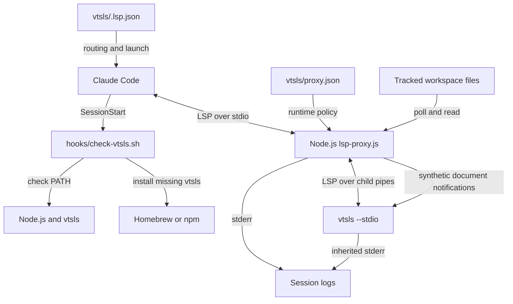

# VTSLS Language Server Integration

## Purpose and system context

The `vtsls_language_server` module connects Claude Code to the VTSLS
TypeScript/JavaScript language server. Packaged as the `vtsls` plugin, it
registers supported file extensions, checks runtime prerequisites at session
start, and launches `vtsls --stdio` through a Node.js LSP proxy.

The integration provides transport compatibility and keeps tracked server
buffers current after out-of-band filesystem edits. VTSLS owns language
analysis, project loading, diagnostics, and language-feature results. The
proxy does not type-check code or synthesize diagnostics. This module belongs
to the wider [language intelligence integration][parent] layer.

## Architecture



The session hook and LSP launcher are separate host entry points. The hook
checks or installs prerequisites; it does not launch the server. The proxy
loads configuration and spawns the child with piped stdin/stdout and inherited
stderr, without a shell or working-directory override.

### Sub-module documentation

These are logical divisions of one plugin, not independently deployed
services. Protocol handling and document lifecycle share one JavaScript
process, its child pipes, and the `openDocs` map.

| Detailed guide | Main responsibilities |
| --- | --- |
| [Setup and registration][setup] | File routing, prerequisites, installation. |
| [Protocol transport][protocol] | Framing, compatibility replies, supervision. |
| [Document lifecycle][lifecycle] | Buffers, disk sync, versions, optional warmup. |

The [setup guide][setup] covers `.lsp.json` and `check-vtsls.sh`. The
[protocol guide][protocol] documents `writeMessage`, `drainBuffer`,
`drainServerBuffer`, and `autoAckResult`. The [lifecycle guide][lifecycle]
covers `toPath`, `statOf`, `sameStat`, `trackOpen`, `reconcileClientChange`,
`pollOpenDocs`, `findFiles`, and `warmupServer`.

## Effective VTSLS configuration

`vtsls/.lsp.json` registers one server entry named `typescript`. That entry
routes all eight extensions; the entry name does not restrict it to `.ts`.

| Extensions | LSP language ID |
| --- | --- |
| `.ts`, `.mts`, `.cts` | `typescript` |
| `.tsx` | `typescriptreact` |
| `.js`, `.mjs`, `.cjs` | `javascript` |
| `.jsx` | `javascriptreact` |

The launcher uses the host-expanded `${CLAUDE_PLUGIN_ROOT}`:

```sh
node "${CLAUDE_PLUGIN_ROOT}/lsp-proxy.js" \
  --config "${CLAUDE_PLUGIN_ROOT}/proxy.json"
```

The inspected `vtsls/proxy.json` contains:

```json
{
  "server": ["vtsls", "--stdio"],
  "blocked": []
}
```

Combined with defaults in `vtsls/lsp-proxy.js`, the effective policy is:

- Resolve `vtsls` through `PATH` and launch it with `--stdio`.
- Block no client methods. Unsupported-method errors from VTSLS are not
  globally filtered or rewritten.
- Perform no proxy-driven workspace warmup. The shared discovery functions
  exist, but no `warmup` section enables them for this plugin.
- Enable disk synchronization with a 300 ms polling interval because `sync`
  is omitted. A nonzero numeric `sync.pollMs` is clamped to at least 50 ms;
  omission or zero uses 300 ms. Setting `"sync": false` disables polling and
  client-change reconciliation, but retains open/close tracking and
  duplicate-open translation.
- Auto-answer four fixed server-request methods independently of
  `blocked`: `client/registerCapability`, `client/unregisterCapability`,
  `workspace/configuration`, and `window/workDoneProgress/create`.
  Configuration receives one `null` array element per requested item; the
  other methods receive `null`.

Auto-acknowledgment prevents waits on unsupported client handlers. It does
not implement dynamic capability registration, configuration lookup, or a
progress UI. Other requests, responses, errors, and diagnostic notifications
pass through normally. See [protocol transport][protocol] for the precise
routing order and frame-preservation rules.

## Runtime interactions

```mermaid
sequenceDiagram
    participant Host as Claude Code
    participant Proxy as Node proxy
    participant Server as VTSLS
    participant Disk as Workspace filesystem
    Host->>Proxy: initialize
    Proxy->>Server: Forward initialize
    Server-->>Proxy: Result with capabilities
    Proxy-->>Host: Forward result
    Host->>Proxy: initialized
    Proxy->>Server: Forward initialized; no configured warmup
    opt VTSLS requests client configuration
        Server->>Proxy: workspace/configuration with items
        Proxy->>Server: Matching array of null results
    end
    Host->>Proxy: didOpen with text, language ID, and version
    Note over Proxy: Track buffer, local path, version, and stat
    Proxy->>Server: Forward didOpen
    Server-->>Proxy: publishDiagnostics when produced
    Proxy-->>Host: Forward diagnostics unchanged
    Note over Disk: Shell, Git, or formatter edits a tracked file
    Proxy->>Disk: Poll detects changed metadata
    Proxy->>Disk: Next stable poll reads UTF-8 content
    Proxy->>Server: Full-text didChange at next version
    Proxy->>Server: didSave
    Server-->>Proxy: Subsequent server results or diagnostics
    Proxy-->>Host: Forward unchanged
    Host->>Proxy: Later client didChange
    Proxy->>Server: Forward, rebasing version if needed
```

The proxy sends synthetic synchronization notifications only to the server.
It does not write workspace files, update Claude Code's buffer, or advance
the client's own version counter. Subsequent server analysis and diagnostic
publication remain VTSLS responsibilities.

Because warmup is absent, enrollment normally starts with client
`textDocument/didOpen` notifications. Polling is not a workspace-wide watcher:
never-opened files and newly created, untracked files are not discovered by
the proxy. VTSLS can independently load project files; that does not enroll
them in the proxy's map.

## Document synchronization contract

The [document-lifecycle guide][lifecycle] explains the state transitions and
version formulas. The key integration guarantees and limits are:

- `trackOpen` records the last known buffer text, server-facing version,
  language ID, file path, metadata, and lifecycle flags. Non-file URIs can be
  tracked and forwarded but are not polled on disk.
- `pollOpenDocs` compares `mtimeMs`, `ctimeMs`, `size`, and `ino`. A changed
  tuple arms an update; the same tuple on the next poll permits a file read.
  Text identical to the known buffer causes no injected notification.
- Divergent disk text produces a full-document `textDocument/didChange`
  followed by `textDocument/didSave`. Client full-text changes update the
  same state, so a matching client disk write is a no-op.
- Client versions that do not exceed the tracked server-facing version are
  rebased before forwarding. The client remains unaware of injected changes.
- Range-based client changes are forwarded but not applied locally. Polling
  pauses for a document whose final text is unknown, including deletion
  handling. A later full-text replacement restores synchronization. Change
  batches are evaluated in order: a trailing full-text replacement can make
  the buffer known again.
- Two consecutive failed stat checks cause a synthetic `didClose`, retaining
  the entry for recovery. Stable reappearance reopens it with disk content;
  a full-text client edit can also reopen it. A client `didClose` removes
  tracking entirely and is swallowed if the proxy already closed the URI.
- A client open for an already-open URI becomes a full-text change rather
  than a second `didOpen`, preserving increasing server-facing versions.

At the default interval, a settled edit is normally propagated after roughly
one to two polls, plus filesystem, event-loop, and server processing time.
The stability gate is best-effort, not an atomic-read guarantee or a bound on
diagnostic latency. Stat failures are treated as absence, and rare metadata
collisions on coarse filesystems can hide edits. Synchronous polling costs
grow with the number of tracked documents.

The proxy does not merge concurrent edits or preserve unsaved client text
against later divergent disk content. It is not a general buffer conflict
resolver. Optional discovery, warmup language-ID rules, and recovery edge
cases are documented in [document lifecycle][lifecycle]; those discovery
rules are dormant under the shipped VTSLS configuration.

## Setup and operational boundaries

`vtsls/hooks/hooks.json` invokes
`bash ${CLAUDE_PLUGIN_ROOT}/hooks/check-vtsls.sh` at `SessionStart`, with a
60-second host timeout. The script checks for `node` before accepting an
existing `vtsls`. It neither installs Node nor checks runtime versions.

When VTSLS is missing, the hook selects `brew install vtsls` if Homebrew is
available; otherwise it selects `npm install -g @vtsls/language-server` if
npm is available. This is availability-based selection, not an OS test. The
npm branch is a fallback for missing Homebrew, not a retry after a failed
Homebrew install. Neither installation method pins the server version.

Installation uses method-wide `/tmp/claude-lsp-brew.lock` or
`/tmp/claude-lsp-npm.lock` locks shared with other installers using the same
method. `flock` is preferred; otherwise an atomic `mkdir` loop waits in
2-second increments and an `EXIT` trap removes the lock directory. Each
critical section rechecks `PATH` to avoid duplicate installation.

The 120-second lock-wait budget exceeds the host's 60-second hook timeout.
Contention or installation can therefore be interrupted before the script's
own wait completes. The hook does not modify `PATH`, and its final check
requires `vtsls` to be discoverable in the current environment. Preinstall
Node and VTSLS for predictable session startup. Installation flow, lock
cleanup limits, and troubleshooting belong to [setup and registration][setup].

Proxy logs use stderr with prefix `[lsp-proxy:vtsls]`; early configuration
errors use `[lsp-proxy]`. VTSLS inherits stderr, while proxy stdout carries
client-facing LSP traffic. Missing or unreadable configuration, an invalid
`server` array, or child spawn errors terminate with status 1. Client stdin
EOF sends `SIGTERM` to the child; received `SIGTERM` and `SIGINT` are
forwarded. There is no automatic restart or forced-kill escalation. See
[protocol transport][protocol] for exit-status and shutdown behavior.

## Packaging and maintenance

`.claude-plugin/marketplace.json` distributes `./vtsls`, and
`vtsls/.claude-plugin/plugin.json` identifies the plugin as version 1.1.0.
That is an integration version, not a pin on `@vtsls/language-server`.

Each marketplace plugin carries a real copy of the unified proxy because
plugin directories are installed independently. The consistency tests require
these copies to be byte-identical. Keep VTSLS-specific policy in
`vtsls/proxy.json`; propagate changes to shared JavaScript across every
plugin copy instead of introducing a VTSLS-only fork. The proxy uses Node
standard-library APIs and requires no npm dependency installation or
compilation step of its own.

Sibling integrations use the same wrapper with different runtime policies:

- [Bash language server](bash_language_server.md).
- [CUE language server](cue_language_server.md).
- [Pyright language server](pyright_language_server.md).
- [Regal language server](regal_language_server.md).

## Validation

Run the canonical repository test entry point from the repository root:

```sh
make test
```

`Makefile` delegates to `bash tests/run.sh`. The harness requires `node`,
`bash`, `jq`, and `shellcheck` and derives plugin membership from marketplace
metadata. Relevant checked-in coverage includes:

- `tests/cases/01-manifests.sh` and `tests/cases/02-consistency.sh`: manifest
  checks, safe launcher paths, installer/server agreement, hook targets,
  and byte-identical proxy copies.
- `tests/cases/03-installer-lint.sh`,
  `tests/cases/04-installer-behavior.sh`, and
  `tests/cases/05-installer-concurrency.sh`: syntax/lint checks and mocked
  VTSLS no-op, Homebrew, npm, npm-failure, missing-manager, and concurrent
  Homebrew installation scenarios. Missing-Node and `mkdir`-fallback checks
  exercise equivalent guards in sibling installers, not dedicated VTSLS cases.
- `tests/cases/06-proxy.sh` and `tests/cases/07-warmup.sh`: shared transport,
  acknowledgment, blocking, synchronization, version-rebasing, deletion,
  reopening, and warmup behavior. `tests/helpers/proxy-suite.js` exercises
  other byte-identical plugin copies with stub servers; these are not all
  VTSLS-specific live tests.
- `tests/cases/08-live.sh` and `tests/helpers/live-suite.js`: optional
  `live/vtsls-clean` and `live/vtsls-broken` scenarios, registered only when
  `vtsls` is on `PATH`. Both explicitly open a TypeScript file and include
  `tests/fixtures/vtsls/tsconfig.json`. The clean case permits no diagnostic
  publication but checks process liveness; the broken case requires a
  matching type-error diagnostic. There is no dedicated live VTSLS disk-edit
  scenario in that registration file.

`.github/workflows/test-gate.yml` runs `make test` in separate Linux and
macOS jobs with Node 24.22.0 and requires successful, non-empty execution from
both. That CI pin is not a runtime minimum enforced by the hook. A green gate
does not establish that optional live VTSLS tests ran. This documentation
reflects source inspection, not a test run performed during its generation.

Repository-wide procedures are documented separately:

- [Build and configuration][build].
- [Development environment bootstrap][bootstrap].
- [Continuous integration][ci].

## Source map

- `vtsls/.lsp.json`: host launcher and extension-to-language routing.
- `vtsls/proxy.json`: actual child command and runtime policy.
- `vtsls/hooks/hooks.json`: session-start command and host timeout.
- `vtsls/hooks/check-vtsls.sh`: prerequisites, installation, and locking.
- `vtsls/lsp-proxy.js`: framing, child supervision, compatibility replies,
  document tracking, synchronization, and optional warmup.
- `vtsls/.claude-plugin/plugin.json` and
  `.claude-plugin/marketplace.json`: plugin identity and distribution.

[setup]: vtsls_language_server/vtsls_language_server_setup.md
[protocol]: vtsls_language_server/vtsls_language_server_protocol.md
[lifecycle]: vtsls_language_server/vtsls_language_server_document_lifecycle.md

[parent]: ../language_intelligence_integration.md
[build]:
  ../engineering_platform_and_validation/repository_build_and_configuration.md
[bootstrap]:
  ../engineering_platform_and_validation/development_environment_bootstrap.md
[ci]: ../engineering_platform_and_validation/continuous_integration.md
