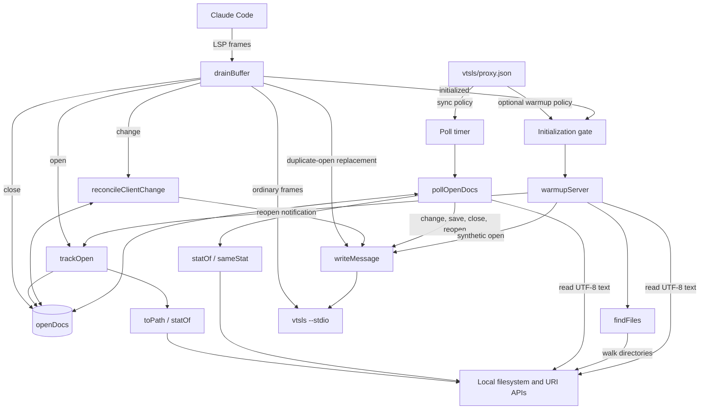
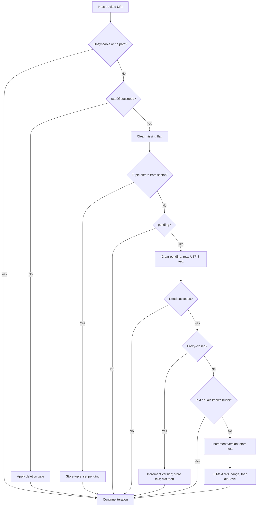
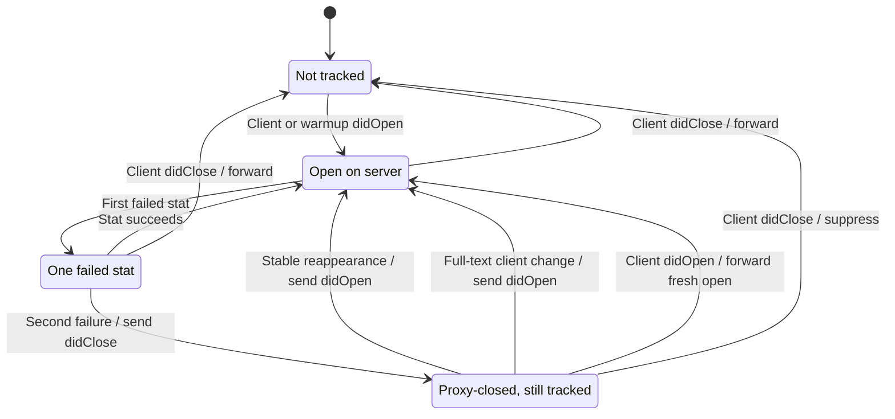
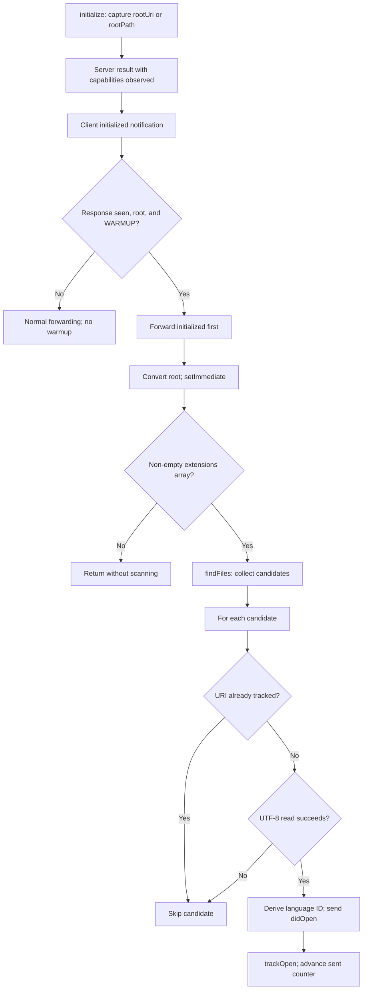

# VTSLS Language Server Document Lifecycle

The `vtsls_language_server_document_lifecycle` module keeps tracked VTSLS
buffers consistent with client notifications and out-of-band filesystem
changes. It observes document opens, changes, and closes; reconciles
server-facing versions; and injects document notifications when a tracked
file changes, disappears, or reappears on disk.

These are file-scoped helpers in `vtsls/lsp-proxy.js`, not a separate package
or language analyzer. VTSLS remains responsible for project loading,
TypeScript/JavaScript analysis, and diagnostics. The proxy updates server
buffers; it neither writes workspace files nor changes Claude Code's buffer.

Related documentation defines the surrounding boundaries:

- [VTSLS integration][integration] describes the plugin and system context.
- [Setup and registration][setup] covers launch configuration, prerequisites,
  and extension-to-language routing.
- [Protocol transport][protocol] covers LSP framing, compatibility replies,
  message routing, and child-process supervision.

## Effective VTSLS behavior

`vtsls/.lsp.json` launches the Node proxy with
`${CLAUDE_PLUGIN_ROOT}/proxy.json`. The inspected `vtsls/proxy.json` selects
`["vtsls", "--stdio"]` as the child command and contains no `sync` or `warmup`
section. Defaults in `vtsls/lsp-proxy.js` therefore produce this policy:

| Concern | Effective behavior |
| --- | --- |
| Disk synchronization | Enabled, polling every 300 ms. |
| Workspace warmup | Disabled; no proxy-driven file discovery. |
| Document enrollment | Normally begins with a client `didOpen`. |
| File selection for polling | All tracked, syncable local-file URIs. |
| Never-opened workspace files | Not discovered or polled by the proxy. |

VTSLS may load additional project files independently. That does not enroll
those files in the proxy's `openDocs` map. The registration's supported
extensions also do not act as a disk-sync filter: synchronization follows
tracked URIs, not a workspace extension scan.

### Synchronization configuration

Only the literal value `"sync": false` disables disk synchronization.
Otherwise the interval is calculated as follows:

```javascript
Math.max(50, config.sync?.pollMs || 300)
```

For numeric settings, omission or zero selects 300 ms; a nonzero value below
50 ms is clamped to 50 ms. Configuration is loaded once at process startup,
not watched for changes.

Disabling synchronization stops the poll timer and skips client
`didChange` reconciliation, including version rebasing. It does **not**
disable open/close bookkeeping, duplicate-open translation, or optional
warmup deduplication. Warmup has its own independent configuration gate.

## Architecture and dependencies



Lifecycle logic shares the `openDocs` map, `child.stdin`, and `writeMessage`
with the protocol layer. A rebased client change is returned to
`drainBuffer` as a complete replacement frame; synthetic notifications are
written directly to the server. Neither path echoes those updates to the
client. Server diagnostics continue through normal protocol forwarding.

The eight lifecycle helpers have these responsibilities:

| Helper | Responsibility |
| --- | --- |
| `toPath` | Convert a usable file URI to a local path. |
| `statOf` | Read the metadata tuple or return `null`. |
| `sameStat` | Compare two non-null metadata tuples. |
| `trackOpen` | Create or replace one tracked document entry. |
| `reconcileClientChange` | Mirror text, rebase versions, or reopen. |
| `pollOpenDocs` | Detect stable disk changes and update the server. |
| `findFiles` | Collect warmup files with an iterative directory walk. |
| `warmupServer` | Open discovered files and enroll them in tracking. |

The implementation uses Node standard-library dependencies only:

- `node:fs`: synchronous `statSync`, `readFileSync`, and `readdirSync`.
- `node:path`: `join` and `extname` for discovery and language selection.
- `node:url`: `fileURLToPath` and `pathToFileURL` for URI conversion.
- `Buffer`, timers, and the child pipe supplied by the surrounding proxy.

There is no filesystem watcher, content-hashing service, external state
store, or independently deployed lifecycle worker.

## Tracked document state

`openDocs` is a process-local `Map` keyed by the exact document URI string.
Each value records the last known **buffer** state, not merely the latest
disk contents.

| Field | Meaning |
| --- | --- |
| `version` | Latest tracked server-facing document version. |
| `text` | Last reconstructable full buffer text. |
| `languageId` | Language ID retained for later synthetic opens. |
| `path` | Local filesystem path, or `null`. |
| `stat` | Last sampled metadata tuple, or `null`. |
| `pending` | A changed tuple is waiting for a stable follow-up poll. |
| `missing` | One failed stat has armed the deletion gate. |
| `closed` | The proxy has closed the server buffer after disappearance. |
| `unsyncable` | Incremental changes have made the full buffer unknown. |

### URI and metadata helpers

`toPath(uri)` accepts a URI beginning with `file:` and delegates conversion
to `fileURLToPath`. Unsupported schemes and conversion failures return
`null`. Such documents can still be tracked, reconciled, and forwarded;
they are simply skipped by disk polling.

Map keys are not canonicalized by real path or filesystem identity. Warmup
uses `pathToFileURL(filePath).href`, so deduplication depends on matching URI
strings, not on detecting aliases for the same underlying file.

`statOf(path)` returns the following fields from `statSync`:

| Field | Detection role |
| --- | --- |
| `mtimeMs` | Detect ordinary content modification. |
| `ctimeMs` | Detect metadata changes, including restored modification time. |
| `size` | Detect file-length changes. |
| `ino` | Detect many atomic write-and-rename replacements. |

`ctimeMs` is the filesystem status-change time, not a creation timestamp.
`sameStat(a, b)` considers tuples equal only when both exist and all four
fields match exactly. Two absent tuples do not compare as equal.

All stat errors become `null`, without distinguishing deletion from
permission or other filesystem failures. Normal `statSync` semantics also
mean tracked paths can follow symbolic links, unlike the descendant-entry
selection used during warmup discovery.

### Enrollment with trackOpen

`trackOpen(uri, text, version, languageId)` replaces any existing map entry.
It records a numeric version unchanged, otherwise defaults to `1`; a nullish
text defaults to `''`, and a missing/falsy language ID to `plaintext`.
It derives `path`, samples `stat`, and initializes all four lifecycle flags
to `false`.

Enrollment does not read or compare disk text. An initial difference between
the supplied buffer and disk is therefore not itself an injection trigger:
polling first needs a metadata change from the recorded baseline.

Tracking remains active with `"sync": false` because the map also prevents
warmup from opening a URI that the client already opened.

## Client document lifecycle

`drainBuffer` observes lifecycle messages before ordinary forwarding and
configured method blocking. The supplied VTSLS configuration blocks no
methods. The [protocol guide][protocol] owns the full routing order.

### Opens and duplicate opens

A client `textDocument/didOpen` for an untracked URI, or one marked
`closed`, calls `trackOpen` and follows the ordinary forwarding path. This
is a fresh open: its initial version comes from the client, rather than
continuing the retained entry's counter.

For an already-open tracked URI, forwarding another `didOpen` would open the
same server buffer twice. Instead, the proxy:

1. Adopts the client's full text and supplied language ID, if present.
2. Chooses `max(numeric client version or 0, tracked version + 1)`.
3. Refreshes metadata and clears `pending`, `missing`, and `unsyncable`.
4. Sends one full-text `textDocument/didChange` to the server.
5. Consumes the original open frame without sending `didSave`.

This handles both warmup/client race orders:

- If the client opens first, later warmup skips its URI.
- If warmup opens first, the later client open becomes a change and makes
  the client's buffer authoritative without a second server-side open.

The same translation applies to repeated client opens even without warmup
or disk synchronization enabled.

### Reconstructing client changes

With synchronization enabled, a tracked client `didChange` is passed to
`reconcileClientChange(msg, rawMessage)`. Untracked changes pass through
unchanged and do not create a tracking entry.

The helper scans `params.contentChanges` **in order**. A reconstructable
full-document replacement has `c.range === undefined` and a string `text`
(`typeof c.text === 'string'`). Range-based changes are forwarded but are
not applied to a local text buffer.

| Ordered batch | Resulting text knowledge |
| --- | --- |
| Full-text replacement | Known; update `st.text`. |
| Incremental change | Unknown; mark `unsyncable`. |
| Incremental, then full text | Known again; synchronization can resume. |
| Full text, then incremental | Unknown; synchronization is suspended. |
| Empty or non-array changes | Leave text and syncability unchanged. |

Other unrecognized entries follow the unknown-text path. If the final text
is unknown, the retained `text` must not be treated as the current buffer.
The `unsyncable` flag prevents the poller from making that mistake.

Transitioning into the unsyncable state logs once. A later reconstructable
full-text change clears the flag and logs that disk-sync is re-enabled.
An already-open client's full-text `didOpen` also restores known text.
A `didSave` alone does not restore it.

While `unsyncable` is true, **all polling for that URI is skipped**, including
deletion and reappearance handling. Client changes still pass through the
version-reconciliation path.

### Server-facing version reconciliation

Injected changes advance the server's version without advancing the
client's own counter. Subsequent client changes must not move the server
backward. For an ordinary tracked change, let `v` be the tracked version
and `c` the incoming version:

| Condition | Result |
| --- | --- |
| Numeric `c > v` | Record `c`; forward the original frame. |
| Numeric `c <= v` | Record `v + 1`; forward a rebased frame. |
| Missing or nonnumeric `c` | Record `v + 1`; forward a rebased frame. |

Rebasing preserves the parsed message's other fields, replaces
`params.textDocument.version`, serializes it, and recalculates framing.
Byte-preservation details belong to [protocol transport][protocol].

Other version rules are:

- A divergent disk edit increments the tracked version by one.
- Stable disk reappearance increments the retained version by one.
- A full-text client change on a proxy-closed URI reopens at
  `max(numeric client version or 0, tracked version + 1)`.
- A proxy-generated close does not increment the version.
- Fresh client opens use the enrollment rule described above.

For a tracked change, `reconcileClientChange` returns the original frame,
a newly framed `Buffer`, or `null`. The last case means it has already sent
a replacement `didOpen` for a proxy-closed document. The original change
must not also be forwarded.

```mermaid
sequenceDiagram
    participant C as Claude Code
    participant P as Lifecycle proxy
    participant D as Filesystem
    participant S as VTSLS
    C->>P: didOpen, version 1, text A
    P->>S: Forward didOpen, version 1
    Note over D: Out-of-band write changes A to B
    P->>D: Poll 1 detects a changed tuple
    Note over P: Store tuple; pending = true
    P->>D: Poll 2 sees same tuple; read B
    P->>S: Full-text didChange, version 2, text B
    P->>S: didSave, URI only
    C->>P: didChange, client version 2, full text C
    Note over P: Update known text; rebase 2 to 3
    P->>S: didChange, version 3, text C
    C->>D: Matching client disk write of C
    P->>D: Detect metadata change; wait one stable tick
    Note over P: Disk text equals known buffer: no injection
```

The sequence illustrates notification reconciliation, not conflict merging.
The proxy does not inform the client about synthetic changes or rebased
versions. These guarantees depend on enabled reconciliation and tracked
state; `"sync": false` bypasses the client-change version logic.

### Client closes

A client `textDocument/didClose` always removes the URI from `openDocs`.
Normally its frame is forwarded. If the retained entry was already marked
`closed`, the frame is consumed to avoid closing the server buffer twice.

Once removed, a later disk edit or reappearance cannot reenroll the URI.
A new client open, or a later explicitly triggered warmup scan, is needed.
Client `didSave` messages are otherwise ordinary forwarded traffic: they
do not update tracked text, version, or metadata.

## Disk synchronization process

`pollOpenDocs()` iterates over the tracked map. It skips unsyncable entries
and entries without a local path. The timer is created when synchronization
is enabled, is unreferenced so it does not alone keep the process alive,
and is cleared on child exit, client stdin EOF, or forwarded shutdown
signals. Process shutdown is detailed in [protocol transport][protocol].

### Stability gate and notification generation

For an existing file, a metadata change records the new tuple and sets
`pending = true`. No content is read or injected on that observation.
Another poll must see the same tuple before the pending read is allowed.
Further tuple changes keep postponing the read.



A successful stable read has three outcomes:

- A proxy-closed entry is reopened with disk text and its retained language
  ID, regardless of whether that text equals the previous buffer.
- An open entry whose disk text equals `st.text` produces no notification
  and no version increment. This suppresses touches, identical rewrites,
  and disk writes that match a mirrored client edit.
- Divergent disk text updates `st.text`, advances the version, and produces
  `textDocument/didChange` followed by `textDocument/didSave`.

The injected change uses `contentChanges: [{ text }]`, with no range.
The injected save contains only `textDocument: { uri }`, not the text or a
version. All generated notifications have `jsonrpc: '2.0'` and no request ID.
They are sent directly to `child.stdin`; the proxy does not wait for
analysis or a diagnostic acknowledgment.

At the default interval, a settled edit is normally propagated after
roughly 300-600 ms, plus filesystem and event-loop delays. This is neither
a hard latency bound nor a guarantee about when VTSLS publishes diagnostics.

### Deletion and reappearance

A failed stat uses a separate two-observation gate:

1. On the first failure, set `missing = true` and wait.
2. On another consecutive failure, clear `missing` and `pending`, set
   `closed = true`, reset `stat = null`, and send one synthetic `didClose`.
3. While the entry remains closed and absent, send no further closes.
4. On reappearance, store the new tuple and arm `pending`.
5. After a stable follow-up poll, read disk text and send `didOpen` at the
   next retained version, then resume ordinary synchronization.

The close is intended to let VTSLS discard its open buffer and associated
diagnostics. Actual diagnostic publication or clearing remains server
behavior; the proxy does not synthesize an empty diagnostic result.

A simplified lifecycle view is:



`pending` and `unsyncable` are orthogonal flags omitted from this diagram.
Poll-driven transitions require synchronization, a local path, and a known
full buffer. A successful stat resets the first-failure flag, so a transient
single failure does not itself close a document.

### Client edits after a proxy-generated close

The client may still consider a deleted file open. A reconstructable
full-text `didChange` on that URI is converted into a synthetic `didOpen`
using the client's text and the retained language ID. This path clears
`closed`, `missing`, and `pending`, refreshes metadata, and consumes the
original change. It does not send a save or write the file to disk.

Reopening does not require the file to exist. If it remains absent,
subsequent polls can close it again after the deletion gate.

An incremental-only change cannot supply the text needed to reopen. It is
still forwarded, with version rebasing if necessary, and makes the entry
unsyncable. It can therefore reach a server that considers the URI closed;
recovery needs full text or a fresh client open, not another disk poll.

## Optional workspace warmup

**Warmup is dormant in the shipped VTSLS configuration.** Its helpers are
part of the shared proxy, not evidence that VTSLS currently scans the
workspace through this mechanism or requires synthetic opens to index.

If explicitly enabled, warmup opens matching workspace files and enrolls
them in the same map as client-opened documents. This can make otherwise
unopened files eligible for disk synchronization.

### Initialization gate

The surrounding protocol code captures
`rootUri = params.rootUri || params.rootPath || null` from `initialize`.
After observing a server result with truthy `capabilities`, a subsequent
`initialized` can schedule warmup when both a root and `WARMUP` exist.
`workspaceFolders` is not used as an alternative discovery root.



A `file://` root is converted with `fileURLToPath`; otherwise the captured
root is used directly as a path. Unlike `toPath`, this root conversion is
not protected by a local catch. Initialization inputs should be valid.
`setImmediate` orders the warmup burst after the initialized write; it does
not confirm that the server has processed initialization.

There is no once-only latch or continuous discovery timer. Another
qualifying `initialized` can schedule another scan, while an early
`initialized` that fails the gate is not queued for retry. Exact protocol
gate and response-detection details are in [protocol transport][protocol].

### Discovery with findFiles

`findFiles(rootDir, extensions, excludeDirs)` returns an array of matching
paths. It uses a stack instead of recursive JavaScript calls, avoiding call
stack depth limits while still doing all filesystem work synchronously.

Its selection rules are deliberately simple:

- Extensions are exact, case-sensitive matches against `extname(entry.name)`.
  A configured `.ts` also matches a filename such as `types.d.ts`.
- Exclusions are exact entry names at any depth, not globs or full paths.
  The check occurs before the type test, so matching file names are also
  skipped, despite the `excludeDirs` parameter name.
- Only directory entries reported as directories are traversed, and only
  entries reported as regular files are selected. Descendant symbolic-link
  entries are neither followed nor selected.
- Unreadable directories are skipped silently. No sorting is applied.
- Hidden directories, dependencies, build outputs, and ignored files have
  no implicit exclusion. The function does not consult `.gitignore`,
  TypeScript project configuration, or `.lsp.json` routing.

For example, this is an **opt-in customization**, not the checked-in policy:

```json
{
  "server": ["vtsls", "--stdio"],
  "blocked": [],
  "sync": { "pollMs": 300 },
  "warmup": {
    "extensions": [".ts", ".js"],
    "exclude": ["node_modules", ".git", "dist", "build"]
  }
}
```

Warmup is not a general new-file watcher. Files created after its scan are
not enrolled unless the client opens them or another scan is triggered.

### Opening discovered files

`warmupServer(rootDir)` returns immediately unless `WARMUP.extensions` is
a non-empty array. For each discovered path, it constructs a file URI,
skips an already-tracked URI, reads UTF-8 text, derives a language ID, sends
`didOpen`, and calls `trackOpen` with exactly that text and version.
Unreadable files are skipped without aborting the burst.

A local counter starts at version `0` and increments only after each sent
open. Thus different files receive successive initial versions; they do
not all start at zero. Later synchronization versions are tracked per URI.
The initial counter restarts for each invocation, and traversal order is
not guaranteed.

Warmup uses a hard-coded language map rather than `.lsp.json` mappings.
For VTSLS, this distinction matters:

| Extensions | Warmup language ID |
| --- | --- |
| `.ts` | `typescript` |
| `.js` | `javascript` |
| `.tsx`, `.jsx` | Fallback `tsx`, `jsx`. |
| `.mts`, `.cts` | Fallback `mts`, `cts`. |
| `.mjs`, `.cjs` | Fallback `mjs`, `cjs`. |

The remaining built-ins map `.rego`, `.py`, `.cue`, `.sh`, `.yml`, `.yaml`,
and `.swift` to their corresponding language IDs in the shared source.
Any unmapped extension falls back to `ext.slice(1)`. In particular, simply
adding React or module suffixes to a warmup configuration does **not**
produce the registration's `typescriptreact`, `javascriptreact`,
`typescript`, or `javascript` IDs. See [setup and registration][setup] for
the client routing mappings before extending warmup behavior.

Warmup still tracks opens when `"sync": false`, but no disk polling follows.
There is no automatic close at the end of the burst.

## Consistency limits and operational behavior

### Synchronization is not conflict resolution

Full-text client notifications immediately update the known buffer, and a
matching disk write is a no-op. A later divergent, stable disk write is
nevertheless injected into the server. There is no merge, dirty-buffer
protection, edit-origin tracking, or feedback to update the client's text.

Incremental edits are not applied locally, and the proxy does not negotiate
a different synchronization mode to reconstruct them. Document versioning
prevents backward server-facing counters; it does not resolve conflicting
content or guarantee fresh diagnostics for every request.

### Metadata sampling and read failures

The stability gate is best-effort, not an atomic snapshot or file lock.
A writer can pause longer than one interval or change a file between the
stat and read. Repeatedly changing metadata can postpone injection
indefinitely.

The four-field tuple catches more cases than modification time and size
alone, but a same-size in-place rewrite within the same timestamp quantum
can still collide on coarse filesystems. There is no content hash on every
tick, so an edit that leaves the tuple unchanged does not trigger a read.

`pending` is cleared **before** attempting a stable read. If that read
fails, no notification is emitted and an unchanged tuple does not
immediately retry; another metadata change is needed to arm a new read.
By contrast, stat failures enter the deletion gate and can close the
server buffer even when the underlying problem is access rather than
actual removal.

### Resource and lifecycle boundaries

Polling performs synchronous filesystem calls for eligible tracked entries.
Costs grow with map size and file size; there is no worker pool, scan limit,
file-size cap, or warmup throttling. Warmup first collects all candidate
paths and then reads and sends their contents, potentially delaying other
protocol work on a large tree.

Proxy-closed entries retain their text, version, path, and language ID for
recovery until a client close removes them or the process exits. Their
sampled `stat` is reset to `null`. There is no cross-process persistence or
automatic eviction of those entries.

### Logs and troubleshooting

Proxy lifecycle logs go to stderr with prefix `[lsp-proxy:vtsls]` under the
shipped command. Useful messages include:

- `incremental didChange ...; disk-sync disabled for it`: full text is
  unknown; send a reconstructable full-text change or a new client open.
- `disk-sync re-enabled ... (full-text didChange)`: polling can resume.
- `disk-sync: injected didChange ... vN`: a divergent disk read was sent.
- `disk-sync: rebased client didChange ...`: normal recovery from a lagging
  client counter, not itself evidence of conflicting text.
- `disk-sync: closed ... (file deleted)` and `disk-sync: reopened ...`:
  deletion/recovery transitions; remember that stat errors count as absence.
- `translated client didOpen -> didChange ...`: duplicate-open protection.
- `warmup: no files found`, `warmup: opening N file(s) for indexing`, and
  `warmup: sent M didOpen notification(s)`: optional discovery progress.
  `N` counts discovered candidates; `M` can be smaller after deduplication
  or read failures.

For stale results, first check that the exact URI is enrolled, disk-sync is
enabled, and the document has not become unsyncable or been client-closed.
No warmup output is expected with the checked-in VTSLS configuration.
Identical-content writes intentionally produce no injected-change log.
Server-side analysis and diagnostic behavior require separate investigation
once the expected document notifications have reached VTSLS.

## Validation and maintenance

Run the repository's canonical validation entry point from its root:

```sh
make test
```

`Makefile` delegates to `bash tests/run.sh`; the runner requires `node`,
`bash`, `jq`, and `shellcheck`. Relevant source-level test coverage is
organized as follows:

- `tests/cases/06-proxy.sh` and `tests/helpers/proxy-suite.js` cover disk-edit
  injection, mirrored client changes, incremental suspension and full-text
  recovery, identical-content no-ops, client closes, disabled sync, tracked
  warmup opens, deletion/reappearance, version rebasing, and both
  warmup/client-open race orders.
- `tests/cases/07-warmup.sh` and `tests/helpers/warmup-suite.js` cover
  discovery/exclusions, initialized-before-open ordering, empty trees,
  absent warmup configuration, and multiple configured extensions.
- `tests/cases/02-consistency.sh` enforces consistent launch wiring and
  byte-identical copies of the unified proxy across marketplace plugins.

The proxy suites exercise byte-identical sibling copies with stub servers,
not the VTSLS copy against a live VTSLS process. For optional live checks and
repository-wide validation context, see [VTSLS validation][validation] and
[build and configuration][build]. This guide reflects source inspection;
no test run was performed while generating it.

Keep VTSLS-specific policy in `vtsls/proxy.json`. Changes to shared lifecycle
JavaScript must be propagated to every plugin's real `lsp-proxy.js` copy,
not implemented as a VTSLS-only fork. In particular, changes to discovery
language IDs, version formulas, or recovery behavior affect sibling
integrations as well.

[integration]: ../vtsls_language_server.md
[setup]: vtsls_language_server_setup.md
[protocol]: vtsls_language_server_protocol.md
[validation]: ../vtsls_language_server.md#validation
[build]:
  ../../engineering_platform_and_validation/repository_build_and_configuration.md
