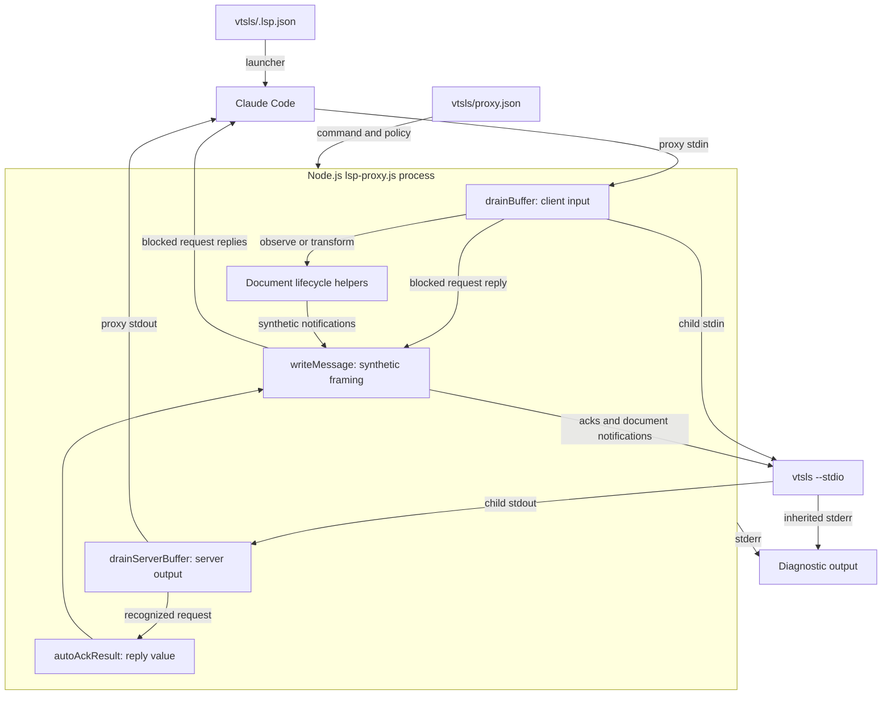
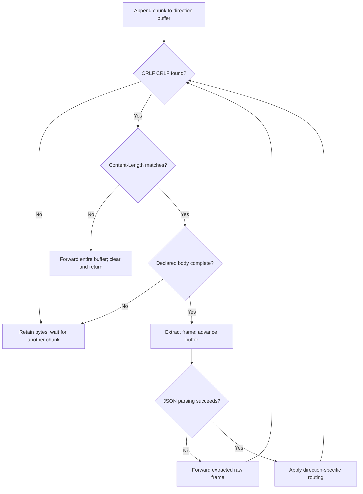
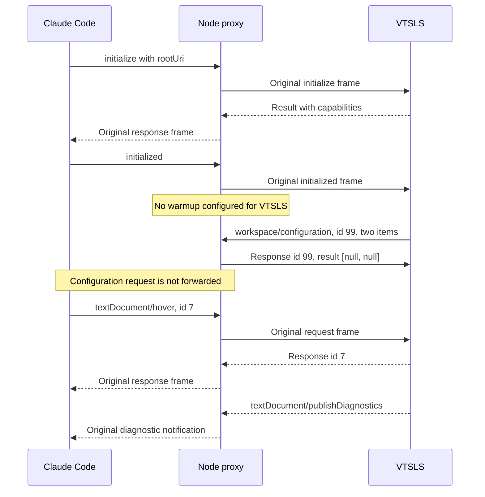

# VTSLS Language Server Protocol

The `vtsls_language_server_protocol` module is the transport and compatibility
layer in `vtsls/lsp-proxy.js`. It relays Language Server Protocol (LSP)
messages between Claude Code and VTSLS, answers selected requests locally,
and coordinates message forwarding with document-lifecycle tracking.
Ordinary traffic retains its original framed bytes unless an interception
or lifecycle transformation applies.

This is a logical module inside one Node.js executable, not an independent
package or a TypeScript analyzer. VTSLS owns language analysis, project
loading, diagnostics, and language-feature results.

Related guides describe the surrounding responsibilities:

- [VTSLS integration][integration] explains the plugin's system context.
- [Setup and registration][setup] covers prerequisites, installation, file
  routing, and the host's launch declaration.
- [Document lifecycle][lifecycle] covers buffer tracking, version rebasing,
  disk synchronization, deletion recovery, and optional workspace warmup.
- [Language intelligence integration][language-integration] describes the
  wider family of language-server plugins.

## Architecture and dependencies



The executable uses Node standard-library APIs only:

- `Buffer` supplies byte-oriented framing and stream accumulation.
- `node:child_process` supplies `spawn` for the real language server.
- `node:fs` and `node:path` support configuration loading and lifecycle work.
- `node:url` supports workspace and document URI conversion.

There is no external JSON-RPC library, socket transport, or compilation step
for the proxy. The child uses `stdio: ['pipe', 'pipe', 'inherit']`: stdin and
stdout carry LSP traffic, while stderr is inherited. Proxy-authored logs also
use stderr, leaving proxy stdout for client-facing protocol traffic.

### Effective VTSLS policy

`vtsls/.lsp.json` launches `node` with the plugin's `lsp-proxy.js`, `--config`,
and `${CLAUDE_PLUGIN_ROOT}/proxy.json`. The host expands the plugin-root
placeholder. The inspected `vtsls/proxy.json` contains:

```json
{
  "server": ["vtsls", "--stdio"],
  "blocked": []
}
```

Together with defaults in `vtsls/lsp-proxy.js`, this produces:

| Concern | Effective behavior |
| --- | --- |
| Child command | `vtsls --stdio`, resolved through `PATH`. |
| Client-method blocking | Inactive: the configured list is empty. |
| Server-request auto-ack | Active for four fixed methods. |
| Workspace warmup | Inactive: no `warmup` section is configured. |
| Disk synchronization | Active, using the default 300 ms poll interval. |

The child is spawned without a shell, environment override, or
working-directory override. Configuration is read once at startup. The proxy
does not learn unsupported methods from server errors, and an upstream
method-not-found error passes through unchanged under the shipped policy.

`blocked`, `warmup`, and `sync` control different mechanisms. Setting
`"sync": false` does not disable auto-acknowledgments or all document
bookkeeping. See [document lifecycle][lifecycle] for synchronization settings
and their precise effects.

## Core components and shared state

The four core functions are file-scoped helpers, not exported APIs:

| Function | Contract |
| --- | --- |
| `writeMessage(stream, body)` | Frame a serialized string or buffer. |
| `drainBuffer()` | Parse and route accumulated client input. |
| `drainServerBuffer()` | Parse and route accumulated server output. |
| `autoAckResult(msg)` | Return the result value for a local server reply. |

Their shared dependencies and state are:

- `buffer` accumulates client bytes; `serverBuffer` accumulates server bytes.
  Each direction handles its own stream chunk boundaries independently.
- `HEADER_DELIM` is the byte sequence `\r\n\r\n`.
  `CONTENT_LENGTH_RE` extracts a body length from the ASCII header.
- `BLOCKED_METHODS` contains configured client-method names.
  `SERVER_REQUESTS_AUTO_RESPOND` contains the fixed server-request names.
- `rootUri` records the workspace root from initialization;
  `initializeResponseSeen` records a server result with truthy `capabilities`.
- `openDocs` is shared with lifecycle helpers. Those helpers also use the
  child pipes and `writeMessage` to inject document notifications.
- `shuttingDown` distinguishes expected termination from an unexpected
  signal-based child exit. `pollTimer` is cleared during shutdown.

There is no general pending-request table, ID remapping, or capability
negotiation engine. Request/response correlation for relayed traffic remains
with Claude Code and VTSLS.

## LSP message framing

### Writing synthetic messages

`writeMessage(stream, body)` accepts an already serialized string or
`Buffer`. Callers construct JSON-RPC objects and call `JSON.stringify`
themselves. The implementation is:

```javascript
function writeMessage(stream, body) {
  const buf = Buffer.isBuffer(body) ? body : Buffer.from(body);
  stream.write(`Content-Length: ${buf.length}\r\n\r\n`);
  stream.write(buf);
}
```

`Content-Length` counts body bytes, not JavaScript characters. Strings become
UTF-8 bytes through `Buffer.from`, so non-ASCII text receives the correct byte
length. Generated framing uses CRLF line endings and an empty line before
the body. It adds neither a `Content-Type` header nor a trailing body newline.

The destinations are:

- `process.stdout` for synthesized replies to blocked client requests.
- `child.stdin` for server-request acknowledgments and synthetic document
  notifications.

The two writes are ordered, not an atomic transport operation. The helper
does not check the return value of `stream.write`, wait for `drain`, or
provide a delivery acknowledgment. Recipients must tolerate arbitrary chunk
boundaries even for locally generated frames.

### Reading frames incrementally

Each stream's `data` handler concatenates its chunk onto the corresponding
accumulator and invokes its drain function. Both directions use the same
framing algorithm:

1. Search for `HEADER_DELIM`. If absent, retain the bytes and return.
2. Decode the header as ASCII and apply
   `/^content-length:\s*(\d+)\s*$/im`.
3. Parse the length in base 10 and calculate body boundaries using byte
   offsets. If the declared body is incomplete, retain the bytes and return.
4. Extract the complete frame as `rawMessage`, extract its body, and advance
   the accumulator past that frame.
5. Decode the body as UTF-8 and attempt `JSON.parse`.
6. Apply direction-specific routing, then loop over any remaining frames.



This supports split headers, split bodies, and several messages in one
chunk. Header matching is case-insensitive and multiline. Other header fields
are not interpreted but survive raw forwarding. The delimiter must be CRLF
CRLF; LF-only framing is not normalized.

### Byte preservation and malformed input

Normal forwarding writes `rawMessage` directly. Parsing alone does not cause
reserialization: header spelling, additional headers, JSON whitespace, and
body bytes remain unchanged. Synthetic replies and lifecycle rewrites use
replacement framing instead.

| Input condition | Behavior |
| --- | --- |
| No header delimiter yet | Retain bytes and wait. |
| Declared body incomplete | Retain bytes and wait. |
| Delimiter without a matching length | Forward the whole buffer; clear it. |
| Complete frame with invalid JSON | Forward that frame; continue draining. |
| Parsed message without interception | Forward its original frame. |

Forwarding means writing to `child.stdin` for client input, or to
`process.stdout` for server output.

These fallbacks preserve opaque traffic; they do not repair the protocol. A
missing length flushes the entire current accumulator, potentially including
later frames, without inspecting them. Invalid JSON bypasses method
interception. Neither case generates a JSON-RPC parse-error response or
searches for a new frame boundary.

There is no frame-size limit or incomplete-frame timeout. Missing delimiters
or excessive declared lengths can retain bytes indefinitely. Only JSON
parsing is guarded: syntactically valid JSON is not fully validated as
JSON-RPC. Unexpected shapes such as `null` can cause uncaught property-access
errors, and batch arrays are not processed as collections of requests.

## Client-to-server processing

`process.stdin.on('data')` appends bytes and invokes `drainBuffer()`. After
successfully parsing each frame, the function processes it in this order:

1. Capture root information from an `initialize` message with params.
2. Observe document-lifecycle methods. Set `outFrame` to the original frame,
   a replacement frame, or `null` if the original input was consumed.
3. If the warmup initialization gate is satisfied, forward the original
   `initialized` frame, schedule warmup, and continue to the next message.
4. Check the blocked-method set. Reply locally to a matching request or
   discard a matching notification, then continue.
5. Forward `outFrame` to the child if it is not `null`.

Client responses to ordinary server requests follow the normal forwarding
path. The proxy does not need to remember their originating requests.

### Configured method blocking

`BLOCKED_METHODS` is a `Set` constructed from `config.blocked || []`. Matching
uses exact method names. The shared wrapper provides this compatibility
mechanism for known unsupported methods whose JSON-RPC `-32601` responses
can leave Claude Code's LSP client unusable.

For a matching method:

- A message with `msg.id !== undefined` receives a response on proxy stdout
  with the same ID and `result: null`.
- A notification without an ID is discarded without a response.
- The original frame is not sent through the normal child-forwarding path.

For example, a configured blocked request with ID 42 receives this body,
framed by `writeMessage`:

```json
{"jsonrpc":"2.0","id":42,"result":null}
```

The ID check uses definedness rather than truthiness, so ID `0` is handled.
This is a successful empty result, not an implementation of the requested
feature. It can make an unsupported feature appear to have no results;
`tests/helpers/proxy-suite.js` explicitly notes this semantic limitation.

**The shipped VTSLS configuration blocks no methods.** This optional path
neither filters all server errors nor discovers unsupported features.

Blocking occurs after lifecycle observation and the special warmup branch.
It is not a security boundary: blocking a lifecycle method does not undo
bookkeeping or synthetic notifications already produced while observing it.
A qualifying warmup-triggering `initialized` also bypasses the later block
check. Avoid treating `blocked` as a general protocol allowlist.

### Document-lifecycle handoff

Three client methods are observed before normal forwarding:

| Method | Protocol-layer action |
| --- | --- |
| `textDocument/didOpen` | Track the open or translate a duplicate open. |
| `textDocument/didChange` | Reconcile the frame when `SYNC` is enabled. |
| `textDocument/didClose` | Remove tracking; suppress a duplicate close. |

For an already-open URI, a client `didOpen` becomes a synthetic full-text
`didChange`, and the original open is consumed. This avoids opening the same
server buffer twice while making the client's text authoritative.

With synchronization enabled, `reconcileClientChange(msg, rawMessage)` can
return:

- The original frame when no wire-level adjustment is needed.
- A complete replacement frame with a rebased version.
- `null` after sending a replacement `didOpen` for a proxy-closed document.

A client close is consumed if the proxy already closed that document
server-side. Open/close bookkeeping and duplicate-open translation remain
active even with `"sync": false`; client-change reconciliation does not.
Other methods, including `textDocument/didSave`, use ordinary forwarding
unless explicitly blocked.

Polling and optional warmup also call `writeMessage(child.stdin, ...)`
directly. Those notifications are not echoed to Claude Code and do not
advance the client's own version counter. The [lifecycle guide][lifecycle]
owns the version formulas, incremental-change handling, filesystem stability
gate, and deletion/reappearance state machine.

### Initialization and the optional warmup gate

Initialization tracking is lightweight rather than a full LSP state machine:

- An `initialize` message with params sets
  `rootUri = msg.params.rootUri || msg.params.rootPath || null` and logs it.
  `workspaceFolders` is not used as an alternative root by this code.
- A server message with truthy `msg.result?.capabilities` sets
  `initializeResponseSeen = true`. This is a shape check, not correlation
  against a stored initialize request ID.
- A later `initialized` triggers warmup only if that response flag, `rootUri`,
  and `WARMUP` are all present.

On that path, the proxy writes the original `initialized` frame first. It
converts a `file://` root with `fileURLToPath`, otherwise uses the root
directly, and schedules `warmupServer(rootDir)` with `setImmediate`. This
orders warmup after the initialized write without waiting for a server
acknowledgment. The lifecycle helper validates its extension list and
avoids duplicate opens.

There is no separate once-only latch: another qualifying `initialized` can
schedule another scan. Conversely, an `initialized` received before the
response flag is set is not queued for a later retry.

The shipped VTSLS policy has no `warmup` section. Its `initialized`
notification follows normal forwarding, and the proxy does not scan the
workspace or pre-open TypeScript files. VTSLS may independently load project
files as part of its own language analysis.

## Server-to-client processing

`child.stdout.on('data')` appends bytes and invokes `drainServerBuffer()`.
For each successfully parsed frame, the function:

1. Checks for a defined ID and a method in `SERVER_REQUESTS_AUTO_RESPOND`.
2. If matched, constructs a JSON-RPC reply using `autoAckResult(msg)`, sends
   it to the child through `writeMessage`, and consumes the request.
3. Otherwise, records a truthy result `capabilities` value for initialization.
4. Forwards the original frame to Claude Code through proxy stdout.

Unrecognized requests, notifications, ordinary responses, and server errors
pass through. A notification named like an auto-acknowledged method is not
intercepted because it has no ID. For example, `window/showMessageRequest`
is outside the fixed set and remains the client's responsibility. Diagnostic
notifications such as `textDocument/publishDiagnostics` are not filtered or
rewritten by this layer.

### Fixed server-request acknowledgments

The auto-response set is hardcoded, independent of `blocked`, `warmup`, and
`sync`. A matching request is answered locally and never delivered to the
client:

| Server request method | Result returned to the server |
| --- | --- |
| `client/registerCapability` | `null` |
| `client/unregisterCapability` | `null` |
| `workspace/configuration` | One `null` per requested item. |
| `window/workDoneProgress/create` | `null` |

`autoAckResult(msg)` builds only the result value. Its caller supplies the
`jsonrpc: '2.0'` envelope and the original request ID, serializes the reply,
and writes it to `child.stdin`.

These replies prevent the server from waiting on client handlers that Claude
Code cannot provide. They do not install dynamic capability registrations,
look up workspace settings, or create a progress UI. Auto-acknowledging
progress creation does not suppress unrelated progress notifications.

### Configuration response shape

For `workspace/configuration`, `autoAckResult` uses `params.items` only when
it is an array; otherwise it uses an empty array. It returns
`items.map(() => null)`, preserving item count and order without inspecting
sections or scopes.

For example, this server request body:

```json
{
  "jsonrpc": "2.0",
  "id": 99,
  "method": "workspace/configuration",
  "params": {
    "items": [
      { "section": "typescript" },
      { "section": "javascript" }
    ]
  }
}
```

receives this response body, framed back to the server:

```json
{"jsonrpc":"2.0","id":99,"result":[null,null]}
```

An empty, missing, or non-array `items` produces `result: []`. A bare
`result: null` is not equivalent: VTSLS and Pyright can index into the
per-item result array and fail when it is absent. Each `null` signals that
no configuration value is supplied for that item, leaving the server to use
its applicable defaults.

### Interaction example



This illustrates routing, not a required ordering of server configuration
requests or diagnostics. VTSLS decides when to issue requests and publish
results; the proxy does not synthesize language-feature output.

## Startup, shutdown, and failure behavior

### Startup validation

The executable resolves the path following `--config` and reads its JSON
before spawning the child. Explicitly handled failures return status 1:

- Missing `--config` or its following argument prints a usage message.
- Unreadable configuration or invalid JSON prints `Failed to read config`.
- A missing, non-array, or empty `server` field prints a configuration error.
- A child-process `error` event logs `child error` and exits.

Validation is not a complete configuration schema. The command is taken from
`config.server[0]` and arguments from `config.server.slice(1)`; malformed
values outside the checked conditions may fail through other paths. Runtime
prerequisite installation belongs to [setup and registration][setup], not to
this executable.

### Termination flow and exit status

- Client stdin EOF sets `shuttingDown`, clears the polling timer, and sends
  `SIGTERM` to the child.
- A received `SIGTERM` or `SIGINT` sets the same flag, clears the timer, and
  forwards that signal to the child.
- Child exit clears the timer and terminates the proxy using
  `code ?? (shuttingDown ? 0 : 1)`.

Consequently, a numeric child exit code is preserved, including nonzero
codes during expected shutdown. A signal-based child exit normally has a
null code: it maps to 0 after expected shutdown and 1 otherwise. The proxy
does not reproduce the original Unix signal exit status.

LSP `shutdown` requests and `exit` notifications have no dedicated proxy
handler; under the shipped configuration they are forwarded normally. EOF
and signal handling do not initiate an LSP shutdown handshake. There is no
automatic restart, termination timeout, or forced-kill escalation if the
child ignores the forwarded signal.

Incomplete buffered input is not flushed on EOF. Exit handling uses the
child's `exit` event and `process.exit`, not a wait for pipe closure or all
pending output writes to drain. This is process supervision, not a guaranteed
graceful transport flush. The proxy also has no general stream-error retry
or backpressure management.

### Operational diagnostics

Proxy-authored runtime logs use `[lsp-proxy:vtsls]`; early usage and
configuration errors use the unqualified `[lsp-proxy]` prefix or usage text.
VTSLS stderr is inherited without proxy prefixing. There is no general
per-frame traffic log.

When investigating a protocol problem:

- Inspect stderr for startup, child-process, root, and lifecycle messages.
- Check the actual `vtsls/proxy.json` policy before attributing a missing
  response to method blocking; the shipped list is empty.
- Expect the four auto-answered server requests to be absent from client
  traffic. Other server requests still require client support.
- Verify byte-counted lengths and CRLF framing when traffic stalls. Partial
  frames can remain buffered indefinitely.
- Keep debug output off stdout. Opaque malformed-input forwarding cannot
  turn server log text into valid LSP frames.
- Use the [lifecycle guide][lifecycle] for stale buffers, rewritten versions,
  and consumed document notifications rather than treating them as lost data.

## Validation and maintenance

Run the canonical repository test entry point from the repository root:

```sh
make test
```

`Makefile` delegates to `bash tests/run.sh`. That runner requires `node`,
`bash`, `jq`, and `shellcheck`. Relevant source-inspected coverage includes:

- `tests/cases/06-proxy.sh` and `tests/helpers/proxy-suite.js`: byte-preserving
  forwarding in both directions, split frames, blocked requests and
  notifications, malformed client headers and JSON, all four auto-acks,
  forwarding of an unmatched server request, startup failures, signals,
  stdin EOF, and child exit-code propagation. The same suite covers the
  lifecycle transformations that affect forwarding.
- `tests/cases/07-warmup.sh`: optional warmup and the absence of a warmup
  section. These shared-wrapper paths are not enabled by VTSLS's current
  configuration.
- `tests/cases/02-consistency.sh`: standard launcher paths, agreement between
  the configured server and installer, and byte-identical proxy copies.
- `tests/cases/08-live.sh`: registers `live/vtsls-clean` and
  `live/vtsls-broken` only when `vtsls` is discoverable through `PATH`. A
  passing test gate does not by itself establish that live VTSLS tests ran.

The stub-based protocol suite exercises byte-identical Bash, Regal, and
Pyright proxy copies with test configurations, not a live VTSLS process in
every scenario. Its shared-code coverage and the consistency check complement
rather than replace VTSLS-specific live validation. This page records source
inspection; tests were not executed during documentation generation.

Each plugin ships a real proxy copy because plugin directories are installed
independently. Keep VTSLS-specific policy in `vtsls/proxy.json`, and propagate
shared JavaScript changes across all plugin copies. When changing framing
or routing, preserve byte transparency, both directions' split-frame
handling, request-ID fidelity, configuration result cardinality, and the
ordering of lifecycle processing before forwarding.

Repository-wide tooling and CI procedures are documented in
[build and configuration][build] and [continuous integration][ci].

## Source map

- `vtsls/lsp-proxy.js`: all four core functions, stream handlers, shared
  routing state, child supervision, and lifecycle integration points.
- `vtsls/.lsp.json`: the host's Node proxy launch definition.
- `vtsls/proxy.json`: the actual VTSLS command and runtime policy.
- `Makefile` and `tests/run.sh`: the canonical test entry point and harness.
- `tests/cases/02-consistency.sh`, `tests/cases/06-proxy.sh`,
  `tests/cases/07-warmup.sh`, `tests/cases/08-live.sh`, and
  `tests/helpers/proxy-suite.js`: the validation sources described above.

[integration]: ../vtsls_language_server.md
[setup]: vtsls_language_server_setup.md
[lifecycle]: vtsls_language_server_document_lifecycle.md
[language-integration]: ../../language_intelligence_integration.md
[build]:
  ../../engineering_platform_and_validation/repository_build_and_configuration.md
[ci]: ../../engineering_platform_and_validation/continuous_integration.md
