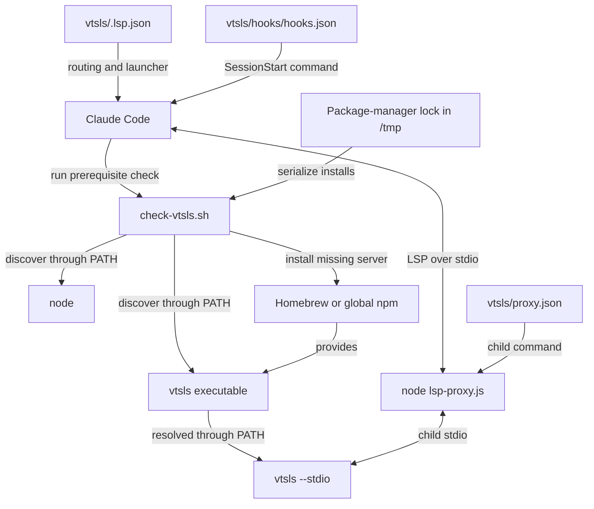
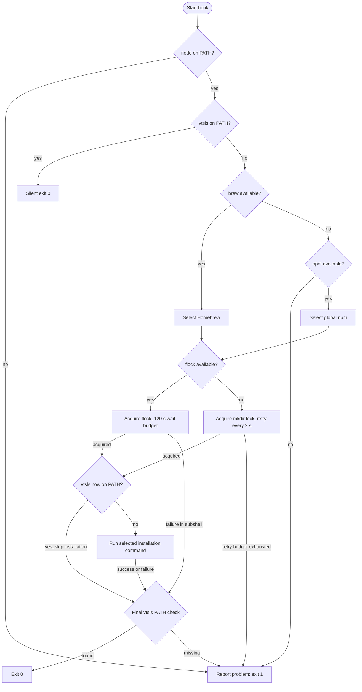

# VTSLS Language Server Setup

The `vtsls_language_server_setup` module registers TypeScript and JavaScript
files with Claude Code and prepares the dependencies needed to run VTSLS. Its
core components are `vtsls/.lsp.json`, which declares file routing and the
launcher, and `vtsls/hooks/check-vtsls.sh`, which checks prerequisites and
installs the language server when its executable is missing.

This is the setup layer of the [VTSLS integration][vtsls], within the wider
[language intelligence integration][integration] system. It does not implement
language analysis, LSP message handling, or document synchronization. Those
responsibilities belong to VTSLS and the integration's [protocol][protocol]
and [document-lifecycle][lifecycle] modules.

## Architecture and component boundaries

Setup exposes two independent host entry points. The session-start hook
prepares dependencies; the LSP registration tells Claude Code how to launch
the proxy. The hook does not start the server or perform LSP initialization.



The source boundaries are:

| Source path | Responsibility |
| --- | --- |
| `vtsls/.lsp.json` | File routing and Node proxy invocation. |
| `vtsls/hooks/check-vtsls.sh` | Checks, installation, and locking. |
| `vtsls/hooks/hooks.json` | Hook event, command, and timeout. |
| `vtsls/proxy.json` | Child-server command and runtime policy. |
| `vtsls/lsp-proxy.js` | Child launch and runtime LSP handling. |

`.claude-plugin/marketplace.json` distributes the `./vtsls` plugin directory;
`vtsls/.claude-plugin/plugin.json` supplies its identity. Plugin assets are
located inside the installed plugin, not inside the user's source workspace.
The external `node` and `vtsls` commands must be visible in the host's
environment.

## Registration and launch configuration

### TypeScript and JavaScript file routing

`vtsls/.lsp.json` defines one server entry named `typescript`. That entry
routes all eight extensions below; its name does not limit it to TypeScript
source files.

| File extension | LSP language ID |
| --- | --- |
| `.ts` | `typescript` |
| `.tsx` | `typescriptreact` |
| `.js` | `javascript` |
| `.jsx` | `javascriptreact` |
| `.mts` | `typescript` |
| `.cts` | `typescript` |
| `.mjs` | `javascript` |
| `.cjs` | `javascript` |

These mappings select the language-server integration and language identifier.
They do not configure TypeScript compiler options, install workspace
packages, or establish server support for additional file formats. No other
extensions are explicitly registered by this file.

### Node proxy launcher and child command

The registration sets `command` to `node` and supplies three arguments: the
plugin's `lsp-proxy.js`, `--config`, and the plugin's `proxy.json`. The
equivalent invocation is:

```sh
node "${CLAUDE_PLUGIN_ROOT}/lsp-proxy.js" \
  --config "${CLAUDE_PLUGIN_ROOT}/proxy.json"
```

Claude Code expands `${CLAUDE_PLUGIN_ROOT}` to locate the installed assets.
The declaration does not depend on the workspace's current directory. Node
is resolved through `PATH`, so it remains necessary even when VTSLS is
already installed.

`vtsls/proxy.json` supplies the actual server command:

```json
{
  "server": ["vtsls", "--stdio"],
  "blocked": []
}
```

The launch chain is therefore:

```text
Claude Code -> node lsp-proxy.js --config proxy.json
            -> vtsls --stdio
```

`vtsls/lsp-proxy.js` spawns the child without a shell, environment override,
or working-directory override. The child inherits the proxy's environment,
including `PATH`. The installer's `BINARY="vtsls"` must agree with
`proxy.json`'s `server[0]`.

The empty `blocked` array configures no blocked client methods; it does not
disable the proxy's other behavior. Runtime configuration semantics,
transport compatibility, and document synchronization are covered by the
[protocol][protocol] and [document-lifecycle][lifecycle] guides.

The proxy is shipped JavaScript using Node standard-library APIs. It requires
no compilation or workspace-local npm dependency installation. The global
npm installation described below is for the external VTSLS server, not the
proxy. `Makefile` documents that this repository is a plugin marketplace,
not an npm application.

### Session-start entry point

`vtsls/hooks/hooks.json` registers a command-type `SessionStart` hook:

```sh
bash ${CLAUDE_PLUGIN_ROOT}/hooks/check-vtsls.sh
```

The manifest sets the host timeout to **60 seconds**. Bash is required;
the script uses Bash redirection and arithmetic syntax rather than only
POSIX `sh` syntax.

The script reports prerequisite availability to the host. It does not define
how Claude Code reacts to a failed hook or when the registered LSP launcher
runs. The hook and launcher remain separate entry points.

## Prerequisites and installation policy

`vtsls/hooks/check-vtsls.sh` checks prerequisites in this order:

- **Node.js first:** if `command -v node` fails, the hook writes an error and
  installation advice to stderr, then exits 1. It does not install Node,
  even if Homebrew is available.
- **Existing VTSLS next:** if `command -v vtsls` succeeds, the hook exits
  silently with status 0. No package manager or lock is needed.
- **Installer selection for a missing server:** Homebrew is preferred
  whenever `brew` is discoverable. npm is selected only if Homebrew is
  absent. If neither is available, the hook reports the problem and exits 1.

The script assigns these fixed settings:

| Setting | Value |
| --- | --- |
| `BINARY` | `vtsls` |
| `FORMULA` | `vtsls` |
| `NPM_PACKAGE` | `@vtsls/language-server` |
| `LOCK_TIMEOUT` | `120` seconds |

These assignments are not environment-variable overrides. Installer
selection determines the command:

| Selection | Installation command |
| --- | --- |
| Homebrew available | `brew install vtsls` |
| Homebrew absent, npm available | `npm install -g @vtsls/language-server` |

npm is an **availability fallback**, not a retry after a failed Homebrew
installation. Selection is based on command availability, not an operating
system check. npm installs the server globally rather than into the user's
TypeScript or JavaScript project.

Discovery uses `command -v`; the hook does not execute Node or VTSLS to check
versions, health, or LSP compatibility. An existing server is not upgraded or
repaired. Neither installation command pins an upstream server version.
The plugin metadata version, currently 1.1.0 in
`vtsls/.claude-plugin/plugin.json`, is an integration version, not a VTSLS
package-version pin.

Installation uses the selected package manager's normal network
configuration and write permissions. The script does not invoke `sudo`,
modify `PATH`, source shell startup files, install project dependencies, or
write TypeScript configuration.

## Installer process flow

After choosing an installer, the script acquires a lock and checks for
VTSLS again. Another session may have installed it during the wait, making a
second installation unnecessary.



This diagram shows the script's control flow if the host does not interrupt
it. The 60-second host timeout can expire before the script's own lock wait
or installation completes.

The final check requires `vtsls` to be discoverable in the current
environment. A package manager reporting success is insufficient if its
executable directory is outside `PATH`. This is still only a discovery
check, not a server startup or LSP handshake test.

## Concurrent installation and locking

### Lock scope and locations

The selected package manager determines the base lock path:

| Installer | Base lock path |
| --- | --- |
| Homebrew | `/tmp/claude-lsp-brew.lock` |
| npm | `/tmp/claude-lsp-npm.lock` |

The paths are hardcoded under `/tmp`; setting `TMPDIR` does not relocate
them. They are package-manager-wide rather than VTSLS-specific. For example,
`bash-language-server/hooks/check-bash-language-server.sh` uses the same
paths; see the [Bash setup guide][bash-setup].

Locks coordinate cooperating hooks using the same path and locking
mechanism. They do not serialize every independent Homebrew or npm
invocation. Different package-manager paths do not coordinate, and the
`flock` and directory-lock implementations use different resources and do
not coordinate with each other.

### Lock acquisition and cleanup

When `flock` is discoverable:

- A subshell opens the base lock file on file descriptor 9.
- `flock --timeout "$LOCK_TIMEOUT" 9` waits for an exclusive lock.
- After acquisition, the subshell rechecks `vtsls` and installs only if it
  is still missing.
- Normal subshell completion releases its locking descriptor before the
  parent's final availability check. The file can remain on disk; its
  existence alone does not mean a lock is held.

Without `flock`, the hook uses an atomic `mkdir` fallback:

- The lock directory is the base path plus `.d`, for example
  `/tmp/claude-lsp-brew.lock.d` or `/tmp/claude-lsp-npm.lock.d`.
- Failed acquisition attempts sleep for two seconds. A counter tracks the
  sleep budget and reports a timeout when it has reached 120 seconds and
  another acquisition attempt fails.
- After acquisition, the hook rechecks `vtsls` before installing.
- An `EXIT` trap attempts `rmdir` cleanup. This lock remains held through
  the final availability check until the script exits.

Directory cleanup is best-effort. Abnormal termination can leave a stale
lock directory, and there is no PID record, age check, or automatic
stale-lock recovery. Acquisition errors are suppressed, so permissions or
other directory-creation problems can also appear as `Lock timeout`.

The hook selects the mechanism by availability. If an installed `flock`
command fails, it does not switch to directory locking.

### Concurrent hook interaction

The following successful example assumes two hooks choose Homebrew, both
use `flock`, and both can see the installed executable through `PATH`:

```mermaid
sequenceDiagram
    participant A as First VTSLS hook
    participant B as Second VTSLS hook
    participant Lock as Shared Homebrew lock
    participant Brew as Homebrew
    A->>A: Node found; vtsls missing
    B->>B: Node found; vtsls missing
    A->>Lock: Acquire
    Lock-->>A: Acquired
    B->>Lock: Wait to acquire
    A->>A: Recheck vtsls; still missing
    A->>Brew: brew install vtsls
    Brew-->>A: Completes; executable now visible
    A->>Lock: Release on subshell completion
    A->>A: Final PATH check; exit 0
    Lock-->>B: Acquired
    B->>B: Recheck vtsls; now present; skip installation
    B->>Lock: Release on subshell completion
    B->>B: Final PATH check; exit 0
```

If the first installation fails and the executable remains missing, the next
lock holder can attempt installation itself. The lock serializes attempts;
it is not a persistent record of installation success.

### Timeout budgets

Two independent settings govern session-start work:

- `vtsls/hooks/hooks.json` sets the host hook timeout to 60 seconds.
- `vtsls/hooks/check-vtsls.sh` sets a 120-second lock-wait budget. This is
  not an installation timeout; the package-manager command has no explicit
  timeout in the script.

The host can interrupt a lock wait or first-time installation before the
script's own budget expires. The 120-second setting is not a guaranteed
startup allowance. Preinstall Node and VTSLS when session startup must be
predictable, especially with slow networks or concurrent plugin setup.
Changes to either timeout should account for the other budget.

## Results and diagnostics

### Exit status and output

With Node and VTSLS already discoverable, the hook returns status 0 without
output. Missing Node, missing both installation tools, and a directory-lock
timeout explicitly exit the main script with status 1.

On the installation path, the final `vtsls` check normally determines the
result: a discoverable server yields status 0; a missing server produces
`Not in PATH after install` and status 1.

Two control-flow details matter when interpreting logs:

- A failed `flock` invocation prints `Lock timeout` and exits the locking
  **subshell** with status 1. The parent still reaches the final server check.
- `do_install` returns 1 after a failed package-manager command, but the
  script has no `set -e` and still performs the final check. It does not
  automatically retry with another package manager.

Consequently, an earlier install error or `flock` failure can coexist with
an overall status 0 if another process makes `vtsls` visible before the final
check. Otherwise, the missing-binary check returns status 1. A directory-lock
timeout differs: it exits the main script immediately.

All script-authored messages use the prefix `[vtsls]`. Missing-Node messages
go to stderr; other explicit progress and failure messages use stdout.
Package-manager output is inherited without prefixing or redirection. These
hook streams are separate from the proxy's LSP stdio stream.

### Troubleshooting

- **Node is missing:** `node is required` is reported even if VTSLS is
  installed. Install Node, expose it to the host, and restart the session.
  The script suggests `brew install node` but does not execute it.
- **No installer is available:** `Neither Homebrew nor npm found` means
  VTSLS is missing and neither supported installer is discoverable. Provide
  one, or preinstall VTSLS through environment provisioning.
- **Installation fails:** inspect package-manager output following
  `brew install failed` or `npm install failed` for network, registry, or
  permission errors. A failed Homebrew attempt never triggers npm fallback;
  use another installation method manually if appropriate.
- **Lock acquisition fails or times out:** check for an active installation
  first. For a stale directory lock, confirm that no cooperating hook is
  using it before removing the empty directory with `rmdir`. Do not remove
  an active lock or delete a persistent `flock` file merely because it exists.
- **The final executable check fails:** `Not in PATH after install` can
  follow a nominally successful installation. Compare the package manager's
  executable directory with the host's `PATH`. The diagnostic always
  suggests `brew install vtsls`, even after the npm route.
- **The host reports a hook timeout:** the 60-second budget may expire before
  lock acquisition or installation completes. Check for remaining installer
  activity and possible stale directory locks before retrying.
- **The hook succeeds but LSP startup fails:** discovery does not prove that
  Node runs, the proxy configuration is readable, or VTSLS initializes.
  Investigate subsequent launch failures through the [protocol guide][protocol].

## Operating and maintaining the setup

### Manual preparation

Install Node first using your environment's normal provisioning process.
Check discovery in the environment used to launch Claude Code:

```sh
command -v node
node --version
```

Preinstall VTSLS through Homebrew:

```sh
brew install vtsls
```

Alternatively, use global npm installation:

```sh
npm install -g @vtsls/language-server
```

From the repository root, check discovery and run the prerequisite hook:

```sh
command -v vtsls
bash vtsls/hooks/check-vtsls.sh
```

The hook is not a read-only health check: it can install VTSLS when missing.
An interactive shell's `PATH` may differ from the host's environment, so
confirm availability in the actual launch environment. The script cannot
export environment changes back into Claude Code.

For repository-wide provisioning rather than plugin-local setup, see
[development environment bootstrap][bootstrap].

### Maintenance invariants

- Keep the Node proxy invocation and plugin-root-relative paths in
  `vtsls/.lsp.json`. The consistency tests enforce the standard launcher.
- Keep installer `BINARY` aligned with `vtsls/proxy.json`'s `server[0]`.
  If changing the server package, ensure the formula or npm package provides
  that command.
- If renaming the check script, update `vtsls/hooks/hooks.json`. Review the
  host timeout and installer lock-wait budget together.
- Preserve the intended extension-to-language mappings when changing file
  routing. Changing registration does not configure compiler options or
  implement new language support.
- Keep plugin identity and version metadata synchronized between
  `vtsls/.claude-plugin/plugin.json` and `.claude-plugin/marketplace.json`.
  These versions do not pin the external server.
- Keep VTSLS-specific runtime policy in `vtsls/proxy.json`. The repository
  requires shipped proxy copies to be byte-identical; shared proxy changes
  must reach every plugin copy, not just `vtsls/lsp-proxy.js`.

Broader build and configuration conventions belong to
[repository build and configuration][build]. Runtime transport and document
state changes belong to the [protocol][protocol] and
[document-lifecycle][lifecycle] modules.

## Validation and test coverage

Run the canonical repository test entry point from the repository root:

```sh
make test
```

`Makefile` delegates to `bash tests/run.sh`. The harness requires `node`,
`bash`, `jq`, and `shellcheck`, and derives plugin membership from
`.claude-plugin/marketplace.json`. Relevant setup coverage includes:

- `tests/cases/01-manifests.sh`: JSON validity, registration structure, hook
  structure, proxy configuration structure, and marketplace metadata
  agreement.
- `tests/cases/02-consistency.sh`: safe launcher paths, the standard proxy
  invocation, installer/server-command agreement, existing hook targets,
  and byte-identical proxy copies.
- `tests/cases/03-installer-lint.sh`: Bash syntax checks and ShellCheck for
  the installer scripts.
- `tests/cases/04-installer-behavior.sh`: dedicated VTSLS scenarios for an
  existing executable, Homebrew installation, npm installation, npm failure,
  and missing both package managers.
- `tests/cases/05-installer-concurrency.sh`: concurrent Homebrew-path VTSLS
  hooks that must produce exactly one installation across two invocations.

The installer tests use mocked package managers and sandboxed environments.
`tests/helpers/mock-bin.sh` rewrites hardcoded lock paths into the sandbox
so tests do not contend on the real `/tmp/claude-lsp-*` paths. Dedicated
missing-Node coverage uses the CUE installer; explicit directory-lock
fallback, Homebrew-failure, and post-install-missing-binary cases use the
Bash installer. Those cases exercise equivalent patterns, not dedicated
VTSLS executions of every failure branch.

`.github/workflows/test-gate.yml` runs `make test` in separate Linux and
macOS jobs and requires successful, non-empty execution from both. Its
Node 24.22.0 test pin and the Node 24.21.0 development pin in `.mise.toml`
are environment choices, not runtime minimums enforced by this hook. See
[continuous integration][ci] for gate details and the [VTSLS integration][vtsls]
for broader runtime validation.

A passing mocked installer test is not proof of a successful live VTSLS
startup or language-analysis result. This page reflects source inspection;
no tests were executed during its generation.

[vtsls]: ../vtsls_language_server.md
[integration]: ../../language_intelligence_integration.md
[protocol]: vtsls_language_server_protocol.md
[lifecycle]: vtsls_language_server_document_lifecycle.md
[bash-setup]: ../bash_language_server/bash_language_server_setup.md
[bootstrap]:
  ../../engineering_platform_and_validation/development_environment_bootstrap.md
[build]:
  ../../engineering_platform_and_validation/repository_build_and_configuration.md
[ci]: ../../engineering_platform_and_validation/continuous_integration.md
