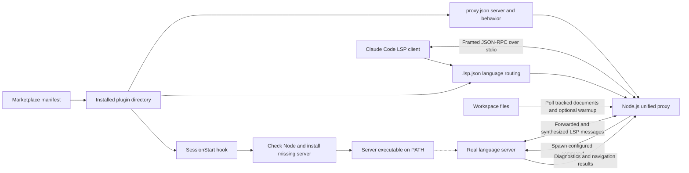
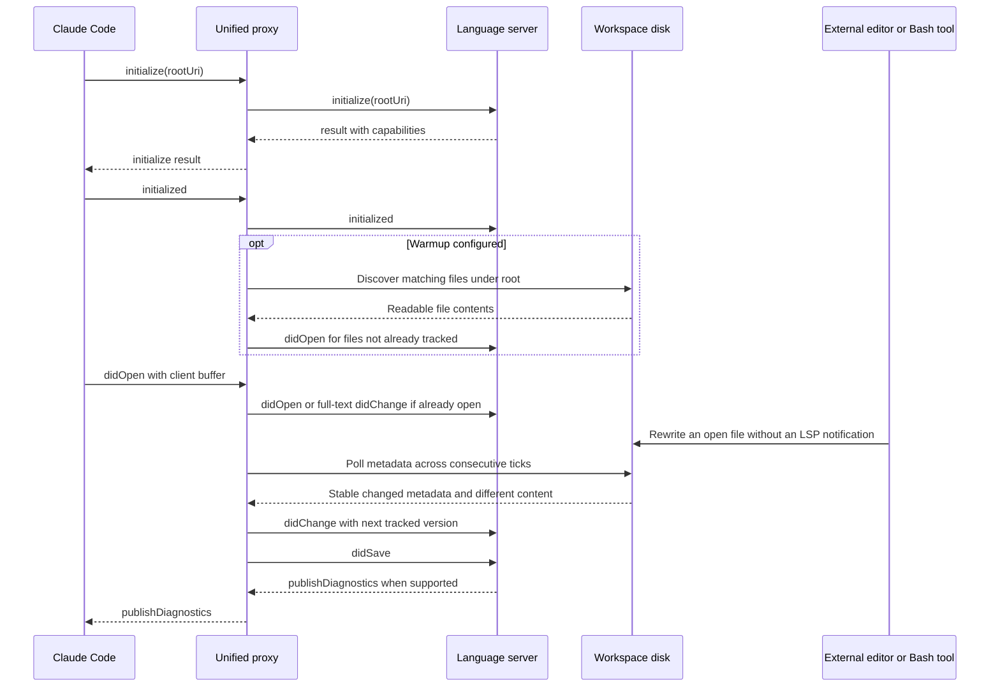
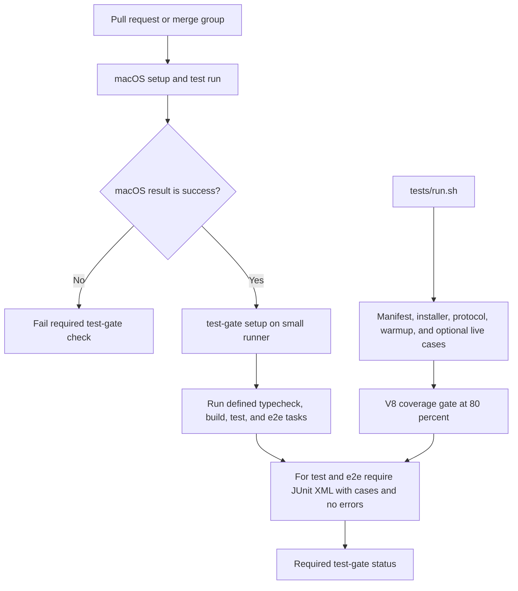

# claude-lsps

## Purpose and scope

`claude-lsps` is a Claude Code plugin marketplace that connects the client's
Language Server Protocol (LSP) integration to external language servers. It
packages language routing, session-start dependency checks, and a common Node.js
proxy that compensates for client/server protocol gaps and unreported disk edits.
The language servers, not the proxy, perform parsing, type checking, linting, and
code navigation.

The marketplace currently lists **five plugins**, as defined in
`.claude-plugin/marketplace.json`. Some proxy comments still refer to six copies;
the marketplace and the marketplace-driven test harness determine the current
plugin set.

| Plugin | Language family | Real server invocation | Additional proxy configuration |
| --- | --- | --- | --- |
| `bash-language-server` | Shell | `bash-language-server start` | No blocked methods or warmup |
| `cue-lsp` | CUE | `cue lsp serve` | No blocked methods or warmup |
| `pyright` | Python | `pyright-langserver --stdio` | No blocked methods or warmup |
| `regal-lsp` | Rego | `regal language-server` | Blocks two methods and warms up `.rego` files |
| `vtsls` | TypeScript and JavaScript | `vtsls --stdio` | No blocked methods or warmup |

Every plugin enables disk synchronization by default and uses the same fixed
server-request auto-acknowledgements. Server invocations and plugin-specific
options come from each plugin's `proxy.json`, rather than language-specific
branches in the proxy.

## Documentation map

The detailed pages are split by responsibility, so shared proxy behavior is not
repeated separately for every language. Each reference page links back to this
overview and to the related subsystems.

| Reference page | Responsibilities | Useful sections |
| --- | --- | --- |
| [Proxy internals](claude-lsps_proxy.md) | LSP framing, forwarding, interception, warmup, document state, and shutdown | [Configuration](claude-lsps_proxy.md#configuration-contract), [document synchronization](claude-lsps_proxy.md#document-state-and-synchronization) |
| [Plugin configuration and installation](claude-lsps_plugins.md) | Language mappings, packaging contracts, installers, and concurrent setup | [Launch contract](claude-lsps_plugins.md#language-routing-and-launch-contract), [installer locking](claude-lsps_plugins.md#locking-and-concurrent-installation) |
| [Experiments and evidence](claude-lsps_experiments.md) | Transparent wiretap, observed client behavior, and Pyright A/B demonstration | [Wiretap](claude-lsps_experiments.md#transparent-lsp-wiretap), [A/B and hybrid demo](claude-lsps_experiments.md#self-verifying-ab-and-hybrid-demo) |
| [Development and CI](claude-lsps_development.md) | Tool setup, tests, Git hooks, formatting, and GitHub Actions | [Bootstrap](claude-lsps_development.md#environment-and-bootstrap), [required Test Gate](claude-lsps_development.md#required-test-gate) |

## Architecture

### Runtime and packaging

Each installed plugin is self-contained. Its `.lsp.json` launches
`node ${CLAUDE_PLUGIN_ROOT}/lsp-proxy.js --config
${CLAUDE_PLUGIN_ROOT}/proxy.json` as an argument vector, with Claude Code expanding
`${CLAUDE_PLUGIN_ROOT}`. The proxy then spawns the configured real server with
piped stdin/stdout and inherited stderr. It is a per-launch process, not a
repository-wide daemon or network service.



The `lsp-proxy.js` files in all five plugin directories are deployed copies of
one implementation. They must be real files rather than references to a shared
repository path: plugin installation copies the plugin directory. The identity
and invocation contracts are enforced by `tests/cases/02-consistency.sh`.
Production proxy code uses only the Node.js standard library; there is no proxy
npm dependency installation or compilation step.

The main integration artifacts are:

- `.claude-plugin/marketplace.json`: plugin discovery and source directories.
- `<plugin>/.claude-plugin/plugin.json`: plugin identity and release metadata.
- `<plugin>/.lsp.json`: extension-to-language mapping and proxy launch arguments.
- `<plugin>/hooks/hooks.json`: `SessionStart` command registration.
- `<plugin>/hooks/check-*.sh`: prerequisites and server installation.
- `<plugin>/proxy.json`: real server command and optional proxy behavior.

See [plugin configuration and installation](claude-lsps_plugins.md) for the exact
language mappings, installation matrix, and manifest consistency rules.

### System boundaries

Claude Code owns the client session and its own document edits. Each real server
owns language semantics and diagnostic publication. The proxy owns transport
adaptation and its in-memory view of documents already opened by the client or
warmup. The proxy does not calculate diagnostics, install project dependencies,
or rewrite workspace source files.

The development toolchain is separate from plugin runtime dependencies.
`mise.toml` pins Node.js `24.22.1` for repository work; the session hooks only check
that `node` is on `PATH` and do not enforce that pin or install Node.js.

## Core functionality

### Protocol compatibility

The shared proxy provides four cooperating behaviors:

- **Blocked client methods:** configured requests receive a successful JSON-RPC
  response with `result: null`; configured notifications are dropped. This avoids
  forwarding known unsupported methods that would return `-32601`. Currently only
  Regal blocks `textDocument/references` and `textDocument/implementation`.
- **Server-request auto-acknowledgements:** the proxy consumes and answers
  `client/registerCapability`, `client/unregisterCapability`,
  `workspace/configuration`, and `window/workDoneProgress/create` requests.
  Configuration requests receive one `null` per requested item; the other three
  receive `null`. These replies unblock the server without implementing those
  client features.
- **Initialization warmup:** when configured, the proxy scans the initialization
  root after forwarding `initialized` and sends synthetic `didOpen` notifications
  for matching files. Regal enables this for `.rego` files, excluding
  `node_modules`, `.git`, `vendor`, `.venv`, and `.claude` by entry name.
- **Disk synchronization:** the proxy detects stable disk changes to tracked
  documents and sends full-text `didChange` followed by `didSave`. This addresses
  stale server buffers after edits not reported by the client.

Unmodified traffic is forwarded using its original framed bytes. Both transport
directions buffer partial messages using `Content-Length` byte counts. Invalid
JSON bodies and headers without a recognized content length are forwarded rather
than treated as protocol validation failures. Compatibility details and function
responsibilities are documented in [proxy internals](claude-lsps_proxy.md).

### Initialization and diagnostic refresh



Warmup requires a captured `rootUri` or fallback `rootPath`, a server result with
`capabilities`, and the subsequent client `initialized` notification. It is a
startup scan, not a continuous discovery mechanism. Client opens and warmup opens
share a tracking map to avoid duplicate server-side opens.

The synchronization model reconciles client full-text changes with the proxy's
last-known buffer rather than disabling synchronization after a client edit.
Matching disk content produces no synthetic change. Injected changes increment
the tracked version, and lagging client change versions are rebased before
forwarding. Stable deletion produces a server-side `didClose` while retaining a
tracking entry for reappearance; a later full-text client edit can also reopen it.

This design follows observations recorded in
`experiments/lsp-wiretap/FINDINGS.md`: Claude Code `2.1.207`, in headless macOS
sessions with Pyright, sent full-text `didChange` and `didSave` for subsequent
Edit-tool edits but no corresponding update for the tested Bash `sed` edit.
These are version- and scenario-specific observations, not a guarantee for every
Claude Code release. See [experiments and evidence](claude-lsps_experiments.md)
for the measurement method and the distinct prototype implementation.

### Proxy configuration

A representative configuration is:

```json
{
  "server": ["pyright-langserver", "--stdio"],
  "blocked": [],
  "sync": {
    "pollMs": 300
  }
}
```

`server` must be a non-empty array. `blocked` defaults to no blocked methods,
and omitted `warmup` disables the scan. Omitted `sync` enables polling every
300 ms; `sync.pollMs` is clamped to at least 50 ms, and `"sync": false` disables
the poll loop and client-change reconciliation. Open/close tracking still runs
for warmup deduplication. All shipped plugin configurations currently use the
default synchronization settings.

After a metadata change is detected, the proxy waits for the same metadata on a
subsequent poll before reading content. A settled edit therefore normally needs
roughly one to two polling intervals to reach the server, plus server analysis
time. This stability check reduces partial-write exposure; it is not an atomic
filesystem snapshot or a hard latency guarantee.

See [proxy internals](claude-lsps_proxy.md) for configuration validation limits,
state transitions, incremental-change handling, and transport edge cases.

## Installation and operation

In a Claude Code session, add the marketplace and install the desired plugin:

```text
/plugin marketplace add Rubio-Enterprises/claude-lsps
/plugin install pyright@claude-lsps
```

Claude Code and Node.js on `PATH` are prerequisites. On session start, the
plugin's hook first checks Node.js, then returns immediately if its real server
binary is available. Otherwise it selects an available installation method and
serializes installation with other plugins using the same method. Homebrew is
preferred for Bash, CUE, Pyright, and vtsls; Regal uses it only on macOS. The
alternatives are npm for Node-based servers or release downloads for CUE and
Regal. A failed selected Homebrew installation does not trigger an automatic
retry through the alternative method.

The hooks do not upgrade or validate the version of an already-present server.
Binary downloads target `$HOME/.local/bin`, which must already be on the
session's `PATH`. Installer lock waits allow 120 seconds, whereas each registered
session hook has a 60-second timeout; lock contention or a slow install can
therefore outlast the caller's timeout. See
[plugin configuration and installation](claude-lsps_plugins.md) for recovery and
platform-specific behavior.

### Operational constraints

- Disk polling covers tracked file URIs only, not every workspace file. Without
  warmup, a file must first be opened by the client. Newly created files are not
  automatically discovered by the startup warmup scan.
- An incremental change that leaves the final buffer unknown disables disk
  synchronization for that document. A later full-text replacement restores it.
  A non-file URI is tracked for lifecycle purposes but cannot be polled on disk.
- Change detection compares modification time, change time, size, and inode.
  Same-size in-place rewrites within one timestamp quantum remain a documented
  blind spot; files are not hashed on every poll.
- The proxy sends close/reopen notifications for stable disappearance and
  reappearance. It does not itself clear diagnostics or guarantee when a server
  will publish a refreshed result. Failed metadata reads are treated as absence.
- Auto-acknowledgement does not implement dynamic registration, workspace settings,
  or progress UI. Blocking a method deliberately returns no result for that
  capability. Upstream server limitations remain upstream limitations.
- Stdin EOF and forwarded `SIGTERM` or `SIGINT` terminate the child and stop
  polling. Unexpected child termination propagates failure when no numeric exit
  code exists. There is no automatic server restart or persistent document state.

### Troubleshooting entry points

| Symptom | First check | Detailed reference |
| --- | --- | --- |
| Hook reports that Node.js is required | Install Node.js and expose it on the session's `PATH`, even for CUE and Regal | [Plugin setup](claude-lsps_plugins.md) |
| Binary installed but not found | Check `$HOME/.local/bin` or the package manager's executable directory in `PATH` | [Plugin setup](claude-lsps_plugins.md) |
| Diagnostics stay stale after a disk edit | Check whether the document is tracked, synchronization is enabled, and stderr reports incremental-change disabling | [Proxy internals](claude-lsps_proxy.md) |
| Regal references or implementation returns no result | Those methods are deliberately blocked in `regal-lsp/proxy.json` | [Plugin configuration](claude-lsps_plugins.md) |
| CUE does not publish error diagnostics | The live tests document this limitation for `cue lsp serve` v0.16 | [Development and CI](claude-lsps_development.md) |
| Need to verify what the client actually sent | Use the transparent wiretap rather than the traffic-mutating proxy | [Experiments](claude-lsps_experiments.md) |

## Development and delivery

The repository's setup and lifecycle tasks are defined in `mise.toml`, which
requires mise `2026.10.19` or later. Setup installs
`@rubio-enterprises/standards` into `.standards/`, installs missing tools, and
registers Lefthook hooks. GitHub Packages authentication is supplied through
`NODE_AUTH_TOKEN`.

```bash
export NODE_AUTH_TOKEN="$(gh auth token)"
mise trust
mise run setup
mise run check
mise run test
```

`mise run test` runs `bash tests/run.sh` with
`JUNIT_REPORT=reports/test/junit.xml`. `make test` runs the same harness but does
not set a JUnit report path. `mise run live-setup` separately installs real
servers for optional live tests. Runtime proxies need no npm packages; the npm
installation performed during repository setup is for development standards.



`.github/workflows/test-gate.yml` requires the macOS job to succeed before running
the lifecycle checks on the small runner. Of the lifecycle tasks it looks for,
this repository's `mise.toml` explicitly defines `test`; missing tasks are
skipped. The opt-out variable affects that lifecycle step, not the preceding
macOS prerequisite. The harness also verifies that deployed proxy copies remain
identical and combines V8 coverage for identical copies by content hash.

Live-server cases are skipped when the corresponding binaries are missing, and
the workflow does not explicitly run `live-setup`. A passing gate is therefore
not proof that every live integration ran. The current CUE live case verifies
startup rather than broken-file diagnostics, as noted in
`tests/cases/08-live.sh`.

The other delivery workflow, `.github/workflows/standards.yml`, dispatches
organization-owned workflows for releases, repository images, and CodeWiki
publication only when their enabling artifacts exist and their event conditions
match. Scheduled or manually requested runs can also invoke TruffleHog. These
jobs do not form a plugin build pipeline. See
[development and CI](claude-lsps_development.md) for conditions, permissions,
runner selection, formatting configuration, and standards-package integration.

## Maintenance guide

- Put language-specific behavior in `proxy.json` and extension mappings in
  `.lsp.json`; keep the production proxy copies byte-identical.
- Keep marketplace entries and plugin manifests consistent, and keep the
  installer's `BINARY` equal to `proxy.json`'s first server element.
- Add regression coverage for document synchronization, version ordering,
  initialization races, transport framing, and shutdown when changing the proxy.
- Keep experimental findings separate from production guarantees. The Pyright
  prototype is not the deployed unified proxy and omits production safeguards.
- Run repository checks before committing. `lefthook.override.yml` excludes
  deliberately malformed `tests/fixtures/**` from pre-commit checks; they remain
  intentional test inputs rather than source files to repair.
