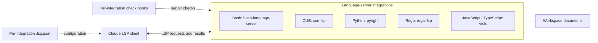
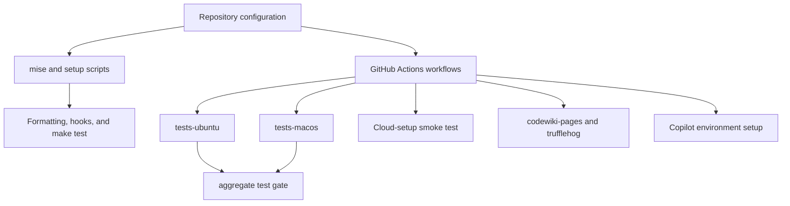

# claude-lsps

`claude-lsps` organizes Language Server Protocol (LSP) integrations for
Claude-based coding workflows. It provides per-language configuration and
check hooks for Bash, CUE, Python, Rego, and JavaScript/TypeScript, together
with shared environment setup and validation tooling.

> This overview is based on the supplied repository structure and artifact
> inventory. The referenced documentation files were not accessible in this
> session, so the diagrams describe logical relationships rather than
> verified execution sequences.

## Architecture

The integration layer connects the Claude client to language-specific
servers. Each integration includes a `.lsp.json` configuration and a
server-specific check script.

The engineering layer supports environment preparation, local checks, and
GitHub Actions validation.

## Core module documentation

- [Language intelligence integration](language_intelligence_integration.md)
  covers the five language integrations, organized around server setup,
  protocol handling, and document lifecycle.
- [Engineering platform and validation](engineering_platform_and_validation.md)
  covers repository policy and configuration, formatting and hooks,
  validation entry points, development bootstrap, and CI workflows.

## Build, run, package, and deploy

- **Build and environment:** The supplied artifacts identify mise
  configuration, bootstrap scripts, and TypeScript configuration, but do not
  establish a compiled application build.
- **Run:** Runtime integration is configured through each language
  directory’s `.lsp.json` and check hook. See
  [Language intelligence integration](language_intelligence_integration.md)
  for server setup and lifecycle documentation.
- **Test:** The Makefile exposes `make test`. CI includes Ubuntu/macOS test
  jobs and an aggregate gate, alongside cloud-setup smoke tests and standards
  automation.
- **Package and deploy:** The inventory does not establish a distributable
  package, release command, or application-deployment procedure. Consult
  [Engineering platform and validation](engineering_platform_and_validation.md)
  for the build, setup, validation, and workflow artifacts rather than
  assuming an additional release pipeline.
